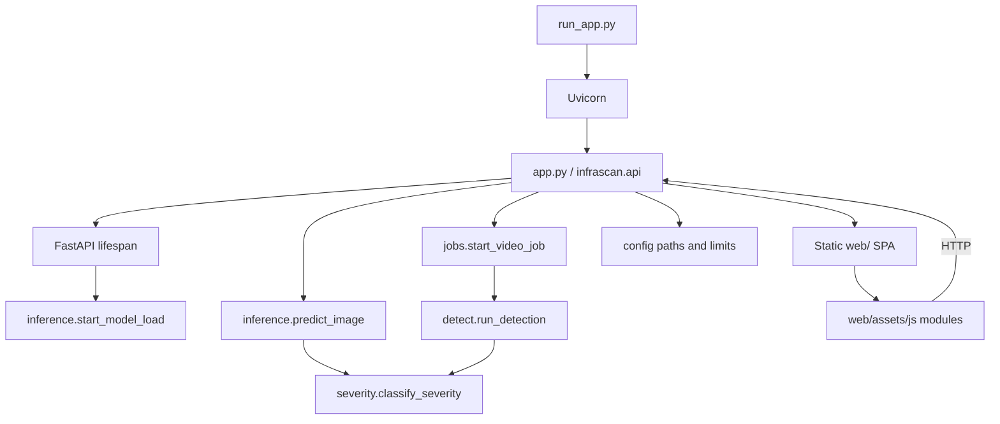

# Code walkthrough

A file-by-file guide to the accepted InfraScan implementation. Use it after reading the [system architecture](../04-architecture/system-architecture.md); this page explains **what each file does, how its functions interact, and what to say in a viva**.

> **Scope:** current `main` of the [InfraScan repository](https://github.com/Aayush9808/InfraScan). The dataset and checkpoint are excluded from Git; runtime paths refer to the local development layout. Line numbers are intentionally omitted so the guide does not go stale on small edits.

## Contents

- [1. Runtime map](#1-runtime-map)
- [2. Top-level Python files](#2-top-level-python-files)
- [3. `infrascan/` package](#3-infrascan-package)
- [4. Dataset scripts](#4-dataset-scripts)
- [5. Frontend shell and CSS](#5-frontend-shell-and-css)
- [6. Frontend JavaScript modules](#6-frontend-javascript-modules)
- [7. Configuration and data contracts](#7-configuration-and-data-contracts)
- [8. What is not in the repository](#8-what-is-not-in-the-repository)
- [9. Change recipes](#9-change-recipes)
- [10. Viva drills](#10-viva-drills)

---

## 1. Runtime map



**One process, two interfaces.** The browser SPA and API share an origin. The CLI imports the same `classify_severity()` policy but does not go through FastAPI.

### Request ownership

| Layer | Owns | Does not own |
|---|---|---|
| `web/` | Presentation, local UI state, polling, downloads | Model inference, severity calculation |
| `infrascan/api.py` | HTTP validation, routing, static serving, headers | Frame-level detection math |
| `infrascan/inference.py` | Model lifecycle, prediction, annotation, image result | Video job state |
| `infrascan/jobs.py` | Job registry, progress, worker thread, output URLs | HTTP request parsing |
| `detect.py` | Frame loop, HUD, annotation, telemetry | Model lifecycle in the dashboard |
| `severity.py` | Shared coverage thresholds | Depth/risk measurement |

---

## 2. Top-level Python files

### `app.py`

A minimal ASGI entrypoint. It imports `app` from `infrascan.api` and exposes it for `uvicorn app:app`. The `if __name__ == "__main__"` block allows `python app.py` for a simple launch. All real configuration lives in `infrascan/api.py` and `infrascan/config.py`.

**Viva point:** “The application is not a script with global side effects at import time. The FastAPI lifespan owns startup and model loading.”

### `run_app.py`

The user-facing launcher.

- Parses `--host` (default `127.0.0.1`), `--port` (default `8000`), `--weights`, `--no-browser`, `--reload`.
- Resolves the weights argument and sets `INFRASCAN_WEIGHTS` before importing/serving the app.
- Prints a small banner and optionally opens the browser.
- Calls `uvicorn.run("app:app", ...)`.

**Why it matters:** `config.py` reads `INFRASCAN_WEIGHTS` at import time. The launcher must set it before the app module is imported; otherwise the path change would be ignored. This is a subtle environment/import-order issue worth mentioning in a viva.

**Demo command:**

```bash
python run_app.py --host 127.0.0.1 --port 8000
```

### `detect.py`

The shared CLI/frame-loop engine.

**`draw_hud(frame, detections, fps=0.0)`** draws a top status bar, pothole/critical counts and an alert strip. It mutates the frame in place and returns it. Used for still-image and video displays; the dashboard uses its own annotation via `inference._annotate`.

**`run_detection(...)`** signature:

```python
run_detection(
    source="dataset/images/test",
    weights="weights/best.pt",
    conf=0.25,
    iou=0.45,
    imgsz=640,
    device=None,
    save=True,
    show=False,
    output_dir="runs/detect/predict",
    export_csv=True,
    progress_callback=None,
)
```

Flow:

1. If `weights` does not exist, print a warning and fall back to `yolo11s.pt`. This is a **CLI compatibility fallback**, not the dashboard behaviour.
2. Load `YOLO(weights)`.
3. Decide whether the source is a camera (numeric index/RTSP/HTTP), a video (known extension), or an image/directory.
4. For video/camera: open with OpenCV, get FPS/frame count, create an annotated writer for files. Try `avc1` first, then `mp4v`; fail loudly if neither opens.
5. Per frame: predict, convert boxes to integer pixel coordinates, compute area/coverage, classify severity, annotate, append telemetry, optionally draw HUD, write the frame, call `progress_callback(frame_idx, total_frames)`.
6. For images: iterate the file or directory, predict, annotate, write `det_<name>.jpg`, append telemetry.
7. If records exist and `export_csv=True`, write `pothole_telemetry.csv` and `pothole_telemetry.json` with pandas/json.
8. Return the telemetry list.

**Telemetry fields:** frame/image, box, confidence, severity, coverage percent. Video records use `frame`; image records use `image`.

**Edge cases:** unreadable video returns `[]`; an unwritable encoder raises `RuntimeError`; an unreadable image is skipped; only `.jpg/.png/.jpeg` are globbed for directory input.

**Viva point:** video inference is a synchronous loop inside a worker thread when called from `jobs.py`; the CLI itself blocks the terminal. The dashboard’s responsiveness comes from moving this call off the event loop and serialising workers.

### `test_camera.py`

A standalone OpenCV live-camera utility.

- `draw_driver_hud()` draws a compact driver-style overlay.
- `open_webcam()` tries the platform-appropriate capture backend (DirectShow on Windows, then default).
- `run_camera_test()` loads the checkpoint, reads frames, predicts, classifies severity, draws boxes/HUD and handles controls: `Q`/Esc quit, `S` snapshot, `+`/`-` confidence, `H` HUD toggle.
- It imports `classify_severity()` from `infrascan.severity`, so the camera path does not duplicate thresholds.

**Verified status:** compile/import/`--help` checks passed; a **physical** camera test was not independently run. A browser synthetic device was tested separately.

### `train.py`

A thin CLI wrapper around Ultralytics training.

Arguments include `--data` (default `data.yaml`), `--model` (default `yolo11s.pt`), `--epochs` 50, `--imgsz` 640, `--batch` 16, `--device`, `--optimizer` (`auto`/SGD/Adam/AdamW/RMSProp), `--lr0` 0.01, `--patience` 15, `--project`, `--name`, `--save-dir`.

`train()` loads the model, calls `model.train(...)`, then copies the resulting best weights to the configured save directory. The script's defaults are **not** the checkpoint's recorded training settings. The checkpoint metadata records 15 epochs, batch 16, 640, optimizer `auto`, lr0 0.003, cosine schedule and CUDA device 0. Always distinguish “the script can be run this way” from “this is how the released checkpoint was trained.”

### `evaluate.py`

A CLI wrapper around Ultralytics validation.

Arguments: `--weights` (default `weights/best.pt`), `--data` (default `data.yaml`), `--split` (`test`/`val`/`train`, default `test`), `--imgsz` 640, `--batch` 16, `--device`, `--project`, `--name`.

`evaluate()` checks that the weights file exists, loads `YOLO`, calls `model.val(...)` and prints/saves the metrics. The verified 718-image run used this path with a temporary data copy and `--device mps`. The output includes precision, recall, mAP@0.50 and mAP@0.50–0.95 plus speed timings.

### `export.py`

A CLI wrapper around `model.export()`.

Arguments: `--weights`, `--format` (default `onnx`), `--imgsz` 640, `--half`, `--dynamic`. `export_model()` checks the weights, loads the model and calls export with the requested options. It prints the output path.

**Important:** the export code path was **not executed** for the verified release. ONNX/TensorRT/OpenVINO/CoreML/TFLite results must not be claimed without a new run and runtime test.

---

## 3. `infrascan/` package

### `infrascan/__init__.py`

Package marker; keeps the package importable without side effects. The version is defined in `config.APP_VERSION` (currently `2.0.0`).

### `infrascan/config.py`

Central configuration and path resolution.

| Symbol | Meaning |
|---|---|
| `PROJECT_ROOT` | Repository root, derived from the package file |
| `WEB_DIR`, `ASSETS_DIR` | Static frontend paths |
| `WEIGHTS_PATH` | `INFRASCAN_WEIGHTS` if set, else `weights/best.pt` |
| `DATASET_TEST_DIR` | `dataset/images/test` |
| `RUNS_DIR`, `RESULTS_DIR`, `JOBS_DIR` | Gitignored runtime storage |
| `APP_NAME`, `APP_VERSION`, `TARGET_CLASS` | App metadata |
| `DEFAULT_IMGSZ` | 640 |
| `IMAGE_EXTENSIONS`, `VIDEO_EXTENSIONS` | Upload/sample filters |
| `MAX_IMAGE_BYTES`, `MAX_VIDEO_BYTES` | 25 MB / 2 GB |
| `UPLOAD_CHUNK_BYTES` | 1 MB streaming chunks |
| `SAMPLE_LIMIT` | 24 sample tiles |
| `RESULT_TTL_SECONDS`, `JOB_TTL_SECONDS` | 24 hours |
| `CONF_*`, `IOU_*` | 0.05–1.0 / 0.10–1.0, defaults 0.25 / 0.45 |

`ensure_directories()` creates result/job directories. `checkpoint_available()` requires a file with nonzero size. Paths are resolved from the package location, not the current working directory, so launching from another directory does not break static assets or results.

**Viva trap:** `WEIGHTS_PATH` is read at import time. If you set `INFRASCAN_WEIGHTS` after importing `infrascan.config`, the change will not be picked up. Set it before launching the process, or use `--weights` with `run_app.py`.

### `infrascan/severity.py`

The single source of truth for severity.

```python
CRITICAL = "CRITICAL"
MODERATE = "MODERATE"
MINOR = "MINOR"

SEVERITY_BANDS = (
    (CRITICAL, 8.0, (0, 0, 255)),
    (MODERATE, 2.5, (0, 140, 255)),
    (MINOR, 0.0, (0, 215, 255)),
)

def classify_severity(box_area, frame_area):
    # coverage percentage, clamped, then first matching band
```

Returns `(label, colour, coverage_pct)`. The dashboard, CLI and camera HUD use the same function. It is a geometric heuristic: box area divided by full frame area. It is not calibrated depth, volume or structural risk.

**Test idea:** call `classify_severity(0, 100)` → MINOR; `(2.5, 100)` → MODERATE; `(8, 100)` → CRITICAL; a zero frame area should be handled defensively (check the actual implementation).

### `infrascan/inference.py`

The model lifecycle and image inference service.

**State and errors**

- `_state`: `starting`, `loading`, `ready`, `unavailable`, `error`.
- `ModelUnavailableError`, `ModelTimeoutError`, `InvalidImageError`.
- `_lock` protects state/device; `_load_lock` serialises loading; `_predict_lock` serialises prediction on the single model instance.

**`_select_device()`**

Tries CUDA if available, then Apple MPS, then CPU. `_device_label()` maps the raw device to a human label. The selected device is exposed to the UI. In `predict_image`, if an accelerated prediction raises, it retries on CPU and updates `_device`; this is a resilience path, not a performance guarantee.

**`start_model_load()`**

Starts a daemon thread that calls `_load_model_sync()`. If the checkpoint is missing, sets `unavailable` with a message. The server can boot even when the ML stack/checkpoint is not ready.

**`_load_model_sync(force=False)`**

Loads `YOLO(str(config.WEIGHTS_PATH))`, reads class names/task, sets `ready`, records the device. On failure, sets `error` with the exception. `reload_model()` forces a reload and returns the status.

**`ensure_ready(timeout=180)`**

Waits for the load thread to finish, then returns the model or raises `ModelUnavailableError` / `ModelTimeoutError`. This is what image inference calls before prediction.

**`model_status()`**

Returns state, checkpoint path/name, device, classes, task, image size, error and availability. `/api/status` and `/api/health` consume it.

**`runtime_versions()`**

Reports Python, platform, PyTorch, Torchvision, Ultralytics, OpenCV, NumPy and related package versions using `importlib.metadata`. This is the evidence surface for the system page.

**`severity_policy()`**

Returns the bands as dictionaries for the API/UI, avoiding duplicated thresholds in JavaScript.

**`_annotate(image, detections)`**

Copies the image, scales line thickness/font with image size, draws a filled label background and box using the severity colour. It mutates only the copy. The label includes confidence and severity.

**`purge_old_artifacts(ttl_seconds)`**

Deletes `runs/dashboard/results/*.jpg` older than the TTL. Called at startup. It does not delete user-uploaded source files outside the managed directories.

**`predict_image(image_bytes, conf, iou)`**

1. Reject empty bytes.
2. `np.frombuffer` + `cv2.imdecode`; reject undecodable data with `InvalidImageError`.
3. Compute frame area, call `ensure_ready()`.
4. Read the current device under lock.
5. Predict with `imgsz=640` under `_predict_lock`; on accelerator failure, retry on CPU.
6. Convert each box to ints, clamp to the image bounds, sort coordinates, compute box area/coverage/severity and build a detection dict.
7. Annotate, write a UUID-named JPEG with quality 92.
8. Build severity counts, max/total coverage summary, and a public detection list without the internal `_colour`.
9. Return `id`, `image_url`, width/height, detections, summary, `inference_ms`, `conf`, `iou`, `imgsz`, `created_at`.

**Viva point:** `inference_ms` is the measured prediction wall time around the model call, not the full HTTP round trip. The recorded API response was 66.2 ms for the sample; do not conflate that with the evaluation's 3.82 ms/image preprocess/inference/postprocess split.

### `infrascan/jobs.py`

The in-memory video job manager.

**State:** `_jobs` dictionary, `_jobs_lock` (state updates), `_worker_lock` (serialises video processing). A job contains id, source name, status, timestamps, conf/iou, progress and result/error.

**`create_job()`** creates a UUID, initialises progress (frame 0, total 0, fraction 0, stage “Queued”), stores it under the lock and returns the public view.

**`update_job()` / `update_progress()`** update fields and derive `fraction`/ETA. Progress updates are frequent; the lock prevents torn reads while the API serialises the job.

**`job_directory()`** returns `config.JOBS_DIR / job_id`, creating it if needed. The job ID is server-generated, so user input never becomes the directory path.

**`run_video_job()`**

1. Checks the checkpoint.
2. Lazily imports `detect.run_detection` so the dashboard can start even if the ML stack is incomplete.
3. Acquires `_worker_lock`, updates “Preparing video”, calls `run_detection` with the job's output directory and a progress callback.
4. Verifies `detection_output.mp4` exists and is nonempty.
5. Computes severity counts, frames processed, detections total, max coverage, elapsed seconds and throughput.
6. Builds result URLs for the video and telemetry, marks the job complete.
7. On any exception, marks `failed` with the error and stage “Failed”.

**`start_video_job()`** starts a daemon thread for `run_video_job`. **`cleanup_old_jobs()`** removes job directories older than the TTL. Jobs are not persisted; a restart loses the in-memory registry even if files remain.

**Viva trap:** `frames_processed` is derived from the progress total/frame, not from a separate frame counter. If progress reporting is interrupted, the summary can be incomplete even when the video file exists. This is a known limitation of the in-memory design.

### `infrascan/api.py`

The FastAPI application.

**Lifespan (`lifespan`)**: creates runtime directories, purges old results/jobs, starts the background model load, yields, then performs cleanup on shutdown. Startup does not block on the checkpoint.

**Security middleware**: sets `X-Content-Type-Options: nosniff`, `X-Frame-Options: DENY`, `Referrer-Policy: no-referrer`, a restrictive `Content-Security-Policy`, and `Cache-Control: no-store` on API paths. Static routes can set their own cache headers.

**Exception handler**: unexpected exceptions are logged and returned as a generic JSON 500 without leaking a stack trace. Specific `HTTPException`s keep their detail messages for the UI.

**Routes**

| Route | Behaviour |
|---|---|
| `GET /` | Serves `web/index.html` with `no-cache` |
| `GET /favicon.svg` | Serves the local brand icon |
| `GET /api/health` | `{status, model_state}` |
| `GET /api/status` | App, model, runtime versions, severity policy, media limits, thresholds, sample availability |
| `GET /api/samples` | Up to 24 test images, names/URLs/sizes, directory label |
| `GET /api/samples/{name}` | Validates a plain filename + image suffix, then serves the file |
| `GET /api/results/{filename}` | Validates a plain `.jpg` filename, then serves the result |
| `POST /api/model/reload` | Runs `reload_model` in a threadpool; 503 on model error |
| `POST /api/detect/image` | Validates thresholds/checkpoint, reads upload, predicts in threadpool |
| `POST /api/detect/video` | Validates, creates job, streams upload to disk, starts worker, returns 202 |
| `GET /api/jobs/{id}` | Returns job or 404 |
| `GET /api/jobs/{id}/video` | 404/409/200; serves annotated MP4 |
| `GET /api/jobs/{id}/telemetry.csv` | 404/409/200; serves CSV |
| `GET /api/jobs/{id}/telemetry.json` | 404/409/200; serves JSON |
| `GET /api/docs`, `/api/openapi.json` | FastAPI's OpenAPI UI/schema |

**`_validate_thresholds()`** returns 422 with a message for out-of-range confidence/IoU.

**`_sample_files()`** returns sorted files from `dataset/images/test` with allowed image suffixes; returns `[]` if the directory is absent or unreadable.

**`_read_upload()`** streams an image into memory in 1 MB chunks, raises 413 above the limit, and closes the file in `finally`. **`_save_upload()`** streams a video to disk, removes a partial file on any exception, and returns the byte count.

**Image route:** threshold validation → checkpoint check → read upload → `run_in_threadpool(inference.predict_image, ...)` → map `InvalidImageError` to 400, model/timeout errors to 503 → add original filename → return JSON.

**Video route:** threshold validation → checkpoint check → suffix check (415) → create job → save upload (413/500, mark job failed) → start worker → return 202 with the public job.

**`_completed_job_output()`** centralises the 404/409 checks and fixed output filename, preventing arbitrary file access through the download routes.

**Static serving:** the API mounts `web/` assets under `/assets` and serves the SPA shell at `/`. Because the SPA uses hash routes, no catch-all HTML rewrite is required.

---

## 4. Dataset scripts

### `scripts/prepare_dataset.py`

Converts a mask-based source into YOLO boxes.

- `process_sample(args)` reads an image and its mask, finds external contours, filters by `min_area`, computes a bounding rectangle, normalizes coordinates by the mask dimensions, and writes a YOLO label. It resizes/copies the image to the target size and returns counts/skips.
- `convert_dataset(...)` reads a CSV/table of image, mask and split, creates output directories, dispatches work with `ThreadPoolExecutor`, and writes a `data.yaml` summary. It validates missing rows and reports totals.
- CLI options include source/output directories, target size, minimum area and workers.

**Important:** this is a mask-to-bounding-box converter. It does not train a segmentation model and does not preserve masks.

### `scripts/ingest_voc_dataset.py`

- `convert_voc_to_yolo(xml_content, img_width, img_height)` parses VOC `<bndbox>` values, clips them to the image, converts absolute coordinates to normalized center/width/height, and returns YOLO lines plus a count. It rejects degenerate boxes.
- `ingest_dataset(...)` walks images/XML pairs, copies images, writes labels, and creates a random 80/10/10 split (train/val/test) with a seed. It can ingest a directory or archive.
- CLI options cover source, output, split ratios and seed.

**Risk:** random splitting can leak near-duplicates across splits. A production dataset pipeline should group by source/sequence before splitting.

### `scripts/visualize_annotations.py`

- `draw_yolo_boxes(img, label_path, class_names)` parses normalized rows, denormalizes to pixels, and draws boxes/labels with OpenCV.
- `visualize(dataset_dir, split, num_samples, output_dir)` samples images, overlays ground truth, writes previews and prints paths.
- CLI: `--dataset`, `--split`, `--samples`, `--output`.

Use this before training to catch swapped coordinates, wrong class IDs and boxes that do not cover the pothole.

---

## 5. Frontend shell and CSS

### `web/index.html`

- A single HTML shell with an inline SVG symbol sprite for icons.
- Sidebar navigation for Overview, Image inspection, Video analysis and System; a mobile menu/scrim.
- A topbar with page title, command-palette trigger, model-status chip and GitHub link.
- Four `<section class="view">` panels toggled by the router.
- The image panel includes source tabs (Upload/Dataset/Webcam), dropzone, sample grid, preview, run button, result media, metrics, severity summary, detection table, download buttons and an error/retry state.
- The video panel includes upload, preview, progress, result video, summary, telemetry links and error state.
- The system panel exposes checkpoint/runtime/severity/API/CLI information.
- Dialogs/lightbox for the camera and full-size result.

**Accessibility features present:** landmarks (`aside`, `main`, `nav`), a “Skip to content” link to `#main`, a focusable main region, labelled controls, `aria-live` regions, `role="alert"` errors, dialog semantics, `aria-selected` tabs, `aria-label` icon buttons, and a hidden file input with a styled label/button.

### `web/assets/css/app.css`

A handcrafted design system:

- CSS custom properties for surfaces, text, accent, severity colours, spacing, radii and shadows.
- Dark glass-style cards, a sidebar, topbar, stat cards, dropzones, tables, badges, toasts and dialogs.
- Responsive breakpoints at 1280, 1120, 1024, 820, 620 and 420 px; reduced-motion media query at the end.
- Focus-visible styling and visually hidden helpers.
- Local font faces for Inter and Space Grotesk.

**Viva point:** the UI does not use a CSS framework or build pipeline. The trade-off is a larger hand-maintained stylesheet and no utility-class ecosystem; the benefit is a self-contained, offline-capable asset set.

---

## 6. Frontend JavaScript modules

### `api.js`

A small fetch wrapper.

- `ApiError` carries status/detail.
- `request(path, options)` sets JSON headers when appropriate, parses JSON/text, and throws a readable error for non-2xx responses.
- `getStatus()`, `getSamples()`, `detectImage(file, {conf, iou})`, `createVideoJob(file, {conf, iou})`, `getJob(jobId)`, `reloadModel()`.

All network access goes through this module; feature modules do not hand-roll `fetch`.

### `store.js`

A minimal observable store.

- `DEFAULT_SETTINGS = {conf: 0.25, iou: 0.45}`.
- `loadSettings()` reads `localStorage`, clamps values and falls back on invalid JSON.
- `state` holds status, settings, samples, session counts, latency and offline state.
- `on(event, handler)` subscribes; `emit(event, payload)` notifies.
- Setters: `setStatus`, `setOffline`, `setSettings`, `resetSettings`, `setSamples`, `incrementSession`, `setLatency`.

It is deliberately not a framework. The small surface makes the data flow inspectable, but there is no time-travel debugging or built-in immutability.

### `app.js`

The application controller.

- `ROUTES`: overview, inspect, video, system.
- Polling intervals: 15 s for normal status, 2.5 s while loading, 5 s while offline.
- `renderStatus()` updates the model chip, sidebar runtime, overview stats and system page.
- `renderOffline()` switches to an explicit offline state and disables actions.
- `refreshStatus()` guards against overlapping requests with `polling`/`queuedRefresh`.
- `loadSamples()` fetches sample metadata for the inspect view.
- `parseRoute()`, `route()`, `go()`, `initRouter()` implement hash routing and focus management.
- `initSidebar()` handles mobile navigation/scrim/Escape.
- `initSettings()` binds the confidence/IoU ranges, syncs labels and persists settings.
- `buildCommands()` builds palette commands for navigation, model reload and links.
- `init()` wires the modules, initial status, router, sidebar, settings and reveal animations.

**Viva point:** the status poll is not a tight loop. It backs off to 15 s when ready and switches to a shorter interval only while loading or offline, which reduces unnecessary requests.

### `inspect.js`

The image workflow state machine.

- `MAX_IMAGE_BYTES = 25 MB`; `busy` prevents concurrent runs; `sourceMode` is upload/sample/webcam.
- `setSource()` toggles tabs/panels and focus.
- `resetOutput()`, `clearSelection()`, `showPreview()` manage the preview/result states.
- `selectFile()` validates type/size, stores the selected file, creates an object URL and enables the run button.
- `selectSample()` fetches the sample as a blob and converts it to a `File`; `sampleToFile()` handles the conversion.
- `updateParamLabels()` reads store settings; `updateRunState()` controls button/disabled/notes.
- `runInspection()` calls `api.detectImage`, shows loading, renders the result or error, increments session count and records latency.
- `renderResult()` draws the annotated image, metrics, severity summary, detection table, meta line and download links.
- `renderSamples()` renders tiles/empty state.
- `openLightbox()` and `downloadCsv()` handle evidence actions.
- `initInspect()` binds tabs, keyboard arrows, dropzone, file input, webcam, run/retry/rerun, downloads and view toggles.

**Failure modes handled:** missing file, oversized file, decode/HTTP error, model unavailable, no detections, and a busy state that prevents double submission.

### `video.js`

The video workflow.

- `MAX_VIDEO_BYTES = 2 GB`; extension allowlist.
- `selectVideo()` validates, previews, enables run.
- `runVideo()` creates a job via `api.createVideoJob`, then `pollJob()`.
- `pollJob()` calls `api.getJob` on an interval, updates progress/ETA/stage, and stops on completion/failure/timeout.
- `renderResult()` sets the annotated video URL, summary metrics and telemetry links; `setDownload()` enables/disables links.
- `clearVideo()`/`resetJobView()`/`resetForAnother()` clean state and object URLs.
- `initVideo()` binds the dropzone, file input, run/clear actions.

**Viva point:** polling is intentionally simple and local. The server owns progress truth; the client does not estimate completion from file size.

### `camera.js`

- `openCamera()` requests `getUserMedia({video: ...})`, handles permission/device/insecure-context errors, and attaches the stream to the dialog video.
- `captureFrame()` draws the current video frame to a canvas, converts it to a blob, closes the stream and calls the injected `onCapture` handler.
- `stopStream()`, `closeCamera()`, `showCameraError()` manage cleanup and error display.
- `initCamera(captureHandler)` wires the dialog buttons.

**Verified status:** synthetic Chrome device only; physical camera not independently tested.

### `system.js`

Renders the system page from `/api/status`:

- checkpoint path/name/size, task, classes, device, image size, model state;
- Python/PyTorch/Ultralytics/OpenCV versions;
- severity policy bands;
- API and CLI reference text;
- reload button state.

It uses text nodes/escaping for values and does not compute severity independently.

### `palette.js`

A small command palette:

- filters a command provider by label/keywords;
- supports ArrowUp/Down, Enter, Escape;
- stores previous focus, restores it on close;
- opens via the trigger or `⌘K`/`Ctrl+K`.

### `ui.js`

Shared utilities: `$`, `$$`, `icon()`, `escapeHtml()`, byte/latency/duration/ETA/number/time/coordinate formatting, severity chips, severity summary rendering, busy buttons, toasts, clipboard copy, CSV download, animated numbers, extension lists and human-readable file sizes.

**Security point:** `escapeHtml()` and text-node rendering are the frontend's XSS defence. The CSP is an additional layer. This is not a substitute for a security audit.

---

## 7. Configuration and data contracts

### `data.yaml`

```yaml
path: ./dataset
train: images/train
val: images/val
test: images/test
nc: 1
names:
- pothole
```

The `path` is relative to the dataset root expected by Ultralytics. A fresh clone has no dataset, so this file alone is not runnable. Do not commit the dataset or rewrite paths to a personal absolute location in the public repo.

### `requirements.txt`

Runtime dependencies: Ultralytics, PyTorch/Torchvision, OpenCV, Pillow, NumPy, pandas, matplotlib/seaborn, PyYAML, tqdm, FastAPI, Uvicorn and python-multipart. The verified versions are recorded in [`../PROJECT_FACTS.md`](../PROJECT_FACTS.md); requirements use lower bounds, so a fresh install can resolve newer versions. For reproducibility, record the actual environment or pin versions in a separate lock file (not currently present).

### Image response contract

```json
{
  "id": "hex",
  "image_url": "/api/results/hex.jpg",
  "width": 640,
  "height": 480,
  "detections": [
    {
      "id": 1,
      "confidence": 0.83,
      "severity": "MODERATE",
      "coverage_pct": 3.4,
      "bbox": [x1, y1, x2, y2]
    }
  ],
  "summary": {
    "count": 1,
    "critical": 0,
    "moderate": 1,
    "minor": 0,
    "max_coverage_pct": 3.4,
    "total_coverage_pct": 3.4
  },
  "inference_ms": 66.2,
  "conf": 0.25,
  "iou": 0.45,
  "imgsz": 640,
  "created_at": "ISO-8601",
  "filename": "original.jpg"
}
```

### Job contract

A job exposes `id`, `source_name`, `status`, `created_at`, `started_at`, `completed_at`, `conf`, `iou`, `progress` (frame, total_frames, fraction, stage, ETA), `result` (video/telemetry URLs, sizes, summary) and `error`. The exact shape is assembled in `jobs.create_job`, `update_progress` and `run_video_job`.

---

## 8. What is not in the repository

- `weights/best.pt` — excluded; operator must supply a compatible checkpoint.
- `dataset/` — excluded; local development data only.
- `runs/` — generated results/jobs; gitignored.
- Uploaded media and annotated outputs — runtime artifacts, not source.
- `GLBITM PPT Format.pptx` / `GLBITM POSTER Format.pptx` — external academic templates.
- A `tests/` directory or pytest suite — none exists.
- A Node `package.json`/lockfile — the frontend has no build step.
- A database, queue, authentication provider, Dockerfile or CI workflow — not part of the accepted scope.

---

## 9. Change recipes

### Add a new API route

1. Add the handler in `infrascan/api.py`.
2. Validate all input explicitly; use `HTTPException` with a specific status/detail.
3. If it touches the model, call `run_in_threadpool` and reuse `inference` — do not load a second model.
4. Add the route to [`../04-architecture/backend-and-api.md`](../04-architecture/backend-and-api.md) and the manual test log.
5. Test success and at least one failure path.

### Change severity thresholds

1. Edit `infrascan/severity.py` only.
2. Confirm `severity_policy()` and the UI labels update from the API.
3. Rerun the image and video functional checks.
4. Update docs and explicitly state that historical results used the old thresholds.

### Add a frontend view

1. Add the section to `web/index.html`.
2. Add a route in `app.js`.
3. Create a feature module or extend an existing one; keep API calls in `api.js`.
4. Add navigation/sidebar/palette entry.
5. Add responsive CSS and keyboard/focus behaviour.
6. Test at 390 and 1440 px and with the API offline.

### Change the model

1. Place the new checkpoint outside Git.
2. Update the hash/metadata in `PROJECT_FACTS.md`.
3. Rerun the full evaluation with the exact command and environment.
4. Do not mix old and new metrics; archive the old result and label the new one.
5. Update the model/architecture docs and the demo.

---

## 10. Viva drills

1. **Trace one image** from browser to JPEG. Name every function boundary.
2. **Trace one video** from upload to playable MP4. Explain the 202, polling, worker lock and H.264 fallback.
3. **Explain why the model is not loaded at import time.**
4. **Explain why one model instance needs a prediction lock.**
5. **Explain why severity lives in Python, not JavaScript.**
6. **Explain the difference between the CLI fallback and the dashboard’s missing-checkpoint behaviour.**
7. **Find the code that prevents `../../etc/passwd` from being served.**
8. **Explain why the frontend has no Node build.**
9. **Name three failure states the SPA handles.**
10. **State one thing this code does not do** — authentication, tracking, depth, export verification, persistent jobs.

---

## Related chapters

- [System architecture](../04-architecture/system-architecture.md)
- [Backend and API](../04-architecture/backend-and-api.md)
- [Frontend architecture](../04-architecture/frontend-architecture.md)
- [Inference workflow](../04-architecture/inference-workflow.md)
- [Dataset and model](../05-dataset-and-model/README.md)
- [Testing and results](../09-testing-and-results/README.md)

---

[Project documentation](README.md) · [Documentation homepage](../README.md) · [Viva preparation](../08-viva-preparation/README.md)
