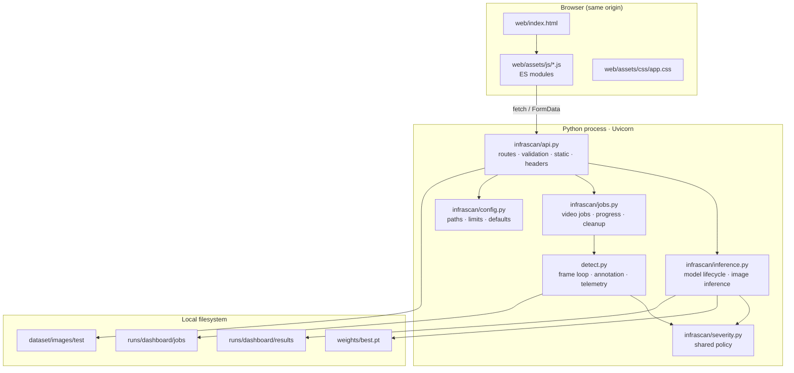
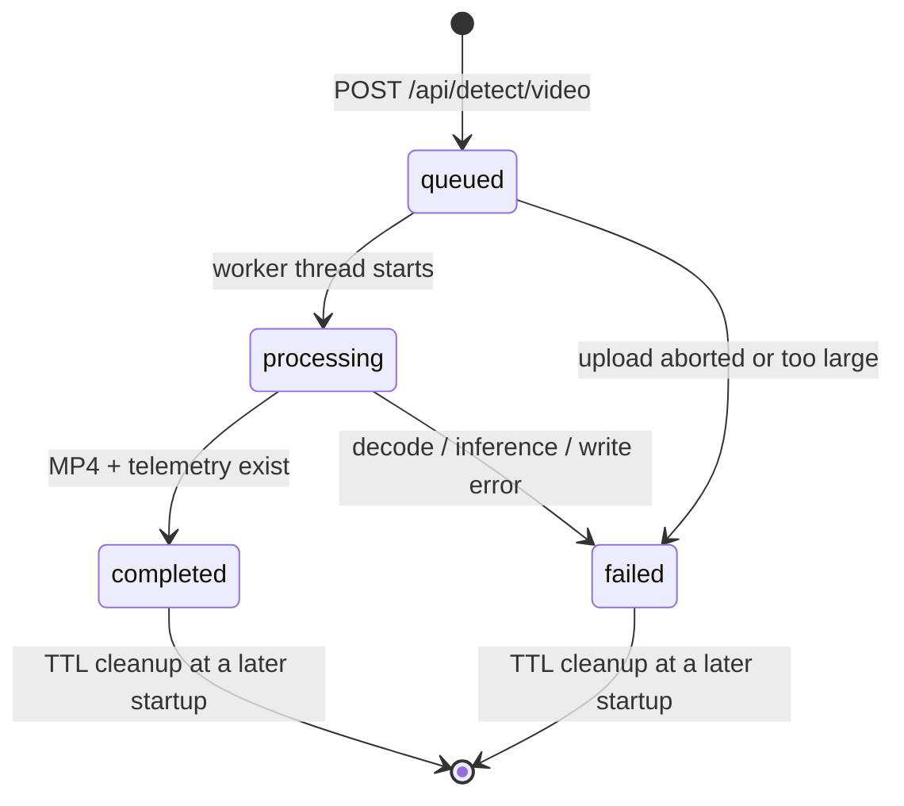
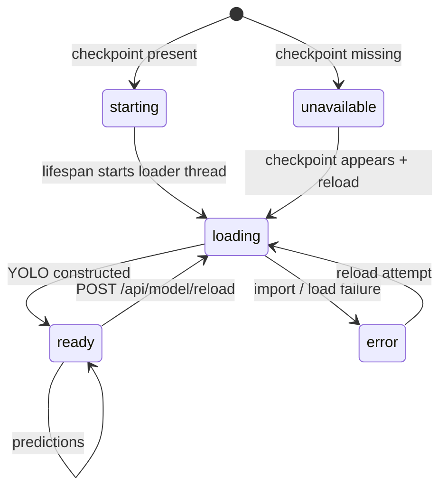

# Implementation details

This page describes the accepted implementation as it exists in the source tree. It is a map for reviewers and for the [code walkthrough](code-walkthrough.md), not a line-by-line tutorial. Factual values are taken from [`../PROJECT_FACTS.md`](../PROJECT_FACTS.md); design rationale is inferred from the code and the project constraints, and is labelled as rationale rather than historical fact.

## 1. Runtime shape

InfraScan is one Python process with two interfaces over one detection stack:



The browser never runs the detector. It sends bytes, receives JSON and media URLs, and renders state. This keeps the model and the severity policy in one place and makes the API usable independently of the dashboard.

## 2. Module map

### 2.1 Root modules

| File | Role | Key interactions |
|---|---|---|
| `app.py` | ASGI entrypoint. Imports `app` from `infrascan.api`, exposes `__all__ = ["app"]`, and delegates `python app.py` to `run_app.main()`. | Uvicorn target `app:app`; launcher |
| `run_app.py` | One-command launcher. Parses `--host`, `--port`, `--weights`, `--no-browser`, `--reload`; changes to `PROJECT_ROOT`; maps `--weights` to `INFRASCAN_WEIGHTS`; prints banner; optionally opens a browser after 1.5 s; calls `uvicorn.run("app:app", ...)`. **Ordering caveat:** `infrascan.config` is imported before the flags are parsed, so in a normal launch `--weights` may not change the already-resolved `WEIGHTS_PATH`; set `INFRASCAN_WEIGHTS` before launch or use `--reload`. | `infrascan.config.PROJECT_ROOT`, Uvicorn |
| `detect.py` | CLI and shared frame loop. Handles image, directory, video and camera sources; optional HUD; H.264/mp4v writer selection; per-frame detections; CSV/JSON telemetry. `run_detection()` is also imported lazily by the video job manager. | Ultralytics, OpenCV, pandas, `infrascan.severity` |
| `test_camera.py` | Separate live OpenCV camera HUD. Tries camera index 0 then 1; keyboard controls for quit, snapshot, confidence and HUD; no telemetry export. | OpenCV, Ultralytics, `infrascan.severity` |
| `train.py` | Ultralytics training wrapper. Selects CUDA or CPU when `--device` is omitted; applies HSV, geometry, mosaic, mixup and flip augmentation; cosine LR; early stopping; copies `best.pt` to `weights/`. | `data.yaml`, Ultralytics |
| `evaluate.py` | Evaluation wrapper for `test`, `val` or `train` split; prints P, R, mAP@0.50, mAP@0.50–0.95 and speed; writes plots and JSON. | Checkpoint, `data.yaml`, Ultralytics |
| `export.py` | Export wrapper for ONNX, TensorRT engine, TorchScript, OpenVINO, CoreML and TFLite. | Ultralytics export |
| `data.yaml` | One-class dataset configuration: `path: ./dataset`, train/val/test image directories, `nc: 1`, `names: [pothole]`. | `train.py`, `evaluate.py` |
| `requirements.txt` | Runtime dependency lower bounds: Ultralytics, PyTorch, Torchvision, OpenCV, Pillow, NumPy, pandas, Matplotlib, Seaborn, PyYAML, tqdm, FastAPI, Uvicorn, python-multipart. | Installation |
| `LICENSE` | MIT licence preserving the upstream copyright notice (Bisman Singh, 2026). | Distribution |
| `README.md` | Primary user-facing documentation, quick start, API reference, benchmark, CLI, limitations. | All |

### 2.2 Application package

| File | Role | Key interactions |
|---|---|---|
| `infrascan/__init__.py` | Package marker; `__version__ = "2.0.0"`. | Packaging |
| `infrascan/config.py` | Resolves `PROJECT_ROOT`, `WEB_DIR`, `ASSETS_DIR`, `WEIGHTS_PATH` (env override), `DATASET_TEST_DIR`, `RUNS_DIR`, `RESULTS_DIR`, `JOBS_DIR`. Defines app identity, image/video extensions, 25 MB / 2 GB limits, 1 MB chunks, 24-sample cap, 24-hour TTLs, confidence/IoU ranges, and `checkpoint_available()`. | Imported by API, inference, jobs, launcher |
| `infrascan/severity.py` | Single source of truth for CRITICAL (`>= 8.0%`), MODERATE (`>= 2.5%`), MINOR (`< 2.5%`); returns `(severity, BGR colour, coverage_pct)`. Handles zero/invalid frame area defensively. | Imported by `inference.py`, `detect.py`, `test_camera.py` |
| `infrascan/inference.py` | Model lifecycle state machine, device selection, background load, 180 s readiness wait, reload, status/runtime metadata, severity policy serialisation, annotation, image prediction, result persistence and stale-result purge. | `ultralytics`, `torch`, OpenCV, NumPy, `config`, `severity` |
| `infrascan/jobs.py` | In-memory video job registry, per-job directory, progress updates, worker thread, serialised processing lock, result summary, failure capture, startup cleanup. Imports `detect.run_detection` lazily. | `config`, `inference.ModelUnavailableError`, `detect` |
| `infrascan/api.py` | FastAPI app, lifespan, static mount, security middleware, exception handler, validation, upload readers, all routes, OpenAPI/Swagger configuration. | `config`, `inference`, `jobs`, Starlette |

### 2.3 Dataset tooling

| File | Role | Notes |
|---|---|---|
| `scripts/prepare_dataset.py` | Converts a mask/contour dataset described by `splits.csv` into YOLO boxes. Finds external contours, filters by minimum pixel area, normalises centre/width/height, optionally resizes to 640, writes images and labels, generates `data.yaml`. | Thread pool; `min_area` default 15 px²; label class always `0` |
| `scripts/ingest_voc_dataset.py` | Ingests a VOC XML archive. Matches `annotations/*.xml` to `images/*`, converts only objects whose name contains "pothole", clips boxes, normalises coordinates, shuffles with seed 42, splits 80/10/10, writes `voc_*` images/labels, removes stale caches. | Intended for adding a compatible VOC source; not a provenance record |
| `scripts/visualize_annotations.py` | Draws ground-truth YOLO boxes for random samples in a split; writes annotated previews to `runs/visualize/`. | Inspection aid, not evaluation |

### 2.4 Frontend modules

| File | Role | Key interactions |
|---|---|---|
| `web/index.html` | Dashboard shell: SVG icon sprite, sidebar, topbar, four views (Overview, Inspect, Video, System), dialogs for palette, lightbox and camera, toast stack; loads `app.js` as `type="module"`. | All JS modules, CSS |
| `web/assets/js/app.js` | Composition root. Hash router (`#/overview`, `#/inspect`, `#/video`, `#/system`), status polling (15 s ready, 2.5 s loading, 5 s offline), model chip, session counters, settings binding, sidebar, command list, reveal observer. | `api.js`, `store.js`, `ui.js`, `inspect.js`, `video.js`, `palette.js`, `system.js` |
| `web/assets/js/api.js` | Thin `fetch` wrapper. `ApiError` carries HTTP status; network failure maps to status 0 and an actionable message. Exposes `getStatus`, `getSamples`, `detectImage`, `createVideoJob`, `getJob`, `reloadModel`. | FastAPI endpoints |
| `web/assets/js/store.js` | In-memory state plus pub/sub (`on`/`emit`); persists only `conf` and `iou` to `localStorage` under `infrascan.settings.v2`; clamps to valid ranges. | All view modules |
| `web/assets/js/inspect.js` | Image workspace: source tabs, drag/drop, sample picker, selection preview, run/cancel-free single request, annotated/original toggle, result metrics, detection table, CSV download, lightbox, camera integration. | `api.js`, `store.js`, `ui.js`, `camera.js` |
| `web/assets/js/video.js` | Video workspace: file validation, local preview, upload, 202 handling, 850 ms polling, progress/ETA, completion metrics, download links, failure state. | `api.js`, `store.js`, `ui.js` |
| `web/assets/js/camera.js` | Webcam dialog using `getUserMedia` (`environment`, ideal 1920×1080), canvas capture to JPEG at quality 0.92, stream stop on close, specific permission/busy/not-found messages. | `ui.js`, `inspect.js` |
| `web/assets/js/system.js` | Renders checkpoint, task, classes, device, image size, size bytes, runtime versions and severity policy; handles checkpoint reload. | `api.js`, `ui.js`, `app.js` |
| `web/assets/js/palette.js` | Accessible command palette (`⌘K` / `Ctrl+K`), keyboard navigation, ARIA listbox, focus restoration. | `app.js`, `ui.js` |
| `web/assets/js/ui.js` | DOM helpers, escaping, formatting, severity chips/summary, toasts, clipboard, CSV generation, animated counters, extension constants. | All view modules |
| `web/assets/css/app.css` | Design tokens, layout, components, responsive breakpoints, reduced-motion and focus styles. | `index.html` |
| `web/assets/fonts/` | Locally bundled Inter and Space Grotesk (SIL OFL). | CSS `@font-face` |

The module graph is deliberately shallow: `app.js` composes views, views depend on `api.js`/`store.js`/`ui.js`, and no module imports `app.js`. There is no circular dependency and no global framework runtime.

## 3. Request and job lifecycles

### 3.1 Image request

```mermaid
sequenceDiagram
    autonumber
    participant U as User
    participant S as SPA
    participant A as FastAPI
    participant I as Inference service
    participant M as YOLO11n
    participant F as Filesystem

    U->>S: Select image / sample / webcam still
    S->>A: POST /api/detect/image (multipart file, conf, iou)
    A->>A: Validate thresholds and checkpoint
    A->>A: Read upload with 25 MB cap
    A->>I: run_in_threadpool(predict_image)
    I->>I: Decode with OpenCV; reject invalid bytes
    I->>I: ensure_ready() (loads model if needed)
    I->>M: predict(conf, iou, imgsz=640, device)
    M-->>I: Boxes, confidence
    I->>I: Clip boxes; compute coverage; classify severity
    I->>I: Draw boxes and labels
    I->>F: Write results/{uuid}.jpg (quality 92)
    I-->>A: JSON result
    A-->>S: 200 JSON
    S->>S: Render metrics, table, annotated image
```

Two details are easy to miss:

- `inference_ms` is measured around `model.predict()` **and** the `_predict_lock` wait, but **excludes** decode, annotation and JPEG writing. It is not an end-to-end request latency.
- Image bytes are decoded from memory after a bounded read. The server does not trust the filename extension; decode failure produces `400`, not a MIME-based rejection.

### 3.2 Video job



The API creates the job **before** saving the upload so a failed upload can be recorded against a real job id. The upload is streamed in 1 MB chunks to `runs/dashboard/jobs/{id}/input{suffix}`; exceeding 2 GB raises 413, deletes the partial file, marks the job failed and returns the error. Only after a successful save does `start_video_job()` spawn a daemon worker.

The worker calls `detect.run_detection()`, which creates its **own** `YOLO` instance from the same checkpoint. It is not the dashboard's in-memory image model. Consequences:

- A video job can coexist with image inference, so two model instances may occupy memory and compete for the same accelerator.
- Video jobs are serialised against each other by `_worker_lock`; they are **not** serialised against image requests by `_predict_lock`.
- A long job cannot block the event loop, but it can still consume the machine's compute.

Progress is stored in the job dictionary as `{stage, frame, total_frames, fraction}`. The browser polls every 850 ms. `fraction` is `frame / total_frames` when the container reports a frame count; otherwise it stays 0 and the UI shows frame counts without a reliable percentage.

### 3.3 Model state machine



State is held in module-level variables guarded by `_lock`. `ensure_ready()` polls every 200 ms up to 180 s. If the state is `unavailable` or `error`, it raises `ModelUnavailableError` immediately with the stored message; if the deadline passes, it raises `ModelTimeoutError`. The API maps both to `503`.

## 4. Command-line and tooling modules

### 4.1 `detect.py`

`run_detection()` is the shared frame loop used by the CLI and the video worker. Its source classification is:

- a digit or `rtsp://` / `http://` prefix → camera/stream;
- a path ending in `.mp4`, `.avi`, `.mov` or `.mkv` → video;
- a file → single image;
- a directory → `*.jpg`, `*.png`, `*.jpeg` images.

For video, it opens `cv2.VideoCapture`, reads width/height/FPS (defaulting to 640×480 and 30 FPS when missing), and creates a writer by trying `avc1` then `mp4v`. If neither opens, it raises rather than silently producing no output. Each frame is predicted, boxes are drawn with severity colours, the HUD is optionally drawn, and the frame is written. Telemetry records are extended per frame.

For images, it processes each file, draws boxes and HUD, writes `det_{name}` when `--save` is set, and extends telemetry with `image` records.

For camera mode, it prints keyboard controls and supports quit, snapshot, confidence ±0.05 and HUD toggle. `--camera` forces `show=True` and uses `--cam-id`.

Telemetry is written only when `export_csv` is true **and** at least one record exists:

- `pothole_telemetry.csv` via pandas;
- `pothole_telemetry.json` via `json.dump(..., indent=2)`.

**Historical fallback:** if `weights` does not exist, `detect.py` prints a warning and loads `yolo11s.pt`. This is retained CLI behaviour, not dashboard behaviour. Any reported result must pass an explicit checkpoint.

### 4.2 `test_camera.py`

A dedicated OpenCV window, separate from the browser. It opens camera 0 (DirectShow on Windows first), falls back to camera 1, sets 1280×720, and loops on `model.predict()` with fixed IoU 0.45 and image size 640. It supports quit, snapshot to `runs/detect/camera_snapshots/`, confidence adjustment and HUD toggle. It imports `classify_severity()` but does not write telemetry. It is the path for continuous live testing; the browser captures stills only.

### 4.3 `train.py`

The wrapper resolves `data.yaml`, selects CUDA when available unless `--device` is given, and calls `model.train()` with:

| Parameter | Value |
|---|---|
| Optimizer | `auto` (default) |
| Initial LR | 0.01 (default) |
| LR schedule | `lrf=0.01`, `cos_lr=True` |
| Patience | 15 |
| HSV | h 0.015, s 0.7, v 0.4 |
| Geometry | ±5° rotation, 0.1 translate, 0.5 scale, 0.0005 perspective |
| Flips | horizontal 0.5 |
| Mosaic | 1.0 |
| Mixup | 0.15 |
| Close mosaic | `min(5, epochs // 4)` when epochs > 5 |
| Workers | 0 on Windows, 4 otherwise |
| Checkpoints | every 5 epochs; plots enabled |

After training it copies the run's `best.pt` to `weights/best.pt`. The default model is `yolo11s.pt`; the released checkpoint is `yolo11n`, so reproducing its size requires `--model yolo11n.pt`.

### 4.4 `evaluate.py` and `export.py`

`evaluate.py` calls `model.val()` with the selected split, image size, batch, device, workers, plots and `save_json=True`, then prints the four headline metrics and three speed values. Like `detect.py`, it falls back to `yolo11s.pt` if the checkpoint is missing; this is a convenience for baseline experiments, not a valid way to reproduce the reported result.

`export.py` wraps `model.export()` for `onnx`, `engine`, `torchscript`, `openvino`, `coreml` and `tflite`, with optional FP16 and dynamic shapes. The code paths exist; **none were exercised during acceptance**.

## 5. Key design decisions

### 5.1 FastAPI instead of Streamlit

**Decision.** Replace the earlier single-script Streamlit interface with a FastAPI backend and a static SPA.

**Rationale.**

- Streamlit reruns the script for each interaction, which couples UI state to execution and makes long-running video work awkward to express.
- FastAPI provides explicit routes, typed form/query validation, OpenAPI generation and a stable contract that the CLI, tests and external clients can use.
- A same-origin static mount removes the need for CORS, a proxy or a second server.
- Blocking inference can be moved to a thread pool; model loading and video work can use background threads without blocking the event loop.

**Trade-off.** The team now owns the UI state model, routing, accessibility and error rendering that Streamlit previously supplied. The backend is also a single process with in-memory jobs, not a distributed system.

### 5.2 Shared severity policy

**Decision.** Put the bands and `classify_severity()` in `infrascan/severity.py`; import it from `inference.py`, `detect.py` and `test_camera.py`.

**Rationale.** Before the refactor, severity logic could drift between dashboard and CLI. A single function guarantees that the same box area and frame area produce the same label everywhere. The System page serialises the same bands, so the published policy cannot diverge from the executed policy.

**Trade-off.** The policy is intentionally simple. Sharing it makes the heuristic consistent, not correct; see [limitations](limitations.md#42-severity-is-a-geometric-heuristic).

### 5.3 Zero-build SPA

**Decision.** Serve `web/index.html`, vanilla ES modules and handcrafted CSS directly. No Node.js, npm, bundler or framework.

**Rationale.** The deployment target is a student laptop or lab machine with Python. A Node toolchain adds installation friction, a lockfile, a build step and a supply-chain surface for a four-view dashboard. Native ES modules, `<dialog>`, `fetch` and `FormData` are sufficient. Fonts are bundled locally so the UI does not call a font CDN.

**Trade-off.** No tree-shaking, bundling, JSX, compile-time type checking or component ecosystem. The team must maintain its own router, state store and rendering helpers. The CSP allows `style-src 'unsafe-inline'` because some dynamic widths are written as inline styles.

### 5.4 Background model load

**Decision.** Start a daemon loader thread during the FastAPI lifespan and let the UI render immediately.

**Rationale.** Loading Ultralytics and PyTorch can take seconds. Blocking startup would make the dashboard appear broken. The state machine (`starting` → `loading` → `ready` / `error` / `unavailable`) gives the UI something truthful to display and lets `/api/health` respond before the model is ready.

**Trade-off.** The first inference may wait for the loader; `ensure_ready()` can block up to 180 s. The UI must handle a transient `loading` state, and the health endpoint reports `status: ok` even when the model is unavailable (liveness, not readiness).

### 5.5 Serialised inference

**Decision.** Guard dashboard image prediction with `_predict_lock`; guard video jobs with `_worker_lock`.

**Rationale.** A single Ultralytics model instance is not safe to call concurrently from multiple threads. Serialising predictions prevents corrupted state and unbounded GPU memory growth. Serialising video jobs prevents two long clips from multiplying CPU/GPU load and disk writes.

**Trade-off.** Throughput is one image prediction at a time, and one video job at a time. There is no queue position, cancellation or fairness policy. Image and video paths use separate model instances and can still compete for the accelerator.

### 5.6 H.264 with `mp4v` fallback

**Decision.** Try `avc1` first, then `mp4v`, and record the chosen codec in the log.

**Rationale.** Browsers do not reliably play `mp4v`-encoded MP4. H.264 is the pragmatic compatibility target. Some OpenCV builds lack an H.264 encoder, so refusing to fall back would make the pipeline unusable on those machines.

**Trade-off.** The fallback file may download but not play in the browser. Codec support depends on the local OpenCV/FFmpeg build. The pipeline does not transcode with an external FFmpeg binary or verify playback server-side.

### 5.7 Upload limits and streaming

**Decision.** Cap images at 25 MB and video at 2 GB; read images into memory and stream video to disk in 1 MB chunks.

**Rationale.** Images are decoded whole anyway, so a bounded in-memory read is simple. Video can be much larger than RAM, so chunked writes bound memory. Both caps are enforced server-side, not only in the browser.

**Trade-off.** A 2 GB upload can still take a long time and fill disk. There is no resumable upload, quota, virus scan or per-client rate limit. The image cap is enforced after reading each chunk, so peak memory is roughly the cap plus one chunk.

### 5.8 Local-only security

**Decision.** Bind to `127.0.0.1` by default; no authentication; add conservative response headers; validate path segments.

**Rationale.** The threat model is a single trusted operator on a local machine. Adding accounts would complicate the academic scope without protecting against the main risk (another local process or a curious user on the same host). Headers reduce clickjacking, MIME sniffing and referrer leakage. Path checks stop `../` traversal on sample and result routes.

**Trade-off.** Binding to `0.0.0.0` exposes an unauthenticated API to the network. There is no TLS, CSRF token, rate limit or audit log. Loading an untrusted `.pt` file is equivalent to running untrusted Python because PyTorch checkpoint loading can execute pickle payloads; only trusted checkpoints should be used.

### 5.9 TTL cleanup at startup

**Decision.** Purge result images and finished job directories older than 24 hours during the FastAPI lifespan.

**Rationale.** Dashboard outputs are disposable; without cleanup, `runs/dashboard/` grows without bound. Startup is a predictable point to do housekeeping without a separate scheduler.

**Trade-off.** Cleanup is not continuous. A server that runs for weeks will keep accumulating files until restarted, and a restart deletes old evidence that a user might still expect. Job **records** are in memory and disappear on restart regardless of files.

### 5.10 No silent model substitution in the dashboard

**Decision.** If the configured checkpoint is missing or fails to load, stay in `unavailable`/`error`; never download or switch to a pretrained model.

**Rationale.** A dashboard that silently substitutes a different model produces results that cannot be attributed to the documented checkpoint. Explicit failure preserves provenance.

**Trade-off.** A first-time user with no checkpoint sees a non-functional detector until they supply weights. The CLI scripts retain the historical `yolo11s.pt` fallback, which is a documented inconsistency between interfaces.

## 6. Data contract

The API returns plain dictionaries; there are no Pydantic response models, so the contract below is the de facto schema. Field names are stable for this release but are not versioned.

### 6.1 Image detection response

```json
{
  "id": "42b4be0a01d44651931dabe615af6b52",
  "image_url": "/api/results/42b4be0a01d44651931dabe615af6b52.jpg",
  "width": 640,
  "height": 640,
  "detections": [
    {
      "id": 1,
      "confidence": 0.7519,
      "severity": "MODERATE",
      "coverage_pct": 7.0,
      "bbox": [166, 383, 407, 502]
    }
  ],
  "summary": {
    "count": 1,
    "critical": 0,
    "moderate": 1,
    "minor": 0,
    "max_coverage_pct": 7.0,
    "total_coverage_pct": 7.0
  },
  "inference_ms": 66.2,
  "conf": 0.25,
  "iou": 0.45,
  "imgsz": 640,
  "created_at": "2026-10-22T00:00:00+00:00",
  "filename": "road.jpg"
}
```

| Field | Type | Meaning |
|---|---|---|
| `id` | string | Result UUID; also the JPEG stem |
| `image_url` | string | Same-origin URL for the annotated JPEG |
| `width`, `height` | integer | Original decoded image dimensions |
| `detections[].id` | integer | 1-based index within this response |
| `detections[].confidence` | float | Model confidence, rounded to 4 decimals |
| `detections[].severity` | string | `CRITICAL`, `MODERATE` or `MINOR` |
| `detections[].coverage_pct` | float | Box area / frame area × 100, rounded to 2 decimals |
| `detections[].bbox` | integer[4] | `[x1, y1, x2, y2]` in pixels, clipped to the image |
| `summary.count` | integer | Number of detections |
| `summary.critical/moderate/minor` | integer | Counts by band |
| `summary.max_coverage_pct` | float | Largest box coverage, 0 when none |
| `summary.total_coverage_pct` | float | Sum of box coverage; **not** a union, so overlapping boxes double-count |
| `inference_ms` | float | Predict time including lock wait; excludes decode/annotation/write |
| `conf`, `iou`, `imgsz` | number/int | Effective request parameters |
| `filename` | string | Original upload name or `capture.jpg` |

### 6.2 Job object

```json
{
  "id": "9f1c...",
  "status": "processing",
  "source_name": "dashcam.mp4",
  "conf": 0.25,
  "iou": 0.45,
  "created_at": "2026-10-22T00:00:00+00:00",
  "started_at": "2026-10-22T00:00:01+00:00",
  "completed_at": null,
  "error": null,
  "progress": {
    "stage": "Analysing frames",
    "frame": 120,
    "total_frames": 900,
    "fraction": 0.1333
  },
  "result": null
}
```

On completion, `result` contains:

| Field | Meaning |
|---|---|
| `video_url` | `/api/jobs/{id}/video` |
| `video_size_bytes` | Annotated MP4 size |
| `telemetry_csv_url` | CSV URL or `null` |
| `telemetry_json_url` | JSON URL or `null` |
| `summary.frames_processed` | Frames reported by progress |
| `summary.detections_total` | Total frame-level records |
| `summary.critical/moderate/minor` | Severity counts over records |
| `summary.max_coverage_pct` | Largest coverage in any frame |
| `summary.processing_seconds` | Wall-clock job duration |
| `summary.throughput_fps` | `frames_processed / elapsed`, or `null` |

`status` is one of `queued`, `processing`, `completed`, `failed`. `error` is a human-readable string on failure. Job records are copied on read (`copy.deepcopy`) so callers cannot mutate internal state.

### 6.3 Status response

`GET /api/status` returns:

| Group | Contents |
|---|---|
| `app` | name, version, description |
| `model` | state, ready, error, checkpoint `{name, path, exists, size_bytes}`, device, device_label, classes, task, imgsz |
| `runtime` | Python, platform, machine, torch, ultralytics, opencv, numpy, pandas, fastapi, uvicorn |
| `severity_policy` | Three rows with name, min_pct, max_pct, description |
| `severity_rules` | `critical_min_pct: 8.0`, `moderate_min_pct: 2.5` |
| `media` | image/video extensions and byte limits |
| `thresholds` | defaults, min/max, imgsz |
| `samples` | count, available |

This is the contract the System page consumes. If a field is removed, the page degrades to `—` rather than crashing.

## 7. API surface

| Method | Endpoint | Request | Response | Notes |
|---|---|---|---|---|
| GET | `/api/health` | — | `{status, model_state}` | Liveness, not readiness |
| GET | `/api/status` | — | Status object | Polled by SPA |
| GET | `/api/samples` | — | `{available, count, shown, items[], directory}` | Up to 24 images |
| GET | `/api/samples/{name}` | path | image bytes | Traversal-checked |
| GET | `/api/results/{filename}` | path | JPEG | `.jpg` only; not in OpenAPI |
| POST | `/api/detect/image` | multipart `file`, `conf`, `iou` | Detection response | 400/413/422/503 |
| POST | `/api/detect/video` | multipart `file`, `conf`, `iou` | `202` job object | 413/415/422/503 |
| GET | `/api/jobs/{id}` | path | Job object | 404 |
| GET | `/api/jobs/{id}/video` | path | MP4 | 404/409 |
| GET | `/api/jobs/{id}/telemetry.csv` | path | CSV | 404/409 |
| GET | `/api/jobs/{id}/telemetry.json` | path | JSON | 404/409 |
| POST | `/api/model/reload` | — | `{model}` | 503 on failure |
| GET | `/api/docs` | — | Swagger UI | `docs_url` |
| GET | `/api/openapi.json` | — | OpenAPI schema | `openapi_url` |

Defaults: confidence 0.25 (range 0.05–1.0), IoU 0.45 (range 0.10–1.0), image size 640. Media limits: 25 MB images, 2 GB video.

## 8. Telemetry fields

Telemetry is produced by `detect.run_detection()` and downloaded by the dashboard only for video jobs. Image CSV is generated **client-side** by `detectionsToCsv()`.

| Source | Fields |
|---|---|
| Image (client CSV) | `image`, `box`, `confidence`, `severity`, `coverage_pct` |
| Video / camera (server CSV + JSON) | `frame`, `box`, `confidence`, `severity`, `coverage_pct` |
| Image (CLI CSV + JSON) | `image`, `box`, `confidence`, `severity`, `coverage_pct` |

`box` is serialised as a JSON array in CSV cells (for example `"[166, 383, 407, 502]"`). There is no timestamp, GPS, frame time, track id or model version in the record. Records are **detections**, not unique potholes: a pothole visible for 20 frames yields up to 20 records.

The video summary is computed from the returned records: counts by uppercase severity, maximum coverage and total records. `frames_processed` comes from job progress, not from the record count, because frames with no detections produce no record.

## 9. Error model

| HTTP | Trigger | User-facing behaviour | Server behaviour |
|---:|---|---|---|
| **400** | Empty or undecodable image | "The file could not be decoded as an image. Use JPG, PNG, WebP or BMP." | `InvalidImageError` mapped by route |
| **404** | Unknown sample/result/job/output | Specific "not found" message | Path existence check |
| **409** | Video/telemetry requested before completion | "The job has not finished yet." | Status check |
| **413** | Image > 25 MB or video > 2 GB | Limit stated in MB/GB | Partial video file deleted |
| **415** | Video suffix not in `.mp4/.avi/.mov/.mkv` | Supported formats listed | Rejected before job creation |
| **422** | `conf` or `iou` outside range; malformed form values | FastAPI validation body | `_validate_thresholds` or framework |
| **500** | Unexpected exception, JPEG write failure, upload failure | Generic message; details only in server log | `unhandled_exception_handler` logs traceback |
| **503** | Checkpoint missing, failed to load, or load timeout | Stored model error with path/instructions | `ModelUnavailableError` / `ModelTimeoutError` |
| **network** | Server not running | SPA shows "Could not reach the local InfraScan server…" and retries at 5 s | `ApiError` status 0 |

The exception handler deliberately does **not** expose tracebacks to the browser. The server log is the diagnostic surface.

## 10. Security design

| Control | Implementation | Scope |
|---|---|---|
| Loopback default | `run_app.py --host 127.0.0.1`; Uvicorn bind | Prevents accidental LAN exposure |
| Security headers | Middleware sets `X-Content-Type-Options: nosniff`, `X-Frame-Options: DENY`, `Referrer-Policy: no-referrer`, CSP, `Cache-Control: no-store` on `/api/` | All responses |
| CSP | `default-src 'self'; img-src 'self' data: blob:; media-src 'self' blob:; style-src 'self' 'unsafe-inline'; script-src 'self'; font-src 'self'; connect-src 'self'; object-src 'none'; frame-ancestors 'none'; base-uri 'self'` | Blocks external script/connect origins; inline styles allowed |
| Path traversal | `Path(name).name != name` checks; `.jpg` suffix; job ids resolved through the registry | Sample/result routes |
| Upload bounds | 25 MB / 2 GB; 1 MB chunks | DoS mitigation |
| Output isolation | UUID filenames under `runs/dashboard/`; per-job directories | Prevents user-controlled output paths |
| No model substitution | Dashboard refuses to run absent the configured checkpoint | Provenance |
| No auth | Deliberate; local-only model | See residual risk |

Residual risks are treated in [limitations](limitations.md#7-security-and-privacy-limitations), including the absence of CSRF tokens, rate limits, TLS and safe checkpoint loading.

## 11. Configuration

| Variable / constant | Default | Effect |
|---|---|---|
| `INFRASCAN_WEIGHTS` | unset | Absolute or `~`-expanded checkpoint path; overrides `weights/best.pt` |
| `--host` | `127.0.0.1` | Bind interface |
| `--port` | `8000` | Bind port |
| `--reload` | off | Uvicorn auto-reload for development |
| `--no-browser` | off | Suppress browser launch |
| `CONF_MIN/MAX/DEFAULT` | 0.05 / 1.0 / 0.25 | Confidence validation and defaults |
| `IOU_MIN/MAX/DEFAULT` | 0.10 / 1.0 / 0.45 | NMS IoU validation and defaults |
| `MAX_IMAGE_BYTES` | 25 MB | Image upload cap |
| `MAX_VIDEO_BYTES` | 2 GB | Video upload cap |
| `RESULT_TTL_SECONDS` | 86,400 | Result image age before startup purge |
| `JOB_TTL_SECONDS` | 86,400 | Finished job directory age before startup purge |
| `DEFAULT_IMGSZ` | 640 | Inference/training input size |

Configuration is centralised in `infrascan/config.py` and the launcher. There is no `.env` loader, settings database or per-user profile.

## 12. Where to read the code

- [Code walkthrough](code-walkthrough.md) — file-by-file narrative.
- [System architecture](../04-architecture/system-architecture.md) — context and layers.
- [Inference workflow](../04-architecture/inference-workflow.md) — prediction sequence.
- [Component interactions](../04-architecture/component-interactions.md) — module collaboration.
- [Dataset and model](../05-dataset-and-model/README.md) — checkpoint, training and provenance.
- [Testing and results](../09-testing-and-results/README.md) — evidence for the behaviours above.
- [Limitations](limitations.md) — what this design does not solve.
