# Problem statement and objectives

## 1. Context

Road agencies inspect pavement to find defects before they become failures. The traditional instrument is a person walking, driving or reviewing footage and recording what they see. Standards for pavement condition surveys formalise this work — for example, ASTM D6433 defines a Pavement Condition Index built from observed distress types and severities — but the observation itself remains a human judgement made at a particular time, from a particular angle, under particular light ([ASTM D6433-20](https://www.astm.org/d6433-20.html)).

Camera-based detection offers a different division of labour. A model can screen many frames consistently and flag candidate regions; a human can then review the flagged evidence, visit the site and decide what maintenance is justified. Research on smartphone-captured road imagery has shown that deep detectors can locate road damage across large image collections ([Maeda et al., 2018](https://arxiv.org/abs/1801.09450)). That line of work establishes feasibility. It does not, by itself, produce a usable local inspection workflow.

The distinction matters for a final-year project. A notebook that reports a mean average precision is an experiment. A system that a surveyor can open, feed an image or clip, inspect at adjustable thresholds, download a record and understand when it has failed is an engineering artefact. InfraScan was built for the second case.

## 2. The precise problem

> **Given a still image or a video recorded by an ordinary camera, identify pothole regions as bounding boxes, attach a transparent severity indication derived from each box's share of the frame, and present the result as annotated media plus structured telemetry through a local browser dashboard and a command-line interface that share one detection and severity policy — while remaining usable and explicit when the checkpoint, the input or the processing pipeline is unavailable.**

Several words in that statement are deliberate:

- **Ordinary camera** — no LiDAR, stereo rig, calibrated depth sensor or specialised pavement scanner is assumed.
- **Bounding boxes** — the output is a two-dimensional region, not a segmentation mask, depth map or volume.
- **Transparent severity** — the rule is published and shared, not an opaque model output.
- **Local** — the system runs on the operator's machine; it is not a cloud service.
- **Share one policy** — a result must not change merely because the user switched from CLI to dashboard.
- **Explicit when unavailable** — missing assets and invalid inputs are first-class states, not silent fallbacks.

The problem is therefore **not** "maximise mAP on a pothole dataset". It is "turn a detector into a bounded, reviewable inspection instrument whose claims match its evidence".

## 3. Why this is non-trivial

A prototype commonly stops after a successful prediction. The operational gaps appear afterwards:

| Gap | Typical prototype behaviour | Required behaviour |
|---|---|---|
| **Input variety** | One hard-coded test image | Upload, dataset sample and webcam still; video with progress |
| **Threshold control** | Fixed confidence | Adjustable confidence and NMS IoU, validated on the server |
| **Long-running work** | Blocks the request until the clip finishes | Background job with progress, result and failure state |
| **Consistency** | Dashboard and CLI re-implement severity | One shared severity module imported by both |
| **Missing assets** | Crash, or silently download a different model | Serve the UI, report `unavailable`, explain how to fix it |
| **Observability** | "Model loaded" badge | Checkpoint path, size, device, classes, task and package versions |
| **Output usability** | A plot in a notebook | Annotated media, result table, CSV/JSON telemetry, download links |
| **Resource safety** | Unbounded uploads and concurrent inference | Size caps, streamed video writes, serialised model access |
| **Claim discipline** | "Accurate pothole detection" | Precision, recall and mAP with dataset, split, device and date |

Each gap is an engineering requirement, and each is treated as one below.

## 4. Users and use cases

| User | Goal | Primary interaction | Success looks like |
|---|---|---|---|
| **Road surveyor / maintenance engineer** | Decide which flagged locations deserve a physical visit | Upload a frame or short clip; review boxes, confidence and severity | A short, defensible priority list with annotated evidence |
| **Municipal analyst** | Keep a record of what was screened | Download CSV/JSON telemetry; archive annotated media | Records can be opened in a spreadsheet and joined to an asset register |
| **Reviewer / examiner** | Check that the system does what it claims | System page, API docs, evaluation log, limitations chapter | Claims are traceable to source, metrics or a recorded check |
| **Student / researcher** | Understand and extend a YOLO inspection pipeline | Read modules; run CLI; change thresholds; retrain | A clear separation between model, inference, jobs, severity and UI |
| **Developer / maintainer** | Add a class, tracker or export target | Modify `infrascan/` without rewriting the frontend | Stable API contract and one place for policy changes |

### Representative use cases

**UC-1 — Screen a single road photograph.** The user uploads a JPEG, leaves confidence at 0.25, runs inspection, sees one MODERATE box at 7.0% coverage, downloads the CSV and attaches the annotated image to a site note.

**UC-2 — Screen a dashcam clip.** The user uploads a 30-second MP4, watches frame progress, receives an annotated MP4, and filters the CSV for CRITICAL frames. The system reports frame-level records; the same pothole may appear in several frames because there is no tracker.

**UC-3 — Work without a checkpoint.** A new machine has the code but no `best.pt`. The dashboard starts, the model chip reads "No checkpoint", the System page explains the expected path and environment variable, and image/video actions are disabled with an actionable note.

**UC-4 — Audit runtime provenance.** An examiner opens the System page and reads the loaded checkpoint name, size, device, task, classes and library versions, then compares them with the evaluation record.

**UC-5 — Reproduce the benchmark.** A researcher supplies an authorised dataset, points `data.yaml` at it, runs `python evaluate.py --weights weights/best.pt --data data.yaml --split test`, and compares the reported metrics with the recorded values.

## 5. Objectives

### 5.1 Primary objective

**Build and verify a local-first pothole inspection workspace that converts still images and video into annotated detections, transparent severity bands and downloadable telemetry through a FastAPI backend and a zero-build browser SPA, using a YOLO11n checkpoint and a shared severity policy across every interface.**

### 5.2 Secondary objectives

| ID | Objective | Rationale | Evidence |
|---|---|---|---|
| **O1** | Provide a browser workflow for image, dataset-sample and webcam-still inspection | The primary user should not need a terminal for routine screening | `web/`, `/api/detect/image`, verified image run |
| **O2** | Process video as a background job with progress, annotated output and telemetry | Long clips must not block the API or freeze the UI | `infrascan/jobs.py`, 24-frame job, H.264 playback |
| **O3** | Keep severity classification identical across dashboard, CLI and camera HUD | Interface choice must not change the label for the same box | `infrascan/severity.py` imported by `detect.py`, `test_camera.py`, `inference.py` |
| **O4** | Make runtime state and failure modes observable | Users must distinguish "no model" from "bad image" from "server down" | `/api/status`, System page, error model |
| **O5** | Produce structured, portable telemetry | Detection output must be usable beyond the dashboard | CSV/JSON from image and video paths |
| **O6** | Preserve CLI parity for training, evaluation, export and camera work | The project remains a research and teaching artefact, not only a UI | `detect.py`, `train.py`, `evaluate.py`, `export.py`, `test_camera.py` |
| **O7** | Bound resource use and secure the local surface | A 2 GB upload or concurrent inference can exhaust a laptop | Upload caps, chunked writes, locks, headers, localhost bind |
| **O8** | Document verified results and residual uncertainty | Academic claims must be defensible under questioning | 718-image evaluation, PASS/BLOCKED register, limitations |

## 6. Functional requirements

Priority uses **M** (must), **S** (should) and **C** (could). Verification refers to the acceptance record in [`../PROJECT_FACTS.md`](../PROJECT_FACTS.md) and [`../09-testing-and-results/verified-results.md`](../09-testing-and-results/verified-results.md).

| ID | Requirement | Priority | Acceptance condition | Verification |
|---|---|---|---|---|
| **FR-01** | Load a compatible YOLO checkpoint from `weights/best.pt` or `INFRASCAN_WEIGHTS` | M | Model reaches `ready`; status exposes path, size, device, classes, task | PASS (health `ready`; image inference) |
| **FR-02** | Start the dashboard even when the checkpoint is missing | M | Root and `/api/health` respond; state is `unavailable`; message is actionable | PASS |
| **FR-03** | Accept JPG/JPEG, PNG, WebP and BMP images up to 25 MB | M | Valid image decoded; invalid bytes rejected with a specific message | PASS (valid); PASS (invalid → 400) |
| **FR-04** | Accept confidence 0.05–1.0 and NMS IoU 0.10–1.0 | M | Out-of-range values rejected; valid values applied to prediction | PASS by source inspection; endpoints validate |
| **FR-05** | Expose up to 24 local test images as selectable samples | S | `GET /api/samples` lists files when the directory exists; picker degrades cleanly otherwise | PASS by source inspection; dataset present locally |
| **FR-06** | Capture a single browser webcam frame | S | Frame becomes a JPEG upload; stream stops after capture | PASS with synthetic device; physical camera BLOCKED |
| **FR-07** | Return annotated JPEG, detection list and summary for an image | M | Response includes `image_url`, `detections`, `summary`, `inference_ms` | PASS |
| **FR-08** | Let the user download image detections as CSV | S | CSV contains image, box, confidence, severity, coverage | PASS (client-side generation) |
| **FR-09** | Accept MP4/AVI/MOV/MKV video up to 2 GB and return a job | M | `202` with job id; unsupported suffix → 415; oversize → 413 | PASS (job); 413/415 code-inspected, not separately exercised |
| **FR-10** | Report video progress and terminal state | M | `GET /api/jobs/{id}` reports queued/processing/completed/failed, frame counts and fraction | PASS (24-frame job) |
| **FR-11** | Produce annotated MP4, CSV and JSON for a completed job | M | Outputs exist and are downloadable; video plays in Chrome | PASS (H.264, `readyState 4`) |
| **FR-12** | Classify every detection as CRITICAL, MODERATE or MINOR using frame coverage | M | `>= 8.0%` critical, `>= 2.5%` and `< 8.0%` moderate, `< 2.5%` minor | PASS (1 MODERATE at 7.0%) |
| **FR-13** | Reuse the same severity function in CLI, camera and dashboard | M | One import path; no duplicated thresholds | PASS by source inspection; CLI telemetry PASS |
| **FR-14** | Expose runtime versions and checkpoint metadata | S | `/api/status` returns app, model, runtime, severity, media, thresholds and sample state | PASS |
| **FR-15** | Reload the checkpoint without restarting the process | S | `POST /api/model/reload` reloads or returns 503 with a reason | PASS by source inspection; not exercised with a replacement checkpoint |
| **FR-16** | Return explicit HTTP errors for known failure classes | M | 400, 404, 409, 413, 415, 422, 500, 503 as defined | PASS for 400 and 503; others code-inspected |
| **FR-17** | Serve the SPA and API from one origin | M | `/` returns the dashboard; `/assets/*` returns static files; no CORS setup | PASS |
| **FR-18** | Clean stale result and job artefacts | S | Startup purge removes results/jobs older than 24 hours | PASS by source inspection; no long-running soak test |
| **FR-19** | Provide OpenAPI documentation | C | `/api/docs` and `/api/openapi.json` available | PASS by source inspection |
| **FR-20** | Provide CLI parity for inference, camera, training, evaluation and export | S | Commands run with explicit weights; output/telemetry written | PASS for CLI image + telemetry; camera help PASS; export NOT RUN |

## 7. Non-functional requirements

| ID | Requirement | Rationale | How it is addressed | Residual gap |
|---|---|---|---|---|
| **NFR-01** | **Local-first privacy** | Road imagery may contain people, plates or sensitive locations | No cloud calls, no accounts, local filesystem storage | Local host compromise is out of scope; no encryption at rest |
| **NFR-02** | **Responsive API during long work** | A video must not block image requests or health checks | Model load in a background thread; video in worker threads; blocking inference in a thread pool | Single-process design; video work still consumes CPU/GPU |
| **NFR-03** | **Bounded resource use** | A laptop must not be exhausted by one request | 25 MB image / 2 GB video caps; chunked video writes; serialised inference | No rate limit or per-user quota; 2 GB is still large |
| **NFR-04** | **Portability** | Students and reviewers use different machines | Python 3.10+; CUDA → MPS → CPU selection; pure-Python web stack | Dependency versions are lower bounds, not a lockfile |
| **NFR-05** | **Maintainability** | The project must be explainable and extendable | Small modules with single responsibilities; configuration centralised | No automated tests or static typing |
| **NFR-06** | **Observability** | Failures must be diagnosable | Structured logs, runtime metadata, explicit model states, actionable errors | No metrics endpoint or structured log schema |
| **NFR-07** | **Usability and accessibility** | The dashboard is the primary interface | Responsive layout, keyboard palette, skip link, ARIA labels, visible focus, reduced-motion handling | No formal WCAG audit; camera depends on permission |
| **NFR-08** | **Local security hygiene** | The API is unauthenticated by design | Loopback bind, CSP, `nosniff`, `DENY`, `no-referrer`, `no-store` on API, path checks | No auth, TLS, CSRF token, rate limit or malware scanning |
| **NFR-09** | **Reproducibility** | Results must be checkable | Evaluation command, environment table, checkpoint hash, dataset counts | Checkpoint and dataset are not redistributed; requirements are unpinned |
| **NFR-10** | **Graceful degradation** | Partial installations are normal | Dashboard without model; no samples without dataset; H.264 → mp4v fallback | Some failures still surface as generic 500s |
| **NFR-11** | **No frontend build chain** | Reduce setup and supply-chain surface | ES modules served directly; fonts bundled locally | No bundling, tree-shaking or compile-time checks |
| **NFR-12** | **Documentation integrity** | Academic claims must be auditable | Fact register, evidence index, explicit unknowns | Some linked chapters may lag the snapshot |

## 8. Success criteria

These are the acceptance criteria adopted for the documented release. They are **process and evidence criteria**, not retrospectively invented accuracy targets.

| ID | Criterion | Target | Result | Status |
|---|---|---|---|---|
| **SC-01** | Dashboard serves without a checkpoint | Root 200; state `unavailable`; actionable message | Observed | **Met** |
| **SC-02** | Image inference produces annotated output and JSON | Valid image → detection response + JPEG | 1 MODERATE, 7.0%, annotated JPEG | **Met** |
| **SC-03** | Video runs as a background job with playable output | 202 → progress → MP4 + telemetry | 24 frames, 28 detections, H.264, Chrome `readyState 4` | **Met** |
| **SC-04** | Shared severity policy | One function used by all interfaces | Source imports verified; CLI telemetry PASS | **Met** |
| **SC-05** | Structured telemetry | CSV and JSON from image and video paths | Image CSV; video CSV/JSON | **Met** |
| **SC-06** | Explicit failure semantics | Invalid input and missing model distinguished | 400 and 503 observed | **Met** (other codes code-inspected) |
| **SC-07** | Full-split quantitative evaluation | All 718 test images, recorded environment | P 0.7959 / R 0.5996 / mAP@0.5 0.7111 / mAP@0.5–0.95 0.3938 | **Met** |
| **SC-08** | Responsive layout | No page-level horizontal overflow at 390/820/1024/1440 px | Observed | **Met** |
| **SC-09** | Reproducible setup | Documented install, run, evaluate commands | Present; checkpoint/dataset must be supplied | **Partially met** |
| **SC-10** | Automated regression suite | Tests run in CI or locally | No `tests/` directory or pytest suite | **Not met** |
| **SC-11** | Physical camera validation | Real webcam on the target machine | Synthetic device only | **Blocked** |
| **SC-12** | Export validation | At least one export target exercised | None exercised | **Not run** |

SC-10 through SC-12 are reported as failures or gaps, not redefined as out of scope after the fact.

## 9. Non-goals

The following are explicitly **not** objectives of this release:

1. **Multi-class road-distress detection.** The checkpoint has one class, `pothole`. Cracks, ruts, raveling, patches, manholes and edge deterioration are not detected.
2. **Depth, volume or structural measurement.** A bounding box is a 2D region. Severity is a geometric heuristic, not a physical measurement.
3. **Ride-quality or pavement-condition scoring.** The system does not compute IRI, PCI or any certified index.
4. **GPS, GIS or map integration.** Telemetry has no coordinates and no spatial layer.
5. **Cross-frame tracking or deduplication.** Video output is frame-level; the same pothole can be counted repeatedly.
6. **Autonomous maintenance decisions.** The system does not schedule repairs, estimate cost or rank sites by policy.
7. **Production deployment.** No TLS termination, authentication, multi-tenancy, horizontal scaling, backup or SLA.
8. **Safety certification.** The system is not a certified inspection instrument and must not be used as one.
9. **Dataset or checkpoint redistribution.** Rights are unresolved; both are excluded from the repositories.
10. **A universal accuracy claim.** The reported metrics apply to one checkpoint, one split and one environment.
11. **Mobile-native applications.** The dashboard is responsive web, not an Android or iOS app.
12. **Batch image upload through the dashboard.** The CLI can process a directory; the SPA inspects one image at a time.

## 10. Assumptions and constraints

### Assumptions

- The operator can supply a compatible Ultralytics checkpoint; the repository does not bundle one.
- The dataset, when present, follows the documented `images/{train,val,test}` and `labels/{train,val,test}` structure with one class.
- The browser is modern enough for ES modules, `<dialog>`, `fetch`, `FormData` and `mediaDevices`; camera capture requires `localhost` or HTTPS.
- The local OpenCV build can decode the uploaded video container and encode at least one of `avc1` or `mp4v`.
- A single trusted operator uses the machine; the API is not exposed to an untrusted network.
- The machine has enough RAM to hold one model instance and enough disk for uploads and outputs.

### Constraints

- **Academic timeline and budget:** no paid cloud inference, annotation service or hardware purchase.
- **Hardware:** development and evaluation on an Apple M2; CUDA path unverified.
- **Data rights:** the dataset and checkpoint provenance are unresolved, so neither is redistributed.
- **Licensing:** Ultralytics YOLO is AGPL-3.0 by default; the repository MIT licence does not replace it.
- **Scope:** one detector, one class, two-dimensional boxes; no tracking, depth or geolocation.
- **Evidence:** no automated test suite and no production telemetry; acceptance relied on recorded manual checks.

## 11. Scope boundary

```mermaid
flowchart LR
    subgraph Inside["Inside the release boundary"]
        A["Pothole detection<br/>single class"]
        B["Image · video · webcam still"]
        C["Bounding-box severity<br/>frame coverage"]
        D["Local dashboard + REST API"]
        E["CLI inference · train · evaluate · export"]
        F["CSV / JSON telemetry"]
        G["Annotated JPEG / MP4"]
    end

    subgraph Outside["Outside the release boundary"]
        H["Cracks · ruts · patches"]
        I["Depth · volume · IRI / PCI"]
        J["GPS · GIS · maps"]
        K["Tracking · deduplication"]
        L["Authentication · cloud · multi-user"]
        M["Autonomous maintenance decisions"]
        N["Safety certification"]
    end

    Inside -. "no claim of" .-> Outside
```

## 12. How the objectives are evidenced

| Objective | Where it is demonstrated | Where its limits are stated |
|---|---|---|
| O1, O2 | [Implementation details](implementation-details.md), [report Chapter 6](project-report.md#6-methodology-and-implementation) | [Limitations](limitations.md) |
| O3 | [Severity policy](implementation-details.md#52-shared-severity-policy) | [Limitations: heuristic severity](limitations.md#42-severity-is-a-geometric-heuristic) |
| O4 | `/api/status`, System page, [error model](implementation-details.md#9-error-model) | [Limitations: observability](limitations.md#75-observability-and-diagnostics) |
| O5 | [Telemetry contract](implementation-details.md#8-telemetry-fields) | [Limitations: no geolocation](limitations.md#44-no-geolocation-or-gis) |
| O6 | [CLI reference](implementation-details.md#4-command-line-and-tooling-modules) | [Limitations: exports unverified](limitations.md#62-export-targets-are-unverified) |
| O7 | [Security design](implementation-details.md#10-security-design) | [Limitations: local-only security](limitations.md#7-security-and-privacy-limitations) |
| O8 | [`../PROJECT_FACTS.md`](../PROJECT_FACTS.md), [verified results](../09-testing-and-results/verified-results.md) | [Limitations](limitations.md) |

## References

- ASTM International. (2020). *ASTM D6433-20: Standard practice for roads and parking lots pavement condition surveys*. <https://www.astm.org/d6433-20.html>
- Maeda, H., Sekimoto, Y., Seto, T., Kashiyama, T., & Omata, H. (2018). Road damage detection using deep neural networks with images captured through a smartphone. *arXiv*. <https://arxiv.org/abs/1801.09450>
- Ultralytics. (n.d.). *Ultralytics documentation*. <https://docs.ultralytics.com/>

See also the repository [bibliography](../10-references-and-governance/bibliography.md) and [project report references](project-report.md#references).
