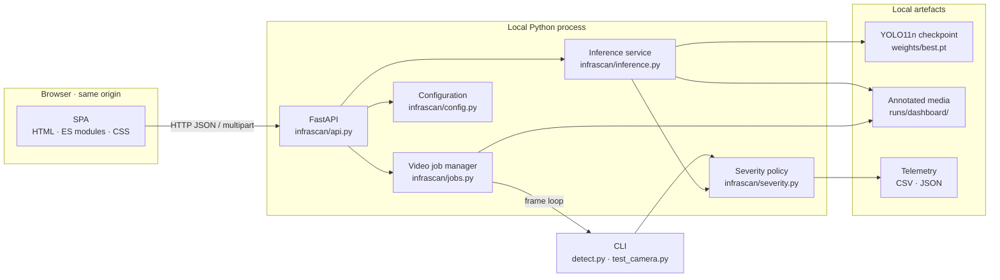

# Project overview

> **InfraScan is a local-first road-surface inspection workspace.** It detects potholes in images and video with a compact YOLO11n checkpoint, scores each detection from its share of the frame, and turns the result into annotated media and structured telemetry — through a browser dashboard and a command-line interface that share one pipeline.

  

<em>The running dashboard. Runtime facts on screen come from the loaded checkpoint, not from hard-coded marketing copy.</em>

## At a glance

| Dimension | Accepted implementation |
|---|---|
| **Task** | Single-class object detection: `pothole` |
| **Model** | Ultralytics YOLO11n · 2,582,347 parameters · 6.4 GFLOPs · 640 px input |
| **Checkpoint** | 5.2 MB `weights/best.pt`, excluded from version control |
| **Backend** | FastAPI 0.156.8 on Uvicorn, Python 3.12.14 |
| **Frontend** | Vanilla ES modules, HTML and handcrafted CSS; no Node.js, npm or bundler |
| **Inputs** | JPG/JPEG, PNG, WebP, BMP images; MP4/AVI/MOV/MKV video; browser webcam still |
| **Outputs** | Annotated JPEG/MP4, bounding boxes, confidence, severity, coverage %, CSV/JSON telemetry |
| **Acceleration** | CUDA → Apple MPS → CPU automatic selection, with CPU fallback on inference failure |
| **Deployment model** | Local process bound to `127.0.0.1:8000`; no cloud, account or external inference |
| **Verified benchmark** | 718 test images · 994 instances · P 0.7959 · R 0.5996 · mAP@0.50 0.7111 · mAP@0.50–0.95 0.3938 |
| **Licence** | MIT for the repository code; Ultralytics terms apply separately |

## The problem in one paragraph

Road defects are usually found by people looking at roads. That process is slow, periodic and subjective: a surveyor sees a defect only when the road is inspected, and two surveyors may describe the same defect differently. Camera-based detection can screen far more imagery than a person can review, but a detector in a notebook is not an inspection workflow. The gap is operational: a usable system must accept realistic inputs, expose its thresholds and failure states, produce reviewable evidence, and be honest about what a bounding box does **not** measure. InfraScan is built around that gap rather than around a leaderboard score.

## Who it is for

| User | Realistic need | What InfraScan provides |
|---|---|---|
| **Road-maintenance engineer or surveyor** | Triage a batch of road imagery and prioritise sites for physical inspection | Per-detection severity band, frame coverage, annotated frames and downloadable telemetry |
| **Municipal or consultancy analyst** | Turn inspection output into a record that can be filtered, audited or joined to an asset register | CSV/JSON records with frame/image, box, confidence, severity and coverage fields |
| **Road-safety researcher or student** | Reproduce a detection baseline and inspect failure modes | Documented checkpoint metadata, dataset counts, evaluation command and recorded environment |
| **Reviewer or examiner** | Check that claims match evidence | Runtime metadata page, explicit PASS/BLOCKED register and an evidence-bound limitations chapter |
| **Developer extending the project** | Add a class, tracker, map export or deployment target without rewriting the app | Separated inference, job, severity, configuration and API modules with a documented contract |

The system is **decision support**, not an autonomous maintenance authority. A detection says "this region looks like a pothole above the chosen confidence"; it does not certify structural condition, ride quality or repair priority.

## What the system does today

### Image inspection
- Upload an image up to **25 MB**.
- Choose one of up to **24 local test-set samples** when `dataset/images/test` exists.
- Capture a single frame from a browser webcam; the stream stops immediately after capture.
- Tune **confidence** (0.05–1.0, default 0.25) and **NMS IoU** (0.10–1.0, default 0.45).
- Compare annotated and original frames, inspect a per-detection table, open a lightbox and download CSV telemetry.

### Video analysis
- Upload a clip up to **2 GB** (MP4, AVI, MOV, MKV).
- The server returns **HTTP 202** and a job identifier; the browser polls progress and estimated time.
- The result contains an annotated MP4 plus frame-level CSV and JSON telemetry.
- Output prefers **H.264 (`avc1`)** for browser playback and falls back to `mp4v` if the local OpenCV build cannot encode H.264.
- Video jobs are processed **one at a time** behind a worker lock so a long clip cannot starve the HTTP server.

### Runtime transparency
- The **System** page reports the loaded checkpoint, device, task, classes and Python/PyTorch/Ultralytics/OpenCV/FastAPI versions.
- The **severity policy** is read from the same module used by inference, not duplicated in the UI.
- A missing checkpoint leaves the dashboard running in an `unavailable` state with instructions; the app never downloads or substitutes a model silently.
- A checkpoint reload endpoint re-reads the configured weights without restarting the server.

### CLI parity
The original command-line workflow remains: image/directory inference, video inference, live OpenCV camera HUD, test-split evaluation, training and export. `detect.py` writes `pothole_telemetry.csv` and `pothole_telemetry.json` next to its outputs. The CLI and dashboard call the same `classify_severity()` function, so changing interface does not change the severity label for the same box and frame.

## Architecture

Three properties matter more than the boxes in the diagram:

1. **One origin.** FastAPI serves both `/api/*` and the dashboard assets, so there is no CORS configuration, proxy or separate frontend server.
2. **One model policy.** Device selection, checkpoint state and severity classification are server-side concerns. The browser renders facts; it does not re-implement detection logic.
3. **Explicit failure.** Missing weights, undecodable images, oversized uploads, unfinished jobs and model-load errors each have a defined response instead of a generic spinner.

For deeper views, see [system architecture](../04-architecture/system-architecture.md), [inference workflow](../04-architecture/inference-workflow.md), [component interactions](../04-architecture/component-interactions.md) and the [code walkthrough](code-walkthrough.md). The module-by-module account is in [implementation details](implementation-details.md).

## Verified results

A fresh evaluation was run on the full **718-image test split** with the local YOLO11n checkpoint on an Apple M2 using MPS.

| Metric | Value | Reading |
|---|---:|---|
| Precision | **0.7959** (79.59%) | Roughly four in five returned detections matched an annotated pothole in this evaluation |
| Recall | **0.5996** (59.96%) | Roughly three in five annotated potholes were recovered |
| mAP@0.50 | **0.7111** (71.11%) | Moderate localization quality at a loose overlap threshold |
| mAP@0.50–0.95 | **0.3938** (39.38%) | Box placement is much less reliable under strict overlap |
| Test images / instances | 718 / 994 | Two background images with empty labels |
| Preprocess / inference / postprocess | 0.17 / **3.82** / 10.75 ms per image | Post-processing, not the forward pass, dominates measured model time |

These are **not** production accuracy claims. They describe one checkpoint on one split in one recorded environment. The checkpoint metadata records training on a CUDA device with 15 epochs; the metrics above are an MPS evaluation. Latency on other hardware, batch sizes or image content will differ. See [verified results](../09-testing-and-results/verified-results.md) and [training and evaluation](../05-dataset-and-model/training-and-evaluation.md).

The functional acceptance record is equally important:

| Check | Status |
|---|---|
| Dashboard root and `/api/health` | PASS |
| Image inference with annotated JPEG | PASS (1 MODERATE detection, 7.0% coverage, 66.2 ms recorded response) |
| Video job and browser playback | PASS (24 frames, 28 frame-level detections, H.264, Chrome `readyState 4`) |
| Invalid image → HTTP 400 | PASS |
| Missing checkpoint → `unavailable`, dashboard still served | PASS |
| Responsive layout at 390/820/1024/1440 px | PASS (no page-level horizontal overflow) |
| Physical webcam | BLOCKED (synthetic device only) |
| CUDA execution | BLOCKED (Apple M2 test machine) |
| Export formats | NOT RUN |
| Automated Python test suite | NOT RUN (none exists) |

## What makes it different

**It is a workflow, not a demo.** The same checkpoint powers image, video, webcam and CLI paths; the same severity function classifies every box; the same telemetry schema is downloadable from both interfaces.

**It is local-first by construction.** Inference, storage and telemetry stay on the machine. There is no account system, no cloud bucket, no hidden API key and no third-party inference call. That reduces data-protection exposure for road imagery that may contain faces, number plates or sensitive locations — while leaving the local host itself as the security boundary.

**It exposes its own runtime.** Most student dashboards show a static "model loaded" badge. InfraScan reports the actual checkpoint name, existence, size, device label, classes, task and package versions, and distinguishes `loading`, `ready`, `unavailable` and `error`.

**It treats failure as a first-class state.** Missing checkpoint, invalid image, oversized upload, unsupported video format, incomplete job and unreachable API each produce a specific message and HTTP status. The dashboard stays usable when the model is not.

**It has a documented evidence boundary.** The project does not convert a single evaluation into a safety claim, does not hide the 59.96% recall, does not claim GPS or depth, and records BLOCKED and NOT RUN checks instead of omitting them.

**It avoids a frontend build chain.** The SPA is served directly from `web/` as ES modules with locally bundled fonts. There is no `node_modules`, lockfile or bundler to reproduce. The trade-off is fewer framework conveniences and no compile-time type checking; see [limitations](limitations.md).

## Scope at a glance

| In scope | Out of scope |
|---|---|
| Single-class pothole detection in stills and video | Cracks, ruts, patches, manholes or multi-class distress |
| Bounding-box severity heuristic based on frame coverage | Depth, volume, ride-quality or structural measurement |
| Local dashboard, REST API and CLI | User accounts, authentication, multi-tenancy or cloud storage |
| CSV/JSON frame-level telemetry | GPS, GIS layers, map integration or cross-frame tracking |
| Checkpoint reload and runtime introspection | Production deployment, TLS termination or internet hardening |
| Reproducible evaluation on the local split | Certification, safety approval or autonomous maintenance decisions |

## Evidence boundary

The project is documented from a **local checkout**, not from a public release containing all artefacts.

- The checkpoint is **not redistributed**. Its SHA-256, size, architecture and metadata are recorded in [`../PROJECT_FACTS.md`](../PROJECT_FACTS.md).
- The dataset is **not redistributed**. Local counts and structure are verified; original creators, source URLs, licences and split history remain **[TO BE CONFIRMED]**.
- The evaluation is a **single 718-image run**, not a multi-seed or cross-dataset study.
- Physical camera, CUDA and export paths are **unverified** in this environment.
- There is **no automated test suite**; functional checks were executed manually and recorded.
- Individual teammate authorship is **not inferred from role allocation**. See [`../CONTRIBUTIONS.md`](../CONTRIBUTIONS.md).

If a statement is not supported by the fact register or the source tree, treat it as unverified rather than filling the gap with an assumption. The full treatment is in [limitations](limitations.md).

## Where to go next

- **For the argument and requirements:** [problem statement and objectives](problem-statement-and-objectives.md).
- **For the code and design decisions:** [implementation details](implementation-details.md).
- **For the complete submission text:** [project report](project-report.md).
- **For definitions:** [technical glossary](technical-glossary.md).
- **For the facts behind every number:** [`../PROJECT_FACTS.md`](../PROJECT_FACTS.md).
