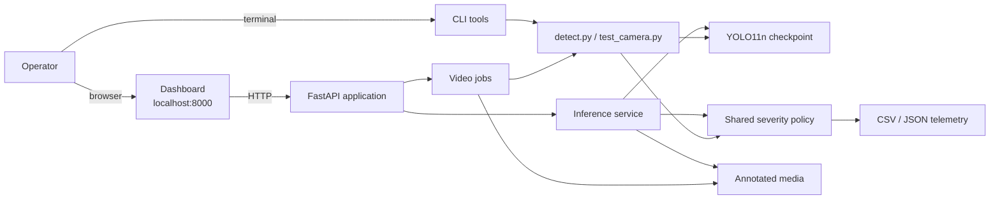
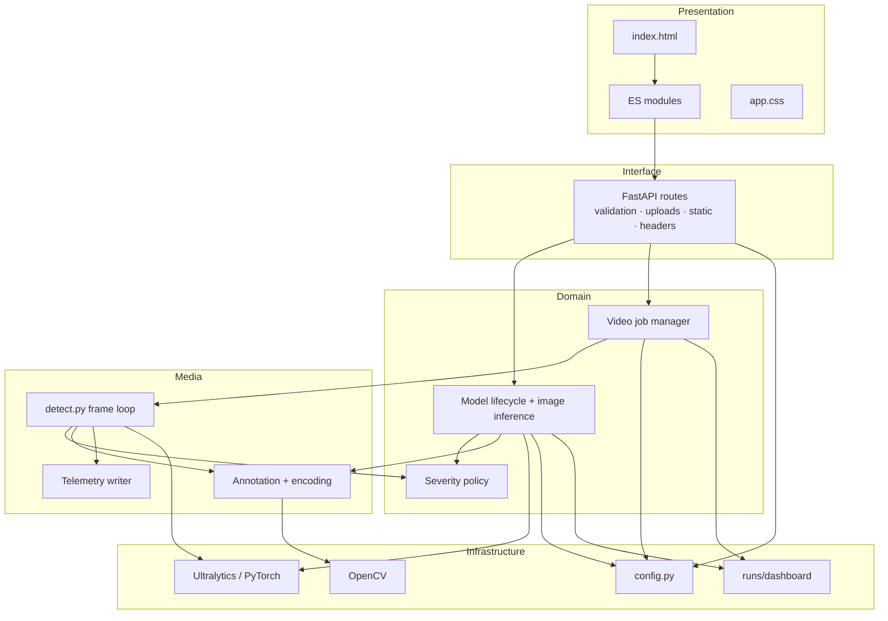
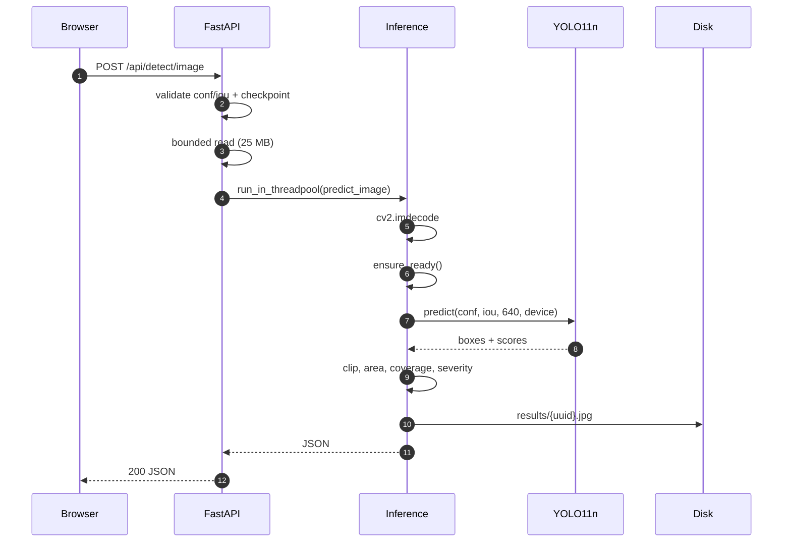
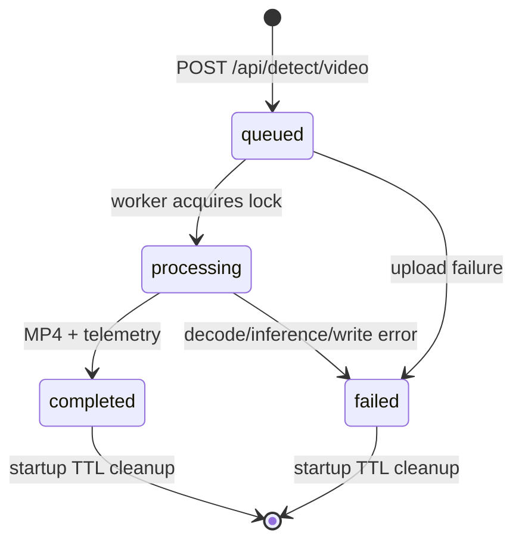
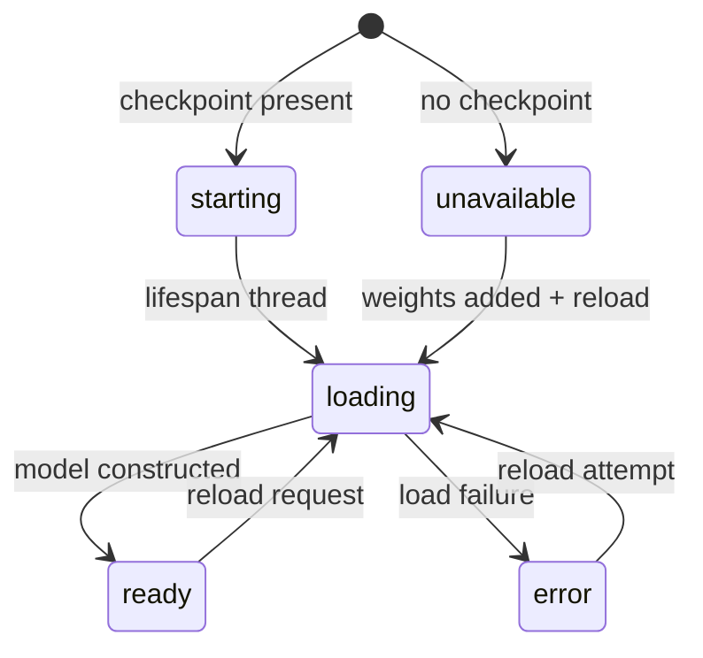
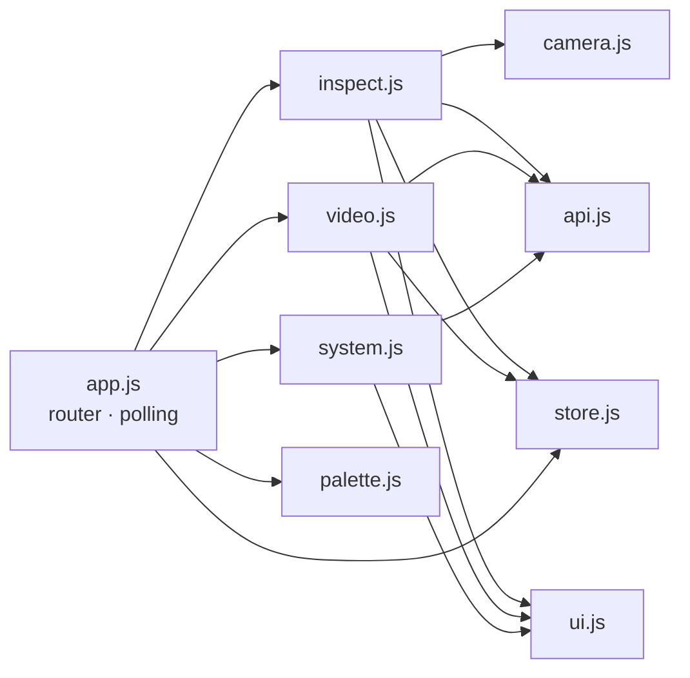
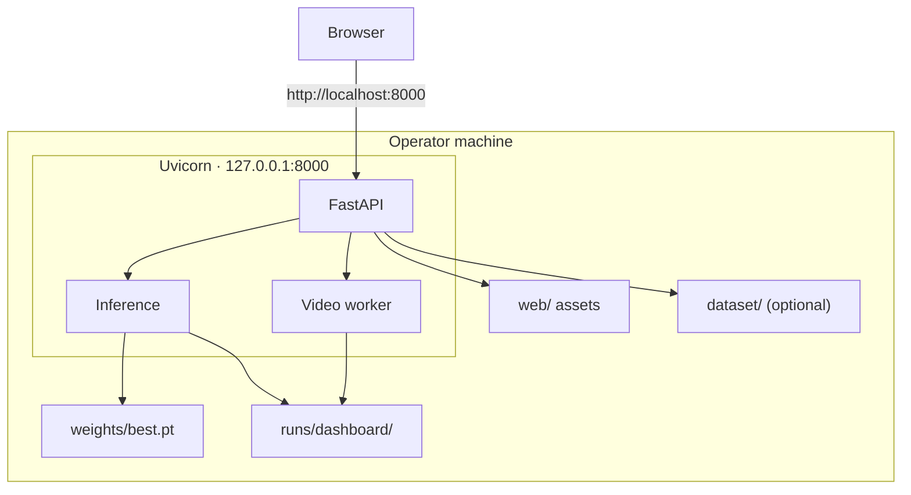

<div align="center">

# InfraScan

## AI-Powered Road Inspection and Pothole Detection System

**A Final-Year Project Report**

Submitted as part of the Final-Year Project

**Department of Computer Science & Engineering — Artificial Intelligence**

**G. L. Bajaj Institute of Technology & Management (GLBITM)**

**Academic Session 2026–2027 · Batch 2023**

</div>

| Field | Detail |
|---|---|
| Project title | InfraScan — AI-Powered Road Inspection and Pothole Detection System |
| Project type | Final-Year Project |
| Institution | G. L. Bajaj Institute of Technology & Management (GLBITM) |
| Department | Computer Science & Engineering — Artificial Intelligence |
| Academic session | 2026–2027 |
| Batch | 2023 |
| Group ID | **[TO BE CONFIRMED]** |
| Supervisor | **[TO BE CONFIRMED]** |
| Report date | 22 October 2026 |
| Software release | InfraScan 2.0.0 |
| Main repository | <https://github.com/Aayush9808/InfraScan> |
| Documentation repository | <https://github.com/Aayush9808/InfraScan-Documentation> |

**Table 1.** Academic and submission metadata.

### Team

| Name | Roll number | Team-declared responsibility |
|---|---|---:|
| Aayush Kumar Shrivastav | 2301921540002 | Team leader; core YOLO model; system architecture and integration |
| Kajal Rawal (“Lucky”) | 2301921520087 | Dataset testing, validation and documentation support |
| Khushi Shakya | 2301921520091 | Frontend development and dashboard |
| Ronak Saini | 2301921520158 | Dataset collection, preparation and documentation |

**Table 2.** Team and team-declared responsibilities. Role allocation is supplied by the team and is not independent evidence of authorship; see Appendix B and [`../CONTRIBUTIONS.md`](../CONTRIBUTIONS.md).

---

## Abstract

Road inspection remains largely manual, periodic and subjective. Camera-based detection can screen imagery faster than a person, but a detector alone is not an inspection workflow: it must accept realistic inputs, expose its thresholds and failure states, produce reviewable evidence, and state what its output does not measure. This report presents **InfraScan**, a local-first pothole inspection workspace built around an Ultralytics **YOLO11n** single-class detector, a **FastAPI** backend and a **zero-build browser single-page application**. It accepts images (JPG, PNG, WebP, BMP; up to 25 MB), video (MP4, AVI, MOV, MKV; up to 2 GB) and browser webcam stills; returns annotated media, bounding boxes, confidence and a CRITICAL/MODERATE/MINOR severity band derived from each box's share of the frame; and exports image- or frame-level CSV and JSON telemetry. A shared `severity.py` module is imported by the dashboard, the CLI inference loop and the camera HUD, so the same box and frame produce the same label regardless of interface. Long video work runs as a background job behind a worker lock, and a missing checkpoint leaves the dashboard running in an explicit `unavailable` state rather than silently substituting another model.

A fresh evaluation on the full **718-image test split** (994 pothole instances, 2 background images) produced **precision 0.7959**, **recall 0.5996**, **mAP@0.50 0.7111** and **mAP@0.50–0.95 0.3938** on an Apple M2 using MPS. Functional checks covered image inference, a 24-frame H.264 video job with browser playback, invalid-input handling, missing-checkpoint behaviour and responsive layouts at four widths. Physical webcam validation, CUDA execution and export formats were blocked or not run, and there is no automated test suite. The results support a usable **decision-support prototype** for relative triage, not a certified or measurement-grade inspection instrument. The central contribution is the integration and honest evaluation of a complete local workflow, together with an evidence boundary that separates verified behaviour from unverified claims.

**Keywords:** pothole detection, road inspection, YOLO11, object detection, FastAPI, single-page application, local-first computing, mAP, precision, recall, severity heuristic, telemetry

---

## Table of Contents

1. [Introduction](#1-introduction)
2. [Literature Survey](#2-literature-survey)
3. [Problem Statement and Objectives](#3-problem-statement-and-objectives)
4. [System Requirements](#4-system-requirements)
5. [System Design and Architecture](#5-system-design-and-architecture)
6. [Methodology and Implementation](#6-methodology-and-implementation)
7. [Dataset and Model](#7-dataset-and-model)
8. [Testing and Evaluation](#8-testing-and-evaluation)
9. [Results and Discussion](#9-results-and-discussion)
10. [Security, Privacy and Limitations](#10-security-privacy-and-limitations)
11. [Conclusion and Future Work](#11-conclusion-and-future-work)
- [References](#references)
- [Appendix A — Commands and Reproduction](#appendix-a--commands-and-reproduction)
- [Appendix B — Team Contributions and Evidence](#appendix-b--team-contributions-and-evidence)

---

## List of Figures

| Figure | Title |
|---:|---|
| 1 | InfraScan system context |
| 2 | Layered architecture of the accepted implementation |
| 3 | Image inference sequence |
| 4 | Video job state machine |
| 5 | Model lifecycle state machine |
| 6 | Frontend module graph |
| 7 | Local deployment topology |

## List of Tables

| Table | Title |
|---:|---|
| 1 | Academic and submission metadata |
| 2 | Team and team-declared responsibilities |
| 3 | Research questions and the evidence used to answer them |
| 4 | Qualitative comparison of road-inspection approaches |
| 5 | Stakeholders and their needs |
| 6 | Objectives and acceptance conditions |
| 7 | Success criteria and outcomes |
| 8 | Functional requirements |
| 9 | Non-functional requirements |
| 10 | Verification environment |
| 11 | HTTP API surface |
| 12 | Component responsibilities |
| 13 | Key design decisions and trade-offs |
| 14 | Dataset split summary |
| 15 | Checkpoint facts |
| 16 | Training metadata compared with repository defaults |
| 17 | Evaluation metrics on the 718-image test split |
| 18 | Verification results |
| 19 | Objective attainment |
| 20 | Limitations summary |
| 21 | Future work |
| 22 | Contribution evidence matrix |

---

## 1. Introduction

### 1.1 Background

Roads deteriorate through traffic loading, weather and drainage failure. A pothole is a localised surface failure: material breaks away, water enters and repeated traffic enlarges the defect, damaging vehicles and endangering two-wheelers and pedestrians.

Road agencies record distress type and severity before planning maintenance. Standards such as ASTM D6433 formalise this through defined distress categories and a Pavement Condition Index [1]. The strength of the standard is consistency; the cost is human time, and judgement depends on training, light, angle and available time. Computer vision changes the allocation of effort: a camera captures more frames than a person can inspect, and a detector can rank candidate regions for review. Maeda et al. showed that deep detectors can locate road damage in smartphone imagery [2]. That established feasibility, not the engineering problem of turning a detector into a usable workflow.

### 1.2 Motivation

Three observations motivated InfraScan. **Detection research and inspection practice optimise different things:** a paper optimises a benchmark metric, while an inspection team needs a result it can open, question, export and compare. **Local-first deployment fits road inspection:** imagery can contain faces, plates and sensitive locations, so local inference avoids a third-party data-processing question and works offline, at the cost of making the local host the security boundary. **An academic project should be honest about evidence:** a test-set score is not a safety certificate, a box is not a depth measurement and a frame-level detection is not a unique pothole count.

### 1.3 Research questions

The project is guided by three questions, summarised in Table 3.

| ID | Research question | Evidence used |
|---|---|---|
| **RQ1** | Can a compact single-class YOLO detector provide useful pothole localisation on a realistic local dataset? | 718-image test evaluation with precision, recall and mAP at two IoU regimes |
| **RQ2** | Can one detection and severity pipeline serve both a browser workflow and a CLI without divergence? | Shared `severity.py`; CLI telemetry check; dashboard image/video checks; source inspection |
| **RQ3** | What does the resulting evidence actually support, and where must claims stop? | Functional acceptance register; dataset and checkpoint provenance audit; limitations analysis |

**Table 3.** Research questions and the evidence used to answer them.

### 1.4 Aim and objectives

The **aim** is to design, implement and evaluate a local-first pothole inspection workspace that converts road imagery into annotated detections, transparent severity bands and structured telemetry through a browser dashboard and a command-line interface.

The **primary objective** is to deliver that workspace as a working, reproducible release using a YOLO11n checkpoint and a FastAPI + SPA architecture. The **secondary objectives** are to support image, sample and webcam-still inspection; process video as a background job with progress, annotated output and telemetry; keep severity classification identical across dashboard, CLI and camera HUD; make runtime state and failure modes observable; produce portable CSV/JSON telemetry; preserve CLI parity for inference, camera, training, evaluation and export; bound resource use and secure the local surface; and document verified results and residual uncertainty. Table 6 restates these with acceptance conditions.

### 1.5 Contributions

The contributions are engineering and documentary rather than algorithmic:

- **A complete local workflow** unifying image, video, webcam-still and CLI inference behind one checkpoint and one severity policy.
- **A FastAPI + zero-build SPA** that removes the Streamlit rerun model, supports background video jobs and serves API and dashboard from one origin without Node.
- **A shared severity module** that makes CLI and dashboard labels identical for identical geometry.
- **Explicit failure semantics** for missing checkpoints, invalid images, unsupported video, oversized uploads and incomplete jobs.
- **A reproducible single-split evaluation** with recorded environment, checkpoint hash, counts and all four headline metrics, including the unflattering ones.
- **Evidence-bound documentation** that separates verified, blocked and unverified claims.

It does **not** contribute a new detector, dataset, tracker, depth method or certified inspection protocol.

### 1.6 Scope

In scope: single-class pothole detection in images and video; bounding-box severity from frame coverage; annotated media; CSV/JSON telemetry; a local dashboard, REST API and CLI; runtime introspection; checkpoint reload; and a reproducible test-split evaluation. Out of scope: cracks and other distress classes; depth, volume, ride quality or Pavement Condition Index; GPS/GIS; cross-frame tracking; user accounts, cloud storage or multi-tenancy; production hardening; safety certification; and dataset or checkpoint redistribution.

### 1.7 Report organisation

Chapter 2 surveys the literature and positions the project; Chapter 3 states the problem, users and objectives; Chapter 4 derives requirements; Chapter 5 presents the architecture; Chapter 6 explains the implementation; Chapter 7 documents the dataset, checkpoint and training evidence; Chapter 8 describes the test method; Chapter 9 interprets the results; Chapter 10 treats security, privacy and limitations; Chapter 11 concludes and proposes future work. Appendix A lists commands and Appendix B records contribution evidence.

---

## 2. Literature Survey

### 2.1 Road-condition assessment

Pavement management systems combine inventory, condition assessment, deterioration modelling and budget allocation. Condition assessment is the observation step. ASTM D6433 records distress type and severity and computes a Pavement Condition Index [1]. Two points matter here: inspection is structured rather than arbitrary, and severity is a *judgement* built from multiple observed attributes, not a single geometric quantity.

Automated assessment is difficult because road distress is visually varied and context-dependent. A pothole can be dark, wet, shadowed, patched or partly occluded, and looks different from a dashcam, a phone at walking height and a fixed traffic camera. A model trained on one view does not automatically transfer to another.

### 2.2 From handcrafted features to learned detection

Early road-damage pipelines relied on handcrafted features, thresholding and classical image processing. These can work in controlled conditions but are brittle under lighting and texture variation. Deep convolutional detectors shifted the problem from feature engineering to data and optimisation.

Two families dominate. **Two-stage detectors** such as Faster R-CNN generate region proposals and then classify and refine each proposal [3]; they can be accurate but carry more computation and pipeline complexity. **One-stage detectors** predict boxes and classes in a single forward pass. Redmon et al. introduced YOLO as a unified formulation: the image is divided into a grid and the network predicts boxes and class probabilities directly [4]. Later versions added multi-scale predictions and deeper backbones [5], CSPDarknet, PANet-style fusion and mosaic augmentation [6], and anchor-free heads plus integrated tooling [7].

Ultralytics documents YOLO11 as a further evolution, with changes to backbone, neck and attention modules [8]. This report does not independently benchmark those claims. What is verified is narrower: the released checkpoint is a **YOLO11n** detection model with **2,582,347 parameters**, **6.4 GFLOPs**, a **640 px** input and one class, `pothole`.

### 2.3 Road-damage detection with deep learning

Maeda et al. framed road damage as an object-detection problem over smartphone imagery and showed that learned detectors can locate damage categories across a large collection [2]. It also surfaced recurring difficulties: class imbalance, varied capture conditions, annotation cost and the gap between benchmark and deployment conditions.

Later work has explored segmentation, multi-class distress, mobile deployment and dataset expansion. Three lessons recur. **Data dominates:** a detector is only as meaningful as its labels and coverage, and a large score on a narrow split can coexist with poor field behaviour. **Context changes appearance:** lighting, weather, camera geometry and road material shift the input distribution, so evaluation should stratify by condition. **Localisation matters:** a box that merely overlaps a pothole is enough for counting but not for measurement.

InfraScan adopts a single-class, bounding-box formulation because it matches the available annotations and the project scope. It deliberately does not claim segmentation, depth or multi-class capability.

### 2.4 Evaluation metrics

Object-detection evaluation was standardised largely by the PASCAL VOC and COCO benchmarks; COCO introduced mAP averaged over multiple IoU thresholds and object-size ranges [9]. For a single class, **precision** is the fraction of returned detections that match a ground-truth box, **recall** is the fraction of ground-truth boxes detected, and **AP** is the area under the precision-recall curve at a given IoU threshold. **mAP@0.50** averages AP at IoU 0.50; **mAP@0.50:0.95** averages AP at ten thresholds, rewarding tighter localisation. A detector can favour precision (few boxes, most of them right) or recall; reporting one number hides that trade-off, so this report reports all four metrics together.

### 2.5 Deployment architectures for computer vision

Research prototypes are often notebooks or scripts. A deployable inspection tool needs an interface non-programmers can use, an API that separates inference from presentation, handling for long-running work, explicit state for missing assets, and a record format that survives the session. **Streamlit** turns a Python script into a web UI with little code, but reruns the script for each interaction, which is awkward for background jobs and explicit REST contracts. **FastAPI** instead provides routes, typed validation, OpenAPI generation and an explicit application boundary [10], built on Starlette [11] and served by an ASGI server such as Uvicorn [12]; the cost is that the team owns routing, state and rendering. On the client side, a **single-page application** can use a framework and bundler or native ES modules [13]; the zero-build route avoids Node.js and a build pipeline at the cost of framework conveniences and compile-time checks. **Local-first** architecture avoids uploading sensitive imagery and removes a network dependency, but moves the security boundary to the local host. InfraScan adopts the FastAPI, zero-build SPA and local-first combination.

### 2.6 Synthesis and research gap

Table 4 summarises the approaches qualitatively. It does not compare accuracy numbers, because no common benchmark was run.

| Approach | Strength | Weakness | Relevance to InfraScan |
|---|---|---|---|
| Manual visual survey | Context-aware; follows standards such as ASTM D6433 | Slow, periodic, subjective | The process supported, not replaced |
| Classical image processing | Interpretable; low compute | Brittle to lighting and shadows | Rejected as the detection core |
| Two-stage deep detectors | Strong localisation; mature | More complex and slower | Not used; one-stage suffices for triage |
| One-stage YOLO detectors | Fast, compact, well tooled | Weaker tight localisation | Used: YOLO11n |
| Segmentation models | Pixel-level shape; area proxies | Higher annotation and compute cost | Out of scope |
| Streamlit prototype | Very fast to build | Rerun model; weak API and jobs | Replaced by FastAPI + SPA |
| FastAPI + SPA | Explicit API, background work, one origin | More engineering; team owns UI | Accepted architecture |

**Table 4.** Qualitative comparison of road-inspection approaches.

The gap is therefore **not** “detect potholes with a CNN”. It is **“assemble a detector into a local inspection workflow whose behaviour, failure modes and evidence are explicit enough to be defended academically”**. The literature provides the detector and the metrics; it provides much less guidance on the integration, observability and claim discipline that make a student project useful beyond a notebook.

---

## 3. Problem Statement and Objectives

### 3.1 Context

A road inspection team needs to know where defects are, how severe they appear and which locations deserve a physical visit. Manual inspection answers those questions slowly. A camera-based assistant can answer them faster, but only if it is usable by the people who inspect roads, not only by the person who trained the model.

The project therefore treats the detector as one component of a larger system: input validation, inference, severity policy, annotation, telemetry, job management, runtime introspection and a browser interface. Quality is judged by whether that whole path works, not only by whether a prediction appears.

### 3.2 Problem statement

> **Given a still image or a video recorded by an ordinary camera, identify pothole regions as bounding boxes, attach a transparent severity indication derived from each box's share of the frame, and present the result as annotated media plus structured telemetry through a local browser dashboard and a command-line interface that share one detection and severity policy — while remaining usable and explicit when the checkpoint, the input or the processing pipeline is unavailable.**

The statement bounds the problem in five ways: input is ordinary camera imagery, not LiDAR, stereo or a calibrated pavement scanner; output is a bounding box, not a mask, depth map or volume; severity is transparent and geometric, not an opaque model score; deployment is local, not a cloud service; and failure is part of the contract, not an afterthought.

### 3.3 Stakeholders

| Stakeholder | Need | What the system provides | What it does not provide |
|---|---|---|---|
| Road surveyor | Fast triage of imagery | Boxes, confidence, severity, annotated frames | Certified condition rating |
| Maintenance planner | Prioritised candidate sites | Coverage-based bands and CSV/JSON records | Cost, depth, ride quality, scheduling |
| Analyst | Portable evidence | Annotated media, telemetry downloads | GIS join, tracking, deduplication |
| Examiner | Verifiable claims | Runtime metadata, evaluation record, limitations | Production certification |
| Developer | Extensible structure | Separated modules and API contract | Automated tests, plugin system |

**Table 5.** Stakeholders and their needs.

### 3.4 Objectives

| ID | Objective | Type | Acceptance condition |
|---|---|---|---|
| **O0** | Deliver a working local inspection workspace | Primary | Dashboard and CLI run against a compatible checkpoint; image and video paths produce annotated output and telemetry |
| **O1** | Support image, sample and webcam-still inspection | Secondary | Valid inputs return detections; invalid inputs fail explicitly |
| **O2** | Process video as a background job | Secondary | 202 + job id; progress; completed MP4 + telemetry |
| **O3** | Share severity across interfaces | Secondary | Same function imported by dashboard, CLI and camera |
| **O4** | Make runtime and failures observable | Secondary | Status endpoint and System page expose checkpoint, device, versions and error state |
| **O5** | Export structured telemetry | Secondary | CSV and JSON contain frame/image, box, confidence, severity and coverage |
| **O6** | Preserve CLI parity | Secondary | Inference, camera, training, evaluation and export commands exist and are documented |
| **O7** | Bound resources and secure the local surface | Secondary | Upload caps, chunked writes, locks, headers, loopback default |
| **O8** | Document evidence and uncertainty | Secondary | Verified metrics, PASS/BLOCKED register, limitations chapter |

**Table 6.** Objectives and acceptance conditions.

### 3.5 Success criteria

| ID | Criterion | Result | Status |
|---|---|---|---|
| SC-01 | Dashboard serves without a checkpoint and explains the state | Observed | Met |
| SC-02 | Image inference returns JSON and an annotated JPEG | 1 MODERATE, 7.0%, 66.2 ms | Met |
| SC-03 | Video job returns 202, progress and a playable MP4 | 24 frames, 28 detections, H.264 | Met |
| SC-04 | Same severity policy across interfaces | Shared import verified | Met |
| SC-05 | CSV and JSON telemetry | Image CSV; video CSV/JSON | Met |
| SC-06 | Explicit errors for invalid input and missing model | 400 and 503 observed | Met |
| SC-07 | Full test-split evaluation with recorded environment | P 0.7959, R 0.5996, mAP@0.5 0.7111, mAP@0.5–0.95 0.3938 | Met |
| SC-08 | Responsive layout without page-level overflow | 390/820/1024/1440 px | Met |
| SC-09 | Reproducible setup | Documented; assets external | Partially met |
| SC-10 | Automated regression suite | No suite | Not met |
| SC-11 | Physical webcam validation | Synthetic device only | Blocked |
| SC-12 | Export validation | None exercised | Not run |

**Table 7.** Success criteria and outcomes.

### 3.6 Non-goals and assumptions

The release does not aim to detect cracks or other distress classes; measure depth, volume or ride quality; compute a certified PCI or IRI; provide GPS/GIS; track or deduplicate potholes across frames; make autonomous maintenance decisions; provide authentication, cloud storage or multi-tenancy; certify safety; redistribute the dataset or checkpoint; or claim universal accuracy.

The operator supplies a compatible checkpoint and, for samples and evaluation, an authorised dataset. The browser supports ES modules and `getUserMedia`; camera capture needs `localhost` or HTTPS. The local OpenCV build can encode at least one supported video codec. The deployment is a single trusted user on a local host. Academic time and budget constraints, an Apple M2 development machine, unresolved data licensing and the absence of production infrastructure shape both the architecture and the evidence.

---

## 4. System Requirements

### 4.1 Requirements approach

Requirements were derived from the workflow rather than from a feature wish-list. Each has a priority, an acceptance condition and a verification method, and requirements that could not be verified are marked rather than assumed. The structure follows the quality-model spirit of ISO/IEC 25010, separating functional suitability from performance, usability, security, maintainability and portability [14].

### 4.2 Functional requirements

| ID | Requirement | Priority | Verification |
|---|---|---|---|
| FR-01 | Load a checkpoint from `weights/best.pt` or `INFRASCAN_WEIGHTS`; serve the dashboard if it is missing | Must | PASS |
| FR-02 | Accept JPG, PNG, WebP and BMP images up to 25 MB; validate confidence 0.05–1.0 and IoU 0.10–1.0 | Must | PASS; 400 on invalid; thresholds source-inspected |
| FR-03 | List up to 24 local test samples when available | Should | Source inspection |
| FR-04 | Capture a browser webcam still | Should | PASS with synthetic device; physical BLOCKED |
| FR-05 | Return annotated JPEG, detections and summary; download image CSV | Must | PASS |
| FR-06 | Accept MP4/AVI/MOV/MKV up to 2 GB and return a background job | Must | PASS (job); 413/415 code-inspected |
| FR-07 | Report video progress and produce annotated MP4, CSV and JSON | Must | PASS |
| FR-08 | Classify severity by frame coverage and share the policy across interfaces | Must | PASS (source and CLI) |
| FR-09 | Expose runtime metadata and reload the checkpoint without restart | Should | PASS; reload source-inspected |
| FR-10 | Return explicit HTTP errors for bad input, missing resources and model unavailability | Must | PASS for 400/503; others code-inspected |
| FR-11 | Serve SPA, API and OpenAPI documentation from one origin | Must | PASS |
| FR-12 | Purge stale artefacts after 24 hours; preserve CLI inference, camera, training, evaluation and export | Should | Source-inspected; CLI PASS; export NOT RUN |

**Table 8.** Functional requirements.

### 4.3 Non-functional requirements

| ID | Requirement | Implementation | Residual gap |
|---|---|---|---|
| NFR-01 | Local-first privacy: no cloud inference or storage | Local model and files | No encryption or access control |
| NFR-02 | Responsive API during long work | Background model load; thread pool; video worker threads | Single process; compute contention |
| NFR-03 | Bounded resources: 25 MB images, 2 GB video, serialised inference | Chunked reads and writes; locks | No quota, rate limit or cancel |
| NFR-04 | Portability across Python 3.10+, CUDA, MPS and CPU | Device selection; pure-Python web stack | Unpinned dependencies |
| NFR-05 | Maintainability: small modules, one policy location | `config`, `inference`, `jobs`, `severity`, `api` | No automated tests or typing |
| NFR-06 | Observability and usability | Logging, status endpoint, System page, hash routes, palette, ARIA | No metrics, tracing or WCAG audit |
| NFR-07 | Local security: loopback, headers, path checks | Middleware, bind default, filename checks | No auth, TLS, CSRF or rate limit |
| NFR-08 | Reproducibility and graceful degradation | Evaluation command, hash, versions; `unavailable` state; codec fallback | Assets not redistributed; some 500s generic |
| NFR-09 | No frontend build; documentation integrity | Native ES modules; fact register and evidence index | No bundling or type checks; some pages may lag |

**Table 9.** Non-functional requirements.

### 4.4 Environment

| Component | Verified value |
|---|---|
| Machine | Apple M2 (arm64) |
| OS | macOS 27.0.1 (Darwin 27.0.1) |
| Python | 3.12.14 |
| PyTorch / Torchvision | 2.14.1 / 0.29.1 |
| Ultralytics | 8.4.183 (evaluation); 8.4.108 in checkpoint metadata |
| OpenCV / NumPy | 5.0.0.93 / 2.5.4 |
| pandas / Pillow | 3.0.6 / 13.0.0 |
| FastAPI / Uvicorn / python-multipart | 0.156.8 / 0.54.0 / 0.0.32 |
| Evaluation device | `mps` (Apple GPU) |
| Batch / image size | 16 / 640 |

**Table 10.** Verification environment. The checkpoint metadata records CUDA training; the reported metrics are an Apple MPS evaluation.

### 4.5 Interfaces and API surface

The browser dashboard is a same-origin HTML/JS client with four workspaces. The REST API serves the SPA, scripts and external clients through JSON, multipart and media bytes under `/api/*`; Swagger UI is available at `/api/docs`; and the CLI exposes `detect.py`, `test_camera.py`, `train.py`, `evaluate.py` and `export.py`. The operator also interacts with `weights/`, `dataset/` and `runs/dashboard/` on the filesystem.

| Method | Endpoint | Purpose |
|---|---|---|
| GET | `/api/health` | Liveness and model state |
| GET | `/api/status` | App, model, runtime, severity, limits, samples |
| GET | `/api/samples`, `/api/samples/{name}` | List or fetch local test images |
| GET | `/api/results/{filename}` | Saved annotated JPEG |
| POST | `/api/detect/image` | Multipart `file`, `conf`, `iou` |
| POST | `/api/detect/video` | Upload and create a job (202) |
| GET | `/api/jobs/{id}` | Job status and progress |
| GET | `/api/jobs/{id}/video` | Annotated MP4 when complete |
| GET | `/api/jobs/{id}/telemetry.csv`, `.json` | Frame-level telemetry |
| POST | `/api/model/reload` | Reload the configured checkpoint |
| GET | `/api/docs`, `/api/openapi.json` | Swagger UI and schema |

**Table 11.** HTTP API surface.

Confidence defaults to 0.25 within 0.05–1.0, NMS IoU to 0.45 within 0.10–1.0, image uploads are capped at 25 MB and video at 2 GB, and results and jobs expire after 24 hours at startup.

### 4.6 Data requirements and traceability

Images must decode with OpenCV; video containers must be readable by the local build. The dataset, when used, follows `dataset/images/{train,val,test}` and `dataset/labels/{train,val,test}` with one class. Outputs are written under `runs/dashboard/results` and `runs/dashboard/jobs`. No database is required: job state is in memory and results are files.

Requirement groups map to modules as follows: model lifecycle to `config.py`, `inference.py` and `api.py`; the image path to `api.py`, `inference.py` and `inspect.js`; the video path to `api.py`, `jobs.py`, `detect.py` and `video.js`; severity to `severity.py`; errors to `api.py`, `inference.py` and `api.js`; and security to `api.py` and `run_app.py`. Each group was checked through the health or status endpoint, an image or video run, source inspection, or the recorded error behaviour.

---

## 5. System Design and Architecture

### 5.1 Architectural drivers

Five drivers shaped the design: one model must serve many interfaces without reimplementation; a laptop is the deployment target, so the stack must install with Python alone and survive a missing checkpoint; video is long-running and cannot block the HTTP event loop or the UI; failures must be legible enough to distinguish “no model”, “bad file”, “unsupported format” and “server down”; and evidence must be attributable, so the running checkpoint, device and versions are visible and the app never silently substitutes another model.### 5.2 System context



**Figure 1.** InfraScan system context. The browser and CLI are two entrances to one local detection stack.

### 5.3 Layered architecture



**Figure 2.** Layered architecture. The domain layer owns policy; the media layer owns frame processing; the interface layer owns HTTP concerns.

### 5.4 Components

The presentation layer is `web/`, a set of ES modules with no build step. `infrascan/api.py` owns routing, validation, upload bounds, security headers and static files; `inference.py` owns model state, device selection, prediction and annotation; `jobs.py` owns the job registry, progress and cleanup; `severity.py` owns the band policy; and `config.py` centralises paths, limits and defaults. `detect.py` provides the frame loop, HUD, annotation and telemetry used by both the CLI and the video worker, while `test_camera.py` provides a live OpenCV HUD. Training, evaluation and export remain CLI tools.

### 5.5 Image inference design



**Figure 3.** Image inference sequence. Decode, prediction and annotation happen off the event loop.

Annotation is deliberately server-side. The browser receives a finished JPEG, so the visual result is identical for API clients and cannot drift from the reported boxes.

### 5.6 Video job design



**Figure 4.** Video job state machine. Jobs are in memory; outputs are files.

The API creates a job before saving the upload, so a failed upload still has a record. The upload is streamed to disk in 1 MB chunks. The worker calls `run_detection()` from `detect.py`, which constructs its own model instance. Video jobs are serialised against each other by `_worker_lock`, but not against image inference.

### 5.7 Model lifecycle



**Figure 5.** Model lifecycle. The UI renders each state distinctly.

A module-level lock protects state; a separate prediction lock serialises model calls. `ensure_ready()` waits up to 180 seconds. The health endpoint is a liveness probe, not a readiness probe: it returns `ok` with `model_state: unavailable` when weights are missing.

### 5.8 Frontend design



**Figure 6.** Frontend module graph. Dependencies point toward shared utilities; there are no cycles.

The SPA uses a hash router so that a static file server needs no rewrite rule. `store.js` holds in-memory state and persists only confidence and IoU. `app.js` polls `/api/status` every 15 seconds when ready, 2.5 seconds while loading and 5 seconds when offline. The status chip, System page and action availability all derive from the same status object.

### 5.9 Concurrency and security

Model loading runs on a daemon thread guarded by `_load_lock`, so the UI renders during load. Image prediction runs in Starlette's thread pool under `_predict_lock`; video jobs run on a daemon thread under `_worker_lock`; and job updates take `_jobs_lock` for consistent snapshots. The model is not thread-safe for concurrent calls, so the prediction lock is a correctness requirement, not only a performance choice. The video path uses a separate model instance; this avoids blocking the dashboard model but can double memory use.

The default bind is `127.0.0.1`. Middleware adds `X-Content-Type-Options: nosniff`, `X-Frame-Options: DENY`, `Referrer-Policy: no-referrer`, a restrictive CSP and `Cache-Control: no-store` on API paths. Sample and result routes reject path segments that are not bare filenames. Uploads are bounded. There is no authentication; the security model is explicitly local-only.

### 5.10 Deployment topology and design decisions



**Figure 7.** Local deployment topology. There is no cloud component and no separate frontend server.

| Decision | Alternative | Rationale | Trade-off |
|---|---|---|---|
| FastAPI + SPA | Streamlit | Explicit API, background jobs, one origin | More UI code; own state model |
| Zero-build ES modules | Framework + bundler | No Node; simple deployment | No bundling, typing or ecosystem |
| Shared severity module | Duplicate logic per interface | Consistency and one policy | Heuristic remains crude |
| Background load; serialised inference | Block startup; concurrent calls | UI responsive; model thread safety | First inference may wait; lower throughput |
| H.264 → mp4v fallback | Fail without H.264 | Works on more OpenCV builds | Fallback may not play in browser |
| Local-only security | Auth + TLS | Matches deployment and scope | Unsafe on untrusted networks |

**Table 12.** Key design decisions and trade-offs.

---

## 6. Methodology and Implementation

### 6.1 Development approach

The release was built incrementally around an acceptance loop: implement a path, run it against the real checkpoint or a deliberately broken input, record the result, then document it. This is why the documentation contains BLOCKED and NOT RUN entries rather than a uniform list of successes. The approach prioritised a working vertical slice (image in, detection out) before breadth, and treated failure states as features to be implemented and checked. The work also replaced an earlier Streamlit interface; the detector, training scripts and CLI lineage were retained while the presentation and application boundary were rebuilt.

### 6.2 Backend bootstrap

`app.py` is a three-line ASGI entrypoint that re-exports `infrascan.api.app`. `run_app.py` provides the operator launcher: it accepts `--host` (default `127.0.0.1`), `--port` (default 8000), `--weights`, `--no-browser` and `--reload`; changes to the repository root; maps `--weights` to `INFRASCAN_WEIGHTS`; prints the dashboard and API URLs; optionally opens a browser after 1.5 seconds; and calls Uvicorn with `"app:app"`. **One caveat is worth recording:** the launcher imports `infrascan.config` before it parses the flags, so `config.WEIGHTS_PATH` is already resolved when `--weights` is assigned. In a normal launch the `--weights` flag may therefore have no effect; the reliable method is `INFRASCAN_WEIGHTS=/path/to/model.pt python run_app.py`, or `--reload`, whose child process re-imports the configuration with the variable set. This was confirmed by reading `run_app.py` against `infrascan/config.py`, not by a browser test. Changing to the project root makes relative paths (`weights/`, `dataset/`, `runs/`) behave the same regardless of where the app is launched.

The FastAPI lifespan performs four startup actions: create runtime directories, purge stale result images, clean stale job directories and start the model load. It does **not** block on the model.

### 6.3 Inference service

The model lifecycle is a state machine guarded by locks. The load path selects `cuda:0`, then `mps`, then `cpu`; constructs `YOLO(config.WEIGHTS_PATH)`; reads class names, falling back to `pothole`; and marks the state `ready`. Accelerator detection failures are logged and do not prevent a CPU start. `predict_image()` decodes bytes with `cv2.imdecode`, rejects `None`, computes frame area, waits for the model and predicts inside `_predict_lock`; if accelerated prediction raises, it retries once on CPU and updates the recorded device.

Boxes are clipped to the image, converted to integer pixel coordinates and passed to the shared severity function. The annotated JPEG is written with quality 92, and the response includes the result UUID, media URL, dimensions, detections, summary, latency and effective parameters. `inference_ms` includes the wait for `_predict_lock` but excludes decode, annotation and JPEG encoding, so the recorded 66.2 ms is a partial pipeline latency, not a full request benchmark.

### 6.4 Shared severity policy

The entire policy is 40 lines:

```python
CRITICAL = "CRITICAL"
MODERATE = "MODERATE"
MINOR = "MINOR"

SEVERITY_BANDS = (
    (CRITICAL, 8.0, (0, 0, 255)),
    (MODERATE, 2.5, (0, 140, 255)),
    (MINOR,    0.0, (0, 215, 255)),
)

def classify_severity(box_area, frame_area):
    if frame_area <= 0:
        return MINOR, (0, 215, 255), 0.0
    ratio = float(box_area) / float(frame_area) * 100.0
    for severity, threshold, colour in SEVERITY_BANDS:
        if ratio >= threshold:
            return severity, colour, ratio
    return MINOR, (0, 215, 255), ratio
```

The important design property is not the arithmetic; it is the import graph. `inference.py`, `detect.py` and `test_camera.py` all import this function. The System page serialises `SEVERITY_BANDS` into the same labels. A threshold change propagates everywhere without a second source of truth.

### 6.5 Video job manager

Jobs are dictionaries in `_jobs`, keyed by UUID. Creation makes `runs/dashboard/jobs/{id}/output/`; the API then streams the upload in 1 MB chunks and raises 413 if `MAX_VIDEO_BYTES` is exceeded:

```python
with destination.open("wb") as handle:
    while chunk := await file.read(1_048_576):
        size += len(chunk)
        if size > config.MAX_VIDEO_BYTES:
            raise HTTPException(status_code=413, ...)
        handle.write(chunk)
```

On failure the partial file is deleted and the job is marked failed. On success a daemon thread runs `run_video_job()`, imports `detect.run_detection` lazily, acquires `_worker_lock`, processes the clip and writes the result. Lazy import keeps the dashboard bootable while the ML stack is installed. Progress comes from a `(frame, total)` callback; if the container reports no total, the UI shows frame counts instead of a percentage. Completion verifies that the output MP4 exists and is non-empty. `frames_processed` comes from progress, not from the number of records, because frames without detections produce no record.

### 6.6 Media pipeline and H.264

Video writing tries `avc1` then `mp4v`:

```python
for codec in ("avc1", "mp4v"):
    candidate = cv2.VideoWriter(str(out_vid),
                                cv2.VideoWriter_fourcc(*codec),
                                src_fps, (w, h))
    if candidate.isOpened():
        writer = candidate
        break
    candidate.release()
if writer is None:
    raise RuntimeError(f"Could not create output video: {out_vid}")
```

H.264 is the codec browsers most reliably play inside MP4; `mp4v` is a fallback for OpenCV builds without an H.264 encoder [18]. The fallback is not guaranteed to play in a browser, and the project does not transcode with FFmpeg or verify playback server-side. The frame loop reads until `cap.read()` fails, predicts each frame, draws severity-coloured boxes, optionally draws a HUD, writes the frame and extends telemetry. For images it processes a file or directory; for camera sources it supports interactive controls and snapshots.

### 6.7 Frontend implementation

The SPA is composed of nine ES modules. `app.js` owns the hash router and status polling; view modules own their DOM sections; `api.js` centralises fetch and error mapping; `store.js` provides state and pub/sub; `ui.js` provides formatting, escaping, toasts and CSV generation. Status polling calls `getStatus()`, renders the result or an offline state, and schedules the next poll in a `finally` block.

There is no WebSocket or server-sent events; polling is adequate for a single-user local app and avoids a second protocol. Video polling runs every 850 ms while a job is active. The camera module uses `getUserMedia` with `facingMode: "environment"` and an ideal 1920×1080 stream, draws the current frame to a canvas, converts it to JPEG at quality 0.92, stops the stream and passes a `File` to the image workspace. It distinguishes permission denial, missing device, busy device and unsupported browser. All server-provided strings that enter `innerHTML` pass through `escapeHtml()`, a deliberate XSS mitigation; the codebase is not formally security-audited.

### 6.8 CLI, training and evaluation

`detect.py` remains the bridge between the old and new interfaces. It exposes `run_detection()` as a function used by the job manager and as a CLI with `--source`, `--weights`, `--conf`, `--iou`, `--imgsz`, `--device`, `--show`, `--save`, `--camera`, `--cam-id` and `--output`; it writes telemetry beside the outputs.

`train.py` wraps Ultralytics with HSV jitter, rotation, translation, scale, perspective, horizontal flip, mosaic 1.0, mixup 0.15 [19], cosine LR [20] and early stopping, then copies the best checkpoint to `weights/best.pt`. `evaluate.py` wraps `model.val()` and prints the four metrics plus timings for the `test`, `val` and `train` splits. `export.py` wraps `model.export()` for six formats but was not exercised.

### 6.9 Dataset tooling, telemetry and errors

`prepare_dataset.py` converts a mask/contour dataset into YOLO boxes: it reads `splits.csv`, finds external contours, filters contours below a minimum pixel area, computes normalised centre/width/height, optionally resizes images to 640 and writes a `data.yaml`. `ingest_voc_dataset.py` ingests a VOC XML archive, keeps only objects whose name contains “pothole”, clips and normalises coordinates, shuffles with seed 42, splits 80/10/10 and writes `voc_*` files. It is an ingestion utility, not a provenance record. `visualize_annotations.py` draws ground-truth boxes for random samples.

Telemetry is a flat record per detection: `frame` (or `image`), `box`, `confidence`, `severity` and `coverage_pct`. The dashboard generates image CSV client-side; video CSV and JSON are generated server-side. The schema is portable but contains no GPS, timestamp, track id or model version.

The API distinguishes 400 (undecodable image), 404 (missing resource), 409 (incomplete job), 413 (oversized upload), 415 (unsupported video), 422 (invalid threshold), 500 (unexpected) and 503 (model unavailable). A catch-all handler logs the traceback and returns a generic message. The frontend maps HTTP errors to `ApiError`; a network failure becomes status 0 with “Could not reach the local InfraScan server”.

### 6.10 Configuration, reproducibility and challenges

Configuration is centralised in `infrascan/config.py`; the checkpoint path can be overridden with `INFRASCAN_WEIGHTS`, and limits and thresholds are constants. Reproducibility is partial: the evaluation command, environment, checkpoint hash and dataset counts are recorded, but `requirements.txt` uses lower bounds rather than exact versions, and the checkpoint and dataset are not redistributed. A reader can reproduce the procedure, not the artefacts, without obtaining them from an authorised source.

Three implementation problems shaped the release. Ultralytics models are not safe for concurrent calls, so the prediction lock was added after recognising that FastAPI's thread pool could otherwise call the same model concurrently. OpenCV's default MP4 writer may produce a file that downloads but does not play, so the codec is chosen explicitly and recorded. Evaluation had to read from a temporary copy because iCloud-evicted files caused read failures, which is why the evaluation record includes the exact data path. A fourth, non-technical challenge was claim discipline: the acceptance register exists to prevent a working demo from drifting into “accurate pothole detection”.

---

## 7. Dataset and Model

### 7.1 Dataset structure and labels

The local dataset follows the standard YOLO layout:

```text
dataset/
├── images/{train,val,test}/
└── labels/{train,val,test}/
```

`data.yaml` points at `./dataset` and defines one class:

```yaml
path: ./dataset
train: images/train
val: images/val
test: images/test
nc: 1
names:
  - pothole
```

Each label line is `<class_id> <x_center> <y_center> <width> <height>`, with coordinates normalised to `[0, 1]`. The only class id is `0` (`pothole`). A sample test label contains class `0` and normalised coordinates; local test filenames use the prefix `pothole_dataset_1_...`.

### 7.2 Split counts

| Split | Images | Pothole instances | Background images |
|---|---:|---:|---:|
| Train | 3,281 | 5,353 | 18 |
| Validation | 720 | 993 | 2 |
| Test | 718 | 994 | 2 |
| **Total** | **4,719** | **7,340** | **22** |

**Table 14.** Dataset split summary. Background images are label files with no objects.

The test split is large enough to produce a meaningful point estimate for this dataset, but the 22 background images are far too few to characterise false positives on clean roads. Split history and scene-level separation are not documented.

### 7.3 Preparation and provenance

`scripts/prepare_dataset.py` and `scripts/ingest_voc_dataset.py` show two preparation routes: mask/contour conversion and VOC XML ingestion. Their existence proves that preparation was tool-supported; it does not prove the origin of every image.

The following are unresolved and must not be inferred: the original creators and stable source URLs; the dataset licence and redistribution permission; whether every local image came from the named upstream sources; the exact split-generation history; the annotation guideline and inter-annotator agreement; and duplicate or scene leakage across splits. The dataset is excluded from version control because these rights are unresolved. It must not be described as a public benchmark or freely reusable.

### 7.4 Model family and checkpoint

YOLO11 is a one-stage, anchor-free detector family documented by Ultralytics [8]. The released checkpoint is the **nano** variant, chosen for a 5.2 MB file and 6.4 GFLOPs at 640 px. That size suits a laptop demo and CPU fallback, but it constrains accuracy: a larger variant would likely localise better at higher computational cost, which this project did not measure.

| Field | Verified value |
|---|---|
| Architecture / task | Ultralytics YOLO11n / `detect` |
| Class / input size | `pothole` (class 0) / 640 px |
| Fused model | 101 layers, 2,582,347 parameters, 6.4 GFLOPs |
| File size | 5,467,546 bytes (5.2 MB) |
| SHA-256 | `f3490f953b4ac2aa0205c206c151be8f2da281da99708713b182492a43c7751c` |
| Metadata date / version | 2026-09-26 / Ultralytics 8.4.108 |
| Metadata licence field | AGPL-3.0 |
| Recorded epochs / batch / image size | 15 / 16 / 640 |
| Recorded optimizer / initial LR | `auto` / 0.003 |
| Recorded LR schedule | `cos_lr=True`, `lrf=0.01` |
| Recorded device / seed | `0` (CUDA) / 0 |
| Recorded `close_mosaic` | 3 |
| Training data path in metadata | `C:\Users\Bisman Singh\...\data.yaml` |

**Table 15.** Checkpoint facts inspected from the local file.

The checkpoint is not redistributed. Its provenance and redistribution permission are unresolved; the metadata path and a public repository under the same name [22] are leads, not a verified chain. The SHA-256 is an integrity aid for this specific file, not a signature or a licence. The metadata licence field is AGPL-3.0 [21]; that field describes the training tooling, not the dataset or the checkpoint's redistribution rights.

### 7.5 Training metadata versus repository defaults

| Parameter | Metadata | `train.py` default | Implication |
|---|---|---|---|
| Model | YOLO11n (from checkpoint size) | `yolo11s.pt` | Exact command used a nano model |
| Epochs | 15 | 50 | Override or different script |
| Batch / image size | 16 / 640 | 16 / 640 | Consistent |
| Optimizer | `auto` | `auto` | Consistent |
| Initial LR | 0.003 | 0.01 | Override or different script |
| Cosine LR | True, `lrf=0.01` | True, `lrf=0.01` | Consistent |
| Close mosaic | 3 | `min(5, 15 // 4) = 3` | Consistent with 15 epochs |
| Device / seed | `0` (CUDA) / 0 | auto / default | Training machine had an NVIDIA GPU |

**Table 16.** Training metadata compared with repository defaults.

This mismatch matters for reproducibility. Evaluation is reproducible given the same checkpoint and test data; training is not reproducible from the default command. A reader should not claim that `python train.py --epochs 15` produced the checkpoint without the original log.

### 7.6 Evaluation protocol and dataset limitations

A fresh evaluation was run on the full 718-image test split with the local checkpoint:

```bash
python evaluate.py \
  --weights weights/best.pt \
  --data <test-data.yaml> \
  --split test \
  --imgsz 640 \
  --batch 16 \
  --device mps
```

The evaluation data was read from a temporary copy to avoid iCloud-evicted files; the normal repository command is the same once `data.yaml` points at an available dataset. The evaluator reports precision (`metrics.box.mp`), recall (`metrics.box.mr`), mAP@0.50 (`metrics.box.map50`), mAP@0.50–0.95 (`metrics.box.map`) and preprocess, inference and postprocess milliseconds. It does not report confidence intervals, per-size strata, calibration or per-condition breakdowns.

The dataset's provenance, label quality and domain coverage are unresolved; the checkpoint's training command is incomplete; the test split has only two background images; and the model is single-class and nano-sized. These are not footnotes; they bound the meaning of every metric in Chapter 8.

---

## 8. Testing and Evaluation

### 8.1 Strategy and environment

Testing combined static checks, API-level functional checks, media-pipeline checks, UI checks and a quantitative test-split evaluation. Each check has one status:

| Status | Meaning |
|---|---|
| **PASS** | Executed and observed to meet the condition |
| **FAIL** | Executed and did not meet the condition |
| **BLOCKED** | Could not execute in the available environment |
| **NOT RUN** | Capability exists but was not exercised |
| **CODE-INSPECTED** | Logic read and judged correct, without execution |

This vocabulary is used consistently so that a code inspection is never presented as a test. The verification environment is recorded in Table 10: Apple M2, macOS 27.0.1, Python 3.12.14, PyTorch 2.14.1, Ultralytics 8.4.183, OpenCV 5.0.0.93, FastAPI 0.156.8, Uvicorn 0.54.0 and MPS. The checkpoint metadata records a CUDA training environment; the evaluation is not an NVIDIA benchmark.

### 8.2 Verification results

| Check | Observed outcome | Status |
|---|---|---|
| Python compilation and FastAPI import | Application and package files compiled; `app` titled `InfraScan API` | PASS |
| `test_camera.py` refactor | Compile, import and `--help` | PASS |
| Dashboard root / `/api/health` | 200 SPA; `{"status":"ok","model_state":"ready"}` | PASS |
| Image inference | 1 MODERATE, 7.0% coverage, 66.2 ms, annotated JPEG | PASS |
| Invalid image / missing checkpoint | 400 with decode message; `unavailable` state, dashboard served | PASS |
| Invalid thresholds, oversized image, unsupported video, unknown job, incomplete job, reload | Validation and error paths present | CODE-INSPECTED |
| Video job | 24 frames, 28 frame-level detections | PASS |
| Video playback and telemetry | H.264, Chrome `readyState 4`; CSV and JSON produced | PASS |
| CLI image and telemetry | Annotated JPEG plus CSV/JSON | PASS |
| H.264 fallback and large-video handling | `avc1` then `mp4v`; 2 GB cap and chunked writes | CODE-INSPECTED |
| Responsive layout | 390, 820, 1024 and 1440 px; no page-level overflow | PASS |
| Webcam capture / physical camera | Chrome synthetic device; hardware/permission required | PASS (synthetic) / BLOCKED |
| Command palette, keyboard focus, ARIA | Implementation present | CODE-INSPECTED |
| Default bind and security headers | `127.0.0.1:8000`; nosniff, DENY, no-referrer, CSP, no-store | PASS (configuration) / CODE-INSPECTED |
| Path traversal and upload bounds | Filename checks; 25 MB / 2 GB caps | CODE-INSPECTED |
| Auth, TLS, CSRF, rate limits | Absent by design | LIMITATION |
| WCAG audit, screen reader, dependency audit | Not performed | NOT RUN |

**Table 17.** Verification results. “PASS” means the condition was observed in the recorded environment, not that it generalises.

The invalid-image and missing-checkpoint cases are the most informative. They show that the system distinguishes a bad input from a missing dependency, and that the dashboard remains usable when detection cannot run.

### 8.3 Quantitative evaluation

| Metric | Value |
|---|---:|
| Precision (P) | 0.7959 (79.59%) |
| Recall (R) | 0.5996 (59.96%) |
| mAP@0.50 | 0.7111 (71.11%) |
| mAP@0.50–0.95 | 0.3938 (39.38%) |
| Test images / instances / backgrounds | 718 / 994 / 2 |
| Preprocess / inference / postprocess | 0.17 / 3.82 / 10.75 ms per image |

**Table 18.** Evaluation metrics on the full test split, Apple M2 MPS, batch 16, image size 640.

The precision-recall curve is available in the main repository at `docs/evaluation/pr-curve.png` and is referenced by the [verified results](../09-testing-and-results/verified-results.md) page.

### 8.4 What was not tested and threats to validity

Not tested: physical webcam on a real target machine; CUDA inference or training; ONNX, TensorRT, TorchScript, OpenVINO, CoreML or TFLite export; automated regression tests (none exist); long-running soak, memory, thermal or disk-exhaustion behaviour; concurrent image requests and image/video contention; multi-user or network-exposed deployment; accessibility conformance; cross-dataset or field validation; checkpoint reload with a different checkpoint; and TTL cleanup over a real 24-hour window.

**Internal validity.** Manual checks can miss regressions; single observations (one image, one video) may not represent the pipeline; the verification machine is a development laptop with other processes. **External validity.** The dataset's provenance and domain coverage are unknown, so results may not transfer to other countries, cameras, weather or road materials. **Construct validity.** Precision, recall and mAP measure agreement with annotations, not road safety; severity bands measure box area, not hazard. **Statistical validity.** One run, no confidence intervals and no repeated seeds make the metrics point estimates. **Conclusion validity.** The project concludes that the system is a usable prototype, not that it is accurate enough for deployment.

---

## 9. Results and Discussion

### 9.1 Detection accuracy

The detector achieves **mAP@0.50 of 0.7111** on the 718-image test split. This is a moderate result for a nano model on a single-class task: strong enough to demonstrate that the pipeline learns pothole-like regions, weak enough to require human review.

**Precision 0.7959** means that, at the operating point summarised by the evaluator, roughly four in five returned detections matched an annotated pothole. **Recall 0.5996** means roughly three in five annotated potholes were recovered. The asymmetry is important: the model is better at avoiding false alarms than at finding every defect. For an inspection assistant, that is the wrong asymmetry if the goal is comprehensive screening, because a missed pothole receives no review at all. The precision/recall pair is a curve summary, not a guarantee at the dashboard default of 0.25; lowering confidence generally trades precision for recall, and the system does not display that curve or warn about the trade-off.

### 9.2 Localisation quality

**mAP@0.50–0.95 of 0.3938** is less than 56% of the mAP@0.50 value. Boxes frequently overlap the pothole at a loose threshold but do not align tightly enough to satisfy stricter thresholds. For triage, loose boxes are often acceptable because the reviewer can see the region. For measurement — area, volume, severity — they are not. This is a central reason the project treats severity as a heuristic rather than a measurement.

### 9.3 Latency

The evaluation reports **0.17 ms preprocess**, **3.82 ms inference** and **10.75 ms postprocess** per image on MPS. Post-processing dominates the measured model time, which is plausible for a nano detector at 640 px: the forward pass is small, while box decoding and NMS are comparatively fixed costs. The recorded API response for one image was **66.2 ms**. That figure includes more of the request path than the evaluator's inference timing, but it is a single observation and excludes decode, annotation and JPEG write. It is not a throughput benchmark and says nothing about CPU-only or CUDA performance.

### 9.4 Video behaviour

The 24-frame test produced **28 frame-level detections** and an H.264 MP4 that played in Chrome (`readyState 4`). This validates the job lifecycle, progress reporting, codec selection and download path. It does **not** validate tracking, because there is none: 28 detections may correspond to far fewer unique potholes. The video summary reports `detections_total`, severity counts and frames processed, and the UI states explicitly that there is no cross-frame tracking.

### 9.5 Severity behaviour

The verified image run produced one MODERATE detection at **7.0% coverage**, just below the 8.0% CRITICAL threshold. The label is internally consistent: 7.0 is in `[2.5, 8.0)`. Whether the pothole is actually moderate is a road-engineering question the system cannot answer; the result demonstrates the policy, not its validity. Severity is also sensitive to camera geometry: a dashcam mounted higher or farther from the defect reduces coverage, while a phone held close increases it. Two surveys of the same road with different equipment can produce different bands. This is a fundamental limitation of a frame-relative heuristic, not a bug that a better threshold alone can fix.

### 9.6 Workflow outcomes

The functional checks support several claims: the dashboard serves and explains a missing checkpoint instead of failing silently; image inference returns annotated media, boxes, confidence, severity and summary; video inference runs as a background job with progress and downloadable outputs; the API distinguishes invalid input, missing model and unknown resources; the layout remains usable at mobile, tablet and desktop widths; and the CLI still produces annotated images and telemetry. These are engineering outcomes, not accuracy claims. They are the evidence that the project is a workflow rather than a notebook.

### 9.7 Objective attainment

| Objective | Status | Evidence | Caveat |
|---|---|---|---|
| O0 Working workspace | Met | Dashboard, API, CLI, image/video runs | Assets external; no automated tests |
| O1 Image/sample/webcam | Met | Image run; synthetic camera | Physical camera blocked |
| O2 Video job | Met | 24-frame job, playback | No cancel; one job at a time |
| O3 Shared severity | Met | Source imports; CLI telemetry | Heuristic not validated |
| O4 Observability | Met | Status endpoint, System page | No metrics or tracing |
| O5 Telemetry | Met | CSV/JSON image and video | No GPS, track or time |
| O6 CLI parity | Partially met | CLI image and camera help | Export not run |
| O7 Resource and security | Partially met | Caps, locks, headers, loopback | No auth, rate limit or soak test |
| O8 Evidence | Met | Metrics, PASS/BLOCKED register | Single run; assets withheld |

**Table 19.** Objective attainment. “Met” means the acceptance condition was observed, not that the capability is production-grade.

### 9.8 Error analysis and comparison

The evaluation does not include a per-image error breakdown, so the following are **plausible failure modes**, not measured findings: small or distant potholes occupy few pixels and are likely missed, contributing to the 59.96% recall; shadows, wet patches, tar seams and drain covers may produce false positives, especially with only 22 background images; occlusion by vehicles or debris reduces visible area and may change both detection and severity; loose boxes on irregular potholes depress mAP@0.50:0.95; and domain shift to different cameras, countries or weather is unmeasured and likely to degrade performance. A rigorous error analysis would sample false negatives and false positives, classify causes and report rates by size, lighting and scene type. That remains future work.

A numerical comparison with Maeda et al. or other road-damage studies would be invalid: the datasets, class definitions, splits and metrics differ. The honest comparison is architectural. InfraScan uses a compact one-stage detector rather than a larger or multi-class pipeline; it prioritises a complete local workflow over benchmark maximisation; it reports a single-split evaluation rather than a cross-dataset study; and it does not implement segmentation, tracking or depth. It is therefore best positioned as an **engineering integration** contribution, not a state-of-the-art detection result.

### 9.9 Interpretation

The results support three conclusions. First, a nano YOLO detector is sufficient to demonstrate single-class pothole localisation on this dataset; mAP@0.50 of 0.7111 is a credible prototype result. Second, the detector is not sufficient for unattended inspection; recall of 0.5996 and strict mAP of 0.3938 require human review and preclude measurement claims. Third, the workflow is the differentiator: the API, dashboard, jobs, severity policy, telemetry and failure states are what turn the detector into a usable artefact, and they are what the evaluation does not measure.

A larger, provenance-verified, multi-geography dataset; a second checkpoint or architecture; repeated runs with confidence intervals; a field pilot with surveyor review; tracking; and calibrated severity would each materially change these conclusions. Until then, they are bounded by Chapter 10.

---

## 10. Security, Privacy and Limitations

### 10.1 Threat model and security posture

| Asset | Threat | Impact | Current control |
|---|---|---|---|
| Uploaded road imagery | Unauthorised local access | Privacy breach | Local filesystem; TTL cleanup |
| Results and telemetry | Unauthorised read | Location or asset inference | UUID paths; local-only bind |
| Model checkpoint | Malicious file | Arbitrary code execution | None beyond trust |
| Compute and disk | Resource exhaustion | Denial of service | Upload caps; serialised jobs |
| API | Network exposure | Unauthenticated use | Loopback default; no auth |
| Browser session | XSS via rendered data | Data theft or actions | HTML escaping; CSP [15] |

**Table 20.** Threat model.

The security model is **local-only, single-user, trusted-host**. It is appropriate for a student laptop or lab machine and inappropriate for a public server. Implemented controls are a loopback bind by default; `nosniff`, `DENY`, `no-referrer`, CSP and `no-store` headers; path-segment checks on sample and result routes; UUID output names and per-job directories; upload size caps and chunked video writes; no silent model substitution; and generic 500 responses that do not leak tracebacks, consistent with HTTP semantics [16].

Absent controls are authentication and authorisation, TLS, CSRF tokens, rate limiting and quotas, audit logging, malware scanning, checkpoint signature verification, encryption at rest and dependency vulnerability scanning.

### 10.2 Privacy and ethics

Local processing reduces third-party exposure but does not anonymise imagery. Faces, plates, homes and locations may be present. Uploaded video is stored under `runs/dashboard/jobs/{id}/`, results under `runs/dashboard/results/`, and filenames may appear in telemetry. The 24-hour TTL is applied at startup, not continuously, and there is no encryption or per-user access control. A deployment handling personal data should add a retention policy, disk encryption, filesystem permissions, a consent and notice process, and a review of whether road imagery counts as personal data under the applicable regime.

Ethically, the project notes five risks: **automation bias**, because a red CRITICAL chip may be over-trusted; **resource allocation**, because coverage-based ranking can favour visually large defects over dangerous ones; **coverage equity**, because under-represented roads and conditions may be under-detected; **dual use**, because the same detector can support maintenance or surveillance; and **academic honesty**, because unverified provenance or single-run metrics must not be presented as general truth.

### 10.3 Limitations summary and evidence boundary

| Category | Key limitation | Status |
|---|---|---|
| Detection | Single class only; recall 59.96% | By design; verified |
| Localisation | mAP@0.50–0.95 39.38% | Verified |
| Severity | Box-area heuristic, not depth or risk | By design |
| Video | No tracking or deduplication | By design |
| Data | 22 background images; provenance unresolved | Verified / unresolved |
| Evaluation | One split, one run, one environment | Verified |
| Training | Exact command not recoverable | Verified |
| Deployment | Single process, in-memory jobs | Verified |
| Media | Codec support machine-dependent | Verified |
| Security / privacy | No auth, TLS, CSRF, rate limit or encryption | By design |
| Testing | No automated suite | Verified |
| Exports | Not exercised | Not run |
| Camera / CUDA | Physical device and NVIDIA hardware untested | Blocked |

**Table 21.** Limitations summary. The full treatment is in [limitations.md](limitations.md).

The project's claims are bounded by the local checkpoint and dataset and their unresolved provenance; one evaluation run on one Apple M2; manual functional checks without an automated suite; no field validation; and no production deployment. Within that boundary the system is a credible prototype. Outside it, claims require new evidence.

---

## 11. Conclusion and Future Work

### 11.1 Summary and findings

InfraScan demonstrates that a compact YOLO11n detector can be assembled into a complete, local-first pothole inspection workflow. The system accepts images, video and webcam stills; returns annotated media, bounding boxes, confidence and a shared severity band; exports CSV/JSON telemetry; runs video as a background job; exposes its runtime and failure states; and preserves a CLI for training, evaluation, camera work and export. The evaluation on 718 test images produced **precision 0.7959**, **recall 0.5996**, **mAP@0.50 0.7111** and **mAP@0.50–0.95 0.3938**. Functional checks confirmed image inference, a 24-frame H.264 video job with browser playback, invalid-input handling, missing-checkpoint behaviour and responsive layouts. Physical camera, CUDA and export paths remain blocked or unexercised, and there is no automated test suite.

Six findings follow. A nano detector is adequate for a prototype, not for unattended inspection: the recall and strict-localisation figures require human review. A shared severity policy is a meaningful architectural improvement because it removes interface-dependent labels and makes the policy auditable. Background jobs are necessary for video because a synchronous request would block the API and the UI. Explicit failure states are a usability feature because a missing checkpoint is a normal first-run condition, not an exception. Local-first deployment is practical because the system runs with Python alone, no Node toolchain and no cloud dependency. Finally, evidence discipline is harder than it looks: the most valuable documentation artefact is the list of things the project cannot claim.

### 11.2 Contributions revisited

The project contributes a working integration, a documented API and data contract, a shared severity module, a background video pipeline, a zero-build SPA and an evidence-bound evaluation. It does not contribute a new detector, dataset, tracker, depth method or certified inspection protocol.

### 11.3 Future work

| Horizon | Work | Why it matters | Dependency |
|---|---|---|---|
| Short | Automated pytest/httpx suite for routes, jobs, severity and errors | Prevents regressions; supports CI | None |
| Short | Provenance and licence record for dataset and checkpoint | Enables ethical redistribution and citation | Team and creator records |
| Short | Background-image expansion and false-positive measurement | Precision on clean roads is unknown | New data |
| Short | Per-size and per-condition evaluation with confidence intervals | Makes metrics interpretable | Existing data and script |
| Short | Cancel button and queue position for video jobs | Usability and resource control | Job-manager changes |
| Medium | Cross-frame tracking and unique-pothole counting | Makes video summaries meaningful | Tracker integration |
| Medium | Calibration and threshold guidance | Confidence should inform review | Calibration study |
| Medium | GPS/IMU ingest and GIS export | Connects detections to assets | Hardware and schema |
| Medium | Multi-class distress detection | Broader inspection utility | New labels and checkpoint |
| Medium | ONNX, TensorRT or OpenVINO export validation | Deployment beyond Python | Toolchains |
| Long | Field pilot with surveyor review | Tests real-world value | Partnership and ethics approval |
| Long | Depth or stereo-based severity | Moves beyond box area | Hardware and calibration |
| Long | Authentication, TLS and multi-user deployment | Production readiness | Security architecture |

**Table 22.** Future work. Short items are feasible within the project; long items require resources beyond it.

### 11.4 Closing statement

InfraScan is best understood as a **bridge**: between a detector and an inspection workflow, between a research metric and an operational decision, and between what a student project can prove and what a road agency would need. The bridge is deliberately bounded. It carries a useful prototype across; it does not claim to carry a certified inspection instrument. That honesty is not a weakness in the result. It is part of the result.

---

## References

[1] ASTM International. (2020). *ASTM D6433-20: Standard practice for roads and parking lots pavement condition surveys*. <https://www.astm.org/d6433-20.html>

[2] Maeda, H., Sekimoto, Y., Seto, T., Kashiyama, T., & Omata, H. (2018). Road damage detection using deep neural networks with images captured through a smartphone. *arXiv*. <https://arxiv.org/abs/1801.09450>

[3] Ren, S., He, K., Girshick, R., & Sun, J. (2015). Faster R-CNN: Towards real-time object detection with region proposal networks. *arXiv*. <https://arxiv.org/abs/1506.01497>

[4] Redmon, J., Divvala, S., Girshick, R., & Farhadi, A. (2016). You only look once: Unified, real-time object detection. *Proceedings of the IEEE Conference on Computer Vision and Pattern Recognition*, 779–788. <https://doi.org/10.1109/CVPR.2016.91>

[5] Redmon, J., & Farhadi, A. (2018). YOLOv3: An incremental improvement. *arXiv*. <https://arxiv.org/abs/1804.02767>

[6] Bochkovskiy, A., Wang, C.-Y., & Liao, H.-Y. M. (2020). YOLOv4: Optimal speed and accuracy of object detection. *arXiv*. <https://arxiv.org/abs/2004.10934>

[7] Ultralytics. (n.d.). *Ultralytics documentation*. <https://docs.ultralytics.com/>

[8] Ultralytics. (n.d.). *YOLO11*. <https://docs.ultralytics.com/models/yolo11/>

[9] Lin, T.-Y., Maire, M., Belongie, S., Hays, J., Perona, P., Ramanan, D., Dollár, P., & Zitnick, C. L. (2014). Microsoft COCO: Common objects in context. *arXiv*. <https://arxiv.org/abs/1405.0312>

[10] FastAPI. (n.d.). *FastAPI documentation*. <https://fastapi.tiangolo.com/>

[11] Starlette. (n.d.). *Starlette documentation*. <https://www.starlette.io/>

[12] Uvicorn. (n.d.). *Uvicorn documentation*. <https://www.uvicorn.org/>

[13] Mozilla Developer Network. (n.d.). *JavaScript modules*. <https://developer.mozilla.org/en-US/docs/Web/JavaScript/Guide/Modules>

[14] International Organization for Standardization. (2023). *ISO/IEC 25010:2023 — Systems and software Quality Requirements and Evaluation (SQuaRE): Product quality model*. <https://www.iso.org/standard/78176.html>

[15] Mozilla Developer Network. (n.d.). *Content Security Policy (CSP)*. <https://developer.mozilla.org/en-US/docs/Web/HTTP/CSP>

[16] Fielding, R., Nottingham, M., & Reschke, J. (Eds.). (2022). *RFC 9110: HTTP Semantics*. IETF. <https://www.rfc-editor.org/rfc/rfc9110.html>

[17] PyTorch. (n.d.). *MPS backend*. <https://pytorch.org/docs/stable/notes/mps.html>

[18] OpenCV. (n.d.). *cv::VideoWriter class reference*. <https://docs.opencv.org/4.x/dd/d9e/classcv_1_1VideoWriter.html>

[19] Zhang, H., Cissé, M., Dauphin, Y. N., & Lopez-Paz, D. (2018). mixup: Beyond empirical risk minimization. *arXiv*. <https://arxiv.org/abs/1710.09412>

[20] Loshchilov, I., & Hutter, F. (2017). SGDR: Stochastic gradient descent with warm restarts. *arXiv*. <https://arxiv.org/abs/1608.03983>

[21] Ultralytics. (n.d.). *Licensing*. <https://www.ultralytics.com/license>

[22] Bisman-Singh-Dev. (n.d.). *YOLO pothole detection model*. <https://github.com/Bisman-Singh-Dev/YOLO-Pothole-Detection-Model>

[23] Aayush9808. (2026). *InfraScan* [Source code]. <https://github.com/Aayush9808/InfraScan>

[24] Aayush9808. (2026). *InfraScan documentation* [Documentation]. <https://github.com/Aayush9808/InfraScan-Documentation>

All URLs were accessed on 22 October 2026.

---

## Appendix A — Commands and Reproduction

### A.1 Install and run

```bash
git clone https://github.com/Aayush9808/InfraScan.git
cd InfraScan
python -m venv .venv
source .venv/bin/activate          # Windows: .venv\Scripts\activate
pip install -r requirements.txt

# Place a compatible checkpoint at weights/best.pt (not bundled)
python run_app.py
```

Open <http://localhost:8000> for the dashboard and <http://localhost:8000/api/docs> for Swagger UI. Launcher options:

```bash
python run_app.py --host 127.0.0.1 --port 8000
python run_app.py --no-browser
INFRASCAN_WEIGHTS=/path/to/best.pt python run_app.py
```

> Binding to `0.0.0.0` exposes an unauthenticated API to the network. Use only on a trusted network.

### A.2 API checks

```bash
curl http://127.0.0.1:8000/api/health
curl http://127.0.0.1:8000/api/status

curl -X POST http://127.0.0.1:8000/api/detect/image \
  -F "file=@road.jpg" -F "conf=0.25" -F "iou=0.45"

curl -X POST http://127.0.0.1:8000/api/detect/video \
  -F "file=@dashcam.mp4" -F "conf=0.25" -F "iou=0.45"
```

### A.3 CLI inference, camera, evaluation and export

```bash
python detect.py --source dataset/images/test --weights weights/best.pt --save
python detect.py --source dashcam.mp4 --weights weights/best.pt --save
python test_camera.py --weights weights/best.pt

python evaluate.py --weights weights/best.pt --data data.yaml \
  --split test --imgsz 640 --batch 16

python export.py --weights weights/best.pt --format onnx
```

Camera controls: `Q`/`Esc` quit, `S` snapshot, `+`/`-` confidence, `H` HUD. If the dataset lives on iCloud Drive and files are evicted, copy it to a local temporary directory first and point `data.yaml` at the copy; the recorded run used MPS and a temporary copy. Export formats are `onnx`, `engine`, `torchscript`, `openvino`, `coreml` and `tflite`; none was exercised during acceptance.

### A.4 Training

```bash
python train.py --data data.yaml --model yolo11n.pt \
  --epochs 15 --batch 16 --imgsz 640 --device 0
```

The released checkpoint metadata records 15 epochs, batch 16, initial LR 0.003 and CUDA device 0. The repository default is 50 epochs, `yolo11s.pt` and LR 0.01, so this command is **not proven** to reproduce the checkpoint. Treat training as a procedure, not a replication.

### A.5 Troubleshooting

| Symptom | Likely cause | Action |
|---|---|---|
| Chip says “No checkpoint” | `weights/best.pt` absent | Place weights or set `INFRASCAN_WEIGHTS`; reload |
| `503` on detection | Model unavailable or loading | Check System page or server log; wait or reload |
| `400` on image | Undecodable file | Use JPG, PNG, WebP or BMP |
| `415` on video | Unsupported suffix | Use MP4, AVI, MOV or MKV |
| Video will not play | `mp4v` fallback | Re-encode to H.264; check OpenCV build |
| Camera will not open | Permission, busy device or no device | Allow permission; close other apps; use `test_camera.py` |
| Dataset samples absent | `dataset/images/test` missing | Optional; upload still works |
| Slow first inference | Model warm-up | Wait; later runs are faster |

---

## Appendix B — Team Contributions and Evidence

### B.1 Declared responsibilities and evidence

| Member | Roll number | Team-declared responsibility | Repository evidence today | Status of individual claim |
|---|---|---|---|---|
| Aayush Kumar Shrivastav | 2301921540002 | Team leader; core YOLO model; architecture and integration | Commits `9242ff3`, `b0d0649`, `d67ea1c`, `4ddcff8`; docs commit `c5414ae`; backend, SPA integration, README, evaluation run | **Verified in repository history** for the listed integration work |
| Kajal Rawal (“Lucky”) | 2301921520087 | Dataset testing, validation and documentation support | No commit independently attributable; verification runs exist but ownership is not recorded | **Assigned role; authorship not independently verified** |
| Khushi Shakya | 2301921520091 | Frontend development and dashboard | Frontend source exists and is reviewed; commit `b0d0649` is authored by Aayush | **Assigned role; authorship not independently verified** |
| Ronak Saini | 2301921520158 | Dataset collection, preparation and documentation | Local dataset, counts and preparation scripts exist; dataset excluded from Git; no provenance record | **Assigned role; authorship not independently verified** |

**Table 23.** Contribution evidence matrix. See [`../CONTRIBUTIONS.md`](../CONTRIBUTIONS.md) for the full checklist.

### B.2 What is verified and what must be attached

Verified: the current architecture is FastAPI + SPA, not Streamlit; the local YOLO11n checkpoint and 718-image test split produced the reported metrics; the source tree contains the files described in this report; Git history records the listed commits under the Aayush identity; and the team names, roll numbers and assigned responsibilities were supplied by the team. This does not prove that no one contributed outside Git, nor that a role assignment proves authorship.

Before the viva, each member should attach presentation evidence. Kajal: a dated test matrix, review notes, screenshots or log excerpts, documentation sections and an oral explanation of PASS, FAIL and BLOCKED. Khushi: a component list, design rationale, browser test notes at named viewports, review or commit evidence and a walkthrough of the frontend modules. Ronak: a dataset provenance record, label-conversion log, split counts, annotation inspection, documentation sections and licence status. Aayush: the evaluation command, log and hash, an architecture walkthrough, an API and frontend demonstration, an explanation of the H.264 fallback and severity policy, and an explicit statement of what remains unverified.

Use precise, evidence-linked language: “My assigned role was frontend development. The repository contains the SPA, and I can walk through the components I worked on; the integration commit was made by Aayush. Here is my design and test evidence.” Avoid “I wrote the entire dashboard.” Examiners often ask follow-up questions about a specific file, test or design decision; a modest, precise claim is easier to defend than a broad one.

---

*End of report.*
