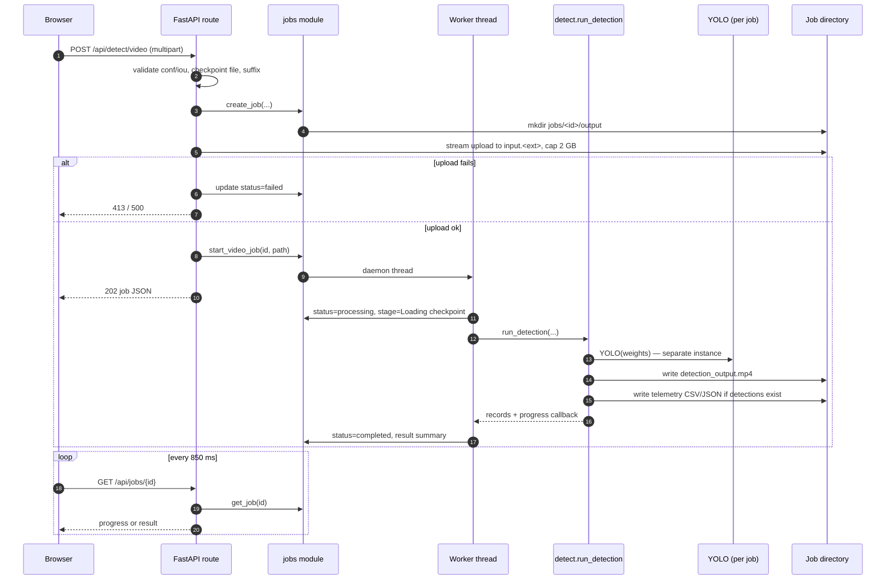

# Backend and API

- [Application design](#application-design)
- [Middleware and security headers](#middleware-and-security-headers)
- [Exception handling](#exception-handling)
- [Route reference](#route-reference)
- [Endpoint details and examples](#endpoint-details-and-examples)
- [Validation and path safety](#validation-and-path-safety)
- [Image inference request flow](#image-inference-request-flow)
- [Video job request flow](#video-job-request-flow)
- [Model reload](#model-reload)
- [OpenAPI and interactive docs](#openapi-and-interactive-docs)
- [Status-code summary](#status-code-summary)

## Application design

The backend is a single FastAPI application defined in `infrascan/api.py` and exported by `app.py`:

```python
app = FastAPI(
    title="InfraScan API",
    description="Local computer-vision API for pothole inspection and road-hazard telemetry.",
    version=config.APP_VERSION,
    lifespan=lifespan,
    docs_url="/api/docs",
    redoc_url=None,
    openapi_url="/api/openapi.json",
)
```

Key design choices:

| Choice | Reason in the code |
|---|---|
| One process serves API and SPA | No CORS, no proxy, no separate frontend server; `StaticFiles` mounts `web/assets` at `/assets` |
| Lifespan starts a background model load | The dashboard can render and explain a missing/loading checkpoint instead of failing startup |
| Image inference uses `run_in_threadpool` | The Ultralytics call is blocking; it must not block the event loop |
| One shared image model behind a lock | A single Ultralytics model instance is not called concurrently from multiple threads |
| Video jobs run in daemon threads | A long clip does not block HTTP request handling; a worker lock prevents concurrent video decoding |
| Results and jobs are files, not database rows | Local-first, inspectable artefacts; no database dependency |
| Fail fast on missing `web/assets` | A broken deployment should not serve an empty shell |

The app assumes it is mounted at the site root. All frontend paths and API URLs are absolute (`/api/...`, `/assets/...`). It is not designed for a sub-path mount.

## Middleware and security headers

A single HTTP middleware adds headers after the response is produced:

```python
response.headers.setdefault("X-Content-Type-Options", "nosniff")
response.headers.setdefault("X-Frame-Options", "DENY")
response.headers.setdefault("Referrer-Policy", "no-referrer")
response.headers.setdefault("Content-Security-Policy", "...")
if request.url.path.startswith("/api/"):
    response.headers.setdefault("Cache-Control", "no-store")
```

Because `setdefault` is used, a route-specific header wins. For example, result images set `Cache-Control: public, max-age=3600`, and job outputs set `Cache-Control: no-store`; the middleware does not overwrite either.

### Headers applied to responses

| Header | Value | Effect |
|---|---|---|
| `X-Content-Type-Options` | `nosniff` | Stops MIME sniffing in supporting browsers |
| `X-Frame-Options` | `DENY` | Blocks framing |
| `Referrer-Policy` | `no-referrer` | Prevents referrer leakage from links |
| `Content-Security-Policy` | see below | Restricts script, style, image, media, font and connection sources |
| `Cache-Control` | `no-store` on `/api/*` | Reduces caching of API responses; route-level exceptions apply |

The exact CSP is:

```text
default-src 'self'; img-src 'self' data: blob:; media-src 'self' blob:;
style-src 'self' 'unsafe-inline'; script-src 'self'; font-src 'self';
connect-src 'self'; object-src 'none'; frame-ancestors 'none'; base-uri 'self'
```

Why each allowance exists:

- `img-src data:` — the CSS ambient noise texture is an inline SVG data URI.
- `img-src blob:` — uploaded image previews use `URL.createObjectURL`.
- `media-src blob:` — the selected-video preview uses an object URL.
- `style-src 'unsafe-inline'` — the SPA sets inline `style` attributes for coverage bars and width values. There are no inline `<style>` blocks or inline event-handler attributes in the shell.
- `script-src 'self'` — only module files under `/assets/js/` are allowed. There is no inline bootstrap script.
- `connect-src 'self'` — all `fetch` calls are same-origin.
- `font-src 'self'` — Inter and Space Grotesk are bundled locally.
- `frame-ancestors 'none'` and `object-src 'none'` — reduce framing and plugin/object attack surface.

Not implemented: HSTS, `Permissions-Policy`, Cross-Origin-Opener-Policy, Cross-Origin-Resource-Policy, CORS, origin/host allowlisting, rate limiting or request IDs. The server does not enforce HTTPS.

> **Swagger UI caveat:** FastAPI's default `/api/docs` page normally loads Swagger UI assets from a CDN and uses an inline bootstrap script. Under `script-src 'self'` and `default-src 'self'`, that page is expected to be blocked or unstyled unless the installed FastAPI version self-hosts its assets or the CSP is adjusted for the docs route. This documentation did not browser-verify the interactive page. The OpenAPI JSON at `/api/openapi.json` remains the reliable machine-readable reference. See [Troubleshooting](../06-setup-and-execution/troubleshooting.md#api-docs-csp).

## Exception handling

`infrascan/api.py` registers a catch-all handler for `Exception`:

```json
{
  "detail": "An unexpected server error occurred. Check the server log for details."
}
```

It logs the path and full exception, then returns HTTP `500`. It does not catch:

- `HTTPException` raised deliberately by the routes (FastAPI's more specific handler returns the intended status and `detail`);
- request-validation errors (FastAPI returns its standard `422` body);
- errors raised before the application starts (for example, missing `web/assets`).

### Error response shapes

Application-raised errors use a string detail:

```json
{ "detail": "Confidence must be between 0.05 and 1.0." }
```

FastAPI request-validation errors use a list:

```json
{
  "detail": [
    {
      "type": "float_parsing",
      "loc": ["body", "conf"],
      "msg": "Input should be a valid number, unable to parse string as a number",
      "input": "abc"
    }
  ]
}
```

The frontend's `api.js` collapses either shape into an `ApiError` message; a list is stringified and shown in a toast. This is functional but not a polished field-level validation experience.

## Route reference

All routes are same-origin. JSON is the default response type; image, video and CSV routes return bytes.

| Method | Path | Success | Request | Response | In OpenAPI? |
|---|---|---|---|---|---|
| `GET` | `/` | `200` | — | `text/html` SPA shell | No |
| `GET` | `/favicon.svg` | `200` | — | `image/svg+xml` | No |
| `GET` | `/assets/{path}` | `200` | — | Static CSS/JS/font/image | No |
| `GET` | `/api/health` | `200` | — | `{status, model_state}` | Yes |
| `GET` | `/api/status` | `200` | — | App, model, runtime, severity, media, thresholds, samples | Yes |
| `GET` | `/api/samples` | `200` | — | Sample list (up to 24 shown) | Yes |
| `GET` | `/api/samples/{name}` | `200` | Path `name` | Image bytes | No |
| `GET` | `/api/results/{filename}` | `200` | Path `filename` | Annotated JPEG | No |
| `POST` | `/api/detect/image` | `200` | Multipart `file`, `conf`, `iou` | Detection JSON | Yes |
| `POST` | `/api/detect/video` | `202` | Multipart `file`, `conf`, `iou` | Job JSON | Yes |
| `GET` | `/api/jobs/{job_id}` | `200` | Path `job_id` | Job status/progress/result | Yes |
| `GET` | `/api/jobs/{job_id}/video` | `200` | Path `job_id` | Annotated MP4 | No |
| `GET` | `/api/jobs/{job_id}/telemetry.csv` | `200` | Path `job_id` | CSV | No |
| `GET` | `/api/jobs/{job_id}/telemetry.json` | `200` | Path `job_id` | JSON | No |
| `POST` | `/api/model/reload` | `200` | — | `{model: ...}` | Yes |
| `GET` | `/api/docs` | `200` | — | Swagger UI HTML | No |
| `GET` | `/api/openapi.json` | `200` | — | OpenAPI schema | No |

### Status codes by route

| Route | Codes returned by this code |
|---|---|
| `/api/health` | `200` |
| `/api/status` | `200`; `500` on an unexpected filesystem/metadata error |
| `/api/samples` | `200`; `500` if a file disappears between listing and `stat()` |
| `/api/samples/{name}` | `200`, `404` |
| `/api/results/{filename}` | `200`, `404` |
| `/api/detect/image` | `200`, `400`, `413`, `422`, `500`, `503` |
| `/api/detect/video` | `202`, `413`, `415`, `422`, `500`, `503` |
| `/api/jobs/{job_id}` | `200`, `404` |
| `/api/jobs/{job_id}/video` | `200`, `404`, `409` |
| `/api/jobs/{job_id}/telemetry.*` | `200`, `404`, `409` |
| `/api/model/reload` | `200`, `503`, `500` |
| `/api/docs`, `/api/openapi.json` | `200` |

`409` means the job exists but is not `completed`. `404` means the job is unknown (including after a restart), the output file is absent, or a sample/result name failed validation.

## Endpoint details and examples

### `GET /api/health`

Liveness plus model state. It is deliberately cheap and does **not** require the model to be ready.

```bash
curl -s http://127.0.0.1:8000/api/health
```

```json
{ "status": "ok", "model_state": "ready" }
```

`status` is always `"ok"` when the process can answer. Use `model_state` for readiness:

| `model_state` | Meaning |
|---|---|
| `starting` | Initial state before a load attempt |
| `loading` | Loader running |
| `ready` | Inference available |
| `unavailable` | Checkpoint missing/empty |
| `error` | Load failed |

Do not use `/api/health` alone as a readiness probe for a demo. Check `/api/status` → `model.state`.

### `GET /api/status`

The SPA's primary status poll (every 15 s when ready, 2.5 s while loading, 5 s when offline). It also lists the test dataset to report sample availability.

```bash
curl -s http://127.0.0.1:8000/api/status | python -m json.tool
```

Abridged response:

```json
{
  "app": {
    "name": "InfraScan",
    "version": "2.0.0",
    "description": "Local road-surface inspection powered by Ultralytics YOLO."
  },
  "model": {
    "state": "ready",
    "ready": true,
    "error": null,
    "checkpoint": {
      "name": "best.pt",
      "path": "weights/best.pt",
      "exists": true,
      "size_bytes": 5467546
    },
    "device": "mps",
    "device_label": "Apple GPU · MPS",
    "classes": ["pothole"],
    "task": "detect",
    "imgsz": 640
  },
  "runtime": {
    "python": "3.12.14",
    "platform": "Darwin 27.0.1",
    "machine": "arm64",
    "torch": "2.14.1",
    "ultralytics": "8.4.183",
    "opencv": "5.0.0.93",
    "numpy": "2.5.4",
    "pandas": "3.0.6",
    "fastapi": "0.156.8",
    "uvicorn": "0.54.0"
  },
  "severity_policy": [
    { "name": "CRITICAL", "min_pct": 8.0, "max_pct": null, "description": "High-impact road damage. Prioritise inspection." },
    { "name": "MODERATE", "min_pct": 2.5, "max_pct": 8.0, "description": "Degradation requiring planned maintenance." },
    { "name": "MINOR", "min_pct": 0.0, "max_pct": 2.5, "description": "Early surface defect with limited coverage." }
  ],
  "severity_rules": { "critical_min_pct": 8.0, "moderate_min_pct": 2.5 },
  "media": {
    "image_extensions": ["bmp", "jpeg", "jpg", "png", "webp"],
    "video_extensions": ["avi", "mkv", "mov", "mp4"],
    "max_image_bytes": 26214400,
    "max_video_bytes": 2147483648
  },
  "thresholds": {
    "default_conf": 0.25,
    "default_iou": 0.45,
    "conf_min": 0.05,
    "conf_max": 1.0,
    "iou_min": 0.1,
    "iou_max": 1.0,
    "imgsz": 640
  },
  "samples": { "count": 718, "available": true }
}
```

Values above are the shape returned by the code; runtime version numbers come from the installed environment and will differ. `samples.count` is the total number of allowed image files in `dataset/images/test`, not the number shown by the picker.

### `GET /api/samples`

```bash
curl -s http://127.0.0.1:8000/api/samples
```

```json
{
  "available": true,
  "count": 718,
  "shown": 24,
  "items": [
    {
      "name": "pothole_dataset_1_test_image1.jpg",
      "url": "/api/samples/pothole_dataset_1_test_image1.jpg",
      "size_bytes": 48213
    }
  ],
  "directory": "dataset/images/test"
}
```

If the directory is absent, the response is `200` with `available: false`, `count: 0`, `shown: 0`, `items: []`. The sample picker is optional; uploads and webcam still work.

### `GET /api/samples/{name}`

Serves one local sample as image bytes. The route is intentionally absent from the OpenAPI schema. It returns `404` for an empty name, a basename mismatch, a disallowed extension or a missing file.

```bash
curl -s http://127.0.0.1:8000/api/samples/pothole_dataset_1_test_image1.jpg -o sample.jpg
```

### `POST /api/detect/image`

Multipart form fields:

| Field | Type | Default | Constraints |
|---|---|---|---|
| `file` | upload | required | Non-empty, at most 25 MB, decodable as JPG/PNG/WebP/BMP |
| `conf` | float | `0.25` | `0.05 ≤ conf ≤ 1.0` |
| `iou` | float | `0.45` | `0.10 ≤ iou ≤ 1.0` |

```bash
curl -s -X POST http://127.0.0.1:8000/api/detect/image \
  -F "file=@road.jpg" \
  -F "conf=0.25" \
  -F "iou=0.45"
```

Recorded sample response shape (values from the verified one-detection run):

```json
{
  "id": "42b4be0a01d44651931dabe615af6b52",
  "image_url": "/api/results/42b4be0a01d44651931dabe615af6b52.jpg",
  "width": 640,
  "height": 640,
  "detections": [
    {
      "id": 1,
      "confidence": 0.7519,
      "severity": "MODERATE",
      "coverage_pct": 7.0,
      "bbox": [166, 383, 407, 502]
    }
  ],
  "summary": {
    "count": 1,
    "critical": 0,
    "moderate": 1,
    "minor": 0,
    "max_coverage_pct": 7.0,
    "total_coverage_pct": 7.0
  },
  "inference_ms": 66.2,
  "conf": 0.25,
  "iou": 0.45,
  "imgsz": 640,
  "created_at": "2026-10-22T12:00:00+00:00",
  "filename": "road.jpg"
}
```

`filename` is added by the route after inference and is the **client-supplied** upload filename, not a path. `created_at` is generated by the inference service in UTC. `image_url` is relative; the browser resolves it against the same origin.

What `inference_ms` measures: the timer starts after decoding and after `ensure_ready()` returns, then includes waiting for `_predict_lock`, `model.predict(...)`, and postprocessing/unboxing. It excludes upload transfer, image decode, model load/wait, annotation, JPEG encoding, disk write and HTTP overhead. It is **not** total request latency. See [Performance](../11-security-and-quality/performance.md).

Common failures:

| Condition | Status | Detail |
|---|---|---|
| `conf` or `iou` out of range | `422` | `Confidence must be between 0.05 and 1.0.` / `IoU must be between 0.10 and 1.0.` |
| `conf`/`iou` not parseable, or `file` missing | `422` | FastAPI validation array |
| Checkpoint missing | `503` | Missing-checkpoint guidance with the configured path |
| Model load failed/loading timeout | `503` | Loader error or "still loading" |
| Empty file | `400` | `The uploaded file is empty.` |
| Undecodable bytes | `400` | `The file could not be decoded as an image. Use JPG, PNG, WebP or BMP.` |
| More than 25 MB | `413` | `File is too large. The limit is 25 MB.` |
| Annotated JPEG write fails | `500` | Generic unexpected-server-error detail; log has the cause |

### `POST /api/detect/video`

Same form fields as image inference, but the file limit is 2 GB and the accepted suffixes are `.mp4`, `.avi`, `.mov`, `.mkv`. The endpoint returns `202 Accepted` with a job object; it does not wait for processing.

```bash
curl -s -X POST http://127.0.0.1:8000/api/detect/video \
  -F "file=@dashcam.mp4" \
  -F "conf=0.25" \
  -F "iou=0.45"
```

```json
{
  "id": "8d1f6f2c9a6b4b7c9d0e1f2a3b4c5d6e",
  "status": "queued",
  "source_name": "dashcam.mp4",
  "conf": 0.25,
  "iou": 0.45,
  "created_at": "2026-10-22T12:01:00+00:00",
  "started_at": null,
  "completed_at": null,
  "error": null,
  "progress": {
    "stage": "Queued",
    "frame": 0,
    "total_frames": 0,
    "fraction": 0.0
  },
  "result": null
}
```

The response snapshot is taken when the job is created. `start_video_job()` is called after the upload completes, but the returned JSON still shows `queued`; poll the job route for the current state.

Failure notes:

- An unsupported **suffix** is rejected with `415` before a job is created.
- A file over 2 GB is rejected with `413` while streaming. A job directory was already created; the job is marked `failed`, and the empty directory remains until a later startup cleanup.
- A readable suffix but an unreadable container is accepted with `202`; the worker later marks the job `failed`.
- The route checks that a checkpoint **file** exists before accepting the upload. It does not wait for the model to be ready.

### `GET /api/jobs/{job_id}`

```bash
curl -s http://127.0.0.1:8000/api/jobs/8d1f6f2c9a6b4b7c9d0e1f2a3b4c5d6e | python -m json.tool
```

Completed response (abridged):

```json
{
  "id": "8d1f6f2c9a6b4b7c9d0e1f2a3b4c5d6e",
  "status": "completed",
  "source_name": "dashcam.mp4",
  "conf": 0.25,
  "iou": 0.45,
  "created_at": "2026-10-22T12:01:00+00:00",
  "started_at": "2026-10-22T12:01:01+00:00",
  "completed_at": "2026-10-22T12:01:31+00:00",
  "error": null,
  "progress": {
    "stage": "Complete",
    "frame": 240,
    "total_frames": 240,
    "fraction": 1.0
  },
  "result": {
    "video_url": "/api/jobs/8d1f6f2c9a6b4b7c9d0e1f2a3b4c5d6e/video",
    "video_size_bytes": 1234567,
    "telemetry_csv_url": "/api/jobs/8d1f6f2c9a6b4b7c9d0e1f2a3b4c5d6e/telemetry.csv",
    "telemetry_json_url": "/api/jobs/8d1f6f2c9a6b4b7c9d0e1f2a3b4c5d6e/telemetry.json",
    "summary": {
      "frames_processed": 240,
      "detections_total": 312,
      "critical": 12,
      "moderate": 180,
      "minor": 120,
      "max_coverage_pct": 14.2,
      "processing_seconds": 30.2,
      "throughput_fps": 7.9
    }
  }
}
```

`detections_total` is the number of **frame-level detection records**, not unique potholes. `critical + moderate + minor` equals that total when every record has a recognised severity. Telemetry URLs are `null` when no records were produced (the pipeline only writes telemetry when at least one detection exists).

### `GET /api/jobs/{job_id}/video`

Returns the annotated MP4 once the job is `completed`. Before completion the route returns `409`; unknown jobs and missing output files return `404`.

```bash
curl -s -L http://127.0.0.1:8000/api/jobs/<job_id>/video -o annotated.mp4
```

The file is always served as `video/mp4` with a `Content-Disposition` filename such as `infrascan_8d1f6f2c_annotated.mp4`. The codec is whatever OpenCV produced; the file extension does not guarantee H.264. See [Inference workflow](inference-workflow.md#video-codec-fallback).

### Telemetry routes

```bash
curl -s -L http://127.0.0.1:8000/api/jobs/<job_id>/telemetry.csv -o telemetry.csv
curl -s -L http://127.0.0.1:8000/api/jobs/<job_id>/telemetry.json -o telemetry.json
```

Both require a completed job and an existing file. They return `409` before completion and `404` if the file is absent. Telemetry is only produced when the frame loop recorded at least one detection.

### `POST /api/model/reload`

No request body. The call blocks while it waits for any in-flight image prediction, then reloads the configured checkpoint synchronously in the thread pool.

```bash
curl -s -X POST http://127.0.0.1:8000/api/model/reload
```

```json
{
  "model": {
    "state": "ready",
    "ready": true,
    "error": null,
    "checkpoint": {
      "name": "best.pt",
      "path": "weights/best.pt",
      "exists": true,
      "size_bytes": 5467546
    },
    "device": "mps",
    "device_label": "Apple GPU · MPS",
    "classes": ["pothole"],
    "task": "detect",
    "imgsz": 640
  }
}
```

- `503` if the checkpoint is missing or the reload does not reach `ready`.
- The reload re-reads the same `WEIGHTS_PATH`; it does not pick up a changed `INFRASCAN_WEIGHTS` environment variable.
- During reload, image requests block on `_predict_lock`; video jobs are **not** blocked by this lock, although they load their own model.

### `GET /` and static assets

`GET /` returns `web/index.html` with `Cache-Control: no-cache`. `GET /favicon.svg` returns the brand SVG. `/assets/*` is served by Starlette's `StaticFiles`; missing files return `404`. The SPA uses a hash router, so no server-side catch-all route is needed for `/inspect`, `/video` or `/system`.

## Validation and path safety

### Threshold validation

`_validate_thresholds(conf, iou)` runs before any upload is read:

```python
if not config.CONF_MIN <= conf <= config.CONF_MAX:
    raise HTTPException(status_code=422, detail="Confidence must be between 0.05 and 1.0.")
if not config.IOU_MIN <= iou <= config.IOU_MAX:
    raise HTTPException(status_code=422, detail="IoU must be between 0.10 and 1.0.")
```

FastAPI parses `conf` and `iou` as floats first. A non-numeric value or a missing `file` field is handled by FastAPI's own `422` response with a structured `detail` array. `NaN` and infinity fail the range comparison and are rejected by the manual check because `not (min <= value <= max)` is true for them.

### Upload validation

| Check | Image | Video |
|---|---|---|
| Filename extension | **Not checked by the server.** The frontend `accept` list and client-side extension check are advisory | Checked against `{.mp4, .avi, .mov, .mkv}` before the job is created |
| Size | 25 MB (26,214,400 bytes), enforced while reading into memory | 2 GB (2,147,483,648 bytes), enforced while streaming to disk |
| Empty file | `400` from `predict_image` | Accepted at the route; the worker fails when OpenCV cannot open it |
| Content decode | `cv2.imdecode`; failure is `400` | OpenCV `VideoCapture`; failure is a failed job |
| MIME/container sniffing | None | None |
| Malware scanning | None | None |

The image route therefore accepts any bytes up to 25 MB and lets the decoder decide. This is intentional simplicity, not a content-type security control.

### Path traversal protections

| Surface | Check | Result on failure |
|---|---|---|
| `/api/samples/{name}` | `Path(name).name == name`, non-empty, suffix in image extensions, `is_file()` | `404` |
| `/api/results/{filename}` | `Path(filename).name == filename`, `endswith(".jpg")`, `is_file()` | `404` |
| `/api/jobs/{job_id}` | ID must exist in the in-memory job dictionary | `404` |
| Job output paths | Built as `JOBS_DIR / job_id / "output" / fixed_filename`; `job_id` comes from the registry, not directly from the path | `404`/`409` |
| Video upload destination | `JOBS_DIR / job_id / f"input{suffix}"`, where `suffix` is one of four allowlisted extensions | `415` before write |
| `/assets/*` | Starlette `StaticFiles` handles path normalisation | `404` |

Two caveats:

- The basename checks prevent `../` and absolute-path injection, but `Path.is_file()` follows symlinks. A symlink placed inside the trusted dataset directory could point outside it. The dataset directory is treated as operator-controlled input.
- Result filenames are generated UUIDs, but the results directory is writable by the same OS user. A local attacker who can write there can add files that pass the `.jpg` check.

## Image inference request flow

```mermaid
sequenceDiagram
    autonumber
    participant B as Browser
    participant A as FastAPI route
    participant T as Thread pool
    participant I as inference module
    participant M as YOLO model
    participant F as Results dir

    B->>A: POST /api/detect/image (multipart)
    A->>A: validate conf/iou
    A->>A: checkpoint_available()?
    alt missing checkpoint
        A-->>B: 503 + guidance
    else checkpoint exists
        A->>A: read upload in 1 MB chunks, cap 25 MB
        A->>T: run_in_threadpool(predict_image)
        T->>I: predict_image(bytes, conf, iou)
        I->>I: cv2.imdecode; 400 if None
        I->>I: ensure_ready(timeout=180 s)
        I->>M: model.predict(..., imgsz=640, device=...)
        alt accelerator exception
            I->>M: retry once with device="cpu"
            I->>I: set device = cpu
        end
        I->>I: clamp boxes; classify_severity per box
        I->>I: annotate copy of frame
        I->>F: write <uuid>.jpg (JPEG quality 92)
        I-->>T: result dict
        T-->>A: result
        A->>A: add client filename
        A-->>B: 200 JSON
    end
```

The order matters: thresholds and checkpoint existence are checked before the upload is consumed, so an invalid request does not waste a 25 MB read. The image is fully read into memory, not written to a temporary upload file.

## Video job request flow



`jobs.start_video_job` only starts the thread; the route does not wait for processing. The worker is serialised by `_worker_lock`, so a second job can sit at stage `Preparing video` while the first is still running. The upload request itself must finish before `202` is returned.

## Model reload

```mermaid
sequenceDiagram
    autonumber
    participant B as Browser
    participant A as POST /api/model/reload
    participant I as inference.reload_model
    participant P as _predict_lock
    participant L as _load_model_sync
    participant F as Checkpoint file

    B->>A: POST /api/model/reload
    A->>I: run_in_threadpool(reload_model)
    I->>I: checkpoint_available()?
    alt missing
        I-->>A: ModelUnavailableError
        A-->>B: 503
    else exists
        I->>P: acquire (waits for active image predict)
        I->>I: _model = None; state = loading
        I->>L: force reload
        L->>F: YOLO(WEIGHTS_PATH)
        L-->>I: ready or error
        I-->>A: model_status()
        alt ready
            A-->>B: 200 {model: ...}
        else not ready
            A-->>B: 503 + error
        end
    end
```

The reload endpoint is a control-plane operation, not a hot-swap of a different file. To change the checkpoint path, restart the process with `INFRASCAN_WEIGHTS` already set in the environment. `--weights` is subject to the launcher ordering caveat documented in [Configuration](../06-setup-and-execution/configuration.md#checkpoint-path).

## OpenAPI and interactive docs

- Schema: `GET /api/openapi.json`
- Swagger UI: `GET /api/docs`
- ReDoc is deliberately disabled (`redoc_url=None`).

Routes marked `include_in_schema=False` — `/`, `/favicon.svg`, `/api/samples/{name}`, `/api/results/{filename}`, `/api/jobs/{job_id}/video` and the telemetry downloads — do not appear in the generated schema. They are still part of the runtime API and are documented above.

You can download the schema and inspect it with any OpenAPI tool:

```bash
curl -s http://127.0.0.1:8000/api/openapi.json -o openapi.json
python -m json.tool openapi.json > /dev/null && echo "valid JSON"
```

Because of the CSP issue described above, the interactive Swagger page should be treated as **not verified** until it is tested in a browser with the current FastAPI version. The JSON schema and the `curl` examples in this page are the dependable interfaces.

## Status-code summary

| Code | Used for |
|---|---|
| `200` | Successful JSON, image, video, CSV, HTML or static asset |
| `202` | Video job accepted |
| `400` | Empty or undecodable image |
| `404` | Unknown job, missing sample/result/output, failed name validation |
| `409` | Job exists but is not complete |
| `413` | Image over 25 MB or video over 2 GB |
| `415` | Unsupported video suffix |
| `422` | Threshold out of range, or FastAPI request-validation failure |
| `500` | Unexpected server error, failed annotated-image write, upload I/O failure |
| `503` | Missing checkpoint, model load error, model load timeout |

For operational diagnosis of each code, see [Troubleshooting](../06-setup-and-execution/troubleshooting.md).
