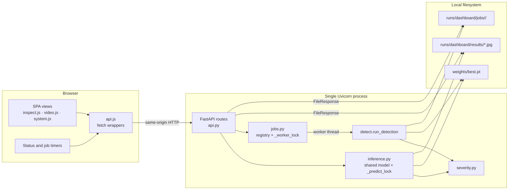
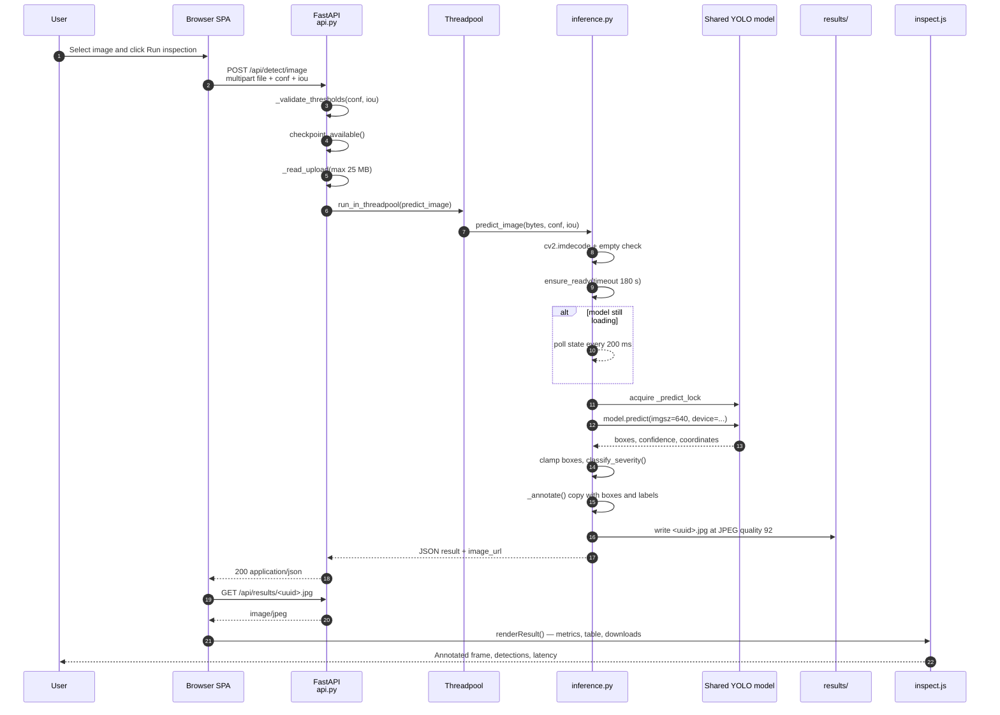
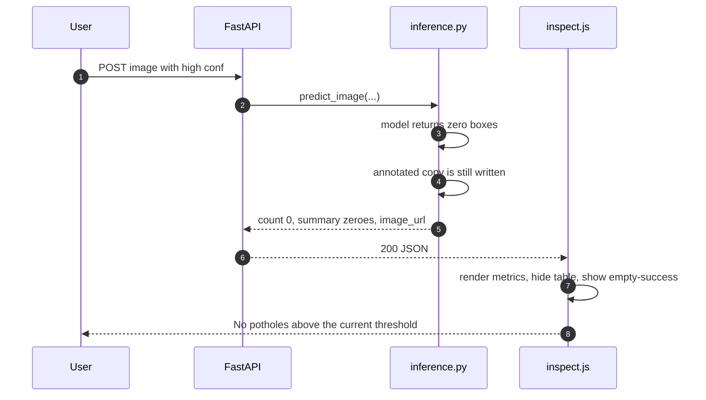
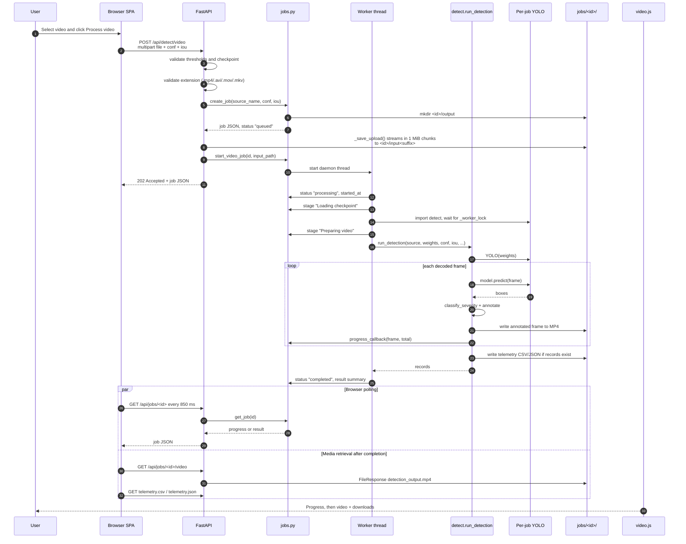
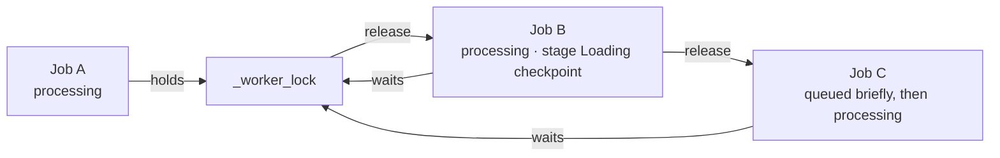
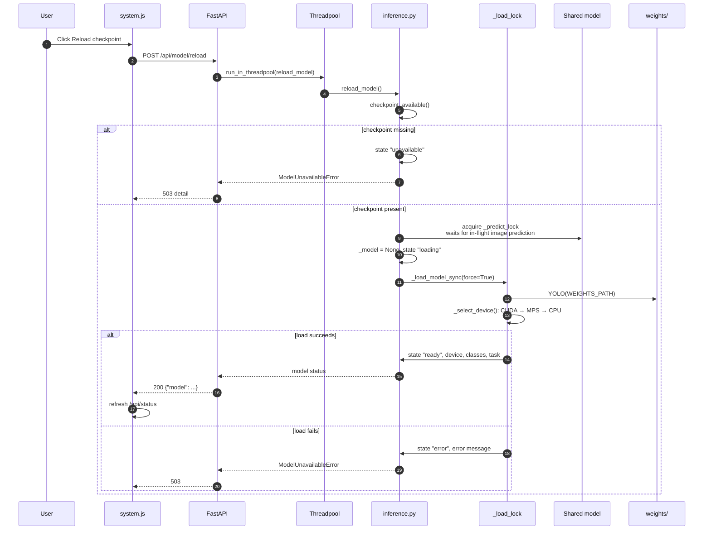
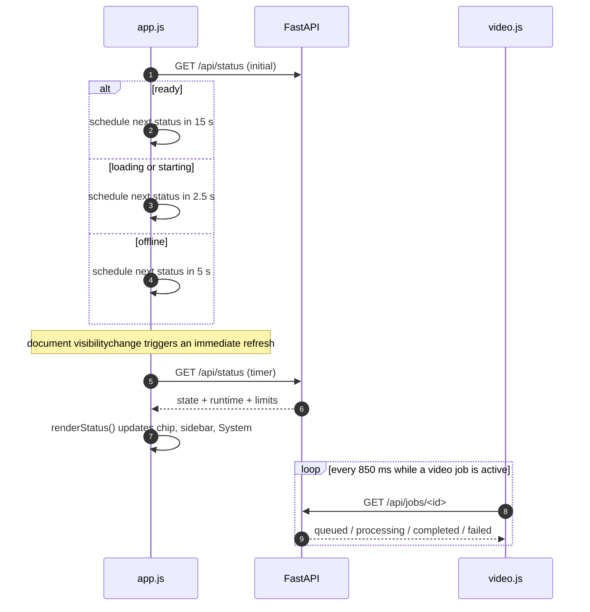
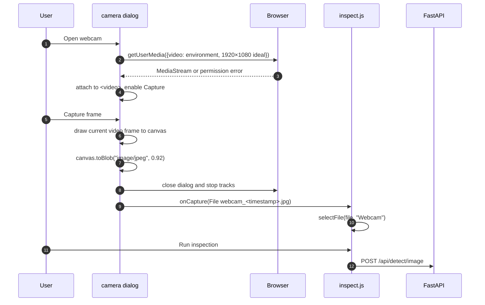
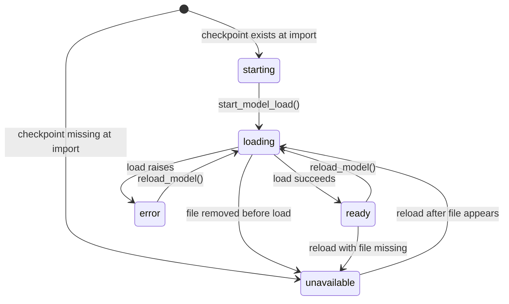
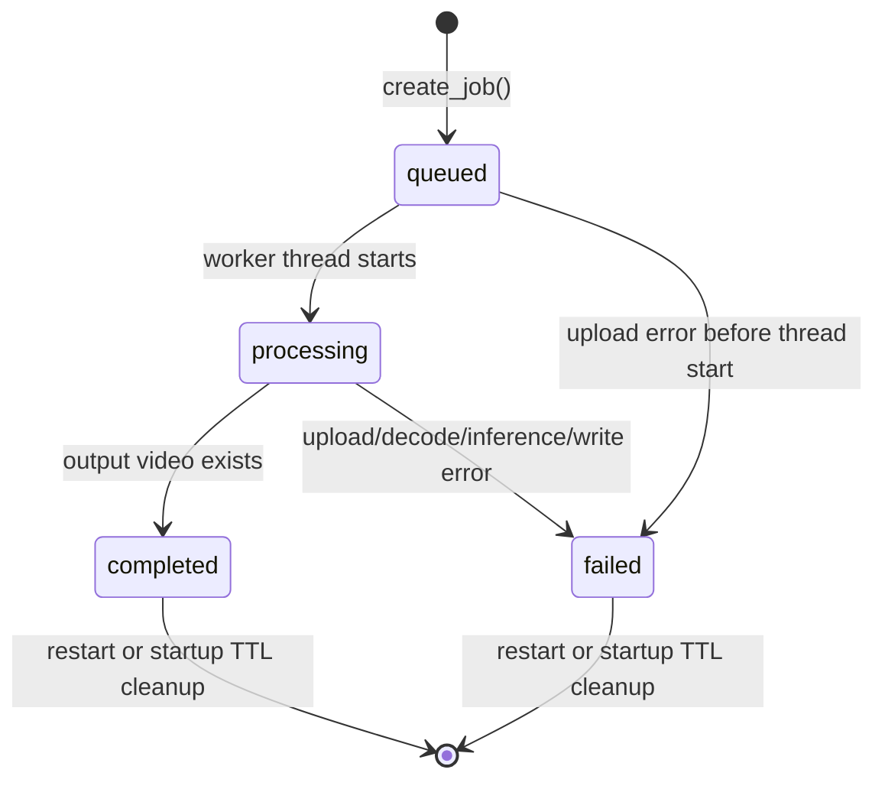

# Component interactions

This page follows the important runtime conversations between the browser, FastAPI, the inference service, the video job manager and the filesystem. Each diagram is derived from the current source and names the function that performs the work. It is a behaviour map, not a claim that every path was exercised on every platform.

- [Interaction map](#interaction-map)
- [Image request — successful inspection](#image-request--successful-inspection)
- [Image request — no detections](#image-request--no-detections)
- [Video job — upload, queue and completion](#video-job--upload-queue-and-completion)
- [Why video jobs appear to start immediately](#why-video-jobs-appear-to-start-immediately)
- [Model reload](#model-reload)
- [Missing checkpoint at startup](#missing-checkpoint-at-startup)
- [Checkpoint that exists but fails to load](#checkpoint-that-exists-but-fails-to-load)
- [Status polling and UI synchronisation](#status-polling-and-ui-synchronisation)
- [Browser webcam capture](#browser-webcam-capture)
- [Interaction contracts](#interaction-contracts)
- [Timing, blocking and concurrency](#timing-blocking-and-concurrency)
- [Related pages](#related-pages)

## Interaction map



The two inference paths deliberately do not share a model object:

| Path | Model instance | Serialised by | Runs in |
|---|---|---|---|
| Image | One long-lived `YOLO` object in `infrascan/inference.py` | `_predict_lock` | Starlette threadpool worker |
| Video | A new `YOLO` object created inside `detect.run_detection()` for each job | `_worker_lock` | One daemon thread per job, frame loop serialised |

This is the central interaction fact of the system. It explains why an image request can still be answered while a video is processing, why two checkpoints can be resident in memory, and why accelerator contention between the two paths is not controlled by a single global lock. Memory use under combined load is **not measured** (`[TO BE CONFIRMED]`).

## Image request — successful inspection



Points that are easy to miss:

- Upload bytes are read fully into memory for images. Unlike video, the original image is **not** written to disk; only the annotated JPEG is persisted.
- `inference_ms` is captured around the prediction section, after decode and after `ensure_ready()`. It includes waiting for `_predict_lock` and the Ultralytics call, but excludes upload, decode, annotation, JPEG encoding, disk write and HTTP transfer. See [Performance](../11-security-and-quality/performance.md).
- Box coordinates are clamped to the decoded frame bounds before severity is calculated. Severity uses the clamped box area over the full frame area.
- The result filename is a fresh UUID; the client filename is echoed in the JSON as `filename` but is not used to build the output path.
- If an accelerator prediction raises, the dashboard retries the same model on CPU and permanently records `_device = "cpu"` for subsequent status reads. The retry is visible in the server log, not in the API response.

The browser's `inspect.js` will only enable **Run inspection** when `state.apiOnline` is true and `state.status.model.state === "ready"`. A direct API client does not have that guard; it relies on the server's `503` response while the model is unavailable.

## Image request — no detections

A valid image with no boxes above the threshold is a successful request, not an error:



The annotated image is still available, and the UI tells the user to lower confidence or choose another frame. The original image is not returned by the API; "Original" view in the browser uses the local object URL or the dataset sample URL.

## Video job — upload, queue and completion

Video processing is asynchronous because a clip can take much longer than a normal HTTP request.



Important details:

- The `202` is returned only after the complete upload has been saved. A 2 GB upload therefore occupies the request for the duration of the transfer; there is no resumable upload or chunked job creation.
- The extension check happens **before** the file is saved. The bytes are not sniffed, and FFmpeg/OpenCV is the first component to judge whether the container is really a video.
- `source_name` is the client-provided filename and is stored verbatim in the job JSON. It is displayed with `textContent` in `video.js`; it is not used to construct the input path.
- The input file is stored as `input` plus the lower-cased extension, for example `input.mp4`. The output directory is created before the upload starts.
- If the upload exceeds 2 GB, `_save_upload` unlinks the partial file and the route marks the job `failed` before returning `413`. The job record remains in memory until restart/cleanup.
- On completion, the worker insists that `output/detection_output.mp4` exists and is non-empty. If not, the job fails with an actionable message.
- Telemetry URLs are `null` when no records were produced (for example, a clip with no detections). The UI disables the corresponding download links rather than linking to a missing file.
- There is no cancel endpoint. Closing the tab does not stop the worker; the daemon thread continues while the server process lives. The page warns the user to keep the tab open for progress, but processing itself is server-side.

## Why video jobs appear to start immediately

Every accepted upload gets its own thread. The expensive frame loop is serialised by `_worker_lock`, but the thread marks its job `processing` and sets the stage to `Loading checkpoint` before it reaches that lock. A second job can therefore display "Processing" while it is actually waiting for the first job to release the worker lock. The UI has no queue-position field.



Consequences:

- The progress bar can sit at zero for a long time with a stage that does not mention queueing.
- `started_at` records when the worker began, not when the frame loop began.
- `processing_seconds` is measured from the start of `run_video_job`, so it includes waiting for `_worker_lock`. `throughput_fps` uses the processed frame count over that elapsed time and can therefore understate true frame-loop throughput when jobs are queued.
- Job order is not guaranteed beyond thread scheduling; the lock is not a FIFO queue.

## Model reload



Reload semantics:

- It does **not** re-read `INFRASCAN_WEIGHTS`; the path was resolved when `config` was imported. To change checkpoints, restart the process with the desired path.
- It acquires `_predict_lock`, so it waits for an image prediction already inside the shared model. It does **not** wait for video jobs, which use their own model instances.
- The request stays open until loading finishes or fails. There is no `202`/job-style progress for reload; the UI relies on the button's busy state and the normal status poll.
- If the new checkpoint fails to load, the previous model object has already been set to `None`. The process does not roll back to the old model; the state remains `error` until a successful reload or restart.
- Reload is a control-plane operation with no authentication. Any local caller that can reach the port can trigger it.

## Missing checkpoint at startup

The checkpoint is not bundled with the repository. A missing file is an expected, supported state: the dashboard still loads and explains what is needed.

```mermaid
sequenceDiagram
    autonumber
    participant U as User
    participant L as run_app.py
    participant A as api.lifespan
    participant C as config
    participant I as inference
    participant SPA as Browser SPA
    participant API as FastAPI

    L->>A: start Uvicorn
    A->>C: ensure_directories()
    A->>I: purge_old_artifacts()
    A->>A: jobs.cleanup_old_jobs()
    A->>I: start_model_load()
    I->>C: checkpoint_available() → false
    I->>I: state "unavailable" + instructions
    Note over I: no loader thread is started
    A-->>L: yield; server accepts requests
    SPA->>API: GET /api/status
    API-->>SPA: model.state "unavailable", error, checkpoint.exists false
    SPA->>SPA: disable image/video run buttons; show System error panel
    U->>API: POST /api/detect/image
    API->>C: checkpoint_available() → false
    API-->>U: 503 with placement/reload instructions
    U->>API: POST /api/model/reload
    API->>I: reload_model()
    I-->>API: ModelUnavailableError
    API-->>U: 503
    Note over U: place weights/best.pt, then retry reload
```

`GET /api/health` still returns `{"status":"ok","model_state":"unavailable"}`. Liveness and readiness are intentionally separate. The UI's status chip and System page distinguish `unavailable` from `error`; both block inference.

The UI text tells the user to add `weights/best.pt` and reload in **System**. A restart also works, because the startup loader checks existence again.

## Checkpoint that exists but fails to load

```mermaid
sequenceDiagram
    autonumber
    participant A as api.lifespan
    participant I as inference loader thread
    participant M as Ultralytics / PyTorch
    participant API as FastAPI
    participant SPA as Browser SPA

    A->>I: start_model_load()
    I->>I: state "loading"
    I->>M: YOLO(weights)
    M--xI: exception (corrupt/incompatible/import failure)
    I->>I: state "error", error text
    SPA->>API: GET /api/status
    API-->>SPA: model.state "error", error text
    SPA->>SPA: show load error; run buttons disabled
    SPA->>API: POST /api/detect/image
    API->>API: checkpoint_available() → true
    API->>I: predict_image → ensure_ready()
    I-->>API: ModelUnavailableError(error)
    API-->>SPA: 503 with load error
```

The route's early checkpoint check only tests that the file exists and is non-empty. A corrupt file passes that check and fails later in `ensure_ready()`, which is why the API returns `503` rather than `400`. The System page exposes the loader's error string. See [Troubleshooting](../06-setup-and-execution/troubleshooting.md#checkpoint-load-failures).

## Status polling and UI synchronisation



The status poll is guarded by a `polling` flag and a queued-refresh flag, so a slow request does not create an unbounded pile of concurrent status requests. Job polling is a chained `setTimeout`, not `setInterval`; it stops on completion, failure or a network error. There is no exponential backoff and no `AbortController`, so a request that never settles can leave the UI waiting. See [Frontend architecture](frontend-architecture.md#polling-and-refresh-behaviour).

## Browser webcam capture

The webcam path is browser-only until the user captures a frame. No video stream is sent to the server.



The captured frame follows the ordinary image path. The browser requires a secure context for `getUserMedia`; `http://localhost` and `http://127.0.0.1` qualify, but a plain-HTTP LAN address generally does not. The dialog closes and stops tracks after capture, but there is a race if the user closes it before the permission promise resolves: the late-resolving stream is not stopped by `closeCamera()` because the module-level `stream` assignment happens after the close. This is documented as a known gap in [Security and privacy](../11-security-and-quality/security-and-privacy.md#sec-10--webcam-stream-race).

## Interaction contracts

### API outcomes the UI must handle

| Trigger | HTTP result | Typical UI response |
|---|---|---|
| Threshold outside range | `422` with a specific detail | Error toast/panel; run button re-enabled |
| Empty or undecodable image | `400` | "Inspection failed" panel with server detail |
| Image over 25 MB | `413` | Error toast |
| Missing checkpoint | `503` | Disable run; point to System |
| Loader still busy past 180 s | `503` | Error panel; retry after load |
| Video extension unsupported | `415` | Error toast |
| Video over 2 GB | `413` | Job marked failed; error toast |
| Unknown job ID | `404` | "Lost connection" / job cleaned up message |
| Output requested before completion | `409` | UI does not request outputs until `completed` |
| Output file missing | `404` | Download link unavailable |
| Unexpected exception | `500` generic detail | Error panel; server log has traceback |

### Model-state transitions



The API never moves a `ready` model back to `ready` without a reload; there is no watchdog that notices a deleted checkpoint until a route's presence check or a reload. Existing in-memory model objects are not garbage-collected deterministically when replaced.

### Video-job transitions



There is no `cancelled` state. A failed job keeps its directory and error message until cleanup. A completed job's input video also remains on disk for the same period.

## Timing, blocking and concurrency

| Operation | Blocking behaviour | Lock(s) held | What can proceed concurrently |
|---|---|---|---|
| Image prediction | Threadpool; HTTP request waits | `_predict_lock` during `model.predict` | Status requests, other threadpool work, video worker |
| Video upload | Async stream to disk; request waits for full upload | None | Status requests, image inference, other uploads |
| Video frame loop | Background thread | `_worker_lock` | Image inference, HTTP, other video threads waiting |
| Model reload | Threadpool; HTTP request waits for load | `_predict_lock`, then `_load_lock` | Video worker, status requests |
| Startup cleanup | Lifespan blocks before serving | None | Nothing until yield |
| Status poll | Threadpool/async route, fast | None | Everything else |

`_predict_lock` and `_worker_lock` are independent. Two image requests are serialised; two video frame loops are serialised; an image and a video can run at the same time and compete for the same accelerator. The project has not measured throughput or memory under that combined load. Do not present the architecture as a benchmark of parallel inference.

Blocking calls inside async routes are deliberately moved to a threadpool (`run_in_threadpool`) for image inference and reload. Upload reading is asynchronous, but decoding and inference are not. A very large image still consumes memory in the request body before decoding; the 25 MB cap is the only guard.

## Related pages

- [System architecture](system-architecture.md) — components, trust boundaries and startup.
- [Backend and API](backend-and-api.md) — route contracts, validation and error bodies.
- [Frontend architecture](frontend-architecture.md) — polling, state and UI guards.
- [Inference workflow](inference-workflow.md) — frame loop, severity, annotation and telemetry.
- [Data flow](data-flow.md) — what is written where and for how long.
- [Deployment and operations](deployment-and-operations.md) — running and observing the process.
- [Troubleshooting](../06-setup-and-execution/troubleshooting.md) — symptom-to-fix guide for each failure above.
