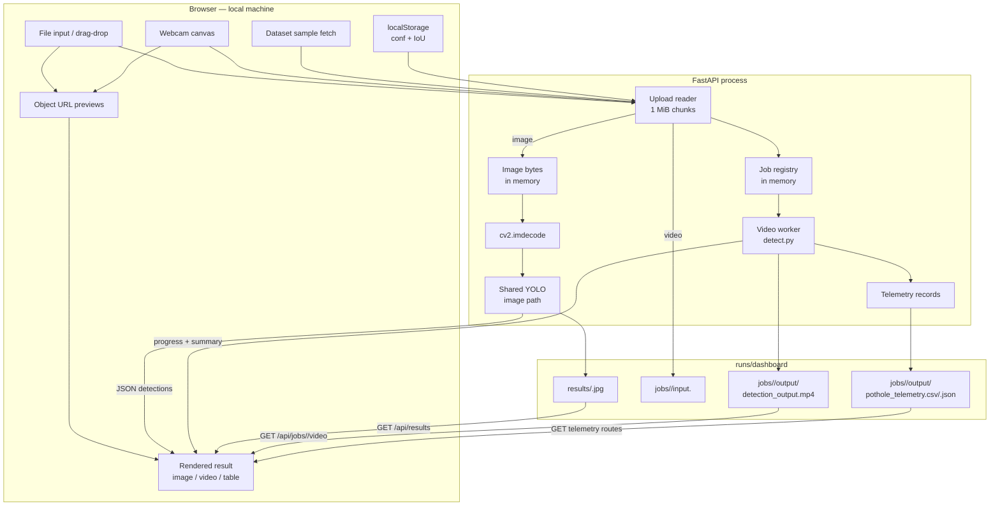
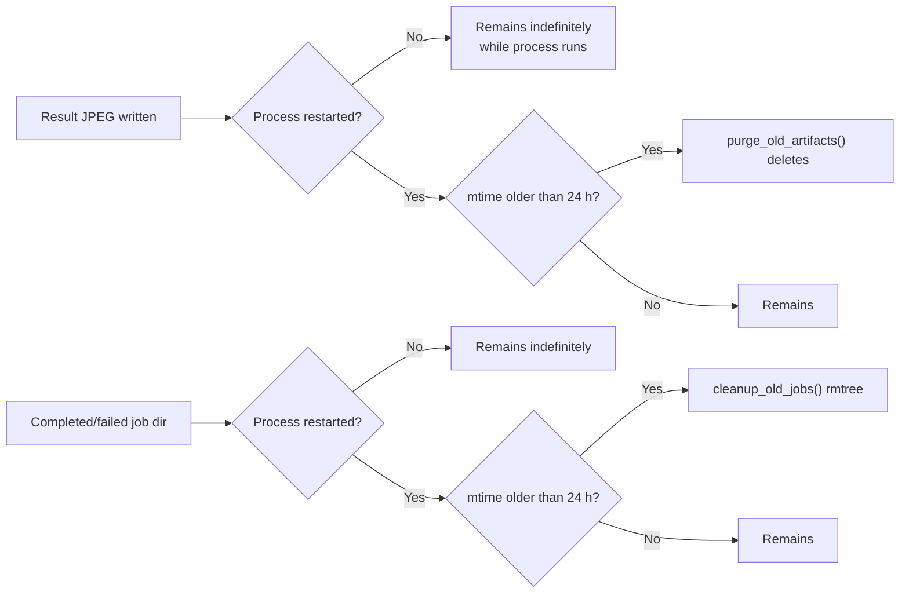

# Data flow

This page traces what InfraScan receives, where it goes, what it writes and how long it remains. It distinguishes data held only in memory from data persisted to disk, because that difference determines the privacy and cleanup behaviour of the application.

- [Data inventory](#data-inventory)
- [End-to-end flow](#end-to-end-flow)
- [Upload handling](#upload-handling)
- [Files written at runtime](#files-written-at-runtime)
- [Image response data](#image-response-data)
- [Video job data](#video-job-data)
- [Telemetry schemas](#telemetry-schemas)
- [Retention and deletion](#retention-and-deletion)
- [Browser-side data](#browser-side-data)
- [Privacy properties and limits](#privacy-properties-and-limits)
- [Disk sizing and failure behaviour](#disk-sizing-and-failure-behaviour)
- [Related pages](#related-pages)

## Data inventory

| Data | Where it originates | Stored by the app? | Location | Lifetime |
|---|---|---|---|---|
| Uploaded image bytes | Browser file input, dataset fetch or webcam canvas | No original file; decoded in memory | Process memory only | Request lifetime; annotated copy persists |
| Annotated image | `inference.predict_image()` | Yes | `runs/dashboard/results/<uuid>.jpg` | Until startup cleanup after 24 h |
| Uploaded video | Browser file input | Yes, byte-for-byte copy | `runs/dashboard/jobs/<id>/input.<ext>` | Until startup cleanup after 24 h |
| Annotated video | `detect.run_detection()` | Yes | `runs/dashboard/jobs/<id>/output/detection_output.mp4` | Same job directory |
| Video telemetry | `detect.run_detection()` | Yes, if at least one detection | `output/pothole_telemetry.csv` and `.json` | Same job directory |
| Job metadata and progress | `jobs.create_job()` / updates | In memory only | Python dict `_jobs` | Process lifetime (or startup cleanup of old records) |
| Image result JSON | `predict_image()` | No, except the JPEG | HTTP response | Not retained |
| Model state | Loader thread | In memory only | Module globals | Process lifetime |
| Threshold settings | Browser range inputs | Yes, browser localStorage | `infrascan.settings.v2` | Until cleared |
| Session counters | Browser memory | No | `state.session` | Tab lifetime |
| Uvicorn/application logs | Server process | Depends on terminal/redirect | stdout/stderr | Operator-controlled |
| Checkpoint | Operator-supplied file | Yes | `weights/best.pt` or `INFRASCAN_WEIGHTS` | Until operator removes it |
| Dataset samples | Operator-supplied dataset | Yes | `dataset/images/test` | Until operator removes it |

There is no database, object store, account system, analytics pipeline or remote logging in the application code. The only durable application state is the checkpoint, the optional dataset and the generated artefacts under `runs/dashboard/`.

## End-to-end flow



The important split is at the upload reader:

- **Images** are buffered in memory, decoded, annotated and written as a new JPEG. The original upload is discarded when the request ends.
- **Videos** are streamed to a per-job file first, then processed by a background worker. The original upload remains on disk alongside the output.

## Upload handling

### Image request

`POST /api/detect/image` accepts multipart form data:

| Field | Type | Required | Validation |
|---|---|---|---|
| `file` | file | Yes | Read up to 25 MB; no server-side extension check |
| `conf` | float | No; default `0.25` | `0.05 ≤ conf ≤ 1.0`, else `422` |
| `iou` | float | No; default `0.45` | `0.10 ≤ iou ≤ 1.0`, else `422` |

`_read_upload()` reads the file in 1 MiB chunks into a `bytearray`, closes the upload, and raises `413` as soon as the total exceeds `MAX_IMAGE_BYTES` (26,214,400 bytes). The comment in `config.py` and the UI call this 25 MB; the exact byte value is 25 × 1024 × 1024.

The server does **not** check the filename extension for images. The browser UI filters by extension and the file input has an `accept` list, but a direct API caller can send any filename. Decoding is the real gate: `cv2.imdecode()` must return an image or the route returns `400`. This means a valid image with an unusual or missing extension is accepted, while a file with `.jpg` that is not decodable is rejected. There is no MIME sniffing, malware scan or metadata sanitisation.

Once decoded:

- Width and height are read from the decoded array.
- The original file is not written anywhere.
- The annotated copy is written to `runs/dashboard/results/<32-hex>.jpg` with JPEG quality 92.
- If `cv2.imwrite()` returns false, the route raises a `RuntimeError`, which becomes a generic `500`.

### Video request

`POST /api/detect/video` accepts the same `conf`/`iou` fields plus a file. The route:

1. Validates thresholds and checkpoint presence.
2. Takes the client filename, lower-cases its suffix, and requires `.mp4`, `.avi`, `.mov` or `.mkv`; otherwise `415`.
3. Creates a job and directory before reading the body.
4. Streams the upload to `jobs/<id>/input<suffix>` in 1 MiB chunks, with a 2,147,483,648-byte cap (2 GiB).
5. On overflow or write failure, deletes the partial file, marks the job `failed`, and returns `413` or `500`.
6. Starts a daemon worker thread and returns the job JSON with `202`.

Only the suffix is validated at upload time. A file named `clip.mp4` that is not a valid container is accepted, saved, and later fails inside OpenCV/FFmpeg; the job status becomes `failed` with the decoder error. This is an important distinction from the image path, where a decode test happens before any output is promised.

## Files written at runtime

```text
runs/dashboard/                  # gitignored runtime root
├── results/
│   └── <32-hex-uuid>.jpg        # annotated image, JPEG quality 92
└── jobs/
    └── <32-hex-uuid>/
        ├── input.mp4            # original upload, suffix preserved
        └── output/
            ├── detection_output.mp4
            ├── pothole_telemetry.csv
            └── pothole_telemetry.json
```

| Path | Producer | Content | Notes |
|---|---|---|---|
| `results/<uuid>.jpg` | `inference._annotate` + `cv2.imwrite` | Decoded frame with severity-coloured boxes and labels | Served at `/api/results/<uuid>.jpg` |
| `jobs/<id>/input.<ext>` | `_save_upload` | Exact uploaded bytes | Retained after completion; not deleted on success |
| `jobs/<id>/output/detection_output.mp4` | OpenCV `VideoWriter` | Annotated frames, no audio track | Codec `avc1` if available, else `mp4v` |
| `jobs/<id>/output/pothole_telemetry.csv` | pandas | One row per frame-level detection | Written only when records exist |
| `jobs/<id>/output/pothole_telemetry.json` | `json.dump` | Same records as a JSON array | Written only when records exist |

The directory is created under the repository root, not under the user's home or a temp directory. `config.PROJECT_ROOT` is the parent of the `infrascan/` package, so the location is stable regardless of the shell's working directory (the launcher also `chdir`s there). The directory must be writable by the process; otherwise startup directory creation, result writes or job writes fail.

`runs/dashboard` is excluded by `.gitignore` through the `runs/` pattern in the main repository. It is not part of the documentation repository.

### Output naming and path safety

- Result files are named with `uuid.uuid4().hex`, so the client cannot choose a path.
- The result route rejects any name whose `Path(name).name` differs from the input and requires a `.jpg` suffix.
- Job IDs are UUID hex strings generated server-side. Output routes first look the ID up in the in-memory registry and only then join fixed filenames (`detection_output.mp4`, `pothole_telemetry.csv`, `pothole_telemetry.json`).
- Video input uses only the validated suffix, never the client basename.
- The original client filename is stored in `source_name` and returned in JSON. It is not used as a filesystem path.

## Image response data

The image response contains everything the result panel needs except the original frame, which remains in the browser.

| Field | Type | Meaning |
|---|---|---|
| `id` | string | 32-hex result identifier; also the JPEG stem |
| `image_url` | string | `/api/results/<id>.jpg` |
| `filename` | string | Client filename echoed back; defaults to `capture.jpg` |
| `width`, `height` | integer | Decoded frame dimensions in pixels |
| `detections[]` | array | One object per box above threshold |
| `detections[].id` | integer | 1-based display index |
| `detections[].confidence` | float | Rounded to 4 decimals |
| `detections[].severity` | string | `CRITICAL`, `MODERATE` or `MINOR` |
| `detections[].coverage_pct` | float | Box area ÷ frame area × 100, rounded to 2 decimals |
| `detections[].bbox` | integer[4] | `[x1, y1, x2, y2]`, clamped to frame bounds |
| `summary.count` | integer | Number of detections |
| `summary.critical`, `moderate`, `minor` | integer | Counts by band |
| `summary.max_coverage_pct` | float | Largest single-box coverage |
| `summary.total_coverage_pct` | float | Sum of box coverages (can exceed 100% with overlapping boxes) |
| `inference_ms` | float | Model-call timing, one decimal; not total request time |
| `conf`, `iou` | float | Thresholds used |
| `imgsz` | integer | `640` |
| `created_at` | string | UTC ISO-8601 timestamp with seconds precision |

`_colour` is deliberately removed before serialisation, so internal OpenCV BGR tuples never appear in the response.

A shape-only example is shown below. The numbers illustrate the schema; they are not a new benchmark:

```json
{
  "id": "0f5c0d9a6f2e4e0c9d0a7f3b1c2d4e6a",
  "image_url": "/api/results/0f5c0d9a6f2e4e0c9d0a7f3b1c2d4e6a.jpg",
  "filename": "road-frame.jpg",
  "width": 1920,
  "height": 1080,
  "detections": [
    {
      "id": 1,
      "confidence": 0.8123,
      "severity": "MODERATE",
      "coverage_pct": 7.0,
      "bbox": [812, 604, 1104, 842]
    }
  ],
  "summary": {
    "count": 1,
    "critical": 0,
    "moderate": 1,
    "minor": 0,
    "max_coverage_pct": 7.0,
    "total_coverage_pct": 7.0
  },
  "inference_ms": 66.2,
  "conf": 0.25,
  "iou": 0.45,
  "imgsz": 640,
  "created_at": "2026-10-22T12:00:00+00:00"
}
```

The recorded functional check produced one MODERATE detection at 7.0% coverage and `inference_ms` 66.2. Those values are evidence for that run only; see [`PROJECT_FACTS.md`](../PROJECT_FACTS.md).

## Video job data

The job object is created before the upload is saved and mutated in place under `_jobs_lock`.

| Field | Type | Meaning |
|---|---|---|
| `id` | string | 32-hex job identifier |
| `status` | string | `queued`, `processing`, `completed` or `failed` |
| `source_name` | string | Client filename, verbatim |
| `conf`, `iou` | float | Thresholds captured at creation |
| `created_at` | string | UTC ISO-8601 |
| `started_at` | string or null | Set when the worker thread begins |
| `completed_at` | string or null | Set on success or failure |
| `error` | string or null | Human-readable failure detail |
| `progress.stage` | string | `Queued`, `Loading checkpoint`, `Preparing video`, `Analysing frames`, `Complete` or `Failed` |
| `progress.frame` | integer | Last processed frame |
| `progress.total_frames` | integer | Container-reported total; may be 0 or inaccurate |
| `progress.fraction` | float | `frame / total`, capped at 1.0; 0 when total is unknown |
| `result` | object or null | Present only on success |

The success `result` contains:

| Field | Meaning |
|---|---|
| `video_url` | `/api/jobs/<id>/video` |
| `video_size_bytes` | Size of the annotated MP4 |
| `telemetry_csv_url` | URL or `null` when no records |
| `telemetry_json_url` | URL or `null` when no records |
| `summary.frames_processed` | Frames reported by the frame loop |
| `summary.detections_total` | Frame-level detection records |
| `summary.critical`, `moderate`, `minor` | Counts by severity |
| `summary.max_coverage_pct` | Largest coverage in any record |
| `summary.processing_seconds` | Wall time including wait for the worker lock |
| `summary.throughput_fps` | `frames_processed / processing_seconds` or `null` |

Counts are **frame-level detections**, not unique potholes. The same physical pothole visible across twenty frames contributes twenty records. There is no tracking or deduplication.

## Telemetry schemas

### Video CSV and JSON

`detect.py` builds one record per detection per frame:

| Column | Type | Example meaning |
|---|---|---|
| `frame` | integer | 1-based frame number |
| `box` | array | `[x1, y1, x2, y2]` in source-frame pixels |
| `confidence` | float | Rounded to 4 decimals |
| `severity` | string | Shared severity band |
| `coverage_pct` | float | Box area ÷ frame area × 100, rounded to 2 decimals |

The CSV is written with pandas (`index=False`); the JSON is a pretty-printed array of the same dictionaries. There is no timestamp, GPS coordinate, frame time, source filename, model version or severity-policy version in the record. If the clip has no detections, neither file is written.

### Image CSV

The dashboard's image CSV is generated in the browser by `detectionsToCsv()`, not by the server. Its columns are:

| Column | Content |
|---|---|
| `image` | Selected filename |
| `box` | JSON-encoded bounding box |
| `confidence` | Detection confidence |
| `severity` | Severity band |
| `coverage_pct` | Coverage percentage |

This file is not stored on the server. It is a Blob download created from the last response. The CLI `detect.py` image mode writes a different CSV with an `image` column derived from each file and the same box/confidence/severity/coverage fields, under the chosen `--output` directory.

## Retention and deletion



The 24-hour TTL is **not** a live expiry timer. Cleanup runs only during the lifespan startup:

- `inference.purge_old_artifacts()` scans `results/*.jpg` and deletes files whose modification time is older than `RESULT_TTL_SECONDS` (86,400 s).
- `jobs.cleanup_old_jobs()` considers completed/failed in-memory jobs plus every directory under `jobs/`; it deletes a directory when its mtime is older than `JOB_TTL_SECONDS` and the job is not queued/processing.
- A queued or processing job is skipped even if its directory is old.
- The in-memory job record is removed only when its directory is deleted by this startup cleanup. Records for jobs whose directories are gone can remain until restart.
- There is no periodic cleanup task, no UI delete action and no shutdown cleanup.

Consequences for a long-running demo:

- Artefacts can persist for days if the process is never restarted, even though the documentation calls them 24-hour artefacts.
- Restarting the process is the reliable way to trigger expiry.
- Uploaded videos remain on disk after completion, including the original file. Deleting a job requires deleting its directory manually or letting cleanup run.
- Deletion uses ordinary filesystem unlink/`rmtree`; it is not secure erasure. Copies may remain in backups, snapshots or filesystem free space.

To clear runtime data deliberately:

```bash
# Stop the server first.
rm -rf runs/dashboard/results runs/dashboard/jobs
# Directories are recreated at the next startup.
```

This is destructive and should only be done for artefacts you no longer need.

## Browser-side data

| Item | Storage | Lifetime | Notes |
|---|---|---|---|
| `infrascan.settings.v2` | `localStorage` | Persistent until cleared | `{conf, iou}`; clamped on read |
| Selected image/video | JS state + object URL | Tab lifetime / until cleared | Object URLs revoked on clear/unload |
| Last image result | JS state | Tab lifetime | Holds JSON and image URL |
| Current video job | JS state | Tab lifetime | Polling stops on completion/failure |
| Session scan/video counts | JS state | Tab lifetime | Not persisted |
| Palette/lightbox/camera state | DOM/dialog state | Until closed | Native `<dialog>` |

The browser does not store uploaded files in IndexedDB, Cache Storage or the service worker cache. There is no service worker. Refreshing the page loses the selected file and the in-memory result; the annotated image may still exist on the server and remains fetchable if its URL is known, but the SPA does not restore it.

## Privacy properties and limits

What the code supports:

- **Local processing by default.** The server binds `127.0.0.1` unless the operator changes `--host`. Inference runs in the local Python process. There is no upload to a cloud API in the application code.
- **No accounts or profiles.** No names, email addresses or user identifiers are collected.
- **No analytics or telemetry beacons.** The SPA does not send usage events. Its only network calls are the local API and explicit external links opened by the user.
- **No database.** Artefacts are ordinary files under the repository.
- **Generated filenames are opaque UUIDs.** The original filename appears in JSON and in downloaded filenames, not in result paths.

What the code does **not** provide:

- **Encryption at rest.** Results, job inputs and outputs are plain files protected only by operating-system permissions.
- **Access control.** Anyone or any process that can reach the port can list samples, run inference, fetch results, create jobs and reload the model. On loopback this is normally the local user and local processes.
- **Metadata stripping guarantee.** The annotated image is re-encoded from decoded pixels, so ordinary EXIF is unlikely to survive, but this has not been tested across formats. The uploaded video is copied byte-for-byte into the job directory, so any container metadata (including location metadata, if present) remains in the input file. The annotated MP4 is written by OpenCV and contains no audio; its metadata handling is not audited.
- **Filename privacy.** `source_name`, CSV `image` values and download names can contain personal or location-revealing text chosen by the user.
- **Secure deletion.** Removing a file does not guarantee it is unrecoverable.
- **Network isolation verification.** Binding to loopback is the control; the project has not tested firewall rules, DNS rebinding or a hostile local process.
- **Third-party egress guarantee.** The application code makes no remote inference calls, but Python packages and browser extensions can have their own network behaviour. This was not audited.

If the application is bound to `0.0.0.0` or placed behind a proxy, the privacy model changes from "local files" to "anyone who can reach the port". There is no authentication or TLS to compensate. See [Security and privacy](../11-security-and-quality/security-and-privacy.md#deployment-and-exposure).

### Dataset and checkpoint data

The sample picker exposes files from `dataset/images/test` by name. The API lists up to 24 and serves any matching image in that directory, without authentication. If the dataset contains sensitive or licensed imagery, exposing the port exposes those images too. The checkpoint is loaded from a local path; its provenance and redistribution rights are unresolved and are documented separately in [Dataset provenance](../05-dataset-and-model/dataset-provenance.md) and [Licensing and attribution](../05-dataset-and-model/licensing-and-attribution.md).

## Disk sizing and failure behaviour

| Situation | Effect |
|---|---|
| Annotated JPEG larger than source | Possible, especially for small PNG/BMP inputs; output has no size cap |
| Many image inspections | One JPEG per request accumulates; no quota or count limit besides TTL |
| Many video jobs | Each retains input + output + telemetry; a 2 GB input can coexist with a similarly large output |
| Disk full during JPEG write | `cv2.imwrite` fails → `RuntimeError` → `500`; partial file may remain |
| Disk full during video write | Worker catches the exception → job `failed`; partial output may remain |
| Job directory removed externally | Completed job routes return `404`; registry still lists the job until restart |
| Server restarted mid-job | Worker thread dies; job record disappears; input/output files remain until cleanup |

The application performs no free-space check and exposes no storage metrics. For a demonstration, keep clips short and clear `runs/dashboard` between runs if disk space is constrained. The 2 GB upload limit is a request cap, not a promise that the machine can process a file of that size.

## Related pages

- [System architecture](system-architecture.md) — process, trust boundaries and startup cleanup.
- [Backend and API](backend-and-api.md) — exact request/response contracts.
- [Inference workflow](inference-workflow.md) — how detections and telemetry are produced.
- [Component interactions](component-interactions.md) — sequence diagrams for the same flows.
- [Deployment and operations](deployment-and-operations.md) — backup, cleanup and operational guidance.
- [Security and privacy](../11-security-and-quality/security-and-privacy.md) — threat model and residual risks.
- [Configuration](../06-setup-and-execution/configuration.md) — paths, limits and TTL values.
