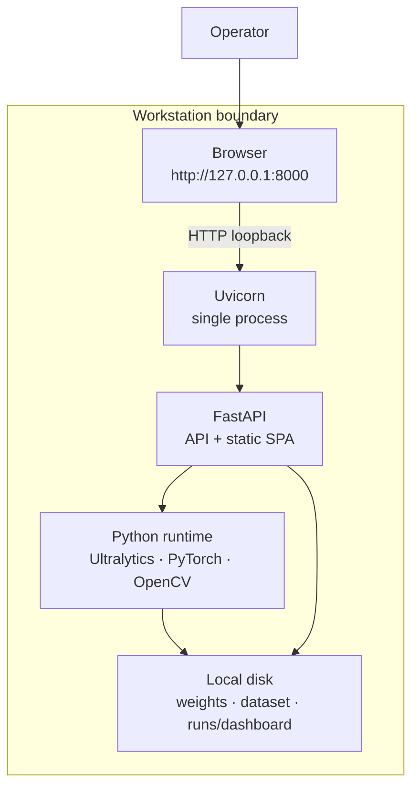

# Deployment and operations

InfraScan is deployed as a **single-user local workstation application**: one Python process, one Uvicorn listener, one browser tab, one local filesystem. This page describes that supported deployment, how to operate it, and which production concerns are deliberately out of scope. It does not describe a cloud service, container platform or multi-user installation, because none is shipped.

- [Supported deployment](#supported-deployment)
- [Tested and untested environments](#tested-and-untested-environments)
- [Topology and ports](#topology-and-ports)
- [Launch commands](#launch-commands)
- [Configuration sources](#configuration-sources)
- [Startup and shutdown sequence](#startup-and-shutdown-sequence)
- [Health checks and readiness](#health-checks-and-readiness)
- [Logs and observation](#logs-and-observation)
- [Runtime directory operations](#runtime-directory-operations)
- [Backup and restore](#backup-and-restore)
- [Upgrades](#upgrades)
- [Reverse proxy and TLS](#reverse-proxy-and-tls)
- [Platform notes](#platform-notes)
- [Resource expectations](#resource-expectations)
- [Operational runbook](#operational-runbook)
- [Non-goals and production gaps](#non-goals-and-production-gaps)
- [Related pages](#related-pages)

## Supported deployment

| Property | Supported value |
|---|---|
| Host model | One workstation; server and browser on the same machine |
| Processes | One `run_app.py` / Uvicorn process (plus the optional reload parent in development) |
| Listener | `127.0.0.1:8000` by default |
| Frontend | Served by the same FastAPI process; no Node or separate web server |
| State | In-memory model/jobs plus files under `runs/dashboard/` |
| Database | None |
| Authentication | None |
| TLS | Not provided by the app |
| Checkpoint | Operator-supplied `weights/best.pt` or `INFRASCAN_WEIGHTS` |
| Dataset samples | Optional `dataset/images/test` |
| Internet required at runtime | No remote API is used by the application; model and frontend assets are local |



This is the topology the source is designed for. A reverse proxy or remote browser can be added, but it changes the trust model and is not a tested configuration.

## Tested and untested environments

The verified environment is recorded in [`PROJECT_FACTS.md`](../PROJECT_FACTS.md):

| Component | Verified value |
|---|---|
| Machine | Apple M2 (arm64) |
| OS | macOS 27.0.1 (Darwin 27.0.1) |
| Python | 3.12.14 |
| PyTorch | 2.14.1 |
| Ultralytics | 8.4.183 |
| OpenCV | 5.0.0.93 |
| FastAPI | 0.156.8 |
| Uvicorn | 0.54.0 |
| Inference device | MPS (Apple GPU) |
| Dashboard checks | Chrome |

Everything else is an expectation, not a verified support statement:

| Environment | Status |
|---|---|
| Linux with CPU | Expected to work; `[TO BE CONFIRMED]` |
| Windows with CPU | Expected to work; `[TO BE CONFIRMED]`; `test_camera.py` includes a DirectShow fallback and `train.py` sets `workers=0` on Windows |
| NVIDIA CUDA | Code path exists (`cuda:0` is selected first); **BLOCKED** — not executed on the development machine |
| Other Apple Silicon models | Expected to work via MPS; not individually tested |
| Docker / Kubernetes | No Dockerfile, Compose file or manifests in the repository |
| CI/CD | No workflow files in the repository |
| systemd / launchd service | No unit files shipped; operator must create one if needed |
| Reverse proxy / TLS | Not shipped or tested |
| Multi-user concurrent use | Not designed, authorised or tested |

Do not describe this application as "production-ready", "cloud-deployed", "containerised" or "CUDA-accelerated" on the basis of the source alone. The repository contains no such deployment artefacts.

## Topology and ports

| Port | Protocol | Purpose | Exposure |
|---|---|---|---|
| `8000` (default) | HTTP | SPA, API, media and telemetry | Loopback only by default |

- `--host 127.0.0.1` is the safe default. Only the local machine can connect.
- `--host 0.0.0.0` listens on every interface. Combined with no authentication and no TLS, this exposes upload, inference, results, samples and model reload to anyone who can reach the host. Do not use it on an untrusted network.
- `--port` accepts any valid TCP port. If the chosen port is busy, Uvicorn exits with an address-in-use error; choose another port with `--port 8001`.
- There is no WebSocket, gRPC or message broker. All communication is HTTP/1.1 request-response.
- The SPA and API must share an origin. There is no CORS middleware and no configurable API base URL. Do not split the frontend onto a separate dev server and expect API calls to work.

## Launch commands

### Recommended launcher

```bash
cd InfraScan
source .venv/bin/activate          # Windows: .venv\Scripts\activate
python run_app.py
```

`run_app.py`:

1. Parses `--host`, `--port`, `--weights`, `--no-browser` and `--reload`.
2. Changes the working directory to the project root.
3. Optionally sets `INFRASCAN_WEIGHTS` from `--weights`.
4. Starts Uvicorn with `app:app`, log level `info`.
5. Opens `http://localhost:<port>` after 1.5 seconds unless `--no-browser` is set.

| Flag | Default | Effect |
|---|---|---|
| `--host` | `127.0.0.1` | Bind interface |
| `--port` | `8000` | Bind port |
| `--weights` | `None` | Sets `INFRASCAN_WEIGHTS` for the launched process; see the caveat below |
| `--no-browser` | off | Suppresses the browser launch |
| `--reload` | off | Enables Uvicorn auto-reload for development |

Examples:

```bash
# Default local launch
python run_app.py

# Another port, no browser
python run_app.py --port 8001 --no-browser

# Development reload
python run_app.py --reload
```

> **`--weights` caveat (source-level):** `run_app.py` imports `infrascan.config` at module import time to obtain `PROJECT_ROOT`. `config` resolves `WEIGHTS_PATH` immediately, before `main()` parses arguments and sets `INFRASCAN_WEIGHTS`. In a normal (non-reload) launch, the already-imported config module is reused when Uvicorn imports `app:app`, so `--weights` may not change the path. The reliable methods are:
>
> 1. place the checkpoint at `weights/best.pt`, or
> 2. export `INFRASCAN_WEIGHTS` in the shell **before** starting Python, or
> 3. use `--reload`, where the reload child re-imports the configuration with the environment already set.
>
> This is a launcher-ordering issue, not a browser-verified test result. See [Configuration](../06-setup-and-execution/configuration.md#checkpoint-path).

### Direct Uvicorn

```bash
# From the project root, with the virtual environment active
uvicorn app:app --host 127.0.0.1 --port 8000
```

This bypasses the browser-opening banner but uses the same ASGI application. Environment variables must be set in the shell before Uvicorn starts.

### Module entrypoint

```bash
python app.py
```

`app.py` imports `app` from `infrascan.api`; when executed directly it delegates to `run_app.main()`. It is not a separate server implementation.

## Configuration sources

There are three layers, in order of precedence:

| Layer | Examples | When it is read | Persistence |
|---|---|---|---|
| Environment | `INFRASCAN_WEIGHTS` | At `infrascan.config` import | Shell/process |
| Code defaults | Port, thresholds, limits, TTLs, paths | At import | Source-controlled |
| Browser settings | `conf`, `iou` | On page load and slider input | `localStorage` |

The only environment variable read by the application is `INFRASCAN_WEIGHTS`. Host and port are Uvicorn/launcher arguments, not environment variables. There is no `.env` loader; a `.env` file is ignored by Git but is not read automatically.

Browser settings affect only the next image or video request. They do not change server defaults or the `/api/status` values. Reset uses the **Reset** button in the sidebar or the command palette.

Full details are in [Configuration](../06-setup-and-execution/configuration.md).

## Startup and shutdown sequence

```mermaid
sequenceDiagram
    autonumber
    participant O as Operator
    participant L as run_app.py
    participant U as Uvicorn
    participant A as FastAPI lifespan
    participant I as inference
    participant J as jobs
    participant F as filesystem

    O->>L: python run_app.py
    L->>L: parse flags, chdir(PROJECT_ROOT)
    L->>U: uvicorn.run("app:app")
    U->>A: import + lifespan startup
    A->>F: ensure results/ and jobs/
    A->>F: purge result JPEGs older than 24 h
    A->>F: remove finished job dirs older than 24 h
    A->>I: start_model_load()
    I-->>I: background daemon thread
    A-->>U: yield; ready to serve
    U-->>O: dashboard URL + API docs URL
    O->>U: Ctrl+C
    U->>A: lifespan shutdown
    A-->>U: no explicit teardown
    Note over U,I: daemon loader/worker threads end with the process
```

Important properties:

- The server accepts requests before the model is ready. The SPA shows "Loading model" and disables inference.
- Startup cleanup is synchronous inside lifespan. A very large `runs/` tree can delay readiness.
- There is no graceful drain of running video jobs. `Ctrl+C` stops the process; workers are daemons and are not joined. A job in progress is lost, and its files remain until a later startup cleanup.
- Model loading is daemonised. If the process exits during a load, the load is abandoned.
- There is no explicit close of the model, OpenCV writers or thread pools. The operating system reclaims resources on exit.

## Health checks and readiness

| Check | Command | Interpretation |
|---|---|---|
| Process alive | `curl -s -o /dev/null -w "%{http_code}\n" http://127.0.0.1:8000/api/health` | `200` means the HTTP server is answering |
| Liveness body | `curl -s http://127.0.0.1:8000/api/health` | `{"status":"ok","model_state":"..."}` |
| Readiness | `curl -s http://127.0.0.1:8000/api/status` | Inspect `model.state`; only `ready` can infer |
| SPA reachable | `curl -s -o /dev/null -w "%{http_code}\n" http://127.0.0.1:8000/` | `200` |
| API schema | `curl -s http://127.0.0.1:8000/api/openapi.json` | Machine-readable schema |

`/api/health` is **liveness plus model state**, not a readiness gate. It returns `status: "ok"` even when the model is unavailable, loading or in error. A script that treats HTTP 200 alone as "ready to infer" is wrong; check `model_state` or `/api/status` → `model.state`.

```bash
# Readiness one-liner
curl -s http://127.0.0.1:8000/api/status \
  | python -c "import json,sys; d=json.load(sys.stdin); print(d['model']['state'])"
```

There is no dedicated `/readyz`, `/metrics` or version endpoint beyond `/api/status` (`app.version` is `2.0.0`).

## Logs and observation

Logging is standard Python logging plus Uvicorn's access/error logs, written to the terminal that launched the process.

| Logger | Examples of what it records |
|---|---|
| `uvicorn` | Startup, shutdown, access lines, reload events |
| `uvicorn.error` | Bind failures, unhandled server errors |
| `infrascan.api` | Startup log; unhandled exception path with traceback |
| `infrascan.inference` | Checkpoint load success/failure; accelerator fallback warning |
| `infrascan.jobs` | Job completion time and detection count; job failure traceback |

What is **not** logged by the application:

- Request bodies or file contents.
- Per-request structured access logs beyond Uvicorn's default line.
- Model inputs/outputs, confidence values or telemetry rows.
- Metrics, traces or dashboards.
- A persistent log file (unless the operator redirects stdout/stderr).

To keep a log for a demo:

```bash
python run_app.py --no-browser 2>&1 | tee infrascan-run.log
```

Treat that log as potentially sensitive: Uvicorn access lines include paths and client addresses, and tracebacks can include absolute filesystem paths. Do not commit logs.

There is no log rotation, retention policy or central aggregation. For a long-running demonstration, redirect to a file and manage it externally.

## Runtime directory operations

```text
runs/dashboard/
├── results/       # annotated image JPEGs
└── jobs/          # one directory per video job
```

| Task | Command / action | Notes |
|---|---|---|
| Inspect disk use | `du -sh runs/dashboard/*` | macOS/Linux; PowerShell equivalent on Windows |
| Count result images | `find runs/dashboard/results -name '*.jpg' | wc -l` | |
| List job directories | `find runs/dashboard/jobs -maxdepth 1 -mindepth 1 -type d` | |
| Force cleanup | Stop server; `rm -rf runs/dashboard/results runs/dashboard/jobs` | Destructive; recreates on next start |
| Preserve evidence | Copy the specific JPEG/MP4/CSV/JSON elsewhere before restart | Cleanup may delete old files |

Do not delete files while the server is running. A video worker may be writing an MP4, and a result may be mid-write. Stop the process first.

Permissions: the process needs read access to `web/`, the checkpoint and the optional dataset, and write access to `runs/dashboard/`. Running as a different OS user with a read-only checkout will fail at startup directory creation or at the first result write.

## Backup and restore

InfraScan has no authoritative database. What you may want to back up depends on the purpose:

| Data | Backup? | Reason |
|---|---|---|
| Source code | Yes, via Git | Reproducibility |
| `weights/best.pt` | Yes, if you are authorised to retain it | Not redistributed; expensive to recreate |
| `dataset/` | Only if authorised | Licence/provenance unresolved; large |
| `runs/dashboard/` | Only for specific evidence | Ephemeral artefacts; can contain sensitive imagery |
| `infrascan.settings.v2` | No | Two numeric settings; trivial to recreate |
| Environment details | Yes, in run notes | Python/package versions matter for reproducibility |
| Logs | Only for a specific investigation | May contain paths and client addresses |

Restore procedure:

1. Restore the source tree at the same commit or release.
2. Recreate the virtual environment and install `requirements.txt`.
3. Restore the checkpoint to `weights/best.pt` (or set `INFRASCAN_WEIGHTS`).
4. Optionally restore `dataset/images/test` for sample selection.
5. Restore only the specific result/job directories you need, preserving their names if URLs are referenced elsewhere.
6. Start the server and verify `/api/status` reaches `ready`.

There is no export/import command. Copying directories is the mechanism.

## Upgrades

```bash
# Stop the server.
source .venv/bin/activate
pip install --upgrade -r requirements.txt
python run_app.py
```

`requirements.txt` uses lower bounds, not exact pins:

```text
ultralytics>=8.3.0
torch>=2.0.0
torchvision>=0.15.0
opencv-python>=4.8.0
pillow>=9.5.0
numpy>=1.24.0
pandas>=2.0.0
matplotlib>=3.7.0
seaborn>=0.12.0
pyyaml>=6.0
tqdm>=4.65.0
fastapi>=0.115.0
uvicorn[standard]>=0.30.0
python-multipart>=0.0.9
```

An upgrade can change Ultralytics behaviour, OpenCV codec support, PyTorch device selection or FastAPI's docs assets. There is no lockfile, dependency audit or compatibility matrix. The verified versions in [`PROJECT_FACTS.md`](../PROJECT_FACTS.md) are the safest known combination for reproducing the recorded results. After an upgrade, re-run the checks in [Installation](../06-setup-and-execution/installation.md#verify-the-installation).

## Reverse proxy and TLS

A reverse proxy is an **operator-added layer**, not part of the shipped application. If one is used:

| Concern | Requirement / caveat |
|---|---|
| Same origin | Proxy `/` and `/api/*` to the same Uvicorn upstream; do not split the SPA and API |
| Upload size | Proxy body limit must allow image (25 MB) and video (2 GB) uploads, or the proxy will reject them before FastAPI sees them |
| Timeouts | Image inference can take longer than a default 30 s proxy timeout; video upload itself can take minutes. Raise read/send timeouts for those routes |
| Streaming | No WebSocket; buffering is acceptable but delays progress responses |
| TLS | Terminate at the proxy if remote access is required. The app itself sets no HSTS and assumes HTTP |
| Host/Origin | The app does not validate `Host` or `Origin`; restrict access at the proxy if exposed |
| Auth | Add authentication at the proxy if more than one trusted user can reach it; the app has none |
| CSP | Headers are set by the app. Do not strip or duplicate them incorrectly. `frame-ancestors 'none'` and `X-Frame-Options: DENY` prevent embedding |
| `/api/docs` | The default Swagger page is expected to be blocked by the app's own CSP; proxying does not fix it. Use `/api/openapi.json` |
| Client IP | The app does not use forwarded headers for authorization or rate limiting, so proxy headers do not create a security control |

Remote access without TLS and authentication is not supported. Binding to `0.0.0.0` on a shared network is an explicit operator decision with known risk. See [Security and privacy](../11-security-and-quality/security-and-privacy.md#deployment-and-exposure).

## Platform notes

### macOS

- Verified on Apple M2 with MPS. `_select_device()` chooses MPS when CUDA is absent and MPS is available.
- If MPS inference raises, the dashboard image path retries on CPU and records `cpu` until restart/reload.
- `getUserMedia` works on `http://localhost` and `http://127.0.0.1`; a plain-HTTP LAN address is not a secure context.
- Gatekeeper/permissions may prompt for camera access in the browser, not in Python.

### Linux

- CPU is the expected fallback. Install a PyTorch build appropriate for the machine; the generic `torch>=2.0.0` may or may not include CUDA support depending on the index used.
- Headless servers need a browser on another machine, which changes the exposure model. No display is needed for the FastAPI server itself.
- OpenCV wheels vary in H.264 encoder support. The video writer tries `avc1`, then `mp4v`; browser playback of `mp4v` is not guaranteed.

### Windows

- Use PowerShell or Command Prompt activation: `.venv\Scripts\activate`.
- `test_camera.py` tries `cv2.CAP_DSHOW` first for camera indices; `detect.py` uses the default backend.
- `train.py` sets `workers=0` on Windows; this is a training detail, not a dashboard setting.
- Paths are resolved with `pathlib`, so the project can live under a path with spaces. Quote paths in shell commands.
- Windows Firewall may prompt when binding a non-loopback host.

### Containers

No container build is provided. A container would need the Python/ML stack, the checkpoint (not in Git), writable `runs/`, and a deliberate decision about loopback versus published ports. The project has not tested one.

## Resource expectations

| Resource | Observation | Evidence status |
|---|---|---|
| Checkpoint file | 5,467,546 bytes (5.2 MB) | Verified |
| Model parameters | 2,582,347; 6.4 GFLOPs | Verified from checkpoint metadata |
| Model memory | Not measured | `[TO BE CONFIRMED]` |
| Image inference (evaluation) | 3.82 ms/image inference, 0.17 ms preprocess, 10.75 ms postprocess on M2 MPS, batch 16, 640 | Verified evaluation log |
| Dashboard image request | 66.2 ms `inference_ms` in one recorded response | Verified functional check |
| Video throughput | Not benchmarked; a 24-frame clip completed with 28 detections | Verified functional check only |
| Startup model load | Not timed | `[TO BE CONFIRMED]` |
| Combined image + video load | Not measured | `[TO BE CONFIRMED]` |
| Disk per job | Input up to 2 GB plus output and telemetry | Code limit |
| Browser memory | Not measured; large video previews use object URLs | `[TO BE CONFIRMED]` |

The evaluation timing and the dashboard `inference_ms` are not directly comparable: the evaluation is a batched Ultralytics validation run, while the dashboard number includes a single-request model call on a differently loaded process. Do not derive a headline FPS from either. See [Performance](../11-security-and-quality/performance.md).

## Operational runbook

### Before a demonstration

1. Activate the virtual environment and confirm `python --version` matches the intended environment.
2. Confirm the checkpoint exists and is non-empty: `ls -lh weights/best.pt`.
3. Start the server with `python run_app.py --no-browser` (or with browser).
4. Wait for `/api/status` to report `model.state == "ready"`.
5. Run one small image inspection and confirm an annotated JPEG appears.
6. Run a short video (a few seconds) and confirm progress, playback and telemetry.
7. Check the System page for device, checkpoint path and runtime versions.
8. Open the browser console once to catch CSP or module-loading errors.
9. Clear old artefacts if disk space or privacy requires it — before starting, not during a run.
10. Keep the terminal visible; it is the only log destination.

### During operation

- Keep the server terminal open. Closing it stops the process.
- Keep the browser tab open for video progress. The server job continues if the tab closes, but the UI stops polling.
- Do not start several large video jobs expecting parallel speed-up; the frame loops are serialised.
- Watch disk space if processing long clips.
- Use the System page's **Reload checkpoint** only after replacing the checkpoint file. Reload does not re-read the environment path.

### After operation

1. Stop with `Ctrl+C`.
2. Confirm no orphan Python/Uvicorn process remains if the terminal was killed.
3. Copy any evidence you need from `runs/dashboard/` before the next startup cleanup.
4. Optionally clear runtime directories.
5. Record the environment and any deviations in the run notes.

### If the port is already in use

```bash
# macOS/Linux
lsof -nP -iTCP:8000 -sTCP:LISTEN
# Then either stop that process or choose another port:
python run_app.py --port 8001
```

Do not kill an unknown process without checking what it is.

## Non-goals and production gaps

The following are outside the implemented and verified scope:

- Multi-user accounts, roles, per-user isolation or audit trails.
- Authentication, authorization, CSRF protection or rate limiting.
- TLS termination inside the app, HSTS or certificate management.
- Cloud storage, remote inference, queue workers or horizontal scaling.
- Container images, orchestration, infrastructure-as-code or CI/CD.
- Centralised logging, metrics, tracing, alerting or dashboards.
- Backup automation, disaster recovery or high availability.
- Data-retention policy enforcement beyond the startup TTL scan.
- Virus/malware scanning of uploads or checkpoint signature verification.
- Formal penetration testing, load testing or accessibility certification.
- CUDA, TensorRT, ONNX, OpenVINO, CoreML or TFLite deployment validation.

For a final-year demonstration, the honest description is: **a local, single-user, best-effort application with a clear operational boundary**, not a production service. The limitations are analysed in [Security and privacy](../11-security-and-quality/security-and-privacy.md) and [Performance](../11-security-and-quality/performance.md).

## Related pages

- [System architecture](system-architecture.md) — components, lifecycle and trust boundaries.
- [Backend and API](backend-and-api.md) — routes and error contracts.
- [Data flow](data-flow.md) — files, retention and privacy properties.
- [Component interactions](component-interactions.md) — sequence diagrams.
- [Installation](../06-setup-and-execution/installation.md) — first-time setup.
- [Configuration](../06-setup-and-execution/configuration.md) — paths, limits and flags.
- [Application usage](../06-setup-and-execution/application-usage.md) — dashboard walkthrough.
- [Troubleshooting](../06-setup-and-execution/troubleshooting.md) — symptom-to-fix guide.
- [Security and privacy](../11-security-and-quality/security-and-privacy.md) — threat model and gaps.
- [Performance](../11-security-and-quality/performance.md) — measured and unmeasured performance.
