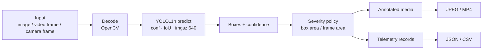

# Inference workflow

- [Pipeline overview](#pipeline-overview)
- [Image path](#image-path)
- [Video path](#video-path)
- [Live-camera paths](#live-camera-paths)
- [Frame loop details](#frame-loop-details)
- [Confidence and NMS](#confidence-and-nms)
- [Severity scoring](#severity-scoring)
- [Annotation](#annotation)
- [Telemetry](#telemetry)
- [Video codec fallback](#video-codec-fallback)
- [Device selection and CPU retry](#device-selection-and-cpu-retry)
- [Warm-up and timing](#warm-up-and-timing)
- [Failure matrix](#failure-matrix)

## Pipeline overview

All interfaces share the same conceptual pipeline:



The detector is a single-class Ultralytics YOLO11n checkpoint (class `pothole`). There is no custom NMS, tracking, depth estimation or defect classifier in this repository. Severity is a geometric heuristic applied **after** detection.

## Image path

### Browser to API

1. The user selects an upload, a dataset sample or a webcam still in `inspect.js`.
2. Client-side checks reject unsupported extensions and files over 25 MB before upload. These checks are advisory; the server enforces its own limit and decodes the bytes.
3. `api.js` sends `multipart/form-data` with `file`, `conf` and `iou` to `POST /api/detect/image`.
4. The route validates thresholds, checks that a checkpoint file exists, then reads the upload in 1 MB chunks into an in-memory `bytearray`, stopping at 25 MB.
5. The bytes are passed to `inference.predict_image` through `run_in_threadpool`.

### Inside `predict_image`

```python
buffer = np.frombuffer(image_bytes, dtype=np.uint8)
image = cv2.imdecode(buffer, cv2.IMREAD_COLOR)
if image is None:
    raise InvalidImageError(...)
height, width = image.shape[:2]
frame_area = float(width * height)
model = ensure_ready()
```

- Empty bytes → `InvalidImageError("The uploaded file is empty.")`.
- Undecodable bytes → `InvalidImageError` with the accepted-format guidance.
- `ensure_ready()` waits for the shared model, up to 180 seconds. Model loading is **not** included in the reported inference time.
- The decoded image keeps its original dimensions; `imgsz=640` is passed to Ultralytics for the network input, not used to resize the stored output.

### Prediction and postprocessing

```python
with _predict_lock:
    result = model.predict(
        image,
        conf=conf,
        iou=iou,
        imgsz=config.DEFAULT_IMGSZ,   # 640
        device=device,
        verbose=False,
    )[0]
```

For each box:

1. `xyxy` is converted to Python integers.
2. Coordinates are clamped to `[0, width - 1]` / `[0, height - 1]` and sorted so `x1 ≤ x2`, `y1 ≤ y2`.
3. Confidence is read from `box.conf`.
4. Box area is `max(0, x2-x1) × max(0, y2-y1)`.
5. `classify_severity(box_area, frame_area)` returns `(severity, colour, coverage_pct)`.
6. A record is appended with `id`, `confidence` (4 decimals), `severity`, `coverage_pct` (2 decimals), `bbox`, and a private `_colour` used only for drawing.

The public response strips `_colour`. Counts are accumulated for CRITICAL/MODERATE/MINOR; `max_coverage_pct` and `total_coverage_pct` are rounded to two decimals.

### Output

- The annotated frame is written as `runs/dashboard/results/<uuid>.jpg` at JPEG quality 92.
- If `cv2.imwrite` returns false, the function raises `RuntimeError("The annotated image could not be written to disk.")`, which the API turns into a generic `500`.
- The response contains `image_url` (`/api/results/<uuid>.jpg`), `width`, `height`, detections, summary, `inference_ms`, the thresholds used, `imgsz`, `created_at`, and the client `filename`.
- An image with **zero** detections is still a successful result: the annotated copy is written and the summary is zero.

### Accelerator retry

The image path is the only path with an automatic CPU retry. If `model.predict` raises while `_device` is not `cpu`:

1. The exception is logged with a warning: `Accelerated inference failed; retrying on CPU`.
2. The same model object is called again with `device="cpu"`.
3. On success, `_device` is set to `"cpu"` permanently for the shared image model.
4. If the retry also fails, the exception propagates and the request becomes a `500` (or `503` if it is a model-unavailable error).

The fallback is a resilience measure, not a benchmark. It does not re-select MPS/CUDA until the model is reloaded or the process restarts.

## Video path

### Browser to API

1. `video.js` checks the extension (`.mp4`, `.avi`, `.mov`, `.mkv`) and the 2 GB client-side limit.
2. It sends the file to `POST /api/detect/video` with `conf` and `iou`.
3. The route validates thresholds, checks that a checkpoint file exists, and validates the filename suffix.
4. `jobs.create_job()` generates a UUID, creates `runs/dashboard/jobs/<id>/output`, and stores a queued job in memory.
5. The upload is streamed in 1 MB chunks to `runs/dashboard/jobs/<id>/input.<ext>`, capped at 2 GB. On failure the destination is deleted and the job is marked failed.
6. `jobs.start_video_job()` starts a daemon thread and the API returns `202` with the queued job snapshot.
7. The browser polls `GET /api/jobs/<id>` every 850 ms.

### Worker

`run_video_job` sets `status="processing"`, records `started_at`, and sets the progress stage to `Loading checkpoint`. It then:

- re-checks `checkpoint_available()`;
- imports `detect.run_detection` lazily (so the dashboard can boot even if the ML stack is incomplete);
- acquires `_worker_lock`, which serialises the entire video inference call across jobs;
- calls `run_detection(source=input_path, weights=WEIGHTS_PATH, conf, iou, save=True, show=False, output_dir=..., progress_callback=...)`.

`run_detection` constructs a **new** `YOLO(weights)` instance for the job. It does not reuse the image model and does not pass a `device` argument, so Ultralytics chooses the device for that instance. There is no CPU retry on the video path.

### Video frame loop

```python
cap = cv2.VideoCapture(cap_src)
w = int(cap.get(cv2.CAP_PROP_FRAME_WIDTH)) or 640
h = int(cap.get(cv2.CAP_PROP_FRAME_HEIGHT)) or 480
src_fps = cap.get(cv2.CAP_PROP_FPS) or 30.0
if src_fps <= 0 or np.isnan(src_fps):
    src_fps = 30.0
total_frames = int(cap.get(cv2.CAP_PROP_FRAME_COUNT) or 0)
```

For every successfully read frame:

1. Increment `frame_idx`.
2. Measure an instantaneous FPS value for the HUD.
3. Run `model.predict(frame, conf=conf, iou=iou, imgsz=imgsz, device=None, verbose=False)`.
4. For each detection, compute box area and severity using the **capture-reported** `w × h` as `frame_area`.
5. Append a record with `frame`, `box`, `confidence`, `severity`, `coverage_pct`.
6. Draw the box, label and HUD.
7. Write the frame to the output video.
8. Call `progress_callback(frame_idx, total_frames)`.

The loop ends when `cap.read()` fails or the user quits a live window. The `finally` block releases the capture, the writer and any OpenCV windows.

### Job completion

- The worker verifies that `output/detection_output.mp4` exists and is non-zero. If not, the job fails with "Inference finished without producing an annotated video."
- It counts severities across all records.
- `frames_processed` is read from the progress state (`total_frames` if known, otherwise the current frame count).
- `processing_seconds` is wall-clock time since the worker started, including checkpoint load and file I/O.
- `throughput_fps` is `frames_processed / processing_seconds`, rounded to one decimal. It is **not** a pure inference benchmark.
- `result` contains the video URL, file size, telemetry URLs when present, and the summary.
- Progress is forced to `fraction=1.0`, `stage="Complete"`, and status becomes `completed`.

An unreadable container is accepted at upload time and fails in the worker; the client sees `status: failed` with `error`.

## Live-camera paths

There are three different camera experiences. They should not be conflated.

### 1. Browser webcam still (`web/assets/js/camera.js`)

- The user opens the camera dialog from the Image inspection workspace.
- `navigator.mediaDevices.getUserMedia({audio:false, video:{facingMode:{ideal:"environment"}, width:{ideal:1920}, height:{ideal:1080}}})` starts a preview.
- The user captures **one** frame. A canvas at the video's intrinsic size draws the current frame and calls `canvas.toBlob(..., "image/jpeg", 0.92)`.
- The resulting `File` is named `webcam_<UTC timestamp>.jpg` and passed to the image selection flow.
- The dialog closes and `stopStream()` stops every track.
- Inference then uses the normal image endpoint. The browser does **not** run a continuous inference loop.

**Known race:** if the user closes the dialog while the `getUserMedia` permission prompt is still pending, `closeCamera()` runs before a stream exists. When the promise later resolves, the code assigns the stream and preview even though the dialog is closed, leaving the camera active until a later close/page unload. This is a privacy-relevant edge case, not a verified normal path. See [Security and privacy](../11-security-and-quality/security-and-privacy.md#sec-10--webcam-stream-race).

### 2. OpenCV live HUD (`test_camera.py`)

```bash
python test_camera.py --weights weights/best.pt --cam-id 0 --conf 0.25
```

- Loads `YOLO(weights)`; if the path is missing, warns and falls back to `yolo11s.pt`.
- Opens camera index 0, with `cv2.CAP_DSHOW` on Windows and a plain `VideoCapture` elsewhere.
- If index 0 fails, tries index 1.
- Requests 1280×720 and uses the actual reported width/height as `frame_area`.
- Runs `model.predict` per frame with `conf=current_conf`, `iou=0.45`, `imgsz=640`; no `device` argument, so Ultralytics selects the device.
- Draws boxes, severity labels and a driver HUD (FPS, counts, critical banner, controls).
- Keyboard: `Q`/Esc quit, `S` snapshot to `runs/detect/camera_snapshots/`, `+`/`=` increase confidence by 0.05 up to 0.95, `-`/`_` decrease down to 0.05, `H` toggle HUD.
- Does **not** write telemetry or a video file.

### 3. `detect.py` camera mode

```bash
python detect.py --camera --cam-id 0 --weights weights/best.pt --device 0
```

- `--camera` forces `source = str(cam_id)` and `show = True`.
- On Windows, tries `CAP_DSHOW` first; otherwise plain `VideoCapture`.
- Runs the same per-frame predict/draw loop as video, with the HUD and interactive keys.
- Does not create an output video for a camera source (`writer` is only created when `save and not is_cam`).
- Still accumulates telemetry in memory and writes `pothole_telemetry.csv` / `.json` at the end if at least one detection was recorded.
- `--device` is passed through to Ultralytics.

The browser path is a single-frame capture. Continuous live inference is only available through the OpenCV scripts. Physical webcam behaviour on the examiner's machine is **not verified**; the recorded check used Chrome's synthetic media device. See [`PROJECT_FACTS.md`](../PROJECT_FACTS.md).

## Frame loop details

| Aspect | Image | Video job | `detect.py` camera | `test_camera.py` |
|---|---|---|---|---|
| Source | Uploaded bytes / sample / webcam still | Uploaded file | OpenCV camera | OpenCV camera |
| Decode | `cv2.imdecode` | `cv2.VideoCapture` | `cv2.VideoCapture` | `cv2.VideoCapture` |
| Model instance | Shared dashboard model | New per job | New per call | New per call |
| Device argument | Selected device, CPU retry | `None` (Ultralytics chooses) | `--device` or `None` | `None` |
| `imgsz` | 640 | 640 | `--imgsz` (default 640) | 640 |
| NMS IoU | Form `iou` (0.10–1.0) | Form `iou` (0.10–1.0) | `--iou` (default 0.45) | Fixed 0.45 |
| Confidence | Form `conf` (0.05–1.0) | Form `conf` (0.05–1.0) | `--conf`, adjustable in window | `--conf`, adjustable in window |
| Output | Annotated JPEG + JSON | Annotated MP4 + CSV/JSON | Annotated window; telemetry at end | Annotated window; snapshots |
| HUD | No | Yes (always) | Yes | Yes |
| Audio | N/A | Not muxed; output is silent | N/A | N/A |
| Tracking | No | No | No | No |

## Confidence and NMS

Ultralytics performs the NMS. InfraScan only passes the thresholds:

- **Confidence (`conf`)** — minimum objectness/class confidence for a box to survive. Higher values reduce detections and usually reduce false positives; lower values surface weaker candidates and increase false positives.
- **NMS IoU (`iou`)** — IoU threshold used by non-maximum suppression. A **lower** value suppresses more overlapping boxes; a **higher** value retains more overlapping boxes. It is not a "confidence" control.
- Image API defaults: `conf=0.25`, `iou=0.45`.
- UI ranges: `conf` 0.05–1.0 in 0.05 steps; `iou` 0.10–1.0 in 0.05 steps.
- The browser stores the chosen values in `localStorage`; the server validates the submitted values on every request.
- `test_camera.py` clamps confidence to 0.05–0.95 in its keyboard controls; the API allows 1.0.

## Severity scoring

`infrascan/severity.py` is the single policy used by the dashboard, `detect.py` and `test_camera.py`.

```text
coverage_pct = ((x2 - x1) × (y2 - y1)) / (frame_width × frame_height) × 100
```

| Band | Lower bound (inclusive) | Colour (OpenCV BGR) |
|---|---:|---|
| CRITICAL | 8.0% | `(0, 0, 255)` red |
| MODERATE | 2.5% | `(0, 140, 255)` orange |
| MINOR | 0.0% | `(0, 215, 255)` amber |

`classify_severity` is defensive: a zero or negative frame area returns `MINOR` with `0.0` coverage instead of raising. The function returns `(severity, colour, coverage_pct)`.

**Interpretation boundary:** coverage is the box's share of the frame. It is not depth, volume, road-roughness, structural damage or a maintenance priority. Camera distance, zoom, perspective, occlusion and box shape all change the score. The dashboard labels this as a heuristic and the documentation should do the same.

## Annotation

### Dashboard image annotation (`inference._annotate`)

- Copies the decoded frame.
- Computes a scale from the longest side (`max(0.5, min(1.1, max(width, height) / 1500))`).
- Draws a filled severity-coloured label background and white text: `Pothole <confidence> [<SEVERITY>]`.
- Draws the bounding box with a thickness derived from the scale.
- Writes JPEG quality 92.

The dashboard image result does **not** include the FPS/count HUD used by the CLI.

### Video and CLI annotation (`detect.py`)

- Draws a 2 px box and a filled label background with `Pothole <confidence> (<SEVERITY>)`.
- Draws the `draw_hud` overlay: title, instantaneous FPS, pothole count, critical count, and a red "severe road damage" banner when any CRITICAL detection is present.
- The HUD is always drawn for dashboard video jobs because `run_detection` defaults `show_hud_overlay = True`.
- For images processed by `detect.py`, the HUD is also drawn with `fps=0.0`.

## Telemetry

### Image result (API JSON)

| Field | Meaning |
|---|---|
| `id` | Result UUID (also the JPEG stem) |
| `image_url` | Relative URL of the annotated JPEG |
| `width`, `height` | Original decoded image dimensions |
| `detections[]` | `id`, `confidence`, `severity`, `coverage_pct`, `bbox` `[x1,y1,x2,y2]` |
| `summary` | `count`, `critical`, `moderate`, `minor`, `max_coverage_pct`, `total_coverage_pct` |
| `inference_ms` | Model-call timing, excluding decode/load/annotation/write/HTTP |
| `conf`, `iou`, `imgsz` | Thresholds and network input used |
| `created_at` | UTC ISO timestamp |
| `filename` | Client-supplied filename, added by the route |

The browser's "Telemetry CSV" download is generated client-side from this JSON with columns `image, box, confidence, severity, coverage_pct`.

### Video job telemetry (CSV/JSON)

Each record is a **frame-level detection**, not a tracked object:

```json
{
  "frame": 42,
  "box": [120, 330, 280, 410],
  "confidence": 0.7312,
  "severity": "MODERATE",
  "coverage_pct": 3.4
}
```

- CSV columns follow the DataFrame keys: `frame, box, confidence, severity, coverage_pct`. The `box` value is written as a Python list string (for example `[120, 330, 280, 410]`) by pandas.
- JSON is a pretty-printed list of the same records.
- Records exist only for detections. A clip with no detections produces no CSV/JSON files, and the job result sets both telemetry URLs to `null`.
- There are no GPS, timestamp, frame-image, track-ID or unique-pothole fields. The same pothole can appear in many frames.

## Video codec fallback

`detect.run_detection` prefers H.264 so the annotated MP4 plays in browsers:

```python
for codec in ("avc1", "mp4v"):
    candidate = cv2.VideoWriter(out_vid, cv2.VideoWriter_fourcc(*codec), src_fps, (w, h))
    if candidate.isOpened():
        writer = candidate
        print(f"Saving annotated video to: {out_vid} ({codec})")
        break
    candidate.release()
if writer is None:
    raise RuntimeError(f"Could not create output video: {out_vid}")
```

| Codec | Browser playback | Notes |
|---|---|---|
| `avc1` (H.264) | Broad support | Preferred; depends on the OpenCV/FFmpeg build having an H.264 encoder |
| `mp4v` (MPEG-4 Part 2) | Not reliably supported in browsers | Fallback so the CLI still produces a file; Chrome may show a black player or refuse playback |
| Neither | No output | Job fails with a runtime error |

The API always serves the file as `video/mp4`, regardless of the codec actually written. The recorded release check observed H.264 output and Chrome `readyState 4`; that is one clip on one machine, not a guarantee for every OpenCV build. If playback fails, inspect the worker log for the codec line and transcode the output with FFmpeg. See [Troubleshooting](../06-setup-and-execution/troubleshooting.md#video-playback).

The annotated output is video-only: OpenCV `VideoWriter` does not mux the source audio track.

## Device selection and CPU retry

### Dashboard image path

```python
if torch.cuda.is_available():
    return "cuda:0"
mps = getattr(torch.backends, "mps", None)
if mps is not None and mps.is_available():
    return "mps"
return "cpu"
```

- CUDA is preferred over MPS, then CPU.
- Accelerator-detection exceptions are logged and fall back to CPU.
- The selected device is reported in `/api/status` and on the System page.
- `model.predict(..., device=device)` uses that selection.
- On an exception during prediction, the image path retries once on CPU and permanently records `device="cpu"` for the shared model.

### Video path

`run_detection` is called with `device=None`; Ultralytics chooses the device. There is no InfraScan CPU retry and no device label for the video worker. A video job can therefore fail on an accelerator even if the image path would have recovered.

### CLI paths

| Tool | Device selection |
|---|---|
| `detect.py` | `--device` passed through; `None` lets Ultralytics choose |
| `test_camera.py` | No device argument; Ultralytics chooses |
| `evaluate.py` | `--device` passed through; verified run used `mps` |
| `train.py` | If `--device` is omitted: CUDA `0` if available, otherwise **CPU**. It does not auto-select MPS |
| `export.py` | No device argument; Ultralytics export behaviour |

The verified evaluation environment was Apple M2 with MPS, Python 3.12.14, batch 16, 640 px. CUDA execution is **BLOCKED** on that machine and no CUDA numbers are claimed anywhere in this documentation.

## Warm-up and timing

- The dashboard loads the model in a background thread at startup, but does **not** run a dummy inference. The first real prediction can therefore include lazy kernel/allocator warm-up and is often slower.
- `inference_ms` starts **after** image decode and `ensure_ready()`, so it excludes model load and upload. It includes waiting for `_predict_lock` and the Ultralytics call/postprocess.
- `processing_seconds` for video starts before checkpoint load inside the job and includes file I/O, so `throughput_fps` is an overall job rate, not a model-only benchmark.
- The validation numbers (0.17 ms preprocess, 3.82 ms inference, 10.75 ms postprocess per image on M2 MPS, batch 16, 640 px) are described separately in [Performance](../11-security-and-quality/performance.md). They are not directly comparable to a single warm API request.

## Failure matrix

| Stage | Failure | Surface |
|---|---|---|
| Upload | Empty image | `400` |
| Upload | >25 MB image | `413` |
| Upload | >2 GB video | `413` |
| Upload | Unsupported video suffix | `415` |
| Thresholds | Out of range | `422` |
| Model | Checkpoint missing | `503` |
| Model | Load exception | State `error`; detection `503` |
| Model | Loading >180 s | `503` model-timeout message |
| Image decode | `cv2.imdecode` returns `None` | `400` |
| Image predict | Accelerator exception | One CPU retry; then `500` if it still fails |
| Image output | JPEG write fails | `500` |
| Video open | `VideoCapture` cannot open | Job `failed` |
| Video writer | Neither codec opens | Job `failed` |
| Video output | Missing/zero-byte MP4 | Job `failed` |
| Telemetry | No detections | No telemetry files; URLs `null` |
| Process restart | In-memory job lost | Job route `404`; files may remain until cleanup |

For user-facing recovery steps, see [Troubleshooting](../06-setup-and-execution/troubleshooting.md).
