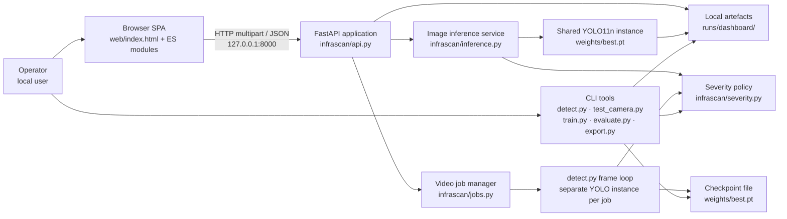
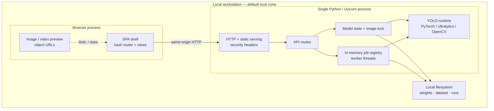
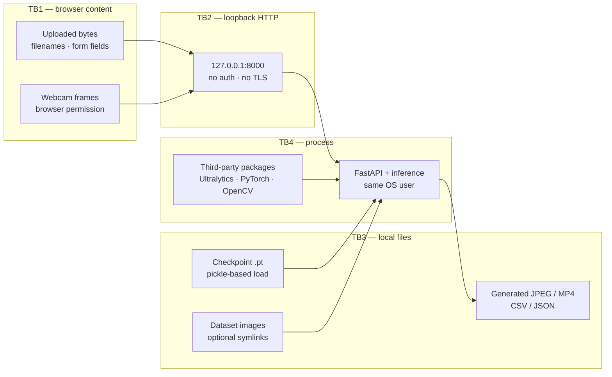
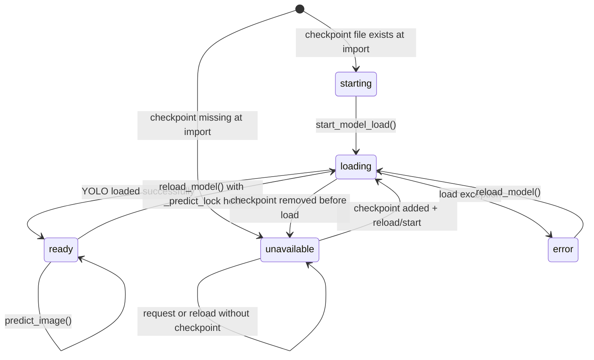
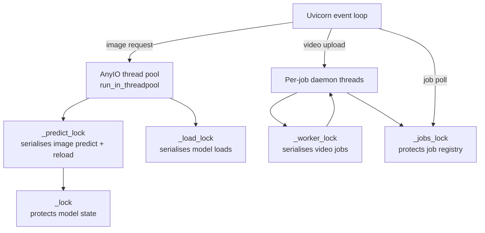

# System architecture

- [Context and scope](#context-and-scope)
- [Deployment topology](#deployment-topology)
- [Component responsibilities](#component-responsibilities)
- [Trust boundaries](#trust-boundaries)
- [Startup and lifespan](#startup-and-lifespan)
- [Model lifecycle](#model-lifecycle)
- [Thread and concurrency model](#thread-and-concurrency-model)
- [Same-origin serving](#same-origin-serving)
- [Failure modes](#failure-modes)
- [What this architecture is not](#what-this-architecture-is-not)

## Context and scope

InfraScan is a **local-first road-image inspection workspace**. A single operator uses a browser on the same machine as the Python process. The browser supplies images, dataset samples or a webcam still; the server runs a locally supplied YOLO checkpoint and returns annotated media plus telemetry. The same inference policy is available from the command line.

There is no account system, no remote inference service, no database, and no separate frontend deployment. The architectural boundary is the workstation.



## Deployment topology

The supported topology is **one host, one Uvicorn process, one browser origin**.

| Element | Location | Notes |
|---|---|---|
| Browser SPA | `web/index.html`, `web/assets/` | Served by FastAPI at `/` and `/assets/*` |
| ASGI app | `app.py` importing `infrascan.api:app` | Started by `run_app.py` or Uvicorn |
| HTTP server | Uvicorn | Default `127.0.0.1:8000`; no TLS by default |
| Model | `weights/best.pt` or `INFRASCAN_WEIGHTS` | Not bundled; loaded in a background thread |
| Runtime artefacts | `runs/dashboard/results`, `runs/dashboard/jobs` | Gitignored; cleaned at startup by TTL |
| Dataset samples | `dataset/images/test` | Optional; enables the sample picker only |
| Telemetry | Files beside outputs | CSV/JSON; no database |



There is no cloud component and no container orchestration in the repository. A reverse proxy or TLS terminator can be placed in front for a controlled demonstration, but that is an operator-added layer, not a shipped production deployment; see [Deployment and operations](deployment-and-operations.md).

## Component responsibilities

| Component | Responsibility | Important boundary |
|---|---|---|
| `run_app.py` | Parse `--host`, `--port`, `--weights`, `--no-browser`, `--reload`; change to the project root; optionally open a browser; call `uvicorn.run("app:app")` | Launcher only; not imported by the API except `app.py`'s `__main__` path |
| `app.py` | Export the ASGI `app` object; allow `python app.py` | No application logic |
| `infrascan/api.py` | FastAPI app, lifespan, security-header middleware, routes, upload limits, threshold validation, static serving, error handling | All HTTP concerns live here |
| `infrascan/config.py` | Resolve project paths; read `INFRASCAN_WEIGHTS`; define limits, extensions, TTLs, thresholds and defaults | Evaluated at import time; changing values needs a restart |
| `infrascan/inference.py` | Shared model state, device selection, background load, image prediction, annotation, runtime metadata, result cleanup | One model instance for image requests; not used by video jobs |
| `infrascan/jobs.py` | Create/track video jobs, per-job directories, worker threads, progress, cleanup | Job registry is in memory only |
| `detect.py` | CLI image/video/camera inference; video frame loop used by jobs; telemetry writing | Re-loads the checkpoint per call; historical `yolo11s.pt` fallback when `--weights` is absent |
| `infrascan/severity.py` | Single severity policy: CRITICAL ≥ 8%, MODERATE ≥ 2.5%, MINOR below | Imported by the API, `detect.py` and `test_camera.py` |
| `web/` SPA | Render views, manage local UI state, call the API, poll jobs, display errors | No business logic is reimplemented in the browser |
| CLI training/evaluation/export | `train.py`, `evaluate.py`, `export.py` | Not part of the running dashboard |
| Third-party runtime | Ultralytics, PyTorch, OpenCV, NumPy, pandas, FastAPI/Uvicorn | Executes in-process with the privileges of the operator |

### Shared versus per-job model instances

A subtle but important design fact:

- **Image path:** one YOLO instance is loaded by `infrascan/inference.py` and reused for every image request. A `threading.Lock` serialises calls into it.
- **Video path:** `infrascan/jobs.py` calls `detect.run_detection()`, which constructs **another** `YOLO(...)` instance inside the worker thread. Video jobs do not use the image model object. `_worker_lock` serialises video jobs against each other, but not against image inference.

This is why the dashboard can answer an image request while a video job is running, and also why two model instances may coexist in memory or contend for the same accelerator. The behaviour is visible in the source; memory use under combined load is **not measured** in this project (`[TO BE CONFIRMED]`).

## Trust boundaries



| Boundary | What crosses it | Current control | Residual risk |
|---|---|---|---|
| TB1 → TB2 | Arbitrary file bytes, `conf`/`iou`, filenames, `job_id` lookups | Size caps, image decode check, video extension check, threshold range check, generated output names | Malformed media can still reach OpenCV/FFmpeg decoders; no malware scan; no MIME sniffing for images; video container is not validated before the job |
| TB2 | HTTP requests from any local process or user | Bind to loopback by default; CSP/frame denial; no CORS | **No authentication, no TLS, no Origin/Host validation, no CSRF token, no rate limit.** A malicious local page can attempt cross-origin form posts; DNS rebinding is not specifically mitigated |
| TB3 | Checkpoint and dataset files | Files are not bundled or auto-downloaded by the dashboard; `.gitignore` excludes them | A `.pt` checkpoint is loaded through PyTorch's pickle-based loader. A malicious checkpoint can execute code with the operator's privileges. Dataset symlinks are followed |
| TB3 → TB2 | Generated results and job outputs | UUID-based names; basename checks; job IDs must exist in memory | Result/sample files are served with a one-hour public cache header; no authorization check |
| TB4 | In-process Python dependencies | Version floors in `requirements.txt` | Supply-chain compromise or a decoder vulnerability is outside the application's control |

The full threat analysis is in [Security and privacy](../11-security-and-quality/security-and-privacy.md).

## Startup and lifespan

```mermaid
sequenceDiagram
    autonumber
    participant L as run_app.py
    participant U as Uvicorn
    participant A as infrascan.api
    participant C as config
    participant I as inference
    participant J as jobs
    participant F as filesystem

    L->>L: parse flags, chdir(PROJECT_ROOT)
    L->>U: uvicorn.run("app:app", host, port, reload)
    U->>A: import app
    A->>C: evaluate paths, INFRASCAN_WEIGHTS, limits
    A->>A: check web/assets exists
    A->>A: mount /assets, define middleware and routes
    U->>A: lifespan startup
    A->>F: ensure RESULTS_DIR and JOBS_DIR
    A->>I: purge results older than 24 h
    A->>J: cleanup finished job dirs older than 24 h
    A->>I: start_model_load()
    I-->>U: background loader thread (daemon)
    A-->>U: yield; server accepts requests
    Note over U,I: /api/health can return ok while model_state is loading
    U->>A: lifespan shutdown
    A-->>U: no explicit teardown; process exits
```

### Import-time work

`infrascan/config.py` is evaluated when the API module is imported:

- `PROJECT_ROOT` is the parent of the `infrascan/` package, so paths remain stable when the process is launched from a different working directory.
- `WEIGHTS_PATH` is `INFRASCAN_WEIGHTS` (expanded and resolved) when set, otherwise `PROJECT_ROOT/weights/best.pt`.
- `infrascan/inference.py` sets its initial state to `starting` if the checkpoint file exists and is non-empty, or `unavailable` otherwise.

`infrascan/api.py` fails fast if `web/assets` is missing (`RuntimeError: Dashboard assets are missing`). The static mount is created before the routes.

### Lifespan startup

The async context manager in `infrascan/api.py` performs four operations before yielding:

1. `config.ensure_directories()` creates `runs/dashboard/results` and `runs/dashboard/jobs`.
2. `inference.purge_old_artifacts()` removes `*.jpg` result files older than the 24-hour TTL.
3. `jobs.cleanup_old_jobs()` removes completed/failed job directories older than the 24-hour TTL and drops their in-memory records.
4. `inference.start_model_load()` starts a daemon thread named `infrascan-model-loader` if a checkpoint exists.

The server begins accepting requests immediately after `yield`. The model may still be loading; the SPA polls `/api/status` every 2.5 seconds while the state is `loading` or `starting`.

### Shutdown

There is no custom shutdown logic. The lifespan has no `finally` block, video workers are daemon threads, and the model is not explicitly unloaded. On process exit:

- in-flight video jobs are abandoned;
- in-memory job records are lost;
- completed job directories and result images remain on disk until a later startup cleanup finds them older than 24 hours.

This is acceptable for a local academic tool but is a deliberate production limitation.

## Model lifecycle



| State | Meaning | API behaviour |
|---|---|---|
| `starting` | Initial state when the file exists but no load has been attempted | `/api/status` reports it; detection requests can trigger `start_model_load()` and then wait |
| `loading` | Background loader is running, or a reload is in progress | Image requests wait in `ensure_ready()` for up to 180 seconds; `/api/health` still says `ok` |
| `ready` | Model object loaded; `_device` selected | Inference allowed |
| `unavailable` | Checkpoint missing or empty | Detection endpoints return `503`; dashboard still serves; System page shows the path and instructions |
| `error` | Checkpoint exists but loading failed | Detection endpoints return `503` with the loader error; reload can retry |

### Load and readiness

- `start_model_load()` is idempotent: it returns if the model is already ready or a loader thread is alive.
- `_load_model_sync()` holds `_load_lock`, sets `loading`, then imports Ultralytics and calls `YOLO(str(WEIGHTS_PATH))`.
- Class names are read from the checkpoint's `model.names`; if absent, the class list falls back to `["pothole"]`.
- The task is read from `model.task` (normally `detect`).
- The device is selected by `_select_device()`: CUDA first, then Apple MPS, then CPU. Any accelerator-detection exception is logged and falls back to CPU.
- `ensure_ready(timeout=180.0)` polls every 0.2 seconds. It raises `ModelUnavailableError` for `unavailable`/`error`, and `ModelTimeoutError` if the deadline passes.
- `reload_model()` first checks that the checkpoint file exists, then acquires `_predict_lock` so it waits for any in-flight image prediction. It clears `_model`, sets `loading`, forces a synchronous load, and raises `ModelUnavailableError` if the resulting state is not `ready`.

**Important:** `INFRASCAN_WEIGHTS` is read at import time. Reloading the model re-reads the same path; it does **not** re-read the environment variable. To point the process at a different checkpoint, restart it with the variable already set in the shell. A source-level ordering caveat applies to `run_app.py --weights`: the launcher imports `infrascan.config` to obtain `PROJECT_ROOT` before it parses flags and sets `INFRASCAN_WEIGHTS`, so a normal non-reload launch reuses the path resolved at import. Prefer `INFRASCAN_WEIGHTS=/path/to/model.pt python run_app.py`, or use `--reload`, which re-imports in the child process. See [Configuration](../06-setup-and-execution/configuration.md#checkpoint-path).

### Missing-checkpoint behaviour

The dashboard never substitutes a different checkpoint or downloads one automatically. `checkpoint_available()` is a file existence/size check, not a readiness check. `POST /api/detect/image` returns `503` immediately when the file is missing; if the file exists but the model is still loading, the request waits in `ensure_ready()`.

The CLI tools are different: `detect.py`, `test_camera.py`, `evaluate.py` and `export.py` print a warning and fall back to `yolo11s.pt` when their `--weights` path does not exist. That historical fallback is not the dashboard behaviour and must be stated explicitly in a demonstration.

## Thread and concurrency model



| Primitive | Protects | Consequence |
|---|---|---|
| `inference._lock` (`RLock`) | `_state`, `_error`, `_model`, `_device`, `_classes`, `_task` | Short critical sections; status snapshots are consistent |
| `inference._predict_lock` | Calls into the shared image model; also held by reload | Image requests are **serialised**; a reload waits for the active prediction and blocks new predictions |
| `inference._load_lock` | The load routine | Only one loader runs at a time |
| `jobs._jobs_lock` (`RLock`) | `_jobs` dictionary | Job snapshots are deep-copied under the lock |
| `jobs._worker_lock` | The entire `detect.run_detection()` video call | Video jobs run one at a time; queued jobs may still report `processing` with stage `Preparing video` |
| Per-job threads | Each video job | Daemon threads named `infrascan-video-<id>`; process exit does not wait for them |

### What runs where

- **Event loop:** route handlers, upload reads (`UploadFile.read`), JSON responses, static files, status/job polling.
- **Thread pool:** `inference.predict_image` and `inference.reload_model` are dispatched with `starlette.concurrency.run_in_threadpool` so the blocking model call does not block the event loop.
- **Video threads:** `jobs.start_video_job` starts a new daemon thread per accepted job; `run_video_job` calls `detect.run_detection`.
- **Image read before the pool:** the entire image is read into memory and decoded inside `predict_image` in the worker thread; the upload itself is accumulated in an in-memory `bytearray` on the event loop before dispatch.
- **Video upload:** the request handler writes the incoming stream to `runs/dashboard/jobs/<id>/input.<ext>` in 1 MB chunks. The upload must finish before the response `202` is returned.

### Concurrency facts that affect real use

1. **Image requests queue.** Ten simultaneous image requests do not run ten predictions; they serialise behind `_predict_lock`. Each still holds its upload bytes in memory.
2. **Video jobs queue.** Multiple uploads can be accepted, but only one `run_detection` call runs at a time. The UI has no queue-position display.
3. **Image and video can overlap.** They use different model objects and different locks. On a shared GPU/MPS device this can increase latency or memory pressure; it is not coordinated.
4. **Every video job reloads the checkpoint.** A long clip pays checkpoint load time inside the job; `processing_seconds` and `throughput_fps` include that overhead.
5. **One process only.** Running Uvicorn with multiple workers would create separate model instances and separate in-memory job registries. The application is designed for a single worker; multi-worker operation is not supported.
6. **Status polling is not free.** `/api/status` calls `_sample_files()`, which lists and sorts `dataset/images/test`, and `runtime_versions()`, which queries package metadata. On a local SSD this is small; on an iCloud-evicted directory it can block the event loop. See [Performance](../11-security-and-quality/performance.md).

## Same-origin serving

The API and SPA share one origin by construction:

- `app.mount("/assets", StaticFiles(directory=config.ASSETS_DIR))` serves CSS, JS, fonts, brand assets and icons.
- `GET /` returns `web/index.html` with `Cache-Control: no-cache`.
- `GET /favicon.svg` serves the brand favicon.
- All frontend `fetch` calls use relative paths (`/api/...`), and all asset URLs are absolute from the site root (`/assets/...`).
- There is no CORS middleware because there is no cross-origin frontend. Running the SPA from a separate dev server or opening `index.html` through `file://` is not supported.

Because URLs are root-relative, the application assumes it is mounted at `/`. A reverse proxy that strips a prefix such as `/infrascan/` will break asset and API paths unless the proxy rewrites both directions. See [Deployment and operations](deployment-and-operations.md#reverse-proxy-and-tls).

## Failure modes

| Failure | Detection | Visible behaviour |
|---|---|---|
| Checkpoint missing | `config.checkpoint_available()` false | `/api/health` returns `ok` with `model_state: unavailable`; image/video requests `503`; System page shows path; dashboard still loads |
| Checkpoint unreadable/corrupt | Loader exception | State `error`; `/api/status` carries `error`; detection `503`; reload can retry |
| Model still loading | State `loading` | Image request waits up to 180 s; video request is accepted, then the worker waits or fails |
| Model load timeout | `ModelTimeoutError` | `503` with "still loading" guidance |
| Invalid image bytes | `cv2.imdecode` returns `None` | `400` with "could not be decoded" message |
| Unsupported video extension | Suffix check | `415` before a job is created |
| Video container unreadable | `detect.run_detection` cannot open the capture | Job `failed` with an actionable error; `202` was already returned |
| Output video not produced | Missing/zero-byte `detection_output.mp4` | Job `failed`; no partial success |
| Accelerator failure during image predict | Exception from `model.predict` | One retry on CPU; device is permanently switched to CPU for the shared image model |
| Disk full or permission denied | Write exception | Image `500`; video job `failed`; check server log |
| Port already in use | Uvicorn bind error | Process exits before serving; see [Troubleshooting](../06-setup-and-execution/troubleshooting.md#port-and-bind-problems) |

## What this architecture is not

- It is **not** a multi-user service. There is no authentication, session isolation, per-user storage or authorization.
- It is **not** a production deployment. It has no TLS, reverse-proxy hardening, rate limiting, audit log, metrics, durable job queue or graceful worker shutdown.
- It is **not** a cloud or edge deployment. No cloud inference, storage or database is implemented.
- It is **not** a tracking system. Video results are frame-level detections; the same pothole can be counted repeatedly.
- It is **not** a safety-certified inspection instrument. Severity is a bounding-box-area heuristic, not a structural measurement.

For the operational consequences, continue to [Deployment and operations](deployment-and-operations.md); for the security analysis, see [Security and privacy](../11-security-and-quality/security-and-privacy.md).
