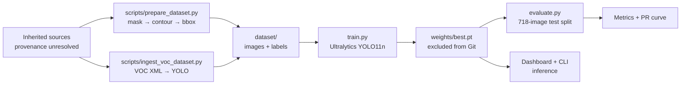

# Dataset and model

> **Evidence snapshot:** 22 October 2026. **Source of truth:** [`../PROJECT_FACTS.md`](../PROJECT_FACTS.md). This chapter describes the local checkpoint and the local development dataset. Neither artifact is redistributed by this documentation repository or by the main InfraScan repository.

This chapter explains what the detector is, how the labels were produced, what the local dataset contains, how the checkpoint was trained and evaluated, and which rights and provenance questions remain open.

## Navigation

| Page | What it answers |
|---|---|
| [Dataset provenance](dataset-provenance.md) | What is actually in `dataset/`, which parts can be verified, and which creator/source/licence fields are missing |
| [Annotation and preprocessing](annotation-and-preprocessing.md) | How mask contours and VOC XML become YOLO labels, with coordinate math and worked examples |
| [Model explanation](model-explanation.md) | What YOLO11n does, what the parameter/GFLOP numbers mean, and what the model is **not** |
| [Training and evaluation](training-and-evaluation.md) | Exact checkpoint metadata, `train.py` defaults, the 718-image evaluation, metrics and reproduction checklist |
| [Licensing and attribution](licensing-and-attribution.md) | MIT vs Ultralytics AGPL-3.0, dataset/checkpoint rights, fonts and dependency notices |

Related evidence: [verified results](../09-testing-and-results/verified-results.md), [evidence index](../09-testing-and-results/evidence-index.md), [contribution evidence](../CONTRIBUTIONS.md), [architecture](../04-architecture/system-architecture.md), [limitations](../03-project-documentation/limitations.md).

## Verified overview

| Item | Verified value | Where it comes from |
|---|---|---|
| Model family | Ultralytics **YOLO11n** | Checkpoint metadata |
| Task | Object detection (`detect`) | Checkpoint metadata |
| Class | `pothole` (class `0`) | `data.yaml`; checkpoint metadata |
| Input size | 640 px | Checkpoint metadata; `infrascan/config.py` |
| Fused model | 101 layers, **2,582,347** parameters, **6.4 GFLOPs** | Checkpoint inspection recorded in `PROJECT_FACTS.md` §3 |
| Checkpoint file | **5,467,546 bytes** (≈ 5.2 MiB) | Local `weights/best.pt` |
| Checkpoint SHA-256 | `f3490f953b4ac2aa0205c206c151be8f2da281da99708713b182492a43c7751c` | Local checkpoint |
| Dataset | 4,719 images, 7,340 pothole boxes, 22 background images | Local `dataset/`; `PROJECT_FACTS.md` §4 |
| Test split | 718 images, 994 instances, 2 background images | Local `dataset/`; evaluation log summarised in `PROJECT_FACTS.md` §5 |
| Test metrics | P 0.7959 · R 0.5996 · mAP@0.50 0.7111 · mAP@0.50–0.95 0.3938 | 718-image evaluation |
| Training metadata | 15 epochs, batch 16, 640 px, optimizer `auto`, `lr0=0.003`, cosine LR, seed 0, CUDA device `0` | Checkpoint metadata |

## How the pieces fit

The diagram separates **what is verifiable in the local tree** (the scripts, the resulting folder structure, the checkpoint and the evaluation) from **what is not** (the original source of every image and the permission to redistribute it). The upstream sources are deliberately drawn as one unresolved box, because the repository does not contain a source manifest that would justify splitting them into named datasets.

## What this chapter can establish

- The local dataset structure, split counts, class name and normalized label format.
- The checkpoint identity: architecture, class, input size, parameter count, file size and SHA-256.
- The training hyperparameters recorded inside the checkpoint.
- The measured test-split metrics and speed for the local checkpoint on the recorded machine.
- That preparation and ingestion utilities exist and what transformations they implement.

## What this chapter cannot establish

- The original creators, stable source URLs or licence of every image.
- That every local image came from a named upstream dataset.
- That the dataset or checkpoint may be redistributed.
- The exact training command, initialization source or augmentation history beyond checkpoint metadata.
- That the 718-image split is free of leakage or duplicates.
- That the reported metrics generalise beyond this local split.

> **Rule for citations:** describe the data as the *local InfraScan development dataset* with the counts above. Do not attach a licence, creator name or URL that is not recorded in [`dataset-provenance.md`](dataset-provenance.md). Do not cite the checkpoint as a public model release.

## Reading order

1. Start with [dataset provenance](dataset-provenance.md) to understand the evidence boundary.
2. Read [annotation and preprocessing](annotation-and-preprocessing.md) for the label mechanics.
3. Read [model explanation](model-explanation.md) for the detector and severity policy.
4. Read [training and evaluation](training-and-evaluation.md) for the numbers and their caveats.
5. Read [licensing and attribution](licensing-and-attribution.md) before sharing any artifact.

For viva preparation, the [dataset and training question bank](../08-viva-preparation/dataset-and-training-questions.md) mirrors these topics.
