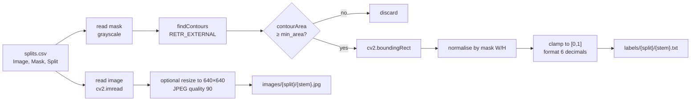
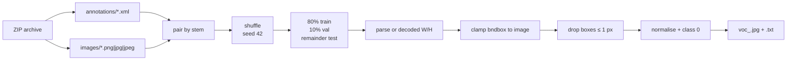

# Annotation and preprocessing

> **Scope:** this page explains the label contract and the two conversion paths that exist in `scripts/`. It does not claim that every local image passed every quality check. Counts and the sample label are verified; exhaustive bounds/leakage checks are not recorded.

The project uses one class, `pothole`, and YOLO detection labels. The interesting part is not the final text format — it is how masks and VOC boxes become that format, and where the conversion can introduce geometric or split errors.

## 1. Label contract

`data.yaml` defines the dataset:

```yaml
path: ./dataset
train: images/train
val: images/val
test: images/test
nc: 1
names:
- pothole
```

Each non-empty label file contains one row per object:

```text
<class_id> <x_center> <y_center> <width> <height>
```

| Field | Range | Meaning |
|---|---|---|
| `class_id` | integer, here `0` | Index into `names`; only `pothole` exists |
| `x_center` | `[0, 1]` | Box centre x divided by image width |
| `y_center` | `[0, 1]` | Box centre y divided by image height |
| `width` | `(0, 1]` | Box width divided by image width |
| `height` | `(0, 1]` | Box height divided by image height |

An **empty** `.txt` file is a valid background image: it says "there are no potholes here." It is not a missing label. The local dataset has 22 such images (18 train, 2 validation, 2 test).

Labels deliberately do **not** contain confidence scores. Confidence is a model output, not ground truth.

## 2. Coordinate math

For a pixel box `(x_min, y_min, x_max, y_max)` on an image of width `W` and height `H`:

```text
x_center = ((x_min + x_max) / 2) / W
y_center = ((y_min + y_max) / 2) / H
width    = (x_max - x_min) / W
height   = (y_max - y_min) / H
```

The inverse, used by the annotation visualiser and by inference annotation code:

```text
x_min = (x_center - width  / 2) * W
y_min = (y_center - height / 2) * H
x_max = (x_center + width  / 2) * W
y_max = (y_center + height / 2) * H
```

### Worked example A — pixels to normalised coordinates

Image: `1280 × 720`. Box: `x_min=320`, `y_min=180`, `x_max=640`, `y_max=420`.

```text
x_center = ((320 + 640) / 2) / 1280 = 480 / 1280 = 0.375000
y_center = ((180 + 420) / 2) /  720 = 300 /  720 = 0.416667
width    = (640 - 320) / 1280       = 320 / 1280 = 0.250000
height   = (420 - 180) /  720       = 240 /  720 = 0.333333
```

Label row:

```text
0 0.375000 0.416667 0.250000 0.333333
```

### Worked example B — a real local label back to pixels

The local test label `pothole_dataset_1_train_image10.txt` begins with:

```text
0 0.441406 0.690625 0.364063 0.159375
```

On a `640 × 640` image:

```text
x_min = (0.441406 - 0.364063 / 2) × 640 = 166.0 px
y_min = (0.690625 - 0.159375 / 2) × 640 = 391.0 px
x_max = (0.441406 + 0.364063 / 2) × 640 = 399.0 px
y_max = (0.690625 + 0.159375 / 2) × 640 = 493.0 px
```

That is a `233 × 102` box. Its rectangular area is `23,766 px²`, or `5.80%` of the `409,600 px²` frame. Under the policy in `infrascan/severity.py`, `5.80%` falls in the **MODERATE** band because it is at least `2.5%` and below `8.0%` (see the band table in [model explanation](model-explanation.md#9-severity-heuristic)):

```text
23,766 / 409,600 × 100 = 5.802%
```

> The filename contains `train`, but the file is in the **test** split. This is an inherited naming token, not a split guarantee. See [dataset provenance](dataset-provenance.md#2-filename-families).

### Worked example C — contour area is not box area

Suppose a mask contour has pixel area `12 px²` and `--min-area 15`. It is discarded even if its bounding rectangle would be large. A contour of `15 px²` or more is kept. For a kept contour with bounding rectangle `x=100, y=200, w=20, h=10` on a `640 × 640` mask:

```text
x_center = (100 + 20/2) / 640 = 110 / 640 = 0.171875
y_center = (200 + 10/2) / 640 = 205 / 640 = 0.320313
width    = 20 / 640 = 0.031250
height   = 10 / 640 = 0.015625
```

Label row:

```text
0 0.171875 0.320313 0.031250 0.015625
```

The filter is on **contour area**, not on the rectangle's area. A thin, long contour can pass the area filter and still produce a very small box dimension.

## 3. Mask → contour → bbox: `prepare_dataset.py`

`scripts/prepare_dataset.py` converts a mask/segmentation-style source into YOLO detection labels. It expects a source directory containing:

```text
<src>/
├── splits.csv          # columns: Image, Mask, Split
├── images/
└── masks/
```

The `Split` column is trusted as-is. The script does not regenerate splits or check leakage.



### What the code does

| Step | Code location | Behaviour |
|---|---|---|
| Read manifest | `prepare_dataset.py:75–84` | Requires `splits.csv`; prints split distribution |
| Create output folders | `prepare_dataset.py:86–88` | Creates `images/{train,val,test}` and `labels/{train,val,test}` |
| Read image and mask | `prepare_dataset.py:24–30` | Skips the sample if either cannot be decoded |
| Find contours | `prepare_dataset.py:34` | External contours only, simple chain approximation |
| Filter noise | `prepare_dataset.py:38–41` | Drops contours with `cv2.contourArea(cnt) < min_area` |
| Bounding rectangle | `prepare_dataset.py:43` | `cv2.boundingRect(cnt)` → `x, y, w, h` |
| Normalise | `prepare_dataset.py:44–47` | Divides by mask width/height |
| Clamp | `prepare_dataset.py:49–52` | Each of `x_center`, `y_center`, `w`, `h` clamped to `[0, 1]` |
| Write label | `prepare_dataset.py:54, 66–67` | `0` + six decimal places; empty file if no contours |
| Resize image | `prepare_dataset.py:57–64` | Optional square resize to `--size` (default 640), `INTER_AREA`, JPEG quality 90 |
| Write config | `prepare_dataset.py:113–137` | Writes `dataset/data.yaml` with an absolute path and a root `data.yaml` with `./dataset` |
| Parallelism | `prepare_dataset.py:106–109` | `ThreadPoolExecutor`, default 8 workers |

### Caveats

- **Square resize distorts aspect ratio.** A `1280 × 720` image becomes `640 × 640`; normalised labels remain mathematically valid, but the object shape is stretched. Ultralytics training/inference normally letterboxes to preserve aspect ratio, so pre-stretched images and letterboxed VOC images can coexist in the same dataset. The effect on accuracy is not measured.
- **Labels are not resized.** They do not need to be, because they are normalised. If you change the resize logic, keep the normalisation relative to the new dimensions.
- **No degenerate-box check after `boundingRect`.** The only gate is contour area. A contour that passes `min_area` but yields a one-pixel dimension is still written.
- **No duplicate/leakage check.** The `Split` column is trusted. If the same source image appears under two splits, the script will copy it twice.
- **Empty labels are intentional.** If a mask has no contour above `min_area`, the image is still written and the label file is empty.
- **The mask dimensions, not the image dimensions, define the normalisation.** This is correct when the mask and image are aligned. If they are not, labels will be misaligned. The script does not compare the two sizes.

### Command

```bash
python scripts/prepare_dataset.py \
  --src /path/to/authorized/data_processed \
  --out ./dataset \
  --size 640 \
  --min-area 15 \
  --workers 8
```

The source path is intentionally a placeholder. The repository does not include the raw mask dataset.

## 4. VOC XML → YOLO: `ingest_voc_dataset.py`

`scripts/ingest_voc_dataset.py` ingests a local ZIP archive in Pascal VOC layout:

```text
annotations/<stem>.xml
images/<stem>.png | .jpg | .jpeg
```

It matches XML files to images by stem, converts each `<object>` whose `<name>` contains `pothole` (case-insensitive), and writes YOLO labels with class `0`.



### What the code does

| Step | Code location | Behaviour |
|---|---|---|
| Read archive | `ingest_voc_dataset.py:102–105` | Finds `annotations/*.xml` |
| Pair files | `ingest_voc_dataset.py:107–123` | Tries `images/<stem>.png`, `.jpg`, `.jpeg` |
| Shuffle/split | `ingest_voc_dataset.py:125–134` | `random.seed(42)`, shuffle, floor 80/10/10 |
| Decode image | `ingest_voc_dataset.py:147–152` | Skips undecodable images |
| Parse XML | `ingest_voc_dataset.py:13–71` | Reads `<size>` if present; otherwise uses decoded dimensions |
| Filter class | `ingest_voc_dataset.py:28–34` | Keeps objects whose lowercased name contains `pothole` |
| Parse box | `ingest_voc_dataset.py:36–46` | Reads `xmin`, `ymin`, `xmax`, `ymax`; skips malformed |
| Clamp | `ingest_voc_dataset.py:48–51` | Clamps to `[0, W]` and `[0, H]` |
| Drop degenerate | `ingest_voc_dataset.py:53–57` | Skips if `bw <= 1` or `bh <= 1` |
| Normalise | `ingest_voc_dataset.py:59–69` | Six decimal places, class `0` |
| Write outputs | `ingest_voc_dataset.py:158–171` | `voc_<stem>.jpg` (quality 95) and `.txt`; empty label if no potholes |
| Remove stale cache | `ingest_voc_dataset.py:181–186` | Deletes `labels/*.cache` |

### Split arithmetic

The split is `int(N × 0.8)` train, `int(N × 0.1)` validation, and the remainder to test. Examples:

| `N` pairs | Train | Val | Test | Note |
|---:|---:|---:|---:|---|
| 9 | 7 | 0 | 2 | Validation can be empty for small archives |
| 100 | 80 | 10 | 10 | Exact 80/10/10 |
| 101 | 80 | 10 | 11 | Remainder goes to test |
| 4,719 | 3,775 | 471 | 473 | Does **not** match the local 3,281/720/718 |

The last row is one reason the local dataset cannot be described as the direct output of one VOC ingestion run. See [dataset provenance §6](dataset-provenance.md#6-split-arithmetic-and-why-it-matters).

### Caveats

- **XML `<size>` overrides the decoded image size.** If the XML says `1920 × 1080` but the decoded image is `640 × 360`, coordinates are normalised against the XML size. That is usually correct for the original annotation, but a mismatch will misplace boxes.
- **Coordinates are treated as continuous.** The script uses `bw = xmax - xmin` and does not add a pixel for inclusive VOC bounds. This is a convention choice; be consistent if you mix VOC and mask-derived labels.
- **Only objects whose name contains `pothole` are kept.** Other VOC classes are silently dropped. This is intentional for a one-class detector, but it means the output is not a full VOC conversion.
- **No duplicate or leakage check.** The random split is reproducible for a fixed archive and seed, but it does not prevent near-duplicate frames from crossing splits.
- **Filenames are rewritten to `voc_<stem>`.** The original filename is not preserved in the output, which makes source tracing harder.
- **Stale cache removal is best-effort.** A failed unlink prints a warning but does not stop ingestion.

### Command

The script's `__main__` block calls `ingest_dataset()` with defaults and no argparse:

```bash
python scripts/ingest_voc_dataset.py
```

That default call raises `ValueError("zip_path must point to a local VOC archive.")` because `zip_path` is `None`. To use it, import and call it from a small wrapper, for example:

```python
from scripts.ingest_voc_dataset import ingest_dataset

ingest_dataset(
    zip_path="/path/to/authorized/voc_potholes.zip",
    dataset_dir="dataset",
    train_ratio=0.80,
    val_ratio=0.10,
    test_ratio=0.10,
    seed=42,
)
```

> The wrapper above is documentation, not a committed script. Do not run it against a dataset whose rights you have not verified.

## 5. Annotation visualisation: `visualize_annotations.py`

`scripts/visualize_annotations.py` draws ground-truth boxes on images so a human can spot coordinate errors before training.

```bash
python scripts/visualize_annotations.py \
  --dataset dataset \
  --split test \
  --num 6 \
  --out runs/visualize
```

Behaviour:

- Collects `*.jpg` and `*.png` images from `dataset/images/<split>`.
- Prefers images whose label file exists and is non-empty; it gathers up to `3 × num_samples` candidates.
- Randomly samples `num_samples` (default 6) and writes `runs/visualize/sample_<n>_<stem>.jpg`.
- Converts each label row back to pixel coordinates and draws a red rectangle with a `pothole` badge.
- Falls back to `cls_<id>` if a class ID is out of range.
- Skips malformed rows that do not have exactly five fields.

Caveats:

- The visualiser does **not clip** boxes to the image. A malformed label can draw outside the frame.
- `cv2.imread` returning `None` is not checked before drawing; a corrupt image can fail.
- It is a spot-check tool, not a validator. It does not check bounds, duplicates or leakage.
- The output directory is under `runs/`, which is git-ignored.

## 6. Quality checks

The checks below separate what was actually verified from what is recommended.

| Check | Method | Status in this evidence set |
|---|---|---|
| Image/label pairing | One `.txt` per image stem; counts equal 3,281 / 720 / 718 | **Verified** by counts |
| Label arity | Every non-empty row has exactly five fields | Sample inspected; exhaustive scan not recorded |
| Class ID | Only class `0` | Contract verified; exhaustive scan not recorded |
| Coordinate bounds | All values in `[0, 1]`; `x_center ± width/2` within bounds | Sample inspected; exhaustive scan not recorded |
| Degenerate boxes | `width > 0`, `height > 0` | Source filters; exhaustive scan not recorded |
| Background labels | Empty `.txt` files: 18 / 2 / 2 | **Verified** |
| Image decode | All images readable | Sample inspected; exhaustive scan not recorded |
| Split leakage | No duplicate stems or hashes across splits | **Not verified** |
| Duplicate boxes | No repeated rows within a label | **Not verified** |
| Class balance | One class; 7,340 instances | **Verified** by counts |
| Image dimensions | Consistent within a source family | Sampled; mixed by design |

### Label-only audit snippet

Run this from the repository root on the authorised local copy. It reads labels only and is fast even when images are cloud-evicted.

```python
from pathlib import Path
import collections

for split in ("train", "val", "test"):
    labels = list(Path("dataset/labels", split).glob("*.txt"))
    empty = boxes = bad_arity = bad_class = out_of_range = degenerate = 0
    classes = collections.Counter()

    for label in labels:
        text = label.read_text(encoding="utf-8", errors="replace").strip()
        if not text:
            empty += 1
            continue
        for line in text.splitlines():
            parts = line.split()
            if len(parts) != 5:
                bad_arity += 1
                continue
            try:
                class_id = int(float(parts[0]))
                xc, yc, w, h = (float(v) for v in parts[1:])
            except ValueError:
                bad_arity += 1
                continue
            boxes += 1
            classes[class_id] += 1
            if class_id != 0:
                bad_class += 1
            if not all(0.0 <= v <= 1.0 for v in (xc, yc, w, h)):
                out_of_range += 1
            if w <= 0 or h <= 0:
                degenerate += 1
            if xc - w / 2 < 0 or xc + w / 2 > 1 or yc - h / 2 < 0 or yc + h / 2 > 1:
                out_of_range += 1

    print(split, {
        "labels": len(labels), "boxes": boxes, "empty": empty,
        "bad_arity": bad_arity, "bad_class": bad_class,
        "out_of_range": out_of_range, "degenerate": degenerate,
        "classes": dict(classes),
    })
```

### Duplicate/leakage audit snippet

```python
from pathlib import Path
import hashlib

def sha256(path: Path) -> str:
    h = hashlib.sha256()
    with path.open("rb") as handle:
        for chunk in iter(lambda: handle.read(1 << 20), b""):
            h.update(chunk)
    return h.hexdigest()

seen = {}
for split in ("train", "val", "test"):
    for image in Path("dataset/images", split).glob("*"):
        if image.suffix.lower() not in {".jpg", ".jpeg", ".png", ".webp", ".bmp"}:
            continue
        digest = sha256(image)
        seen.setdefault(digest, []).append((split, image.name))

cross_split = {k: v for k, v in seen.items() if len({s for s, _ in v}) > 1}
print("cross-split byte-identical groups:", len(cross_split))
for digest, entries in list(cross_split.items())[:10]:
    print(digest[:12], entries)
```

SHA-256 catches byte-identical files only. Re-encoded, resized or cropped near-duplicates need a perceptual hash or embedding-based check. No such audit is recorded for this dataset.

## 7. Leakage and split integrity

Leakage is the most important unresolved annotation risk. The filename evidence already shows that upstream split tokens were not preserved: `pothole_dataset_1_train_image*` and `pothole_dataset_1_valid_image*` appear in all three current splits. That does **not** prove duplication, but it removes filename-based reassurance.

A credible leakage audit would:

1. Hash every image byte-for-byte across splits.
2. Compute a perceptual hash (for example pHash or dHash) and inspect near-duplicate clusters.
3. Compare image dimensions and capture families; consecutive dashcam frames are a common source of near-duplicates.
4. Record the audit command, threshold and result in the evidence index.
5. Re-split at the **source-video or source-sequence** level, not the frame level, if near-duplicates are found.

Until then, describe the 718-image result as an evaluation on the **local split**, not as an unbiased estimate of generalisation.

## 8. Preprocessing at inference

The dashboard does not repeat the preparation transform. It decodes the uploaded image with OpenCV, passes the BGR array to Ultralytics `model.predict(..., imgsz=640)`, and lets Ultralytics resize/letterbox to the model input. The resulting boxes are converted back to the original image coordinates by Ultralytics before the API clamps them to the image bounds and computes severity.

Consequences:

- Normalised labels are resolution-independent, so a `640 × 640` training image and a `400 × 400` VOC image can share one label format.
- Training used a mixture of pre-stretched `640 × 640` images and letterboxed original-aspect images. Inference uses letterboxing. The distribution mismatch is a quality consideration, not a measured failure.
- Severity is computed on the **original uploaded frame**, so the same physical pothole can receive a different percentage when the camera distance or crop changes.
- The API returns the original image dimensions in `width`/`height`; boxes are in those coordinates.

## 9. Practical checklist before training on a new source

- [ ] Confirm you have permission to use and derive labels from the source.
- [ ] Record the source name, URL, licence and retrieval date.
- [ ] Decide mask→bbox or VOC→bbox, and keep the two paths separate by filename prefix.
- [ ] Validate image/mask alignment before contour extraction.
- [ ] Validate XML `<size>` against decoded image dimensions.
- [ ] Run the label-only audit and inspect the counts.
- [ ] Run the duplicate/leakage audit across splits.
- [ ] Visualise at least one batch per split with `visualize_annotations.py`.
- [ ] Record the split protocol and seed.
- [ ] Do not describe the result as a public benchmark.
