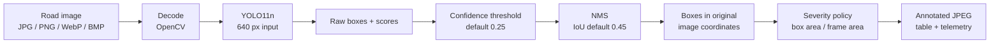

# Model explanation

> **What the checkpoint is:** an Ultralytics **YOLO11n** detection model fine-tuned for one class, `pothole`, at 640 px input. It outputs bounding boxes and confidence scores. It does **not** output masks, depth, volume, GPS coordinates or maintenance decisions.

This page explains the model at a level that can be defended without over-claiming architecture internals. The exact training and evaluation numbers are in [training and evaluation](training-and-evaluation.md); the measured results are in [verified results](../09-testing-and-results/verified-results.md).

## 1. At a glance

| Field | Verified value |
|---|---|
| Architecture | Ultralytics YOLO11n |
| Task | Detection (`detect`) |
| Class | `pothole` (class `0`) |
| Input size | 640 px |
| Fused model | 101 layers, **2,582,347** parameters, **6.4 GFLOPs** |
| Checkpoint size | **5,467,546 bytes** (≈ 5.2 MiB) |
| Checkpoint SHA-256 | `f3490f953b4ac2aa0205c206c151be8f2da281da99708713b182492a43c7751c` |
| Training device in metadata | `0` (CUDA) |
| Evaluation device in recorded run | Apple M2 GPU via MPS |

The parameter/GFLOP/layer values come from inspecting the fused checkpoint, not from the public YOLO11n specification table. Ultralytics lists YOLO11n at roughly 2.6 M parameters and 6.5 B FLOPs on COCO; the small differences are expected because the project checkpoint is a fine-tuned, fused model and the measurement context differs.

## 2. Where the model sits



The dashboard and CLI share the checkpoint and the severity function. The API's `conf` and `iou` controls act at the stages shown: confidence filtering before NMS, then NMS suppression.

## 3. Architecture at a defensible level

YOLO11 is a **single-stage, CNN-based object detector**. At the level documented publicly by Ultralytics, the detection pipeline has three conceptual parts:

| Stage | Role | What this document claims |
|---|---|---|
| **Backbone** | Extracts feature maps at several spatial resolutions | Yes — multi-scale feature extraction |
| **Neck** | Fuses features from different scales | Yes — feature fusion before prediction |
| **Head** | Predicts class scores and box coordinates | Yes — detection head; anchor-free prediction |
| **Post-processing** | Thresholds scores and suppresses overlapping boxes | Yes — confidence filter + NMS |

The detector is **anchor-free**: it predicts boxes directly rather than regressing offsets from a fixed set of anchor boxes. The Ultralytics detection family documents an anchor-free split head; YOLO11 is the successor to that family. This page does not assert the placement or exact composition of named blocks (for example C3k2 or C2PSA modules), because the project did not independently inspect the architecture YAML and Ultralytics has not published a formal YOLO11 research paper. The public documentation describes an improved backbone and neck over YOLOv8, but block-level claims are unnecessary for the viva and easy to overstate.

The checkpoint reports **101 fused layers**. That is a serialization/fusion count, not a count of named architectural blocks. Do not say "the model has 101 layers" as if it were a clean block diagram.

YOLO11 is not the newer NMS-free family. The project pipeline relies on Ultralytics' NMS post-processing; Ultralytics positions YOLO26 as its end-to-end NMS-free line. Do not describe this checkpoint as NMS-free.

## 4. What the numbers mean

### Parameters

`2,582,347` learnable weights in the fused checkpoint. This is a measure of model capacity, not accuracy. A larger parameter count does not guarantee better pothole detection, especially with a single class and a modest local dataset.

### GFLOPs

`6.4 GFLOPs` is the approximate number of floating-point operations for one 640 × 640 forward pass, as reported by the model tooling. It is a **compute cost estimate**, not a latency measurement. Real latency depends on hardware, batch size, memory bandwidth, preprocessing, post-processing and whether the device is CPU, CUDA or MPS.

### File size

`5,467,546 bytes` (≈ 5.2 MiB) is the serialized checkpoint on disk. It is small enough to sit in a local project folder and to move between machines, but it is **not** bundled in Git. The repository excludes `weights/`.

### Input size

`640 px`. Ultralytics resizes/letterboxes the input to this size. The API returns boxes in the original image coordinates, so a 1920 × 1080 upload is not reported in 640-space.

## 5. Why a nano model

The released checkpoint is the **nano** variant, not the `small` default of `train.py`.

| Consideration | Consequence |
|---|---|
| Local-first deployment | The dashboard is intended to run on a laptop or workstation, not a GPU cluster |
| Apple M2 / CPU fallback | A small model keeps interactive latency usable; the recorded MPS inference was 3.82 ms/image in evaluation |
| Single class | The detection problem is narrower than 80-class COCO; a large model is not obviously necessary |
| Small checkpoint | 5.2 MiB is easy to store and load locally |
| Trade-off | Lower capacity than s/m/l/x; the recorded recall is 0.5996, so misses matter |

This is a **design rationale**, not an ablation. The project did not train s/m/l/x variants on the same split, so it cannot claim that nano is optimal. A larger model or more data would need a separate training and evaluation run before any accuracy claim.

The `train.py` default is `yolo11s.pt`; the checkpoint metadata says YOLO11n. To reproduce the checkpoint's **size class**, pass `--model yolo11n.pt`. See [training and evaluation](training-and-evaluation.md#3-trainpy-defaults-versus-checkpoint-metadata).

## 6. What the model is not

| Not this | Why |
|---|---|
| **Instance segmentation** | The checkpoint is a detect model. It returns rectangles, not pixel masks. Masks may have been used to *derive* training boxes, but the deployed model has no mask head. |
| **Depth or volume estimation** | The input is a monocular RGB image. There is no depth sensor, stereo pair or calibrated scale. |
| **Pothole tracking** | Video inference is frame-by-frame. The same pothole can be counted in consecutive frames; there is no cross-frame identity or deduplication. |
| **Geolocation / GIS** | Telemetry contains frame/box/confidence/severity/coverage fields, not GPS coordinates or a map layer. |
| **Crack/rut/other-defect classifier** | Only class `0` (`pothole`) exists. |
| **A calibrated probability model** | Confidence scores are ranking scores, not calibrated probabilities. See §7. |
| **A safety certification** | The output is decision support for inspection, not a certified road-safety measurement. |
| **An autonomous maintenance decision system** | Severity is a geometric heuristic; no maintenance action is automated. |

## 7. Confidence is not a calibrated probability

The API and UI expose a confidence score for each box. That score is produced by the detection head and used to rank/filter candidates. It is **not** the probability that the box is a true pothole.

Why:

- The training objective optimises detection loss, not probability calibration.
- No calibration set, reliability diagram, expected calibration error (ECE), temperature scaling or isotonic regression is recorded.
- The default `conf=0.25` is an interaction default, not a validated operating point with a known false-positive rate.
- The score distribution changes with the checkpoint, image domain, input size and NMS settings.

A score of `0.75` means "this candidate ranked relatively high," not "75 out of 100 such boxes are correct." For a deployment decision, choose a threshold from a labelled validation set and report precision/recall at that threshold. The recorded PR curve is a better tool than a single confidence number.

## 8. IoU and NMS

### IoU

For two boxes `A` and `B`:

```text
IoU = area(A ∩ B) / area(A ∪ B)
```

`IoU = 0` means no overlap; `IoU = 1` means identical boxes.

Example: `A = [0, 0, 100, 100]`, `B = [30, 0, 130, 100]`.

```text
intersection = 70 × 100 = 7,000
union        = 10,000 + 10,000 − 7,000 = 13,000
IoU          = 7,000 / 13,000 = 0.5385
```

### NMS

Non-maximum suppression (NMS) removes redundant overlapping boxes:

1. Sort candidate boxes by confidence.
2. Keep the highest-confidence box.
3. Suppress remaining boxes whose IoU with a kept box exceeds the NMS threshold.
4. Repeat until no candidates remain.

With the dashboard default `iou=0.45`, the example above (`IoU 0.5385`) would suppress the lower-confidence duplicate. A pair with `IoU 0.30` would both survive.

Important distinctions:

- The API's `iou` form field controls **NMS**, not the IoU used by mAP evaluation.
- `mAP@0.50` uses a fixed evaluation IoU of `0.50`.
- Lowering the NMS IoU suppresses more overlapping boxes; raising it keeps more duplicates.
- NMS is post-processing. It does not improve the model's localization; it only removes redundant candidates.

For one class, NMS is class-agnostic in effect; Ultralytics applies class-aware NMS by default, which matters only if multiple classes exist.

## 9. Severity heuristic

Severity is a geometric heuristic based on the detection box's area as a percentage of the full frame. The implementation is shared by the dashboard, `detect.py` and `test_camera.py` through `infrascan/severity.py`.

### Formula

```text
coverage_pct = ((x2 - x1) × (y2 - y1)) / (frame_width × frame_height) × 100
```

### Bands

| Band | Frame coverage | Interpretation |
|---|---:|---|
| **CRITICAL** | ≥ 8.0% | High-impact road damage; prioritise inspection |
| **MODERATE** | ≥ 2.5% and < 8.0% | Degradation requiring planned maintenance |
| **MINOR** | < 2.5% | Early surface defect with limited coverage |

The lower bounds are inclusive: exactly `8.0%` is CRITICAL; exactly `2.5%` is MODERATE.

### Worked examples

**Example 1 — the recorded image result.** Frame `640 × 640` (`409,600 px²`), box `[166, 383, 407, 502]`:

```text
width  = 407 − 166 = 241
height = 502 − 383 = 119
area   = 241 × 119 = 28,679
coverage = 28,679 / 409,600 × 100 = 7.0017%
```

`7.0017%` is at least `2.5%` and below `8.0%` → **MODERATE**. This matches the recorded API response (`coverage_pct: 7.0`, `severity: MODERATE`).

**Example 2 — CRITICAL.** Frame `640 × 640`, box `[100, 100, 300, 300]`:

```text
area = 200 × 200 = 40,000
coverage = 40,000 / 409,600 × 100 = 9.7656% → CRITICAL
```

**Example 3 — MINOR on a different frame size.** Frame `1280 × 720` (`921,600 px²`), box `[0, 0, 100, 100]`:

```text
area = 10,000
coverage = 10,000 / 921,600 × 100 = 1.085% → MINOR
```

**Example 4 — boundary.** Frame `640 × 640`, box `256 × 128`:

```text
area = 32,768
coverage = 32,768 / 409,600 × 100 = 8.000% → CRITICAL (inclusive lower bound)
```

### Why the heuristic is limited

- It uses the **rectangle area**, not the pothole's pixel area. A loose box inflates severity; a tight box reduces it.
- It is sensitive to camera distance, perspective, crop and occlusion. The same pothole close up and far away can receive different bands.
- It does not measure depth, volume, edge severity, ride quality or structural damage.
- It is normalized by frame area, so resizing the image does not change coverage, but cropping or digital zoom does.
- It is a triage aid, not an engineering measurement.

The severity function is deterministic and shared, which is valuable for consistency between CLI and dashboard. Consistency is not validity: both interfaces can be consistently wrong about physical severity.

## 10. Interpretation checklist

When explaining a detection, separate four questions:

1. **Did the model detect something?** Check the confidence and the box.
2. **Does the box overlap a real pothole?** Check the annotated image; the model can box shadows, patches or road texture.
3. **How large is the box relative to the frame?** That is the severity input, not a physical measurement.
4. **Is the result stable?** A single frame is not a distribution; video is frame-level and not deduplicated.

For the measured behaviour, see [verified results](../09-testing-and-results/verified-results.md). For the training/evaluation protocol, see [training and evaluation](training-and-evaluation.md).
