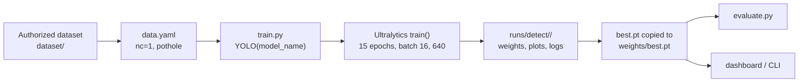
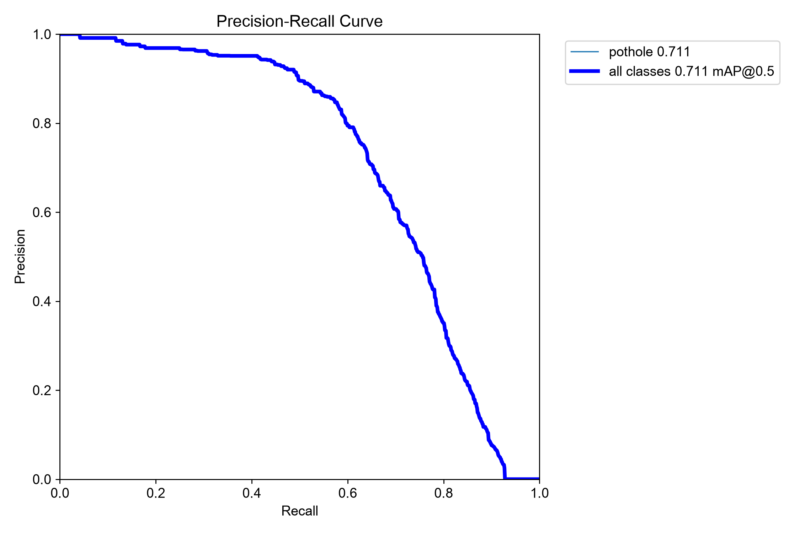

# Training and evaluation

> **Bottom line:** the local checkpoint records a 15-epoch YOLO11n training run on a CUDA device. A fresh evaluation of that checkpoint on the local **718-image test split** produced **P 0.7959, R 0.5996, mAP@0.50 0.7111 and mAP@0.50–0.95 0.3938** on an Apple M2 via MPS. The evaluation is verified; a bit-identical training reproduction is not possible from the repository alone because the dataset is excluded and the exact training command is not recorded.

## 1. Checkpoint identity

| Field | Verified value |
|---|---|
| Architecture | Ultralytics YOLO11n |
| Task | `detect` |
| Class | `pothole` (class `0`) |
| Input size | 640 px |
| Fused layers | 101 |
| Parameters | 2,582,347 |
| GFLOPs | 6.4 |
| File size | 5,467,546 bytes (≈ 5.2 MiB) |
| SHA-256 | `f3490f953b4ac2aa0205c206c151be8f2da281da99708713b182492a43c7751c` |
| Checkpoint metadata date | 2026-09-26 |
| Metadata Ultralytics version | 8.4.108 |
| Metadata licence field | AGPL-3.0 |
| Training data path in metadata | `C:\Users\Bisman Singh\.gemini\antigravity-ide\scratch\YOLO-Pothole-Detection-Model\data.yaml` |

The checkpoint is excluded from Git by `.gitignore` (`weights/`, line 43) and is not redistributed. The metadata is self-reported by the checkpoint; it is evidence of the training environment, not a signed training certificate.

## 2. Training hyperparameters recorded in the checkpoint

| Field | Recorded value |
|---|---|
| Epochs | 15 |
| Batch size | 16 |
| Image size | 640 |
| Optimizer | `auto` |
| Initial learning rate (`lr0`) | 0.003 |
| Final LR factor (`lrf`) | 0.01 |
| Cosine LR | `True` |
| Device | `0` (CUDA) |
| Seed | 0 |
| `close_mosaic` | 3 |

No training log, `args.yaml`, dataset manifest or raw metrics file is committed in the verified tree. The checkpoint metadata is the only record of these values.

## 3. `train.py` defaults versus checkpoint metadata

`train.py` is a wrapper around Ultralytics `model.train()`. Its defaults do **not** describe the released checkpoint exactly.

| Setting | `train.py` default | Checkpoint metadata | Match? | Implication |
|---|---|---|---|---|
| Model | `yolo11s.pt` (small) | YOLO11n (nano) | **No** | Pass `--model yolo11n.pt` to reproduce the size class |
| Epochs | 50 | 15 | **No** | Pass `--epochs 15` |
| Batch | 16 | 16 | Yes | Default is consistent |
| Image size | 640 | 640 | Yes | Default is consistent |
| Optimizer | `auto` | `auto` | Yes | Default is consistent |
| `lr0` | 0.01 | 0.003 | **No** | Pass `--lr0 0.003` |
| `lrf` | 0.01 | 0.01 | Yes | Hard-coded in `train.py` |
| `cos_lr` | `True` | `True` | Yes | Hard-coded in `train.py` |
| Device | `None` → CUDA if available, else CPU | `0` (CUDA) | Conditional | Pass `--device 0` on a CUDA host |
| Seed | Not exposed | 0 | Not comparable | Metadata value is consistent with the Ultralytics default, but the script does not set it |
| `patience` | 15 | Not recorded | Unknown | The default may or may not have been used |
| `close_mosaic` | `min(5, epochs // 4)` if `epochs > 5`, else 0 | 3 | Yes for 15 epochs | `min(5, 15 // 4) = 3` |
| Workers | 0 on Windows, 4 otherwise | Not recorded | Unknown | Platform-dependent |
| Augmentation | Explicit values in `train.py` | Not recorded | Unknown | The script is the best available description, not proof of the actual run |

### A command consistent with the metadata

```bash
python train.py \
  --data data.yaml \
  --model yolo11n.pt \
  --epochs 15 \
  --batch 16 \
  --imgsz 640 \
  --lr0 0.003 \
  --device 0
```

> This is a **reconstruction**, not a recovered command. It does not set `seed=0` because `train.py` does not expose a seed argument; Ultralytics' default seed is 0. It also does not prove the initialization source. The actual run may have used a different wrapper or additional arguments.

### Initialization and reproducibility

`train.py` loads `YOLO(model_name)`. If `yolo11n.pt` was used, Ultralytics loads its COCO-pretrained weights and fine-tunes them on the pothole dataset. The checkpoint metadata does not record the initialization source, so the document cannot assert that this exact transfer-learning path was used.

A bit-identical training rerun would require:

- the exact dataset and split (not available in the repository);
- the exact initialization checkpoint;
- the exact Ultralytics version (metadata says 8.4.108, which differs from the evaluation environment's 8.4.183);
- the exact augmentation and worker settings;
- deterministic CuDNN settings, which `train.py` does not set;
- the same hardware/driver stack.

None of those are recorded end-to-end. Treat training as **partially documented, not reproducible**.

## 4. Training pipeline



`train.py` enables:

| Augmentation / setting | Value | Effect |
|---|---:|---|
| `hsv_h` | 0.015 | Slight hue jitter |
| `hsv_s` | 0.7 | Saturation jitter |
| `hsv_v` | 0.4 | Brightness jitter |
| `degrees` | 5.0 | Small rotation |
| `translate` | 0.1 | Small translation |
| `scale` | 0.5 | Scale jitter |
| `perspective` | 0.0005 | Slight perspective warp |
| `fliplr` | 0.5 | Horizontal flip |
| `mosaic` | 1.0 | Mosaic augmentation |
| `mixup` | 0.15 | Mixup augmentation |
| `close_mosaic` | 3 for 15 epochs | Disable mosaic near the end |
| `save_period` | 5 | Periodic checkpoint saves |
| `plots` | `True` | Training plots |
| `workers` | 4 (non-Windows) | Data loading |

Only explicitly set values are listed. Ultralytics may apply additional defaults (for example erasing) that `train.py` does not override. The checkpoint metadata does not record the augmentation values, so this table describes the **script**, not necessarily the released run.

## 5. Evaluation protocol

### Command used for the verified run

```bash
python evaluate.py \
  --weights weights/best.pt \
  --data <test-data.yaml> \
  --split test \
  --imgsz 640 \
  --batch 16 \
  --device mps
```

The evaluation data was read from a temporary copy to avoid iCloud-evicted dataset files. The normal repository command is the same once `data.yaml` points at an available dataset:

```bash
python evaluate.py \
  --weights weights/best.pt \
  --data data.yaml \
  --split test \
  --imgsz 640 \
  --batch 16
```

### What `evaluate.py` does

- Checks that `weights` exists. **If it does not, it falls back to pretrained `yolo11s.pt`** (`evaluate.py:24–27`). Always pass an explicit checkpoint; otherwise a "missing checkpoint" run silently evaluates a COCO model, not the pothole model.
- Calls `model.val(data=..., split=..., imgsz=..., batch=..., device=..., workers=..., plots=True, save_json=True)` (`evaluate.py:34–45`).
- Prints precision, recall, mAP@0.50, mAP@0.50–0.95 and preprocess/inference/postprocess speed (`evaluate.py:47–58`).
- Writes plots and JSON artifacts under `runs/detect/<name>`.

The evaluation uses Ultralytics validation defaults, not the dashboard's `conf=0.25` / `iou=0.45` inference settings. Do not describe the reported precision/recall as metrics at the UI operating point.

## 6. Verified test metrics

| Metric | Value |
|---|---:|
| Precision (P) | **0.7959** (79.59%) |
| Recall (R) | **0.5996** (59.96%) |
| mAP@0.50 | **0.7111** (71.11%) |
| mAP@0.50–0.95 | **0.3938** (39.38%) |
| Test images | 718 |
| Test instances | 994 |
| Background images | 2 |
| Preprocess | 0.17 ms/image |
| Inference | 3.82 ms/image |
| Postprocess | 10.75 ms/image |

The arithmetic sum of the three speed components is `14.74 ms/image`; this is a sum, not a sustained throughput benchmark.

### Per-metric interpretation

| Metric | What it means | What it does not mean |
|---|---|---|
| **Precision 0.7959** | Of the boxes the detector reports under the validation protocol, roughly four in five match a ground-truth pothole at IoU ≥ 0.5. | It is not "79.59% of all potholes are found"; that is recall. It is not measured at the UI's 0.25 threshold. |
| **Recall 0.5996** | Roughly three in five annotated pothole instances are recovered at IoU ≥ 0.5. | It does not say the missed 40% are invisible; many may be small, occluded, blurred or ambiguously labelled. |
| **mAP@0.50 0.7111** | Area under the precision–recall curve at IoU 0.5; the standard single-threshold summary for this class. | It is not a deployment accuracy guarantee; the test split's provenance and leakage status are unresolved. |
| **mAP@0.50–0.95 0.3938** | Average AP over ten IoU thresholds from 0.50 to 0.95; rewards tighter localization. | It is not directly comparable to COCO mAP, because the dataset, class count and protocol differ. |
| **2 background images** | Empty-label images still contribute false positives to precision. | Two images are too few to estimate the background false-positive rate. |

The gap between precision and recall suggests a conservative operating point: when the model fires, it is often right, but it misses a substantial fraction of instances. Lowering the confidence threshold could trade precision for recall, but **no threshold sweep is recorded**, so this is a hypothesis, not a measured recommendation.

The COCO YOLO11n figure in Ultralytics documentation (about 39.5 mAP@0.50–0.95) is **not** comparable to the project's 39.38. The numbers look similar by coincidence; the datasets and evaluation protocols are different.

## 7. Precision–recall curve



The supplied curve is from the same 718-image run. The legend reports `pothole 0.711` and `all classes 0.711 mAP@0.5`. Precision stays high at low recall and falls as recall increases; the area under the curve corresponds to the reported mAP@0.50 of `0.7111`.

The curve is a **plot artifact**, not an independent re-evaluation. It is consistent with the metric table but does not replace the raw evaluation log. No raw log is committed; the summarised values are recorded in [`../PROJECT_FACTS.md`](../PROJECT_FACTS.md) §5.

## 8. Evaluation environment

| Component | Version / value |
|---|---|
| Machine | Apple M2 (arm64) |
| OS | macOS 27.0.1 (Darwin 27.0.1) |
| Python | 3.12.14 |
| PyTorch | 2.14.1 |
| Torchvision | 0.29.1 |
| Ultralytics | 8.4.183 |
| OpenCV | 5.0.0.93 |
| NumPy | 2.5.4 |
| pandas | 3.0.6 |
| Pillow | 13.0.0 |
| FastAPI | 0.156.8 |
| Uvicorn | 0.54.0 |
| python-multipart | 0.0.32 |
| Evaluation device | `mps` (Apple GPU) |
| Batch / image size | 16 / 640 |

**Training vs evaluation:** the checkpoint metadata records training on CUDA device `0` with Ultralytics `8.4.108`. The metrics above are an **Apple MPS evaluation** with Ultralytics `8.4.183`. Do not present them as an NVIDIA benchmark.

## 9. Reproducibility checklist

### Evaluating the released checkpoint

- [ ] Obtain `weights/best.pt` from an authorised source.
- [ ] Verify SHA-256: `f3490f953b4ac2aa0205c206c151be8f2da281da99708713b182492a43c7751c`.
- [ ] Obtain an authorised copy of the same test split: 718 images, 994 instances, 2 background images.
- [ ] Confirm `data.yaml` points at the dataset and defines `nc: 1`, `names: [pothole]`.
- [ ] Install the recorded environment (or record your own).
- [ ] Run the evaluation command with `--device mps` or the device you are actually using.
- [ ] Save the console log, `runs/detect/<name>` plots and the PR curve.
- [ ] Compare P/R/mAP and record any differences.
- [ ] Record the device, batch size, image size and Ultralytics version.
- [ ] State that the result is a local-split evaluation, not a public benchmark.

### Re-training

- [ ] Obtain the exact authorised training/validation/test split, not just the current test folder.
- [ ] Record the split protocol and seed.
- [ ] Run the label and leakage audits in [annotation and preprocessing](annotation-and-preprocessing.md#6-quality-checks).
- [ ] Use `--model yolo11n.pt` for the nano size class.
- [ ] Set `--epochs 15`, `--batch 16`, `--imgsz 640`, `--lr0 0.003`, `--device 0`.
- [ ] Set `seed=0` explicitly if your Ultralytics version/API allows it; `train.py` does not expose it.
- [ ] Record whether the run used COCO-pretrained initialization.
- [ ] Record augmentation values and Ultralytics version.
- [ ] Expect numerical, not bit-identical, agreement.

## 10. Export commands and untested warning

`export.py` wraps `YOLO.export()` and supports:

| Format | Command | Typical target | Prerequisite / note |
|---|---|---|---|
| ONNX | `python export.py --weights weights/best.pt --format onnx` | Cross-platform runtime | ONNX toolchain; not tested |
| TensorRT | `python export.py --weights weights/best.pt --format engine --half` | NVIDIA edge devices | TensorRT + NVIDIA GPU; not tested |
| TorchScript | `python export.py --weights weights/best.pt --format torchscript` | C++ / LibTorch | Not tested |
| OpenVINO | `python export.py --weights weights/best.pt --format openvino` | Intel CPU / iGPU | OpenVINO toolchain; not tested |
| CoreML | `python export.py --weights weights/best.pt --format coreml` | Apple platforms | CoreML toolchain; not tested |
| TFLite | `python export.py --weights weights/best.pt --format tflite` | Android / mobile | TensorFlow toolchain; not tested |

> **Warning:** none of these export paths was exercised in the recorded evidence. Do not claim export success, exported-model accuracy or latency. `export.py` also falls back to `yolo11s.pt` if the `--weights` path is missing (`export.py:14–17`), so always pass an explicit checkpoint.

Export is provided by Ultralytics; each target may download additional dependencies and may carry its own licence and hardware requirements. Review those terms before distributing an exported artifact.

## 11. What would change the numbers

- A different checkpoint or training run.
- A different test split, or a leakage-free re-split.
- A different confidence/NMS operating point.
- A different input size or batch size.
- CPU vs CUDA vs MPS.
- A different Ultralytics/PyTorch version.
- A different image domain (night, rain, motion blur, different camera geometry).

The recorded result is a single evaluation on a single local split. It is useful evidence that the pipeline works and that the checkpoint has learned the class; it is not a generalisation claim.

For the functional checks that accompany the evaluation, see [verified results](../09-testing-and-results/verified-results.md). For the checkpoint's licensing caveats, see [licensing and attribution](licensing-and-attribution.md).
