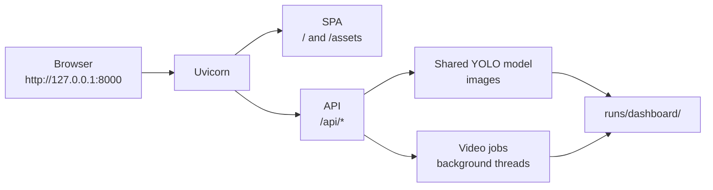

# Setup and execution

This chapter takes InfraScan from a fresh checkout to a running local dashboard, explains every configuration value that matters, walks through the interface, and maps common failures to concrete fixes. It describes the accepted **FastAPI + vanilla ES-module SPA** implementation, not the earlier Streamlit prototype.

> **Before you start:** the repository does **not** include the trained checkpoint or the dataset. The dashboard can start without them, but it cannot run inference until a compatible `weights/best.pt` is supplied. Obtain the checkpoint only from a source you are authorised to use; no download URL is asserted here. See [Dataset provenance](../05-dataset-and-model/dataset-provenance.md) and [Licensing and attribution](../05-dataset-and-model/licensing-and-attribution.md).

## Chapter contents

| Page | Use it when |
|---|---|
| [Installation](installation.md) | You need Python, dependencies, a virtual environment and a checkpoint in place |
| [Configuration](configuration.md) | You need to change the checkpoint path, port, thresholds, limits or paths |
| [Application usage](application-usage.md) | You want a guided tour of image, video, webcam, System and keyboard workflows |
| [Troubleshooting](troubleshooting.md) | Something fails and you need a symptom-to-fix path |

## What you need

| Requirement | Detail |
|---|---|
| Operating system | Verified on macOS 27.0.1 (Apple M2). Linux/Windows are expected but `[TO BE CONFIRMED]` |
| Python | 3.12.14 was used for the verified run; 3.10+ is a reasonable floor from the dependency set, but not tested |
| Disk | Room for the virtual environment, dependencies, checkpoint (5.2 MB) and `runs/dashboard/` artefacts |
| Checkpoint | A YOLO11n-compatible `best.pt` with a `pothole` class; not redistributed |
| Dataset (optional) | `dataset/images/test` enables the sample picker; not required for uploads |
| Browser | Current Chrome was used; it needs ES modules, native `<dialog>`, `:has()` and `fetch` |
| Camera (optional) | Browser permission and a `localhost`/`127.0.0.1` origin for `getUserMedia` |

The Python package floors are listed in `requirements.txt`:

```text
ultralytics>=8.3.0
torch>=2.0.0
torchvision>=0.15.0
opencv-python>=4.8.0
pillow>=9.5.0
numpy>=1.24.0
pandas>=2.0.0
matplotlib>=3.7.0
seaborn>=0.12.0
pyyaml>=6.0
tqdm>=4.65.0
fastapi>=0.115.0
uvicorn[standard]>=0.30.0
python-multipart>=0.0.9
```

There is no Node.js, npm, bundler or build step. `web/` is served as static files.

## Quick start

```bash
git clone https://github.com/Aayush9808/InfraScan.git
cd InfraScan
python3 -m venv .venv
source .venv/bin/activate          # Windows: .venv\Scripts\activate
python -m pip install --upgrade pip
pip install -r requirements.txt

# Supply a compatible checkpoint you are authorised to use:
#   weights/best.pt
# or export INFRASCAN_WEIGHTS before launch.

python run_app.py
```

Open <http://localhost:8000>. The SPA loads immediately; the status chip moves from **Loading model** to **Model ready** when the checkpoint finishes loading. API schema: <http://localhost:8000/api/openapi.json>.

If the model is missing, the dashboard still loads and explains the problem. The image and video run buttons stay disabled until a checkpoint is available and the model reports `ready`.

## The one architecture fact to remember

The browser, API, static assets and generated media are all served by **one Uvicorn process on one origin**:



There is no separate frontend server, no proxy and no CORS configuration. Do not run `web/` through a separate dev server and expect the API calls to work.

## Supported launch forms

| Command | Use |
|---|---|
| `python run_app.py` | Normal local launch with banner and browser opening |
| `python run_app.py --no-browser` | Same, without opening a browser |
| `python run_app.py --port 8001` | Another port |
| `python run_app.py --reload` | Development auto-reload |
| `uvicorn app:app --host 127.0.0.1 --port 8000` | Direct ASGI launch |
| `python app.py` | Delegates to the launcher |

The default bind is `127.0.0.1:8000`. Do not bind `0.0.0.0` on a shared network: there is no authentication, TLS, CSRF protection or rate limiting. See [Deployment and operations](../04-architecture/deployment-and-operations.md#reverse-proxy-and-tls).

## Where things live

| Path | Purpose |
|---|---|
| `app.py` | ASGI entrypoint exporting `app` |
| `run_app.py` | Launcher with host/port/weights/browser/reload flags |
| `infrascan/` | API, config, inference, jobs and severity modules |
| `web/` | SPA shell, ES modules, CSS, fonts and brand assets |
| `weights/best.pt` | Default checkpoint location (gitignored, not bundled) |
| `dataset/images/test/` | Optional samples for the dataset picker |
| `runs/dashboard/results/` | Annotated image JPEGs |
| `runs/dashboard/jobs/` | Per-job input, MP4 and telemetry |
| `data.yaml` | One-class dataset definition for CLI training/evaluation |

## Evidence boundary

| Claim | Status |
|---|---|
| FastAPI imports and serves the dashboard | Verified |
| Image inference, annotated JPEG and telemetry | Verified |
| Video job, annotated H.264 playback in Chrome | Verified |
| Webcam capture with Chrome synthetic media device | Verified with synthetic device |
| Physical webcam | **BLOCKED** on the development machine |
| CUDA execution | **BLOCKED**; MPS was used |
| ONNX/TensorRT/OpenVINO/CoreML/TFLite export | **NOT RUN** |
| Automated Python test suite | **NOT RUN**; none exists |
| Linux/Windows setup | `[TO BE CONFIRMED]` |

The authoritative values are in [`PROJECT_FACTS.md`](../PROJECT_FACTS.md). Full results are in [Verified results](../09-testing-and-results/verified-results.md).

## Related chapters

- [Architecture](../04-architecture/README.md) — how the process, model and SPA fit together.
- [Deployment and operations](../04-architecture/deployment-and-operations.md) — runbook, logs, backup and non-goals.
- [Security and privacy](../11-security-and-quality/security-and-privacy.md) — local trust model and residual risks.
- [Performance](../11-security-and-quality/performance.md) — measured latency and unmeasured areas.
- [Accessibility](../11-security-and-quality/accessibility.md) — keyboard, contrast and screen-reader findings.

If setup fails, start with [Troubleshooting](troubleshooting.md) before changing code.
