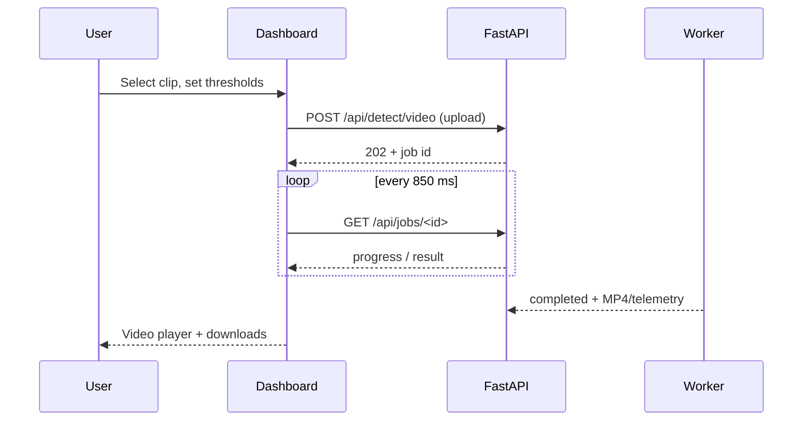

# Application usage

This is a guided tour of the running InfraScan dashboard and its command-line companions. It assumes the server is installed, a checkpoint is available, and the dashboard reports **Model ready**. Installation is covered in [Installation](installation.md).

- [Before you begin](#before-you-begin)
- [The shell](#the-shell)
- [Overview](#overview)
- [Image inspection](#image-inspection)
  - [Choose a source](#choose-a-source)
  - [Set thresholds](#set-thresholds)
  - [Run and read the result](#run-and-read-the-result)
  - [Download and re-run](#download-and-re-run)
- [Video analysis](#video-analysis)
- [Webcam capture](#webcam-capture)
- [System page](#system-page)
- [Command palette and keyboard](#command-palette-and-keyboard)
- [Session and offline behaviour](#session-and-offline-behaviour)
- [Reading severity correctly](#reading-severity-correctly)
- [Command-line usage](#command-line-usage)
- [Limits and expectations](#limits-and-expectations)
- [Evidence boundary](#evidence-boundary)
- [Related pages](#related-pages)

## Before you begin

1. Start the server from the project root:

   ```bash
   source .venv/bin/activate
   python run_app.py
   ```

2. Open <http://localhost:8000> (or the port you chose).
3. Wait for the status chip in the top bar to read **Model ready**. If it says **No checkpoint**, see [Troubleshooting](troubleshooting.md#missing-checkpoint).
4. Keep the terminal visible. It is the only place server errors and tracebacks appear.

The dashboard is a single page with four hash-routed views. Navigation does not reload the page. There is no login screen, account menu or cloud sync.

## The shell

```text
┌──────────────────────────────────────────────────────────────┐
│ ☰  Workspace / Overview          Jump to…  Model ready  ⧉   │
├───────────────┬──────────────────────────────────────────────┤
│ Overview      │                                              │
│ Image inspect │            Active view                       │
│ Video analysis│                                              │
│ System        │                                              │
│               │                                              │
│ Runtime       │                                              │
│ conf / IoU    │                                              │
│ Severity scale│                                              │
└───────────────┴──────────────────────────────────────────────┘
```

| Element | Behaviour |
|---|---|
| Sidebar navigation | Switches views via the URL hash (`#/overview`, `#/inspect`, `#/video`, `#/system`) |
| Runtime card | Model filename/status and device label |
| Inference parameters | Confidence and NMS-IoU sliders, plus **Reset** |
| Severity scale | CRITICAL ≥ 8%, MODERATE 2.5–8%, MINOR < 2.5% |
| Top-bar status chip | Connecting / Loading model / Model ready / No checkpoint / Model error / API offline |
| **Jump to…** | Opens the command palette (`⌘K` / `Ctrl+K`) |
| Hamburger (≤1024 px) | Opens the sidebar drawer |
| Footer | Links to the GitHub repository and documentation |

At widths below 1024 px the sidebar becomes an overlay drawer with a scrim. At widths below 620 px the status chip collapses to a colour dot; the text is hidden. That is a known accessibility gap, not a feature to rely on.

## Overview

The Overview is a read-only summary:

- Hero status, checkpoint filename, device and last measured latency.
- Four statistics: model status, compute device, checkpoint size, and session scans.
- Capability cards linking to image and video workspaces.
- Pipeline explanation (Capture → Detect → Filter → Score → Export).
- Severity scale and a link to start an inspection.

Use it before a demonstration to confirm the checkpoint name and device. The "last latency" value is the most recent image `inference_ms` in this tab, not a rolling benchmark.

## Image inspection

Route: `#/inspect`.

The workspace has two columns on wide screens: source and guidance on the left, result on the right. They stack below 1120 px.

### Choose a source

Three tabs use a segmented control:

| Tab | What it does |
|---|---|
| **Upload** | Drag-and-drop or browse for JPG, JPEG, PNG, WebP or BMP up to 25 MB |
| **Dataset** | Lists up to 24 images from `dataset/images/test`; click a tile to select it |
| **Webcam** | Opens a camera dialog to capture one JPEG frame |

The tabs support Left/Right arrow keys when focused. The dropzone is keyboard-operable with Enter or Space. The hidden file input enforces the browser-side extension and size checks; the server independently enforces the byte limit and decodes the image.

Selecting a file or sample shows a preview, the source label, filename and size/dimensions. The **Run inspection** button is enabled only when:

- the local API is online,
- the model state is `ready`,
- an image is selected,
- no inspection is already running.

If the model is loading, the note says so. If the checkpoint is missing or errored, the note points to the System page. Changing a slider after a result produces "Parameters changed — run again to apply."

### Set thresholds

The global sidebar controls apply to both image and video requests:

| Control | Range | Step | Default | Effect |
|---|---|---|---|---|
| Confidence | 0.05–1.0 | 0.05 | 0.25 | Higher values keep fewer, stronger detections |
| NMS IoU | 0.10–1.0 | 0.05 | 0.45 | Lower values suppress more overlapping boxes |

The current values appear in the view header (`conf`, `IoU`, `imgsz 640`). They persist in this browser's `localStorage` until **Reset** or site-data clearing. They are not saved on the server and do not change the CLI defaults.

The labels are explanatory, not calibrated guarantees. A lower confidence surfaces weaker candidates and more false positives; a higher value can miss real potholes, especially at the verified recall of 0.5996.

### Run and read the result

Click **Run inspection** (or use the command palette action). The result card shows a loading state, then one of:

| State | What you see |
|---|---|
| Success with detections | Annotated image, four metrics, severity summary bar, telemetry table, downloads |
| Success with zero detections | Annotated image still present; "No potholes above the current threshold" message |
| Error | "Inspection failed" panel with the server's message and a **Retry** button |
| Offline | Toast and disabled run controls; existing result remains until replaced |

The result area includes:

| Element | Meaning |
|---|---|
| **Annotated / Original** toggle | Switches between the server JPEG and the local preview |
| **Expand** or click image | Opens the lightbox at full size |
| **Detections** | Number of boxes above threshold |
| **Critical** | Count in the CRITICAL band |
| **Max coverage** | Largest single-box frame coverage |
| **Inference** | `inference_ms` for the model call, not total request time |
| Severity summary | Proportional bar with counts and an accessible label |
| Table | `#`, severity, confidence, coverage, bounding box |
| Result meta | Dimensions, thresholds, filename, local time |

The **Original** view depends on the browser still holding the source preview. If the source was a dataset sample, the URL is still available; if the object URL was revoked by clearing the selection, the toggle is disabled. The annotated JPEG remains available from the server until cleanup.

The telemetry table is frame-level for images (one row per detected box). Confidence is shown as a percentage with one decimal; coverage uses two decimals. Bounding boxes are integer pixel coordinates in the decoded frame.

### Download and re-run

| Action | Result |
|---|---|
| **Annotated image** | Downloads the server JPEG with a name derived from the source |
| **Telemetry CSV** | Generates a CSV in the browser from the current result |
| **Run again** | Repeats the request with the current thresholds |
| **Clear (×)** | Removes the selection, revokes the object URL and resets the result |
| **Retry** (error panel) | Repeats the failed request |

The CSV columns are `image`, `box`, `confidence`, `severity`, `coverage_pct`. The CSV is not stored server-side. If you need an auditable copy, download it before starting another inspection.

## Video analysis

Route: `#/video`.

The flow is deliberately asynchronous:



### Upload and start

- Accepted extensions: MP4, AVI, MOV, MKV.
- Maximum size: 2 GB (2,147,483,648 bytes).
- Drag-and-drop or browse; a local preview player appears with name, size and duration once metadata loads.
- While a job is active, changing footage is blocked with a toast.
- **Process video** is enabled only when the API is online, the model is ready, and a video is selected.

The upload itself is part of the request. A large file can take a long time before the `202` appears; the button shows **Uploading…** during that period. There is no resumable upload.

### Progress

The processing card shows:

- Stage text (`Queued`, `Loading checkpoint`, `Preparing video`, `Analysing frames`, `Complete`, `Failed`).
- A progress bar based on `progress.fraction`.
- Frame count when the container reports a total.
- An ETA estimated from elapsed time and fraction once enough progress exists.

The UI warns you to keep the tab open. Processing is server-side and continues if the tab closes, but polling stops and you will not see completion. There is no cancel button; stopping a long job requires stopping the server.

Multiple video jobs are accepted, but frame loops are serialised. A second job can appear to be "processing" while waiting for the first. Do not expect parallel speed-up.

### Result

On completion:

| Element | Meaning |
|---|---|
| Video player | Annotated MP4 from `/api/jobs/<id>/video` |
| Detections | Total frame-level records (not unique potholes) |
| Critical | Frame-level CRITICAL records |
| Frames | Frames processed |
| Processing | Wall time and approximate processed frames/s |
| Severity summary | Counts by band |
| Annotated video | MP4 download |
| Telemetry CSV / JSON | Frame/box/confidence/severity/coverage records; disabled if none |

The result note states explicitly that counts are frame-level and that there is no cross-frame tracking. The same pothole across many frames inflates the count.

### Playback caveats

The worker tries an H.264 (`avc1`) writer first, then `mp4v`. On the verified machine the output was H.264 and Chrome reached `readyState 4`. On a machine without an H.264 encoder, the fallback MP4 may not play in every browser. If the video element is blank or shows an unsupported-source error, see [Troubleshooting](troubleshooting.md#video-playback).

## Webcam capture

The **Webcam** tab captures a single still; it does not stream to the server or record video.

1. Click **Open webcam**.
2. Grant camera permission when the browser asks.
3. Frame the road and click **Capture frame**.
4. The dialog closes, the stream stops, and the JPEG becomes the selected image.
5. Click **Run inspection** to send it through the normal image endpoint.

Requirements and limits:

- The page must be a secure context. `http://localhost` and `http://127.0.0.1` qualify; a plain-HTTP LAN address usually does not.
- The browser requests `facingMode: environment` at an ideal 1920×1080. The actual resolution is device-dependent.
- Capture is a canvas JPEG at quality 0.92.
- Permission denial, no camera, a busy camera and unsupported browsers produce specific messages in the dialog.
- A physical webcam was **not** independently verified on the development machine; the recorded check used Chrome's synthetic media device. Treat physical camera behaviour on the examiner's machine as `[TO BE CONFIRMED]`.
- There is a known close-during-permission race that can leave a late-resolving stream active. If the camera indicator stays on after closing, close the tab or revoke the site's camera permission. See [Security and privacy](../11-security-and-quality/security-and-privacy.md#sec-10--webcam-stream-race).

## System page

Route: `#/system`. This is the transparency page and the first place to look when inference is unavailable.

| Card | Contents |
|---|---|
| **Model & checkpoint** | State tag, checkpoint name, resolved path, task, classes, device, inference size, file size, loader error |
| **Runtime** | Python, platform, architecture, PyTorch, Ultralytics, OpenCV, NumPy, FastAPI |
| **Severity policy** | Band, coverage range and interpretation, fetched from `/api/status` |
| **HTTP API** | Short route list and a link to `/api/docs` |
| **Good to know** | Checkpoint/dataset bundling, severity heuristic, frame-level counts, camera requirements |
| **CLI reference** | Copyable commands for dashboard, detect, camera, evaluate, export and train |

The **Reload checkpoint** button calls `POST /api/model/reload`. It waits for any in-flight image prediction, reloads the same path, and shows a toast on success or failure. It does not re-read `INFRASCAN_WEIGHTS`; use a restart to change the path.

The **Open interactive API docs** link points to FastAPI's Swagger UI. The application's CSP (`script-src 'self'`) is expected to block the default CDN/inline Swagger assets, so the page may appear blank or unstyled. This was not browser-verified in the documentation run. Use `/api/openapi.json` for the schema and the `curl` examples in [Backend and API](../04-architecture/backend-and-api.md) for testing. See [Troubleshooting](troubleshooting.md#api-docs-csp).

## Command palette and keyboard

Open with **⌘K** on macOS or **Ctrl+K** on Windows/Linux, or click **Jump to…**.

| Key | Action |
|---|---|
| `↑` / `↓` | Move the active command |
| `Home` / `End` | First / last command |
| `Enter` | Run the active command |
| `Esc` | Close the palette/dialog |

Available commands include navigation to each view, **Run image inspection**, **Capture a webcam frame**, **Reload checkpoint**, **Reset inference parameters**, **Copy dashboard command**, **Open API documentation** and **Open GitHub repository**.

Other keyboard behaviour:

- Image source tabs: Left/Right arrows.
- Dropzones: Enter or Space opens the file picker.
- Native dialogs (palette, lightbox, camera): Escape closes, focus is restored by the browser/palette code.
- Sidebar drawer: Escape closes it; the menu button exposes `aria-expanded`.

There is no global shortcut to start a video job and no keyboard shortcut to download results beyond tabbing to the links.

## Session and offline behaviour

- **Session scans** counts successful image inspections in this tab; its subtitle counts completed videos. It resets on refresh and is not sent anywhere.
- Last latency is in-memory and resets on refresh.
- The status poll runs every 15 s when ready, 2.5 s while loading and 5 s while offline. Returning to the tab triggers an immediate refresh.
- If the server stops after the SPA has loaded, the UI shows **API offline**, disables run controls and keeps existing results visible. Starting the server again restores the chip on the next poll.
- If the server is down before the first page load, the SPA cannot load at all. There is no service worker or offline cache.

## Reading severity correctly

Severity is computed from the **bounding-box area divided by the full frame area**:

```text
coverage_pct = ((x2 - x1) × (y2 - y1)) / (frame_width × frame_height) × 100
```

| Band | Coverage | Intended reading |
|---|---|---|
| CRITICAL | ≥ 8.0% | High-impact road damage; prioritise inspection |
| MODERATE | ≥ 2.5% and < 8.0% | Degradation requiring planned maintenance |
| MINOR | < 2.5% | Early surface defect with limited coverage |

The bands are shared by the dashboard, `detect.py` and `test_camera.py`. They are a visual heuristic:

- A close-up pothole can score CRITICAL purely because it fills the frame.
- A distant, severe pothole can score MINOR.
- Perspective, occlusion, crop and camera angle change coverage.
- Severity says nothing about depth, volume, ride quality or structural damage.
- Boxes can overlap; `total_coverage_pct` is a sum, not a union, and can exceed 100%.

Use the numbers as triage evidence, not as an engineering assessment. See [Inference workflow](../04-architecture/inference-workflow.md#severity-scoring).

## Command-line usage

The CLI uses the same checkpoint and severity policy but is separate from the running dashboard.

### Image or video

```bash
python detect.py --source path/to/road.jpg --weights weights/best.pt --save
python detect.py --source path/to/clip.mp4 --weights weights/best.pt --save
```

Outputs go to `runs/detect/predict` by default: annotated images/video plus `pothole_telemetry.csv` and `.json` when detections exist. Use `--output` to choose another directory, `--conf`/`--iou` to override thresholds, and `--device cpu` or `--device 0` to choose hardware.

### Live camera HUD

```bash
python test_camera.py --weights weights/best.pt --cam-id 0 --conf 0.25
```

This opens an OpenCV window. Controls: `Q`/`Esc` quit, `S` snapshot, `+`/`-` adjust confidence, `H` toggle the HUD. Physical camera behaviour is `[TO BE CONFIRMED]`; the script falls back to `yolo11s.pt` if the checkpoint is missing, which is **not** the trained model.

### Evaluation

```bash
python evaluate.py --weights weights/best.pt --data data.yaml --split test --imgsz 640 --batch 16 --device mps
```

This writes Ultralytics plots and metrics under `runs/detect/evaluation_test` by default. The verified metrics are P 0.7959, R 0.5996, mAP@0.50 0.7111 and mAP@0.50–0.95 0.3938 on 718 test images. Re-running on a different dataset or split will produce different numbers; do not present them as the verified values.

### Training and export

```bash
python train.py --data data.yaml --model yolo11n.pt --epochs 50 --batch 16
python export.py --weights weights/best.pt --format onnx
```

Training and export are outside the dashboard. Export formats are **NOT RUN**; do not claim a successful ONNX/TensorRT/OpenVINO/CoreML/TFLite conversion. Training requires the dataset and can take a long time; the verified checkpoint metadata records 15 epochs on CUDA, but that run is not re-executed here.

## Limits and expectations

| Limit | Value |
|---|---|
| Image upload | 25 MB (26,214,400 bytes) |
| Video upload | 2 GB (2,147,483,648 bytes) |
| Image formats | JPG, JPEG, PNG, WebP, BMP (server decodes; extension not enforced server-side) |
| Video formats | MP4, AVI, MOV, MKV (extension checked; container not sniffed) |
| Confidence | 0.05–1.0 |
| NMS IoU | 0.10–1.0 |
| Inference size | 640 px |
| Sample tiles | Up to 24 |
| Result/job retention | 24 h TTL, applied only at startup |
| Authentication | None |
| Default bind | `127.0.0.1:8000` |

Expected but not guaranteed:

- First inference after startup can be slower while the accelerator warms up.
- A warm image request was recorded at 66.2 ms `inference_ms` on the verified machine. This is one observation, not a performance guarantee.
- Video processing time scales with frames, resolution, device and whether another job is running.
- Long clips can take minutes; keep the terminal and tab open.
- Very large images can use significant memory even under the 25 MB file cap.

## Evidence boundary

| Claim | Status |
|---|---|
| Image upload, sample selection, webcam (synthetic), annotated result, CSV | Verified |
| Video upload, progress, annotated MP4 playback in Chrome, telemetry | Verified |
| Responsive checks at 390, 820, 1024 and 1440 px with no page-level horizontal overflow | Verified |
| Physical webcam | **BLOCKED** |
| CUDA | **BLOCKED** |
| Export formats | **NOT RUN** |
| Automated test suite | **NOT RUN** |
| Cross-browser matrix | `[TO BE CONFIRMED]` |
| Accessibility certification | None; see [Accessibility](../11-security-and-quality/accessibility.md) |

Screenshots of these views are in the repository's [`assets/screenshots`](../assets/screenshots/) directory; they are captures of the accepted dashboard, not mockups.

## Related pages

- [Installation](installation.md) — setup and verification.
- [Configuration](configuration.md) — paths, flags, thresholds and TTLs.
- [Troubleshooting](troubleshooting.md) — failure recovery.
- [Frontend architecture](../04-architecture/frontend-architecture.md) — state, routing and polling.
- [Inference workflow](../04-architecture/inference-workflow.md) — what happens inside each request.
- [Data flow](../04-architecture/data-flow.md) — where results and telemetry are stored.
- [Security and privacy](../11-security-and-quality/security-and-privacy.md) — local-only trust model.
- [Performance](../11-security-and-quality/performance.md) — measured and unmeasured performance.
