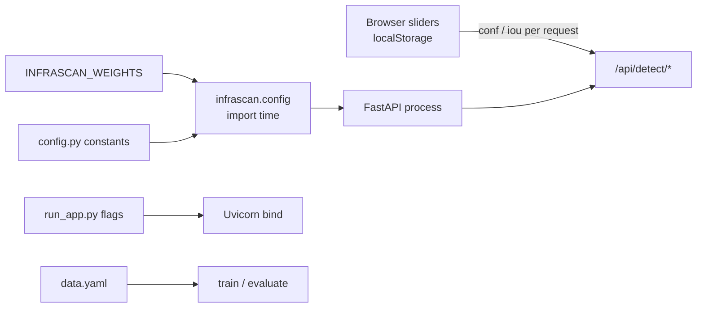

# Configuration

InfraScan has no configuration file, settings database or admin panel. Configuration comes from three places: **Python constants** in `infrascan/config.py` and `infrascan/severity.py`, **one environment variable** for the checkpoint path, and **browser localStorage** for the two inference thresholds. Understanding which layer owns which value prevents most "why didn't my change apply?" confusion.

- [Configuration layers](#configuration-layers)
- [Checkpoint path](#checkpoint-path)
- [Server host and port](#server-host-and-port)
- [Paths and directories](#paths-and-directories)
- [Upload limits and formats](#upload-limits-and-formats)
- [Thresholds and defaults](#thresholds-and-defaults)
- [Runtime and retention values](#runtime-and-retention-values)
- [Severity policy](#severity-policy)
- [Browser settings](#browser-settings)
- [Dataset configuration](#dataset-configuration)
- [CLI configuration](#cli-configuration)
- [What requires a restart](#what-requires-a-restart)
- [Common configuration tasks](#common-configuration-tasks)
- [Related pages](#related-pages)

## Configuration layers

| Layer | Where | Read when | Applies to | Persisted |
|---|---|---|---|---|
| Python constants | `infrascan/config.py`, `infrascan/severity.py` | Module import | Server, defaults, limits, paths | In source |
| Environment | `INFRASCAN_WEIGHTS` | `infrascan.config` import | Checkpoint path | Shell/process |
| Launcher flags | `run_app.py` CLI | Process start | Host, port, checkpoint attempt, browser, reload | Command line |
| Browser settings | `localStorage["infrascan.settings.v2"]` | Page load | Next image/video request | Browser |

There is **no** `.env` loader. A `.env` file is ignored by Git but is not read by the application. There is no YAML/JSON application config. The only YAML file, `data.yaml`, is for Ultralytics training/evaluation and is not read by the dashboard.



## Checkpoint path

### Resolution order

1. If `INFRASCAN_WEIGHTS` is set and non-empty at import, use `Path(value).expanduser().resolve()`.
2. Otherwise use `<PROJECT_ROOT>/weights/best.pt`.

`PROJECT_ROOT` is the parent of the `infrascan/` package, so the default path is stable even if the launcher is started from another directory.

```python
_weights_env = os.environ.get("INFRASCAN_WEIGHTS", "").strip()
WEIGHTS_PATH = (
    Path(_weights_env).expanduser().resolve()
    if _weights_env
    else PROJECT_ROOT / "weights" / "best.pt"
)
```

| Property | Value |
|---|---|
| Variable | `INFRASCAN_WEIGHTS` |
| Read at | Import of `infrascan.config` |
| Type | Filesystem path; `~` expanded |
| Relative paths | Resolved against the process's current working directory at import |
| Re-read by model reload | **No** |
| Required format | A PyTorch/Ultralytics checkpoint compatible with the installed Ultralytics version |

Use an **absolute path** to avoid working-directory ambiguity:

```bash
export INFRASCAN_WEIGHTS="/Users/you/models/pothole-best.pt"
python run_app.py --no-browser
```

```powershell
$env:INFRASCAN_WEIGHTS = "C:\Users\you\models\pothole-best.pt"
python run_app.py --no-browser
```

### The `--weights` caveat

`run_app.py --weights <path>` looks convenient, but the launcher imports `infrascan.config` near the top of the file to get `PROJECT_ROOT`, before `main()` parses arguments and sets `INFRASCAN_WEIGHTS`. In a normal launch, Uvicorn imports `app:app` in the same process and reuses the cached config module. The path was already resolved, so `--weights` may have no effect.

| Approach | Reliability |
|---|---|
| Place at `weights/best.pt` | Works; default path |
| `export INFRASCAN_WEIGHTS=...` before `python run_app.py` | Works |
| `python run_app.py --weights ... --reload` | Works because the reload child re-imports config with the environment inherited |
| `python run_app.py --weights ...` without reload | **May not apply**; source-ordering issue |
| Editing the path in `config.py` | Works, but do not edit source for a demonstration if an env var suffices |

This caveat is code-derived; it has not been presented as a browser test result. If you need to verify which path the running process uses, open **System → Checkpoint path**, which reports the resolved `WEIGHTS_PATH`.

### Reload behaviour

**Reload checkpoint** calls `inference.reload_model()`. It re-opens the same resolved path; it does not re-read `INFRASCAN_WEIGHTS`. To change the path, stop the process and start it again with the desired environment.

### CLI checkpoint flags

The CLI scripts have their own `--weights` flags, independent of the dashboard:

```bash
python detect.py --weights weights/best.pt ...
python test_camera.py --weights weights/best.pt ...
python evaluate.py --weights weights/best.pt ...
python export.py --weights weights/best.pt ...
```

Unlike the dashboard, `detect.py`, `test_camera.py`, `evaluate.py` and `export.py` print a warning and fall back to `yolo11s.pt` when the supplied path does not exist. That historical fallback is **not** dashboard behaviour and should be called out in a demonstration.

## Server host and port

| Flag | Default | Read by | Notes |
|---|---|---|---|
| `--host` | `127.0.0.1` | `run_app.py` → Uvicorn | Loopback only by default |
| `--port` | `8000` | `run_app.py` → Uvicorn | Any free TCP port |
| `--no-browser` | off | `run_app.py` | Suppresses the 1.5 s browser timer |
| `--reload` | off | `run_app.py` → Uvicorn | Development only |
| `--weights` | `None` | `run_app.py` | See caveat above |

```bash
python run_app.py --host 127.0.0.1 --port 8001 --no-browser
```

There are no `INFRASCAN_HOST` or `INFRASCAN_PORT` variables. When launching with Uvicorn directly, pass `--host` and `--port` to Uvicorn:

```bash
uvicorn app:app --host 127.0.0.1 --port 8000
```

### Binding beyond loopback

`--host 0.0.0.0` exposes the dashboard to every interface. The application has **no authentication, no TLS, no CSRF token, no Origin/Host validation and no rate limiting**. Do not do this on a shared or untrusted network. If remote access is genuinely required, put an authenticating TLS proxy in front and restrict network access; see [Deployment and operations](../04-architecture/deployment-and-operations.md#reverse-proxy-and-tls).

### Reload mode

`--reload` watches Python files and restarts the worker on change. It is for development only:

- In-memory jobs and model state are lost on each reload.
- A video job in progress is interrupted.
- The reload child re-imports configuration, which is why `--weights` works in this mode.
- Startup cleanup runs again on each reload.

## Paths and directories

All defaults are derived from `PROJECT_ROOT`:

| Constant | Default | Purpose |
|---|---|---|
| `PROJECT_ROOT` | Parent of `infrascan/` | Stable base for every default path |
| `WEB_DIR` | `<root>/web` | SPA shell and assets |
| `ASSETS_DIR` | `<root>/web/assets` | Static mount at `/assets` |
| `WEIGHTS_PATH` | `<root>/weights/best.pt` or env | Checkpoint |
| `DATASET_TEST_DIR` | `<root>/dataset/images/test` | Dataset sample picker |
| `RUNS_DIR` | `<root>/runs/dashboard` | Runtime artefact root |
| `RESULTS_DIR` | `<root>/runs/dashboard/results` | Annotated image JPEGs |
| `JOBS_DIR` | `<root>/runs/dashboard/jobs` | Per-job input/output |

Notes:

- `api.py` fails at import with `RuntimeError: Dashboard assets are missing` if `web/assets` is absent. The SPA cannot be disabled independently.
- `ensure_directories()` creates `RESULTS_DIR` and `JOBS_DIR` at startup. It does not create `weights/` or the dataset.
- The `runs/dashboard` tree is gitignored. It is not inside the documentation repository.
- Paths are not configurable by environment variable; changing them requires editing `config.py` and restarting. Do not do that casually for a demo.
- The application assumes the checkout is writable. A read-only install fails on the first result or job write.

## Upload limits and formats

| Constant | Value | Enforced where |
|---|---|---|
| `MAX_IMAGE_BYTES` | `25 * 1024 * 1024` = 26,214,400 bytes | `_read_upload()` in the image route |
| `MAX_VIDEO_BYTES` | `2 * 1024 * 1024 * 1024` = 2,147,483,648 bytes | `_save_upload()` in the video route |
| `UPLOAD_CHUNK_BYTES` | 1,048,576 bytes (1 MiB) | Both upload readers |
| `IMAGE_EXTENSIONS` | `.jpg`, `.jpeg`, `.png`, `.webp`, `.bmp` | Sample listing/route and browser file filter |
| `VIDEO_EXTENSIONS` | `.mp4`, `.avi`, `.mov`, `.mkv` | Video route extension check and browser filter |
| `SAMPLE_LIMIT` | 24 | `/api/samples` response |

Important asymmetry:

- **Images are not extension-validated server-side.** The route decodes the bytes; a valid image with any filename can be accepted. The browser filters extensions, but the API does not.
- **Videos are extension-validated, not container-validated.** A `.mp4` file with non-video bytes is accepted, saved and then fails in the worker. The decoder is the real judge.
- Upload limits are byte counts, not duration, dimensions or pixel counts. A highly compressed image can decode to a very large array; a small video can have many frames.

The `/api/status` response exposes the extension lists and byte limits under `media`, so a client can discover them without reading source. It does not expose the chunk size or TTLs.

## Thresholds and defaults

| Constant | Value | Notes |
|---|---|---|
| `CONF_MIN` | `0.05` | Lower bound accepted by the API |
| `CONF_MAX` | `1.0` | Upper bound |
| `CONF_DEFAULT` | `0.25` | API form default and UI initial value |
| `IOU_MIN` | `0.10` | Lower bound |
| `IOU_MAX` | `1.0` | Upper bound |
| `IOU_DEFAULT` | `0.45` | API form default and UI initial value |
| `DEFAULT_IMGSZ` | `640` | Fixed for dashboard inference; not a request field |

The API validates `conf` and `iou` with an inclusive range check and returns `422` with a specific message when they are outside the bounds. The browser sliders use steps of `0.05`; the API accepts any float within range, not just multiples of 0.05.

`imgsz` is fixed at 640 in the dashboard. A client cannot request a different inference size. The CLI has an `--imgsz` flag.

The UI's default values are **hard-coded in `store.js`**, not fetched from `/api/status`. If you change `CONF_DEFAULT`/`IOU_DEFAULT` in `config.py`, the API defaults change but the browser's first-load slider values do not automatically follow. Changing the UI defaults requires editing `web/assets/js/store.js` and reloading the page.

## Runtime and retention values

| Constant | Value | Meaning |
|---|---|---|
| `RESULT_TTL_SECONDS` | `86,400` (24 h) | Age threshold for result JPEG cleanup |
| `JOB_TTL_SECONDS` | `86,400` (24 h) | Age threshold for finished job directory cleanup |
| `APP_NAME` | `InfraScan` | Reported in `/api/status` |
| `APP_VERSION` | `2.0.0` | Reported in `/api/status` and OpenAPI |
| `TARGET_CLASS` | `pothole` | Fallback class label if checkpoint metadata lacks names |

Both TTL cleanups run **only at startup**, not on a timer. A process left running for days will accumulate artefacts until restarted. See [Data flow](../04-architecture/data-flow.md#retention-and-deletion).

The TTL values are Python constants, not environment variables. To change them, edit `config.py` and restart. For a demonstration, the practical control is to stop the server and clear `runs/dashboard/` manually.

## Severity policy

Severity lives in `infrascan/severity.py`, not `config.py`:

| Band | Lower bound (inclusive) | Upper bound |
|---|---|---|
| `CRITICAL` | ≥ 8.0% of frame area | — |
| `MODERATE` | ≥ 2.5% | < 8.0% |
| `MINOR` | ≥ 0.0% | < 2.5% |

```python
SEVERITY_BANDS = (
    ("CRITICAL", 8.0, (0, 0, 255)),
    ("MODERATE", 2.5, (0, 140, 255)),
    ("MINOR", 0.0, (0, 215, 255)),
)
```

The same function is imported by the dashboard image path, `detect.py` and `test_camera.py`. Changing a threshold changes every path after restart. The `/api/status` response exposes the policy and the two numeric rules, and the System page renders them. This is the only "configuration" that is visible in the UI without a restart.

Coverage is a bounding-box area heuristic, not a depth or structural measurement. Do not treat a threshold change as a safety-policy change.

## Browser settings

| Key | Value | Defaults | Bounds |
|---|---|---|---|
| `infrascan.settings.v2` | `{"conf": number, "iou": number}` | `0.25`, `0.45` | conf 0.05–1.0; IoU 0.10–1.0 |

Behaviour:

- Values load on page start and are clamped with `clamp()`.
- Malformed JSON or unavailable `localStorage` falls back to defaults.
- Slider input updates the store, persists, and notifies both the image and video views.
- **Reset** in the sidebar removes the key and restores defaults.
- The settings affect only future requests. Changing a slider after a result does not re-run inference; the UI notes "Parameters changed — run again to apply."
- Settings are not sent to the server until a request is made; there is no server-side per-user profile.

To clear them manually, use the browser's site-data controls or run in the console:

```js
localStorage.removeItem("infrascan.settings.v2");
location.reload();
```

## Dataset configuration

`data.yaml` is used by `train.py`, `evaluate.py` and the Ultralytics CLI, not by the dashboard API (except that the sample picker reads `dataset/images/test` directly).

```yaml
path: ./dataset
train: images/train
val: images/val
test: images/test
nc: 1
names:
  - pothole
```

| Field | Meaning |
|---|---|
| `path` | Dataset root, relative to the working directory when Ultralytics resolves it |
| `train`, `val`, `test` | Image directories relative to `path` |
| `nc` | Number of classes; must be 1 |
| `names` | Class names; class 0 is `pothole` |

The dashboard does not read this file, so a wrong `path` does not break the dashboard; it only breaks CLI training/evaluation. The sample picker is controlled solely by the existence of `dataset/images/test`.

The verified dataset has 718 test images. It is not redistributed and its licence is unresolved. See [Dataset provenance](../05-dataset-and-model/dataset-provenance.md).

## CLI configuration

### `detect.py`

| Flag | Default | Meaning |
|---|---|---|
| `--source` | `dataset/images/test` | Image file, directory, video file, camera index or stream |
| `--weights` | `weights/best.pt` | Checkpoint; falls back to `yolo11s.pt` if missing |
| `--conf` | `0.25` | Confidence threshold |
| `--iou` | `0.45` | NMS IoU threshold |
| `--imgsz` | `640` | Inference size |
| `--device` | `None` | Ultralytics device, e.g. `0`, `cpu`, `mps` |
| `--show` | off | Display a window |
| `--save` / `--no-save` | save on | Write annotated output |
| `--camera`, `--webcam` | off | Use camera index 0 and enable display |
| `--cam-id` | `0` | Camera index |
| `--output` | `runs/detect/predict` | Output directory |

Example:

```bash
python detect.py --source road.jpg --weights weights/best.pt --save
python detect.py --source clip.mp4 --weights weights/best.pt --conf 0.3 --output runs/demo
```

### `test_camera.py`

| Flag | Default | Meaning |
|---|---|---|
| `--weights` | `weights/best.pt` | Checkpoint; falls back to `yolo11s.pt` |
| `--cam-id` | `0` | Camera index |
| `--conf` | `0.25` | Initial confidence |

### `train.py`

| Flag | Default | Meaning |
|---|---|---|
| `--data` | `data.yaml` | Dataset YAML |
| `--model` | `yolo11s.pt` | Base model |
| `--epochs` | `50` | Training epochs |
| `--imgsz` | `640` | Training image size |
| `--batch` | `16` | Batch size |
| `--device` | `None` | Auto CUDA/CPU if omitted |
| `--optimizer` | `auto` | `auto`, `SGD`, `Adam`, `AdamW`, `RMSProp` |
| `--lr0` | `0.01` | Initial learning rate |
| `--patience` | `15` | Early-stopping patience |
| `--project` | `runs/detect` | Output project directory |
| `--name` | `pothole_yolo11` | Experiment name |
| `--save-dir` | `weights` | Where the final `best.pt` is copied |

Training is not part of the dashboard and was not re-run for this documentation. The verified checkpoint metadata records 15 epochs, batch 16, 640 px and a CUDA training device.

### `evaluate.py`

| Flag | Default | Meaning |
|---|---|---|
| `--weights` | `weights/best.pt` | Checkpoint; falls back to `yolo11s.pt` |
| `--data` | `data.yaml` | Dataset YAML |
| `--split` | `test` | `test`, `val` or `train` |
| `--imgsz` | `640` | Evaluation size |
| `--batch` | `16` | Batch size |
| `--device` | `None` | Device |
| `--project` | `runs/detect` | Output directory |
| `--name` | `evaluation_test` | Run name |

The verified evaluation command and metrics are in [Verified results](../09-testing-and-results/verified-results.md):

```bash
python evaluate.py --weights weights/best.pt --data <test-data.yaml> --split test --imgsz 640 --batch 16 --device mps
```

### `export.py`

| Flag | Default | Meaning |
|---|---|---|
| `--weights` | `weights/best.pt` | Checkpoint |
| `--format` | `onnx` | `onnx`, `engine`, `torchscript`, `openvino`, `coreml`, `tflite` |
| `--imgsz` | `640` | Export input size |
| `--half` | off | FP16 where supported |
| `--dynamic` | off | Dynamic input shapes |

Export targets are documented by Ultralytics but were **not run** for this project. Do not claim a successful ONNX/TensorRT/OpenVINO/CoreML/TFLite export.

## What requires a restart

| Change | Restart needed? | Notes |
|---|---|---|
| `INFRASCAN_WEIGHTS` | Yes | Read at import |
| `config.py` constants | Yes | Imported once |
| `severity.py` thresholds | Yes | Imported once |
| `web/` HTML/CSS/JS | No server restart; hard-refresh browser | Static files are read per request |
| Host/port | Yes | Uvicorn bind is fixed at start |
| Checkpoint file contents at same path | No; use **Reload checkpoint** | Reload acquires the image lock |
| Dataset test images | No for next `/api/samples` call | Sample list is not cached |
| Browser conf/IoU | No | Applies to next request |
| TTL/limits | Yes | Constants |

`--reload` restarts the Python process on Python changes, but it does not help with `INFRASCAN_WEIGHTS` changes unless the variable is set before the reload child starts. Static frontend changes do not need Python reload; a browser hard refresh is enough.

## Common configuration tasks

### Use a checkpoint outside the repository

```bash
export INFRASCAN_WEIGHTS="/absolute/path/to/best.pt"
python run_app.py --no-browser
```

Verify with **System → Checkpoint path** or:

```bash
curl -s http://127.0.0.1:8000/api/status \
  | python -c "import json,sys; print(json.load(sys.stdin)['model']['checkpoint'])"
```

### Change the port

```bash
python run_app.py --port 8001
```

Then open <http://localhost:8001>. The API URLs in the SPA are relative, so no frontend configuration is needed.

### Lower the default confidence for a demo

Use the sidebar slider. It persists in that browser only. To change the API default for every client, edit `CONF_DEFAULT` and restart; to change the UI's first-load value, also edit `DEFAULT_SETTINGS` in `store.js`.

### Disable the sample picker

Rename or remove `dataset/images/test`. The API returns `available: false`; uploads and webcam still work. Do not delete a dataset you do not own.

### Use CPU instead of MPS/CUDA

There is no dashboard flag for device selection. `_select_device()` chooses CUDA → MPS → CPU automatically. To force CPU, you would need to edit `_select_device()` or use the CLI `--device cpu`. The dashboard image path also falls back to CPU automatically after an accelerator prediction error and records that change until reload/restart.

### Keep artefacts longer

Increase `RESULT_TTL_SECONDS` / `JOB_TTL_SECONDS` in `config.py` and restart. Cleanup still runs only at startup. There is no per-job retention control.

## Related pages

- [Installation](installation.md) — environment and checkpoint setup.
- [Application usage](application-usage.md) — where each setting appears in the UI.
- [Troubleshooting](troubleshooting.md) — checkpoint, port and codec failures.
- [Backend and API](../04-architecture/backend-and-api.md) — request fields and validation.
- [Data flow](../04-architecture/data-flow.md) — paths, telemetry and retention.
- [Deployment and operations](../04-architecture/deployment-and-operations.md) — launch, logs and platform notes.
- [Security and privacy](../11-security-and-quality/security-and-privacy.md) — risks of changing the bind address.
