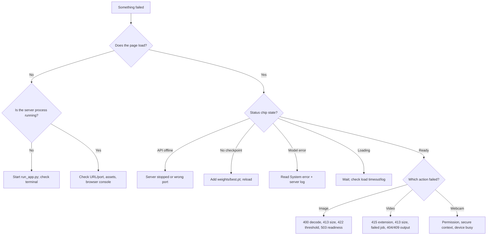

# Troubleshooting

This page maps observable symptoms to likely causes and fixes. Start with the quick triage, then jump to the matching section. Commands assume the virtual environment is active and the server is running from the project root unless stated otherwise.

- [Quick triage](#quick-triage)
- [Server will not start](#server-will-not-start)
- [Missing checkpoint](#missing-checkpoint)
- [Checkpoint load failures](#checkpoint-load-failures)
- [Model stays loading or times out](#model-stays-loading-or-times-out)
- [Port and bind problems](#port-and-bind-problems)
- [Dashboard is blank or unstyled](#dashboard-is-blank-or-unstyled)
- [API offline](#api-offline)
- [Image inspection errors](#image-inspection-errors)
- [Video job errors](#video-job-errors)
- [Video playback](#video-playback)
- [Webcam problems](#webcam-problems)
- [Dataset samples unavailable](#dataset-samples-unavailable)
- [API docs CSP](#api-docs-csp)
- [Slow or stalled processing](#slow-or-stalled-processing)
- [Disk and permission problems](#disk-and-permission-problems)
- [CLI surprises](#cli-surprises)
- [Reset to a clean state](#reset-to-a-clean-state)
- [Diagnostic commands](#diagnostic-commands)
- [Known gaps that are not bugs to “fix” casually](#known-gaps-that-are-not-bugs-to-fix-casually)
- [Related pages](#related-pages)

## Quick triage



The first three commands to run:

```bash
curl -s http://127.0.0.1:8000/api/health
curl -s http://127.0.0.1:8000/api/status | python -m json.tool
tail -n 50 <the terminal running run_app.py>
```

## Server will not start

| Symptom | Likely cause | Fix |
|---|---|---|
| `ModuleNotFoundError: No module named 'fastapi'` | Wrong interpreter or dependencies not installed | Activate `.venv`; `python -m pip install -r requirements.txt` |
| `ModuleNotFoundError: No module named 'ultralytics'` | Same | Same; confirm `python -c "import ultralytics"` |
| `RuntimeError: Dashboard assets are missing: .../web/assets` | Incomplete checkout or wrong directory layout | Restore `web/`; the server refuses to run without it |
| `Address already in use` | Another process (often an earlier InfraScan) owns the port | Stop it or use `--port 8001`; see [Port and bind problems](#port-and-bind-problems) |
| `command not found: python` | Only `python3` is installed, or venv not active | Use `python3` or activate the environment |
| Permission denied on `.venv/bin/activate` | Wrong shell/path | Use `source .venv/bin/activate`; on Windows use the PowerShell/batch script |
| `externally-managed-environment` from pip | System Python is managed by the OS | Create/activate a virtual environment; do not fight the system Python |
| Server exits immediately with no traceback | Uvicorn cannot bind or import; output may be above the fold | Run in the foreground and capture all output; try `python -c "import app"` |

Verify the interpreter before changing code:

```bash
python -c "import sys; print(sys.executable); print(sys.version)"
python -c "import fastapi, ultralytics, cv2; print('imports ok')"
```

If `import app` fails, the error is usually a missing dependency or missing `web/assets`. Fix that before launching Uvicorn.

## Missing checkpoint

**Symptoms:** status chip **No checkpoint**; System page says checkpoint `exists: false` or shows the expected path; image/video buttons disabled; API returns `503` with:

```text
No trained checkpoint is available. Place a compatible best.pt at
<PROJECT_ROOT>/weights/best.pt (or set INFRASCAN_WEIGHTS) and reload the model.
```

**Cause:** `weights/best.pt` is absent, empty, or `INFRASCAN_WEIGHTS` points to a missing file. The checkpoint is intentionally not bundled.

**Fix:**

1. Place a compatible checkpoint at `weights/best.pt`:

   ```bash
   mkdir -p weights
   cp /authorised/path/best.pt weights/best.pt
   ls -lh weights/best.pt
   ```

2. Or set an absolute path before launch:

   ```bash
   export INFRASCAN_WEIGHTS="/absolute/path/to/best.pt"
   python run_app.py --no-browser
   ```

3. Open **System → Reload checkpoint**, or restart the server.

4. Verify:

   ```bash
   curl -s http://127.0.0.1:8000/api/status \
     | python -c "import json,sys; m=json.load(sys.stdin)['model']; print(m['state'], m['checkpoint'])"
   ```

Do not expect the dashboard to download a checkpoint or silently substitute `yolo11s.pt`. That fallback exists only in some CLI scripts and is not the trained model.

If `--weights` did not change the path, see [Configuration](configuration.md#the---weights-caveat). The launcher resolves config before parsing the flag in a normal launch.

## Checkpoint load failures

**Symptoms:** status `error`; System page shows "Could not load the checkpoint: ..." and a traceback in the terminal; API returns `503` with the loader error.

Common causes:

| Error fragment | Meaning | Fix |
|---|---|---|
| `Unsupported weights ...` / `not a valid YOLO model` | File is not a compatible checkpoint | Use a YOLO11n `best.pt` produced by a compatible Ultralytics version |
| `Could not deserialize` / `pickle` / `UnpicklingError` | Corrupt or truncated file, or wrong format | Re-copy the checkpoint; verify size/hash |
| `No module named 'torch'` | PyTorch missing/broken | Reinstall requirements in the active venv |
| CUDA/device errors | Driver or wheel mismatch | Try CPU (see below); install a matching PyTorch build |
| MPS errors | Unsupported op or backend issue | The image path retries on CPU automatically; restart/reload records CPU |
| Permission denied | File unreadable by the process user | Fix file permissions/ownership |
| Out of memory | Model cannot fit | Close other workloads; use CPU/smaller environment; memory was not benchmarked |

Steps:

1. Read the full error on the System page or in the terminal.
2. Sanity-check the checkpoint in a separate process:

   ```bash
   python - <<'PY'
   from ultralytics import YOLO
   m = YOLO("weights/best.pt")
   print(m.task, m.names)
   PY
   ```

3. Confirm the file is non-empty and matches the expected size for your checkpoint:

   ```bash
   ls -lh weights/best.pt
   shasum -a 256 weights/best.pt     # macOS/Linux
   ```

   The verified checkpoint is 5,467,546 bytes with SHA-256 `f3490f953b4ac2aa0205c206c151be8f2da281da99708713b182492a43c7751c`. A different compatible checkpoint is allowed; do not expect identical metrics.

4. Fix the file or environment, then **Reload checkpoint**. A failed reload does not roll back to the previous model; if the process is in a bad state, restart it.

5. Check disk space. A truncated copy is a common cause of deserialisation errors.

> A `.pt` checkpoint is loaded through PyTorch's pickle-based loader. Only use checkpoints from sources you trust. See [Security and privacy](../11-security-and-quality/security-and-privacy.md#sec-03--checkpoint-trust).

## Model stays loading or times out

**Symptoms:** chip **Loading model** for a long time; image request returns `503` after roughly 180 seconds with "The model is still loading. Try again in a moment or reload it from the System page."

**Cause:** first-time import of PyTorch/Ultralytics, slow disk, large checkpoint, CPU-only load, or a loader blocked on an error that has not surfaced. `ensure_ready()` waits up to 180 s per request.

**What to do:**

1. Watch the terminal for `Loaded best.pt on <device>` or a traceback.
2. Check `/api/status`; `state` tells you whether the loader is still running or has errored.
3. Do not launch many parallel image requests while loading; they each wait and consume threadpool capacity.
4. If the state is stuck in `loading` with no log progress, restart the server and watch the load from the beginning.
5. If it consistently fails on an accelerator, force CPU for diagnosis by editing `_select_device()` temporarily or use the CLI with `--device cpu`. The dashboard has no device flag.

Model load time itself was **not benchmarked**; do not quote a number.

## Port and bind problems

### `Address already in use`

```bash
# macOS/Linux
lsof -nP -iTCP:8000 -sTCP:LISTEN

# Windows PowerShell
Get-NetTCPConnection -LocalPort 8000 | Select-Object LocalAddress,LocalPort,OwningProcess
```

Either stop the owning process (after confirming what it is) or choose another port:

```bash
python run_app.py --port 8001
```

The browser URL and any curl commands must use the same port. The SPA uses relative API paths, so no frontend edit is needed.

### Cannot reach the dashboard from another machine

This is expected with the default bind. `127.0.0.1` is loopback only. Binding to `0.0.0.0` would expose an unauthenticated service; do not do it casually. Use a secured proxy or demonstrate on the same machine. See [Deployment and operations](../04-architecture/deployment-and-operations.md#reverse-proxy-and-tls).

### `--host` seems ignored

Check that you launched `run_app.py`, not a different script, and that the process did not fail and restart. Confirm the listening socket:

```bash
lsof -nP -iTCP:8000 -sTCP:LISTEN
```

## Dashboard is blank or unstyled

| Check | Fix |
|---|---|
| Opened `web/index.html` directly as a file | Serve through FastAPI; ES modules and absolute `/assets` paths require HTTP |
| Opened the wrong port | Use the URL printed by the launcher |
| Browser console shows 404 for `/assets/...` | `web/assets` is missing/incomplete; restore it |
| Console shows CSP errors for scripts | `script-src 'self'` blocks inline/third-party scripts; do not add inline scripts. The shipped SPA modules should load from `/assets/js/` |
| Page loads but styles are missing | Check `/assets/css/app.css` returns `200`; hard-refresh to bypass cache |
| Page loaded from a separate dev server | There is no CORS configuration; serve the SPA and API from the same origin |
| Blank after an update | Hard refresh (Cmd/Ctrl+Shift+R); service workers are not used, so a normal cache issue is the likely cause |

A quick asset check:

```bash
curl -s -o /dev/null -w "%{http_code} %{content_type}\n" http://127.0.0.1:8000/assets/js/app.js
curl -s -o /dev/null -w "%{http_code} %{content_type}\n" http://127.0.0.1:8000/assets/css/app.css
```

Both should be `200`. If the server returns the SPA HTML for an asset path, the mount is misconfigured or the file is missing.

## API offline

**Symptoms:** status chip **API offline**; toast "Could not reach the local InfraScan server"; run buttons disabled; existing results remain visible.

Causes:

- The server process stopped (terminal closed, Ctrl+C, crash).
- The page points at a different port/host.
- A proxy or firewall blocks the request.
- The process is hung or still starting.

Fix:

1. Check the terminal; restart with `python run_app.py`.
2. Confirm the URL and port.
3. `curl -s http://127.0.0.1:8000/api/health`.
4. Reload the page if the SPA was loaded from a stale origin.

The SPA polls every 5 s while offline and will recover automatically without a reload once the API answers again.

## Image inspection errors

| HTTP | Message/shape | Cause | Fix |
|---|---|---|---|
| `400` | "The uploaded file is empty." | Zero-byte upload | Select a real image |
| `400` | "The file could not be decoded as an image..." | Corrupt, truncated or unsupported encoding | Re-export as JPG/PNG/WebP/BMP; verify it opens locally |
| `413` | "File is too large. The limit is 25 MB." | More than 26,214,400 bytes | Resize/compress; the browser also blocks >25 MB |
| `422` | "Confidence must be between 0.05 and 1.0." | Threshold outside range | Use slider/valid value |
| `422` | "IoU must be between 0.1 and 1.0." | Threshold outside range | Use slider/valid value |
| `503` | Checkpoint/model message | Missing, loading, load error or 180 s timeout | See checkpoint sections |
| `500` | "An unexpected server error occurred..." | Write failure, decoder crash, filesystem problem | Read terminal traceback; check disk/permissions |
| `404` on result URL | Result JPEG cleaned up or never written | Re-run; check `runs/dashboard/results` |
| Browser shows a broken result image | Result URL fetched after cleanup or server restart | Re-run; do not rely on old URLs |

Notes:

- The server does **not** check the image extension. A `.txt` file containing a valid JPEG can decode; a `.jpg` containing text returns `400`. The browser's file picker is stricter than the API.
- The 25 MB limit is the upload, not the decoded pixel count. A small, highly compressed image can still be large in memory.
- If **Run inspection** is disabled, read the note under the button; it names the blocking state (offline, no image, loading, missing checkpoint, error).
- If the annotated image is written but the browser cannot fetch it, check `/api/results/<id>.jpg` directly and the server log.

## Video job errors

| Symptom | Cause | Fix |
|---|---|---|
| `415` "Unsupported video format" | Suffix not in `.mp4/.avi/.mov/.mkv` | Rename/convert to a supported container; do not just rename a random file |
| `413` "Video is too large..." | Over 2 GiB | Trim/compress; use a shorter clip |
| `202` then job `failed` with decode error | Container/codec unreadable by OpenCV/FFmpeg, or file is not a video | Re-encode with a known-good H.264 MP4; test with a short clip |
| Job `failed` with "Inference finished without producing an annotated video" | Writer failed or no frames were written | Check codec support, output permissions, disk space, source readability |
| Job stuck in `processing` with no frame progress | Waiting for `_worker_lock` behind another job, or decoder hang | Wait for the first job; restart if truly hung (no cancel endpoint) |
| `404` on job status | Unknown ID, server restarted, or cleanup removed it | Jobs are in-memory; restart loses them. Re-submit |
| `409` on video/telemetry URL | Job not `completed` yet | Poll until `completed`; the UI does this automatically |
| `404` on output file | Output missing or job directory removed | Check `runs/dashboard/jobs/<id>/output`; re-run |
| Telemetry links disabled | No detections were recorded | Expected; the MP4 still exists |
| Tab closed during processing | Polling stopped; server may continue | Reopen and the job list is not restored; there is no job history UI. Keep the tab open |

Debugging a failed job:

```bash
# Replace <id> with the job id from the POST response.
curl -s http://127.0.0.1:8000/api/jobs/<id> | python -m json.tool
find runs/dashboard/jobs/<id> -maxdepth 2 -type f -ls
```

The terminal traceback usually names the decoder or writer failure. A corrupt input often fails at `cap.isOpened()` or the first `cap.read()`. Audio is not preserved; the output is video-only by design.

If the job fails immediately after upload, confirm the input file is non-empty:

```bash
ls -lh runs/dashboard/jobs/<id>/input.*
```

## Video playback

**Symptoms:** annotated video downloads but the player is blank, shows a broken source, or reports an unsupported format.

Cause: the worker tries `avc1` (H.264) first and falls back to `mp4v` if the local OpenCV build cannot open an H.264 writer. H.264 played in Chrome on the verified machine; `mp4v` is not universally supported by browsers.

Checks:

```bash
# Inspect the file type and streams (if ffprobe is installed).
ffprobe -hide_banner runs/dashboard/jobs/<id>/output/detection_output.mp4
```

| Finding | Action |
|---|---|
| `Video: h264` and still no playback | Try another browser; check the response is `video/mp4` and not an HTML error page |
| `Video: mpeg4` (`mp4v`) | The fallback was used. Convert to H.264 for browser playback if needed |
| No video stream / zero bytes | The writer failed; the job should be `failed`; read the log |
| `404`/`409` from the URL | Job not complete or output missing; see [Video job errors](#video-job-errors) |
| Plays in VLC but not browser | Codec/container profile mismatch; convert to H.264/AAC or H.264 video-only |

Conversion is an external step, not an application feature:

```bash
ffmpeg -i detection_output.mp4 -c:v libx264 -pix_fmt yuv420p -an infrascan_h264.mp4
```

`ffmpeg` is not a declared dependency and was not required for the verified run. Do not claim the application transcodes automatically; it does not.

## Webcam problems

| Symptom | Cause | Fix |
|---|---|---|
| "This browser does not expose camera access" | `navigator.mediaDevices` unavailable | Use a current browser on `localhost`/`127.0.0.1` or HTTPS |
| "Camera permission was denied" | User/browser blocked permission | Allow camera for the site; reload |
| "No camera was found" | No device or constraints unsatisfiable | Connect a camera; try another device |
| "The camera is busy in another application" | Zoom/Teams/browser tab holds it | Close the other app/tab and retry |
| Dialog opens but preview is black | Permission pending, device initialising, or no frames | Wait; close/reopen; check OS camera privacy settings |
| Capture disabled | Stream not ready or an error is shown | Wait for the preview; read the error text |
| Camera indicator stays on after closing | Known close-during-permission race | Close the tab or revoke camera permission; see [Security and privacy](../11-security-and-quality/security-and-privacy.md#sec-10--webcam-stream-race) |
| Works on localhost but not LAN IP | `getUserMedia` requires a secure context | Use localhost or HTTPS; plain HTTP on a LAN address is not secure |

A physical webcam was **not** verified on the development machine. The recorded check used Chrome's synthetic media device. If the examiner's machine has unusual camera privacy software, test it before the demonstration.

## Dataset samples unavailable

**Symptoms:** Dataset tab shows "Dataset samples are unavailable"; `GET /api/samples` returns `available: false`; uploads still work.

Causes and fixes:

| Cause | Fix |
|---|---|
| `dataset/images/test` does not exist | Create it or restore the authorised dataset |
| Directory exists but has no supported extensions | Add JPG/JPEG/PNG/WebP/BMP files |
| Files are iCloud-evicted/offline (macOS) | Download them locally; the app reads the filesystem directly |
| Permission denied on the directory | Fix read permissions |
| Wrong project root | The path is `<repo>/dataset/images/test`, independent of the shell's cwd; restore the dataset there |
| A file disappears during listing | `/api/samples` can return `500`; refresh after the filesystem settles |

The picker shows at most 24 files sorted by name, even if more exist. `count` reports the full number and `shown` the displayed number. The sample is fetched by the browser and posted to `/api/detect/image` like an upload; it is not a special server-side inference path.

## API docs CSP

**Symptom:** clicking **Open interactive API docs** shows a blank page, unstyled HTML, or console errors about blocked scripts/styles from a CDN.

**Cause:** the application sets:

```text
Content-Security-Policy: default-src 'self'; ... script-src 'self'; ...
```

FastAPI's default Swagger UI page normally loads its JavaScript/CSS from a CDN and uses an inline bootstrap script. `script-src 'self'` blocks those, and `default-src 'self'` blocks the CDN assets. This is a **known, expected incompatibility**, not evidence that the API is broken. It was not browser-verified during the documentation run.

**Workarounds:**

1. Use the machine-readable schema:

   ```bash
   curl -s http://127.0.0.1:8000/api/openapi.json | python -m json.tool
   ```

2. Use the `curl` examples in [Backend and API](../04-architecture/backend-and-api.md).
3. If interactive docs are essential for a demo, serve them from a separate trusted origin with an appropriate CSP, or adjust the CSP **for the docs route only** in a local build. Do not weaken `script-src` globally for the dashboard; that removes a real defence.

Do not "fix" this by adding `'unsafe-inline'` to `script-src` for the whole app.

## Slow or stalled processing

| Observation | Explanation | Action |
|---|---|---|
| First image slower than later ones | Accelerator/library warm-up | Wait; warm up before the demo |
| `inference_ms` 66 ms but request feels longer | Metric excludes upload, decode, annotation, JPEG write, HTTP | Measure end-to-end separately; do not equate the two |
| Video progress stuck at 0 | Waiting for `_worker_lock` behind another job, or decoder initialising | Wait; check `/api/jobs/<id>` and logs; avoid parallel jobs |
| Video ETA inaccurate | Estimate from elapsed/fraction; total frames can be 0/wrong | Treat as approximate |
| Image runs while video is processing | Separate models/locks; they can contend | Expect variable speed; combined load was not benchmarked |
| CPU fallback after an MPS error | Image path retries on CPU and records `cpu` | Reload/restart to retry the accelerator; read the warning |
| High memory/disk | Large images/videos, multiple model instances, retained jobs | Close jobs, clear `runs/dashboard`, restart |
| Browser sluggish with large video preview | Object URL and decoder memory | Use shorter clips; close other tabs |

There is no request timeout in `api.js` and no cancellation. If a request never settles, the UI can remain busy until the browser/network gives up. Reload the page and inspect the server log.

## Disk and permission problems

| Error/symptom | Cause | Fix |
|---|---|---|
| `Permission denied` creating `runs/dashboard/...` | Checkout read-only or wrong owner | Run as the owner; fix directory permissions |
| `The annotated image could not be written to disk` | Disk full, read-only volume, path issue | Free space; check `runs/dashboard/results` |
| Video job fails writing MP4 | Disk full or codec/writer failure | Free space; check codec/log; try a shorter clip |
| `OSError: [Errno 28] No space left on device` | Disk full | Clear old artefacts; move the checkout to a larger volume |
| Results disappear | Startup TTL cleanup or manual deletion | Copy evidence before restart; see [Data flow](../04-architecture/data-flow.md#retention-and-deletion) |
| Cannot delete job directory | Files still open/being written | Stop the server first |

The application does not check free space or enforce a storage quota. A 2 GB upload can coexist with a large output; plan disk accordingly.

## CLI surprises

| Symptom | Cause | Fix |
|---|---|---|
| `detect.py` says "falling back to pretrained yolo11s.pt" | `--weights` path missing | Fix the path; the fallback is not your trained model |
| `test_camera.py` falls back to `yolo11s.pt` | Same | Same |
| `evaluate.py` metrics differ from the documented values | Different split/dataset/checkpoint/device | Use the verified command and data; do not compare across datasets |
| `data.yaml` not found | Wrong working directory | Run from the project root or pass an absolute `--data` path |
| Dataset path errors | `data.yaml` `path` is relative to cwd | Use an absolute path or run from the root |
| Camera index fails on Windows | Backend/permission | Try `--cam-id 1`; check Windows camera privacy settings |
| `--device 0` fails | No CUDA/driver mismatch | Use `--device cpu` or `mps` where supported |
| Export fails | Missing exporter dependency/toolchain | Export targets were not validated; see Ultralytics docs for the specific format |

The CLI is a separate entrypoint. A dashboard problem does not always reproduce in the CLI, and vice versa.

## Reset to a clean state

### Reset browser settings

Use **Reset** in the sidebar, or:

```js
localStorage.removeItem("infrascan.settings.v2");
location.reload();
```

### Clear runtime artefacts

Stop the server first:

```bash
rm -rf runs/dashboard/results runs/dashboard/jobs
```

They are recreated at the next startup.

### Recreate the environment

```bash
deactivate 2>/dev/null || true
rm -rf .venv
python3 -m venv .venv
source .venv/bin/activate
python -m pip install --upgrade pip
pip install -r requirements.txt
```

### Confirm a clean launch

```bash
python run_app.py --no-browser
curl -s http://127.0.0.1:8000/api/health
curl -s http://127.0.0.1:8000/api/status | python -m json.tool
```

Do not delete `weights/` or `dataset/` unless you have the authority and a copy; they are not reproducible from the repository.

## Diagnostic commands

```bash
# Which interpreter and packages?
python -c "import sys; print(sys.executable); print(sys.version)"
pip show fastapi uvicorn ultralytics torch opencv-python python-multipart

# Is the server listening?
lsof -nP -iTCP:8000 -sTCP:LISTEN

# Liveness and readiness
curl -s http://127.0.0.1:8000/api/health
curl -s http://127.0.0.1:8000/api/status | python -m json.tool

# Static assets
curl -s -o /dev/null -w "%{http_code}\n" http://127.0.0.1:8000/
curl -s -o /dev/null -w "%{http_code}\n" http://127.0.0.1:8000/assets/js/app.js

# Checkpoint
ls -lh weights/best.pt
shasum -a 256 weights/best.pt

# Runtime artefacts
du -sh runs/dashboard/*
find runs/dashboard/jobs -maxdepth 3 -type f | head

# API schema (works even if Swagger UI is CSP-blocked)
curl -s http://127.0.0.1:8000/api/openapi.json | python -m json.tool | head -n 40
```

The terminal running `run_app.py` is the primary log. Redirect it if you need to search a long traceback:

```bash
python run_app.py --no-browser 2>&1 | tee infrascan-run.log
```

## Known gaps that are not bugs to “fix” casually

These are documented limitations, not setup mistakes:

- No authentication, TLS, CSRF token, Origin/Host validation or rate limiting.
- The default loopback bind is the main security control; do not expose the port to fix a connection problem.
- No cancel endpoint for video jobs; stopping the server is the only immediate stop.
- TTL cleanup runs only at startup; artefacts can outlive 24 h in a long-running process.
- No cross-frame tracking; video counts are frame-level.
- No GPS, depth, volume or maintenance-decision features.
- Swagger UI is expected to be blocked by the app's CSP.
- Physical webcam and CUDA were not verified.
- No automated test suite or formal accessibility certification.

If a symptom does not match this page, capture the exact HTTP status, response body, terminal traceback, browser console output and the contents of `/api/status`. Those four artefacts usually identify the layer.

## Related pages

- [Installation](installation.md) — setup and dependency issues.
- [Configuration](configuration.md) — checkpoint path, port, thresholds and TTLs.
- [Application usage](application-usage.md) — expected UI behaviour.
- [Backend and API](../04-architecture/backend-and-api.md) — status codes and response shapes.
- [Component interactions](../04-architecture/component-interactions.md) — sequence diagrams for each flow.
- [Data flow](../04-architecture/data-flow.md) — where artefacts live and when they expire.
- [Deployment and operations](../04-architecture/deployment-and-operations.md) — runbook and platform notes.
- [Security and privacy](../11-security-and-quality/security-and-privacy.md) — why certain “fixes” would weaken the model.
