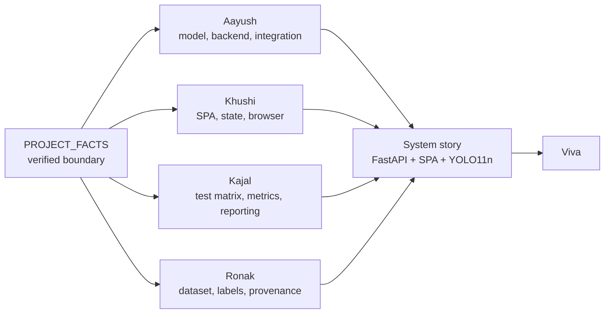

# Team preparation

This directory contains four role-specific preparation guides for the InfraScan final-year viva. Each guide is written for one team member, but every guide explains the same system from a different entry point. Use your own guide as the spine, then use the cross-links to fill gaps.

The accepted stack is **FastAPI + a zero-build vanilla ES-module SPA + Ultralytics YOLO11n**. Older material that describes a Streamlit dashboard is obsolete. If a page elsewhere in this repository still contains Streamlit-era wording, treat [`../PROJECT_FACTS.md`](../PROJECT_FACTS.md) as authoritative and do not repeat the older claim.

## Start here

| If you are… | Read in this order |
|---|---|
| **Aayush Kumar Shrivastav** (2301921540002) | [Technical guide](aayush-technical-guide.md) → [Verified facts](../PROJECT_FACTS.md) → [Contribution evidence](../CONTRIBUTIONS.md) |
| **Khushi Shakya** (2301921520091) | [Frontend guide](khushi-frontend-guide.md) → [Verified facts §2, §6, §7](../PROJECT_FACTS.md) → [Contribution evidence](../CONTRIBUTIONS.md) |
| **Kajal Rawal (“Lucky”)** (2301921520087) | [Testing and presentation guide](lucky-testing-presentation-guide.md) → [Verified facts §4–§6](../PROJECT_FACTS.md) → [Contribution evidence](../CONTRIBUTIONS.md) |
| **Ronak Saini** (2301921520158) | [Dataset and documentation guide](ronak-dataset-documentation-guide.md) → [Verified facts §3–§4](../PROJECT_FACTS.md) → [Contribution evidence](../CONTRIBUTIONS.md) |
| **An examiner or faculty member** | [Verified facts](../PROJECT_FACTS.md) → the member guide for the area being examined → [Test strategy](../09-testing-and-results/test-strategy.md) |

## What each guide contains

Every guide follows the same eleven-part structure so that you can move between them:

1. **Assigned responsibility vs verified contribution** — what the team assigned, what the repository can prove, what is only team-declared, and what evidence to attach before the viva.
2. **Objectives and task map** — 6–10 concrete tasks with the exact files to inspect and commands to run.
3. **Technical concepts and implementation workflow** — explained from the current source, not from generic definitions.
4. **Integration with the whole system** — what calls what, what data crosses each boundary, and how each stage fails.
5. **Challenges, debugging, validation and testing** — realistic issues, separated into verified, code-level and likely.
6. **Speaking scripts** — a 60-second overview, a 3-minute technical segment, and a 5-minute demo with commands and screen cues.
7. **Twenty or more viva questions with explanatory answers.**
8. **Ten or more difficult follow-ups with detailed answers.**
9. **Practical exercises** — at least five, each with an expected observation.
10. **A pre-viva checklist.**
11. **A one-page fact card** for last-minute revision.

## The evidence boundary

The project is stronger when the contribution story matches the evidence. Use these five labels consistently.

| Label | Meaning | Example |
|---|---|---|
| **Verified in source** | The file or code path can be inspected in the current repository. | `infrascan/inference.py` contains the CUDA → MPS → CPU selection. |
| **Verified in a recorded run** | A result is recorded in [`../PROJECT_FACTS.md`](../PROJECT_FACTS.md) or a named test log. | The 718-image evaluation produced P 0.7959, R 0.5996, mAP50 0.7111. |
| **Team-declared** | The team supplied the role or decision, but the repository does not independently prove it. | “Khushi owned the frontend.” |
| **Attachable evidence** | A document, screenshot, signed log or shared-document history that a member can present but that is not in Git. | A browser test note at 390/820/1024/1440 px with a date and screenshot. |
| **BLOCKED / NOT RUN** | The check could not be executed, or was documented but never exercised. | Physical webcam, CUDA, ONNX/TensorRT exports, automated pytest suite. |

### What is not negotiable

- Do **not** say that a team-declared role proves authorship.
- Do **not** say that a Git author proves nobody else contributed.
- Do **not** claim that all tests passed. Use the recorded status in `PROJECT_FACTS.md`.
- Do **not** invent a group ID, supervisor, dataset URL, dataset licence or checkpoint redistribution permission.
- Do **not** quote a metric other than the verified 718-image run as if it were reproduced.
- Do **not** claim CUDA, export targets, physical-camera behaviour or production readiness without new evidence.

### What is verified and safe to say

- The application is a FastAPI backend serving a vanilla ES-module SPA from the same origin.
- The checkpoint is YOLO11n, one class `pothole`, 640 px, 2,582,347 parameters, 6.4 GFLOPs, 5,467,546 bytes, SHA-256 `f3490f953b4ac2aa0205c206c151be8f2da281da99708713b182492a43c7751c`.
- The local dataset has 4,719 images, 7,340 pothole boxes and 22 background images; the test split has 718 images, 994 instances and 2 backgrounds.
- The recorded 718-image evaluation on Apple M2 MPS produced P 0.7959, R 0.5996, mAP50 0.7111 and mAP50–95 0.3938.
- The recorded release checks include dashboard startup, `/api/health`, image inference, invalid-image handling, missing-checkpoint handling, a 24-frame video job with 28 detections, H.264 playback in Chrome, CLI telemetry, responsive layout at 390/820/1024/1440 px, and synthetic-device webcam capture.
- The checkpoint and dataset are excluded from Git; their provenance and redistribution rights are unresolved.

## Recommended preparation paths

### 60-minute emergency path

1. Read your own guide's **assigned responsibility vs verified contribution** and **one-page fact card** (10 minutes).
2. Read [`../PROJECT_FACTS.md`](../PROJECT_FACTS.md) §3–§7 (15 minutes).
3. Run the demo commands in your guide's 5-minute script (20 minutes).
4. Say the 60-second overview aloud twice and answer the first ten viva questions (15 minutes).

### Half-day path

1. Work through every task in your guide's task map (90 minutes).
2. Run the five exercises and write down the expected observation before running each one (60 minutes).
3. Rehearse the 3-minute technical segment and the 5-minute demo with a timer (45 minutes).
4. Have a teammate ask you the 20 viva questions and 10 follow-ups (60 minutes).
5. Assemble your evidence packet (45 minutes).

### Day-before path

- Run the server from a clean shell and confirm `/api/health` reports `model_state: ready`.
- Confirm `weights/best.pt` exists, is non-zero and has the recorded SHA-256.
- Confirm the short demo video plays in the presentation browser.
- Export a PDF or screenshot backup of the dashboard in case the venue machine fails.
- Re-read the “what not to say” list and the unresolved-facts table.
- Charge the laptop, bring a camera cover, and have an offline copy of the repository.

## Evidence packets

Each member should bring a one-page evidence sheet and the artefacts behind it. The sheet should state the claim, the date, the command or design action, the observed result, and the file path or URL of the evidence.

| Member | Minimum packet |
|---|---|
| **Aayush** | Evaluation command and log; checkpoint SHA-256; architecture walkthrough; API/frontend demonstration notes; list of unverified items. |
| **Khushi** | Component/design ownership note; browser test notes at 390/820/1024/1440 px; accessibility review notes; screenshots or screen recording; commit/PR review evidence if the integration was paired. |
| **Kajal** | Test matrix with dates and commands; label/split validation notes; screenshots or log excerpts she captured; documentation sections she edited; a signed PASS/FAIL/BLOCKED summary. |
| **Ronak** | Dataset inventory; label-conversion log; split counts; sample annotation checks; provenance record with explicit `[TO BE CONFIRMED]` fields; documentation edit history. |

A checked box is not evidence by itself. Link the artefact. If the artefact does not exist, say so and describe what would close the gap.

## How the guides fit together

- Aayush explains why the system is shaped this way and how the pieces connect.
- Khushi explains how a user action becomes an HTTP request and a rendered result.
- Kajal explains how the team knows a result is trustworthy, and what remains unverified.
- Ronak explains where the data came from, how labels were produced, and what cannot be claimed about provenance.

## Cross-reference map

| Topic | Primary page |
|---|---|
| Verified numbers, checkpoint, dataset, API surface | [`../PROJECT_FACTS.md`](../PROJECT_FACTS.md) |
| Contribution evidence and gaps | [`../CONTRIBUTIONS.md`](../CONTRIBUTIONS.md) |
| Unresolved academic and governance fields | [`../MISSING_INFORMATION.md`](../MISSING_INFORMATION.md) |
| Test status policy | [`../09-testing-and-results/test-strategy.md`](../09-testing-and-results/test-strategy.md) |
| Recorded results (check `PROJECT_FACTS.md` if wording conflicts) | [`../09-testing-and-results/verified-results.md`](../09-testing-and-results/verified-results.md) |
| Evidence index (claim → artefact → limitation) | [`../09-testing-and-results/evidence-index.md`](../09-testing-and-results/evidence-index.md) |
| Viva question bank | [`../08-viva-preparation/README.md`](../08-viva-preparation/README.md) |
| Demo script | [`../01-presentation/demo-script.md`](../01-presentation/demo-script.md) |
| Setup and troubleshooting | [`../06-setup-and-execution/installation.md`](../06-setup-and-execution/installation.md), [`../06-setup-and-execution/troubleshooting.md`](../06-setup-and-execution/troubleshooting.md) |

## A note on documentation QA

The documentation repository is not the application repository. A claim in a Markdown page is not evidence that the code behaves that way. Before repeating a statement, check it against:

1. the current source file named in the claim;
2. the recorded status in `PROJECT_FACTS.md`;
3. the actual behaviour of the running application, if the claim is about runtime.

If those three disagree, the source and the recorded run win. Mark the discrepancy as a documentation defect rather than silently choosing the most flattering version.

## Final reminder

The examiner is not only testing whether you can recite a number. They are testing whether you know **where the number came from**, **what it does not prove**, and **what you would do next**. A precise, modest answer with a file path and a caveat is stronger than a confident answer with no evidence.
