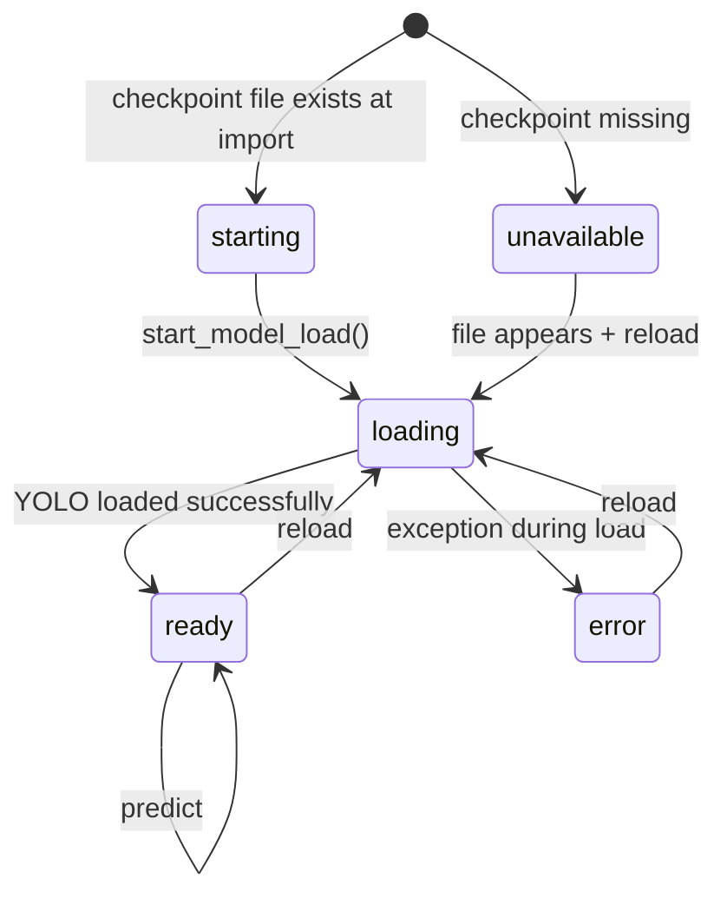
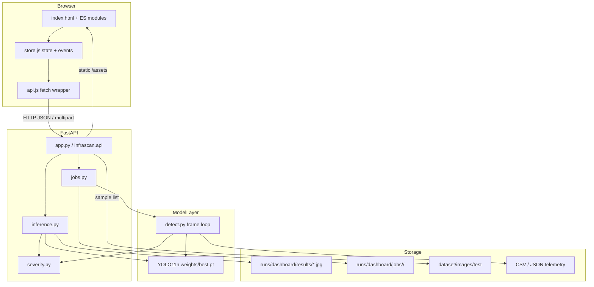
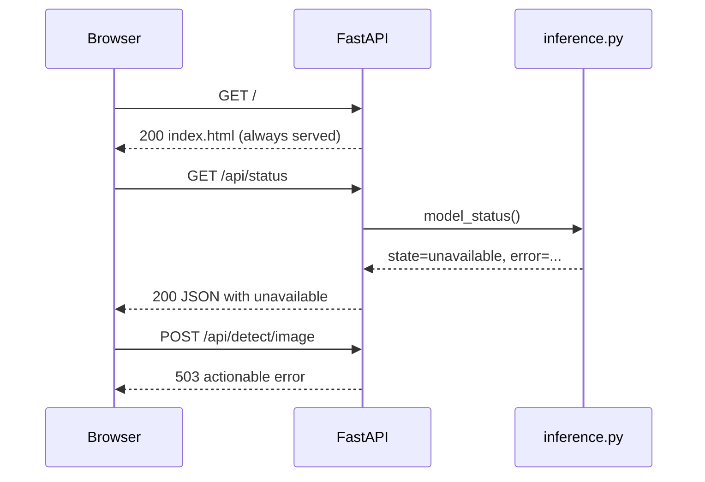

# Aayush Kumar Shrivastav — Technical Guide

**Roll number:** 2301921540002
**Assigned responsibility:** Team leader; core YOLO model; system architecture and integration
**Guide scope:** the actual FastAPI + SPA + YOLO11n implementation in `/Users/aayus/Desktop/College final year/InfraScan`
**Evidence snapshot:** 22 October 2026, matching [`../PROJECT_FACTS.md`](../PROJECT_FACTS.md)

> This guide is a preparation aid, not a substitute for the source. Every technical statement below is tied to a file, a recorded result, or a clearly marked inference. Where the repository cannot prove something, the guide says so.

---

## Table of contents

1. [Assigned responsibility vs verified contribution](#1-assigned-responsibility-vs-verified-contribution)
2. [Objectives and task map](#2-objectives-and-task-map)
3. [Technical concepts and implementation workflow](#3-technical-concepts-and-implementation-workflow)
4. [Integration with the whole system](#4-integration-with-the-whole-system)
5. [Challenges, debugging, validation and testing](#5-challenges-debugging-validation-and-testing)
6. [Speaking scripts](#6-speaking-scripts)
7. [Viva questions with explanatory answers](#7-viva-questions-with-explanatory-answers)
8. [Difficult follow-up questions](#8-difficult-follow-up-questions)
9. [Practical exercises and demonstration walkthroughs](#9-practical-exercises-and-demonstration-walkthroughs)
10. [Pre-viva checklist](#10-pre-viva-checklist)
11. [One-page fact card](#11-one-page-fact-card)

---

## 1. Assigned responsibility vs verified contribution

### 1.1 The three different claims

The team-declared role is **team leader, core YOLO model, system architecture and integration**. That is a statement about assigned responsibility. It is not, by itself, proof of authorship. The current repository supports a narrower but still substantial claim: the integration and release work listed below is attributable to the configured Aayush identity, and the source tree contains the FastAPI backend, the SPA, the YOLO pipeline and the release documentation.

| Claim | Evidence status | What the evidence actually shows |
|---|---|---|
| Team leadership and integration | **Verified in repository history** for the listed commits | Main-repo commits `9242ff3`, `b0d0649`, `d67ea1c`, `4ddcff8`; docs-repo commit `c5414ae`. All current commits in both repositories are authored by `Aayush Kumar Shrivastav <ashrivastav2209@gmail.com>` or the GitHub identity `Aayush9808`. |
| FastAPI backend and SPA | **Verified in source and history** | `app.py` exports the FastAPI app; `infrascan/api.py` implements routes and static serving; `web/` contains the SPA; commits `d67ea1c` (“serve dashboard with FastAPI backend”) and `b0d0649` (“add local dashboard frontend”). |
| YOLO11n checkpoint and evaluation | **Verified as a recorded team run** | `PROJECT_FACTS.md` §3 and §5 record the checkpoint inspection and the 718-image MPS evaluation. The exact human operator of that run is not recorded in Git. |
| Release documentation | **Verified in repository history** | Commit `4ddcff8` (“docs: rebuild README with verified results”) and docs commit `c5414ae`. |
| Teammate authorship | **Not verified by Git** | No current commit is independently attributable to Kajal, Khushi or Ronak. Their roles are team-declared. See [`../CONTRIBUTIONS.md`](../CONTRIBUTIONS.md). |
| CUDA, exports, physical camera | **BLOCKED / NOT RUN** | The test machine is an Apple M2; CUDA was unavailable. Export targets were documented but not exercised. Physical camera access was not independently tested. |

### 1.2 Verified commit history

| Commit | Message | What it supports |
|---|---|---|
| `9242ff3` | `Prepare InfraScan release` | Release preparation baseline |
| `b0d0649` | `feat(ui): add local dashboard frontend` | SPA source exists and entered history |
| `d67ea1c` | `feat(api): serve dashboard with FastAPI backend` | FastAPI serving and API integration |
| `4ddcff8` | `docs: rebuild README with verified results` | README rebuilt around the 718-image result |
| `24bd606` | `chore: verify contributor attribution` | A commit about attribution exists; it does **not** prove teammate authorship |
| `c5414ae` (docs repo) | `Add InfraScan academic documentation` | Documentation repository baseline |

The honest sentence is:

> “My assigned role was team leader for the YOLO model, architecture and integration. The repository history records the integration and release commits under my configured identity, and I can walk through the backend, frontend and evaluation code. The 718-image evaluation is a team-recorded run; I can explain its command and limits. I am not claiming that a Git author record proves nobody else contributed.”

### 1.3 What to attach before the viva

- [ ] A one-page evaluation record: command, environment, checkpoint SHA-256, split counts, metrics, log excerpt.
- [ ] The architecture diagram from this guide or `PROJECT_FACTS.md`, annotated in your own words.
- [ ] A live or recorded walkthrough of one image request and one video job.
- [ ] A short written explanation of the H.264 fallback and the shared severity module.
- [ ] A list of what remains unverified: CUDA, export targets, physical camera, dataset rights, checkpoint redistribution.
- [ ] If available, a commit or release checklist showing your integration work; do not fabricate one.

### 1.4 What not to say

Avoid:

- “I wrote every line.” The evidence does not support that, and the upstream attribution to Bisman Singh is preserved in the README and LICENSE.
- “All tests passed.” The recorded evidence includes PASS, BLOCKED and NOT RUN items.
- “The model is 79.59% accurate.” Precision is not accuracy, and the metric is not an end-to-end system accuracy.
- “The dataset is public.” Provenance and licence are unresolved.
- “It runs on CUDA.” CUDA was not available on the validation machine.

---

## 2. Objectives and task map

The goal of your preparation is not to memorise every line. It is to be able to trace any claim to a file, a command and a limit. Work through these ten tasks in order.

| # | Task | Files to inspect | What to run or do | What you should be able to explain |
|---|---|---|---|---|
| 1 | Audit the checkpoint identity | `weights/best.pt`, `infrascan/inference.py`, `PROJECT_FACTS.md` §3 | `shasum -a 256 weights/best.pt`; inspect size; load with Ultralytics in the venv | Architecture, class, input size, parameter count, GFLOPs, SHA-256, why it is not in Git |
| 2 | Reconcile training metadata with `train.py` | `train.py`, checkpoint metadata in `PROJECT_FACTS.md` §3 | `python train.py --help`; compare defaults with the metadata | Why the README command and the exact checkpoint run are not identical |
| 3 | Re-run or audit evaluation | `evaluate.py`, `data.yaml`, `PROJECT_FACTS.md` §5 | `python evaluate.py --weights weights/best.pt --data data.yaml --split test --imgsz 640 --batch 16 --device mps` | What P, R, mAP50 and mAP50–95 mean; why the fallback matters; what the speed numbers do and do not measure |
| 4 | Trace the FastAPI lifecycle | `app.py`, `run_app.py`, `infrascan/api.py` | `python run_app.py --no-browser`; `curl -s http://127.0.0.1:8000/api/health` | Startup order, background model load, static serving, security headers |
| 5 | Trace image inference | `infrascan/api.py`, `infrascan/inference.py` | `curl -X POST .../api/detect/image -F file=@... -F conf=0.25 -F iou=0.45` | Decode → readiness → lock → predict → severity → annotate → persist → JSON |
| 6 | Verify severity parity | `infrascan/severity.py`, `detect.py`, `test_camera.py` | Call `classify_severity()` on known box/frame areas; compare CLI and API output | The formula, the three bands, and why perspective changes the score |
| 7 | Audit video jobs and the codec fallback | `infrascan/jobs.py`, `detect.py`, `infrascan/api.py` | Upload a short clip; watch `GET /api/jobs/{id}`; read the server log | Job lifecycle, worker lock, progress, telemetry, H.264 → mp4v fallback |
| 8 | Audit limits and security | `infrascan/config.py`, `infrascan/api.py` | `curl -sI` the root and an API path; send an invalid image; test a missing checkpoint via `INFRASCAN_WEIGHTS` | 25 MB/2 GB limits, extension allow-lists, CSP, no auth, path-traversal checks |
| 9 | Verify the frontend contract | `web/assets/js/api.js`, `inspect.js`, `video.js`, `store.js` | Open DevTools → Network; inspect the image POST and the job polling | What the browser sends, what it expects, how errors and offline states surface |
| 10 | Audit the release story | `README.md`, `PROJECT_FACTS.md`, `CONTRIBUTIONS.md` | Compare README claims with recorded facts | The 651 → 718 correction, excluded assets, licensing, unresolved provenance |

### 2.1 A note on the working directory

All commands in this guide assume:

```bash
cd "/Users/aayus/Desktop/College final year/InfraScan"
source .venv/bin/activate   # if you created a virtual environment
```

If the environment is not active, `python` may not have Ultralytics, FastAPI or OpenCV installed. The repository's `requirements.txt` is the dependency list; it does not install itself.

---

## 3. Technical concepts and implementation workflow

### 3.1 What the checkpoint actually is

The released checkpoint is an Ultralytics **YOLO11n** detection model with one class, `pothole` (class 0), and a 640 px input. The inspected, fused model has:

| Field | Value |
|---|---|
| Architecture | YOLO11n, task `detect` |
| Class | `pothole` |
| Input size | 640 px |
| Fused model | 101 layers, 2,582,347 parameters, 6.4 GFLOPs |
| File size | 5,467,546 bytes (5.2 MB) |
| SHA-256 | `f3490f953b4ac2aa0205c206c151be8f2da281da99708713b182492a43c7751c` |
| Checkpoint metadata date | 2026-09-26 |
| Metadata Ultralytics version | 8.4.108 |
| Metadata license field | AGPL-3.0 |

The “n” in YOLO11n means nano. It is the smallest model in the YOLO11 family. The parameter count is the number of learned weights; GFLOPs is a rough measure of compute per forward pass at the model's input size. A smaller model is not automatically “worse” for this project: the system is local-first, the task is single-class, and the deployment target may be a laptop CPU or Apple GPU. The trade-off is visible in the evaluation: precision is relatively high, recall is lower, and the model misses roughly two out of five test instances at the validation operating point.

The SHA-256 matters because it lets another person verify that they are evaluating the same file. A metric without a checkpoint hash is not reproducible. The checkpoint is excluded from Git because its provenance and redistribution permission are unresolved; that is a governance decision, not a technical one.

### 3.2 Training metadata versus the current training script

The checkpoint metadata records:

| Field | Metadata value |
|---|---|
| Epochs | 15 |
| Batch size | 16 |
| Image size | 640 |
| Optimizer | `auto` |
| Initial LR | 0.003 |
| LR schedule | `cos_lr=True`, `lrf=0.01` |
| Device | `0` (CUDA) |
| Seed | 0 |
| `close_mosaic` | 3 |
| Data path | `C:\Users\Bisman Singh\...\data.yaml` |

The current `train.py` defaults are different in several places:

| Field | `train.py` default | Consequence |
|---|---|---|
| Model | `yolo11s.pt` | The released checkpoint is **nano**, not small. Use `--model yolo11n.pt` to match the size. |
| Epochs | 50 | The metadata records 15. A 50-epoch run is a different experiment. |
| Initial LR | 0.01 | The metadata records 0.003. |
| Device | `None` → CUDA if available, else CPU | `train.py` does **not** auto-select Apple MPS. On an M2 without an explicit `--device mps`, training would fall back to CPU. |
| `close_mosaic` | `min(5, epochs // 4)` if `epochs > 5` | For 15 epochs this is 3, which matches the metadata. |
| Batch / image size | 16 / 640 | Matches the metadata. |

The important viva answer is:

> “The checkpoint metadata is the authoritative record of the released file. The current `train.py` is a reusable training wrapper whose defaults are not the exact command that produced this checkpoint. The README command sets the nano architecture but uses 50 epochs, while the metadata records 15 epochs and an initial LR of 0.003. I can describe the difference; I cannot claim the default command reproduces the checkpoint bit-for-bit.”

That is a stronger answer than pretending the defaults match.

The training script itself does the following:

1. Resolves `data.yaml` and fails fast if it does not exist.
2. Chooses CUDA if available, otherwise CPU, unless `--device` is explicit.
3. Constructs `YOLO(model_name)`.
4. Calls `model.train()` with HSV augmentation, small rotation/translation/scale jitter, perspective, horizontal flip, mosaic, mixup, cosine LR decay, early stopping (`patience=15`), periodic checkpoints (`save_period=5`) and plots.
5. Copies `best.pt` from the run directory to `weights/best.pt`.

The augmentation values are concrete: `hsv_h=0.015`, `hsv_s=0.7`, `hsv_v=0.4`, `degrees=5.0`, `translate=0.1`, `scale=0.5`, `perspective=0.0005`, `fliplr=0.5`, `mosaic=1.0`, `mixup=0.15`. These are not arbitrary “data augmentation” claims; they are the arguments passed in `train.py`.

### 3.3 Evaluation: what the numbers mean

The recorded evaluation used the full 718-image test split, containing 994 pothole instances and 2 background images. It ran on an Apple M2 with MPS, batch 16, image size 640, using `evaluate.py`.

| Metric | Value |
|---|---:|
| Precision (P) | 0.7959 |
| Recall (R) | 0.5996 |
| mAP@0.50 | 0.7111 |
| mAP@0.50–0.95 | 0.3938 |
| Preprocess | 0.17 ms/image |
| Inference | 3.82 ms/image |
| Postprocess | 10.75 ms/image |

Definitions, in the terms an examiner will expect:

- **True positive (TP):** a predicted box that matches a ground-truth box at the chosen IoU threshold and class.
- **False positive (FP):** a predicted box with no matching ground truth, including a detection on a background image.
- **False negative (FN):** a ground-truth pothole with no matching prediction.
- **Precision** = TP / (TP + FP). Of everything the model called a pothole, how many were correct. 0.7959 means about 79.6% of the matched predictions were correct at the validation operating point.
- **Recall** = TP / (TP + FN). Of all real potholes, how many were found. 0.5996 means about 60.0% were found.
- **AP** is the area under the precision–recall curve for one class at one IoU threshold.
- **mAP@0.50** is the mean AP at IoU 0.50. With one class, it is the AP for `pothole` at that threshold.
- **mAP@0.50–0.95** averages AP over IoU thresholds from 0.50 to 0.95 in steps of 0.05. It rewards tighter box localization, not just “is there a box somewhere near the pothole.”

The gap between 0.7111 and 0.3938 is therefore expected: boxes that overlap a pothole at 50% may not overlap tightly enough at 75% or 90%. The gap does not prove the model is “bad”; it says the localization is looser than the detection. The precision–recall gap (P 0.7959 > R 0.5996) says the model is conservative: when it fires, it is often right, but it misses a substantial share of instances.

Two cautions are essential:

1. **`evaluate.py` does not pass `conf` or `iou` to `model.val()`.** Ultralytics therefore uses its validation defaults, which are not the dashboard's `conf=0.25`, `iou=0.45`. The metric is a validation-curve result, not a measurement of the dashboard's default operating point. If an examiner asks “what precision do I get at 0.25?”, the correct answer is: “That is a different operating point; run the API or a threshold sweep and measure it.”
2. **The metric is not end-to-end system accuracy.** It measures box matching on a held-out split. It does not measure whether a maintenance crew agrees with the severity band, whether the image is representative of the examiner's road, or whether the model generalizes to a new city.

The speed numbers are also component measurements:

- 0.17 ms preprocess, 3.82 ms inference and 10.75 ms postprocess are per-image averages from the Ultralytics validation loop on MPS, batch 16.
- The recorded warm API request was **66.2 ms** for a single image. That includes HTTP handling, decoding, model call, annotation, JPEG encoding and disk write.
- Do not turn 3.82 ms into “262 FPS end-to-end.” Batch throughput, I/O, Python overhead and the dashboard's single-request path all change the number.

### 3.4 The evaluation script's fallback trap

`evaluate.py` contains this behaviour:

```python
weights_path = Path(weights)
if not weights_path.exists():
    print(f"⚠️ Warning: Checkpoint '{weights}' not found. Using pretrained 'yolo11s.pt' as baseline.")
    weights_path = "yolo11s.pt"
```

If the path is wrong, the script does not stop. It evaluates a pretrained `yolo11s.pt` baseline and prints metrics that look like project results. The same pattern exists in `detect.py`, `export.py` and `test_camera.py`. The dashboard is deliberately different: it reports `unavailable` and returns HTTP 503 rather than substituting a model.

For any reported evaluation, verify:

- the weights file exists before the run;
- the log says `Model Weights: .../weights/best.pt`, not the fallback warning;
- the checkpoint SHA-256 matches;
- the data YAML points at the intended split;
- the split name is `test`;
- the environment and device are recorded.

### 3.5 The inference service lifecycle

`infrascan/inference.py` owns the model state. The module-level state starts as `"starting"` if `config.checkpoint_available()` is true, otherwise `"unavailable"`. The lifecycle is:



`start_model_load()` launches a daemon thread named `infrascan-model-loader`. It does not block the FastAPI startup. That is why the dashboard can render while the model is still loading. `ensure_ready(timeout=180.0)` polls every 0.2 seconds and raises:

- `ModelUnavailableError` if the state is `unavailable` or `error`;
- `ModelTimeoutError` if 180 seconds pass without readiness.

`predict_image()` then:

1. Rejects empty bytes.
2. Decodes with `cv2.imdecode`.
3. Reads `height`, `width` and `frame_area`.
4. Calls `ensure_ready()`.
5. Takes `_predict_lock` and calls `model.predict(...)` on the selected device.
6. If accelerated inference raises and the device is not `cpu`, logs a warning, retries on CPU, and sets `_device = "cpu"` for subsequent requests.
7. Clips and sorts box coordinates into the image bounds.
8. Calls the shared `classify_severity()`.
9. Annotates a copy, writes a JPEG at quality 92, and returns the JSON payload.

The lock matters. A single Ultralytics model instance is not safe to call concurrently from multiple threads. Image requests are therefore serialized at the model call. Video jobs use a separate `detect.py` model instance and a separate worker lock, so a video can run while an image request is being served; the two can still contend for the same GPU/CPU.

### 3.6 Device selection: CUDA → MPS → CPU

The selection logic is small and worth knowing verbatim:

```python
if torch.cuda.is_available():
    return "cuda:0"
mps = getattr(torch.backends, "mps", None)
if mps is not None and mps.is_available():
    return "mps"
return "cpu"
```

Consequences:

- On an NVIDIA machine, the dashboard prefers CUDA.
- On an Apple Silicon machine with a working MPS backend, it prefers MPS.
- On any other machine, it uses CPU.
- If accelerator detection itself throws, the exception is logged and the function returns CPU.
- If the first accelerated prediction throws, `predict_image()` retries on CPU and records the downgrade.

The checkpoint metadata says training used device `0` (CUDA). The recorded evaluation used MPS. Those are different hardware paths. The reported 3.82 ms inference is not an NVIDIA benchmark and must not be presented as one.

`train.py` is less flexible: its automatic branch checks only CUDA, then CPU. It does not auto-select MPS. If you demonstrate training on a Mac, pass `--device mps` explicitly or state that the automatic path would choose CPU. The checkpoint was not trained on the M2.

### 3.7 FastAPI startup and the request surface

`app.py` is deliberately thin:

```python
from infrascan.api import app
__all__ = ["app"]
```

`run_app.py` changes the working directory to the project root, optionally sets `INFRASCAN_WEIGHTS`, opens a browser after 1.5 seconds, and calls `uvicorn.run("app:app", ...)`. The default bind is `127.0.0.1:8000`.

`infrascan/api.py` creates the app with a lifespan:

```python
@asynccontextmanager
async def lifespan(_app: FastAPI):
    config.ensure_directories()
    inference.purge_old_artifacts()
    jobs.cleanup_old_jobs()
    inference.start_model_load()
    yield
```

Startup therefore does four things before accepting traffic: create runtime directories, delete result JPEGs older than 24 hours, remove finished job directories older than 24 hours, and start the background model load. It does not wait for the model.

The app mounts `/assets` from `web/assets` and serves `web/index.html` at `/`. If the assets directory is missing, the import raises `RuntimeError` immediately. That is a fail-fast design: a broken deployment should not serve a blank shell.

The route surface is:

| Method | Endpoint | Input | Output | Main failure modes |
|---|---|---|---|---|
| GET | `/api/health` | none | `{"status":"ok","model_state":...}` | Always returns 200 if the app is alive |
| GET | `/api/status` | none | app, model, runtime, severity policy, media limits, thresholds, sample count | Dataset scan `OSError` is caught; sample count becomes 0 |
| GET | `/api/samples` | none | up to 24 test images from `dataset/images/test` | Missing directory → `available: false`, empty list |
| GET | `/api/samples/{name}` | filename | image bytes | Basename check, extension check, 404 |
| GET | `/api/results/{filename}` | filename | annotated JPEG | Basename check, `.jpg` check, 404 |
| POST | `/api/detect/image` | multipart `file`, `conf`, `iou` | JSON detections + image URL | 422 threshold, 503 model, 413 size, 400 decode, 500 unexpected |
| POST | `/api/detect/video` | multipart `file`, `conf`, `iou` | 202 + job JSON | 415 extension, 413 size, 503 model, 500 upload |
| GET | `/api/jobs/{id}` | job id | status, progress, result | 404 after restart/cleanup |
| GET | `/api/jobs/{id}/video` | job id | MP4 | 404 unknown, 409 not complete, 404 missing file |
| GET | `/api/jobs/{id}/telemetry.csv` | job id | CSV | Same completed-file checks |
| GET | `/api/jobs/{id}/telemetry.json` | job id | JSON | Same completed-file checks |
| POST | `/api/model/reload` | none | model status | 503 missing/failed checkpoint |
| GET | `/api/docs` | none | Swagger UI | Served by FastAPI |
| GET | `/api/openapi.json` | none | OpenAPI schema | Served by FastAPI |

The security middleware sets:

```text
X-Content-Type-Options: nosniff
X-Frame-Options: DENY
Referrer-Policy: no-referrer
Content-Security-Policy: default-src 'self'; img-src 'self' data: blob:;
  media-src 'self' blob:; style-src 'self' 'unsafe-inline';
  script-src 'self'; font-src 'self'; connect-src 'self';
  object-src 'none'; frame-ancestors 'none'; base-uri 'self'
```

and `Cache-Control: no-store` on `/api/*`. The CSP explains several frontend decisions: no CDN scripts, no external fonts, no inline `<script>`, but `blob:` images and media for local previews and `'unsafe-inline'` styles for dynamic width values. It is a local-only security posture, not a hardened internet deployment. There is no authentication, no TLS termination and no rate limiting.

Uploads are read in 1 MiB chunks. The image path holds the whole file in memory (up to 25 MB). The video path streams to `runs/dashboard/jobs/<job_id>/input<suffix>` and deletes the partial file on failure. The suffix is checked against the allow-list before saving. Sample and result filenames are checked with `Path(name).name == name`, which blocks directory traversal.

### 3.8 Severity: one policy, three call sites

`infrascan/severity.py` defines the bands and the function:

```python
SEVERITY_BANDS = (
    ("CRITICAL", 8.0, (0, 0, 255)),
    ("MODERATE", 2.5, (0, 140, 255)),
    ("MINOR", 0.0, (0, 215, 255)),
)

def classify_severity(box_area, frame_area):
    if frame_area <= 0:
        return MINOR, (0, 215, 255), 0.0
    ratio = float(box_area) / float(frame_area) * 100.0
    for severity, threshold, colour in SEVERITY_BANDS:
        if ratio >= threshold:
            return severity, colour, ratio
    return MINOR, (0, 215, 255), ratio
```

The bands are **CRITICAL ≥ 8.0%**, **MODERATE ≥ 2.5% and < 8.0%**, **MINOR < 2.5%** of the full frame area.

A concrete check from the recorded API response: bbox `[166, 383, 407, 502]` on a 640 × 640 frame. Width = 241, height = 119, area = 28,679. Coverage = 28,679 / 409,600 × 100 = 7.0%. That is MODERATE, which is exactly what the response records. Use this example in the viva; it proves you understand the arithmetic rather than reciting a label.

The same function is imported by `detect.py`, `test_camera.py` and `infrascan/inference.py`. That is the parity guarantee: the CLI and dashboard cannot disagree about the band boundaries. They can still disagree about the box coordinates because the image may be resized, cropped or decoded differently, but the policy itself is shared.

Severity is a geometric heuristic. It does not measure depth, volume, ride quality or structural damage. A close-up photo of a small pothole can produce a larger frame percentage than a distant photo of a large one. Perspective, occlusion and box shape all affect the score. Say that before the examiner asks.

### 3.9 Video jobs and the H.264 fallback

`infrascan/jobs.py` keeps jobs in a module-level dictionary protected by `_jobs_lock`. A job is created before the upload is saved:

1. `POST /api/detect/video` validates thresholds and checkpoint availability.
2. It checks the suffix against `{.mp4, .avi, .mov, .mkv}`.
3. `create_job()` allocates a UUID, creates `runs/dashboard/jobs/<id>/output/`, and records `status: "queued"`.
4. The upload is streamed to `input<suffix>` with the 2 GB limit.
5. `start_video_job()` launches a daemon thread.
6. `run_video_job()` sets `processing`, checks the checkpoint, lazily imports `detect.run_detection`, and takes `_worker_lock`.
7. `detect.run_detection()` writes `detection_output.mp4`, `pothole_telemetry.csv` and `pothole_telemetry.json` into the job's `output/` directory.
8. The progress callback updates frame count and fraction.
9. On success, the job becomes `completed` with result URLs and a summary. On failure, it becomes `failed` with the exception string.

The worker lock serializes video jobs among themselves. It does not serialize video against image requests, because the two use different model instances. A long video can still compete for CPU/GPU with image inference; it just cannot starve the HTTP event loop, because it runs in a background thread.

The codec selection is in `detect.py`:

```python
writer = None
for codec in ("avc1", "mp4v"):
    candidate = cv2.VideoWriter(
        str(out_vid), cv2.VideoWriter_fourcc(*codec), src_fps, (w, h)
    )
    if candidate.isOpened():
        writer = candidate
        print(f"🎥 Saving annotated video to: {out_vid} ({codec})")
        break
    candidate.release()
if writer is None:
    cap.release()
    raise RuntimeError(f"Could not create output video: {out_vid}")
```

`avc1` is H.264, which browsers play reliably. `mp4v` is a fallback for OpenCV builds that cannot encode H.264. The fallback keeps the CLI and server pipeline working, but an `mp4v` file may not play in Chrome or Safari. The server log records which codec was chosen. The recorded release check observed H.264 output and Chrome `readyState 4`; that is a verified happy path, not a guarantee for every machine.

Job state is in memory. Restarting the server clears the dictionary. The output files remain on disk until the next startup cleanup removes directories older than 24 hours. A browser that polls an old job ID after a restart receives 404 “Job not found. It may have been cleaned up.” There is no cancel endpoint; closing the tab warns while the upload/processing is busy but does not stop the server-side job.

### 3.10 CLI versus dashboard: the differences that matter

| Behaviour | Dashboard / API | CLI scripts |
|---|---|---|
| Missing `weights/best.pt` | `unavailable`; detection returns 503; no model substitution | `detect.py`, `evaluate.py`, `export.py`, `test_camera.py` print a warning and fall back to `yolo11s.pt` |
| Image formats | API accepts JPG, JPEG, PNG, WebP, BMP | `detect.py` directory scan globs only `*.jpg`, `*.png`, `*.jpeg` |
| Model instance | One shared instance, serialized by `_predict_lock` | New `YOLO(...)` per script run |
| Device | Auto CUDA → MPS → CPU; CPU retry on failure | `--device` argument; `test_camera.py` has no device argument |
| Telemetry | Image JSON response + client-side CSV; video job files | `pothole_telemetry.csv` and `.json` written only if at least one detection exists |
| Video output | `runs/dashboard/jobs/<id>/output/detection_output.mp4` | `runs/detect/predict/detection_output.mp4` by default |
| Authentication | None; local-only | None; local process |
| Model reload | `POST /api/model/reload` | Restart the script |

These differences are a favourite examiner trap. If you say “the CLI and dashboard are identical,” you are wrong. They share the checkpoint and the severity policy, not every input/output behaviour.

### 3.11 Release and licensing

The main repository history records the sequence from release preparation to README rebuild. The README preserves upstream attribution to **Bisman Singh** and the MIT copyright notice. The project code is MIT-licensed, but Ultralytics YOLO is distributed under **AGPL-3.0** by default; the repository's MIT licence does not replace Ultralytics' terms. The dashboard fonts (Inter and Space Grotesk) are bundled under the SIL Open Font License.

The checkpoint and dataset are excluded from Git. The checkpoint metadata's Windows path is evidence of a training environment, not proof that the dataset may be redistributed. The README says the checkpoint is not bundled and must be supplied locally. That is the correct governance position.

The README correction is also part of the release story: earlier revisions mixed a 651-image baseline table with a 718-image fine-tuned table. The current README keeps only the reproducible 718-image result. If asked about the discrepancy, say that the older table was a baseline and the current table is the accepted fine-tuned evaluation; do not present the 651 numbers as the current result.

---

## 4. Integration with the whole system

### 4.1 The call graph



### 4.2 An image request, step by step

1. The user selects a file in `web/index.html` and `inspect.js` validates extension and size.
2. `inspect.js` calls `detectImage(file, {conf, iou})` in `api.js`.
3. `api.js` builds `FormData` and `fetch("/api/detect/image", {method:"POST", body:form})`.
4. FastAPI validates `conf` and `iou` with `_validate_thresholds` (422 on failure).
5. It checks `config.checkpoint_available()` (503 if missing).
6. It reads the upload in 1 MiB chunks with a 25 MB cap (413 if exceeded).
7. It runs `inference.predict_image` in a thread pool.
8. `predict_image` decodes, waits for the model, locks, predicts, retries CPU if needed, computes severity, annotates and writes a JPEG.
9. FastAPI returns JSON with `id`, `image_url`, `detections`, `summary`, `inference_ms`, `conf`, `iou`, `imgsz`, `created_at`.
10. `inspect.js` renders the annotated image, metrics, severity bar and table; it can switch to the original preview and download a client-generated CSV.

**Failure surfaces:** invalid thresholds → 422; missing model → 503; oversized upload → 413; undecodable image → 400; model timeout → 503; unexpected error → 500 with a generic message; browser offline → `ApiError` with status 0 and an offline chip.

### 4.3 A video request, step by step

1. `video.js` validates extension and size.
2. `api.js` POSTs multipart to `/api/detect/video`.
3. FastAPI validates thresholds and checkpoint, checks the suffix (415), creates a job, streams the upload, and starts the worker thread.
4. The response is **202** with the queued job JSON.
5. `video.js` polls `GET /api/jobs/{id}` every 850 ms.
6. The worker calls `detect.run_detection`, which writes the annotated MP4 and telemetry.
7. The job becomes `completed` with `result.video_url`, `telemetry_csv_url`, `telemetry_json_url` and a summary.
8. `video.js` sets the `<video>` source, fills the metrics, enables downloads and scrolls to the result.

**Failure surfaces:** unsupported extension → 415; oversized upload → 413; missing checkpoint → 503; unreadable video → job `failed` with “Could not open video/camera source”; no output file → job `failed`; browser poll after restart → 404; no telemetry due to zero detections → download links disabled.

### 4.4 Missing-checkpoint trace



The dashboard never downloads or substitutes a model. The System page shows the exact path and error. The CLI scripts are the exception: they fall back to `yolo11s.pt` when `--weights` is missing. That difference is deliberate enough to be documented in the README, but it is also a source of misleading metrics if you are not careful.

### 4.5 Reload trace

1. The user clicks “Reload checkpoint” on the System page.
2. `system.js` calls `POST /api/model/reload`.
3. FastAPI runs `inference.reload_model` in a thread pool.
4. `reload_model` checks the file, takes `_predict_lock` (waiting for any in-flight prediction), clears the model, sets `loading`, and calls `_load_model_sync(force=True)`.
5. If loading succeeds, the response is the new model status. If it fails, FastAPI returns 503 with the load error.
6. The UI shows a toast and dispatches `infrascan:refresh-status`; `app.js` re-fetches `/api/status`.

The lock ordering is intentional: reload waits for prediction, and prediction waits for the model lock. A reload during a long video does not wait for the video worker, because the video uses a separate model instance; it can still contend for hardware.

### 4.6 What calls what: compact contract table

| Caller | Callee | Input | Output | If it fails |
|---|---|---|---|---|
| `run_app.py` | `uvicorn` | host, port, reload, env weights | running ASGI server | Port in use → uvicorn error |
| `app.py` | `infrascan.api` | none | `app` object | Missing assets → `RuntimeError` at import |
| `api.lifespan` | `config` / `inference` / `jobs` | none | directories, cleanup, loader thread | Cleanup `OSError` logged; loader errors become model `error` |
| `api.detect_image` | `inference.predict_image` | bytes, conf, iou | result dict | 400/503/500 as above |
| `api.detect_video` | `jobs.create_job` / `start_video_job` | file, conf, iou | 202 job | 415/413/503/500; job marked failed on upload error |
| `jobs.run_video_job` | `detect.run_detection` | input path, weights, conf, iou, output dir, callback | telemetry records | Job `failed` with exception text |
| `detect.run_detection` | `YOLO.predict` | frame/image | boxes | Missing weights → CLI fallback; unreadable source → empty/return |
| `detect.run_detection` | `severity.classify_severity` | box area, frame area | severity, colour, coverage | Zero frame area → MINOR, 0.0 |
| `inference.predict_image` | `severity.classify_severity` | clipped box area, frame area | same | Same |
| `web/api.js` | FastAPI | HTTP | JSON/blob | Network error → `ApiError(..., 0)`; non-2xx → detail |
| `web/inspect.js` | `web/api.js` | file, settings | result | Error state + retry |
| `web/video.js` | `web/api.js` | file, settings; job id | job JSON | Error state; polling stops |
| `web/system.js` | `web/api.js` | none | status | Toast; button restored |

---

## 5. Challenges, debugging, validation and testing

### 5.1 Real issues in this codebase

| Issue | Status | What happens | How to talk about it |
|---|---|---|---|
| Checkpoint fallback in CLI | **Verified in code** | `detect.py`, `evaluate.py`, `export.py`, `test_camera.py` use `yolo11s.pt` if the requested weights are missing. The dashboard does not. | “The fallback is a convenience for demos, but it can invalidate a reported metric if the path is wrong. Always check the log line.” |
| MPS unavailable or failing | **Verified code path; performance not benchmarked** | `_select_device` falls back to CPU; `predict_image` retries CPU on an accelerated inference exception and records the downgrade. | “The system degrades rather than crashing. The CPU retry is slower and changes latency, so the recorded MPS numbers no longer apply.” |
| H.264 unavailable | **Verified code path; happy path verified** | `detect.py` tries `avc1`, then `mp4v`. The log records the codec. Chrome played the H.264 output (`readyState 4`). | “H.264 is the browser-safe path. If the local OpenCV build falls back to `mp4v`, the file may not play in Chrome; transcode or change the OpenCV build.” |
| In-memory job state | **Verified in code** | `_jobs` is a dict. Restart clears it; files remain until TTL cleanup. | “Jobs are not durable. A restart loses the job record, and an old polling tab gets 404. The output files are still on disk.” |
| iCloud/dataless dataset | **Verified environment issue** | The evaluation was read from a temporary copy to avoid iCloud-evicted files. A naive recursive scan of the local dataset can stall. | “The dataset is iCloud-managed. For a reliable run, copy the split to local storage or force download first.” |
| No automated test suite | **Verified** | There is no `tests/` directory or pytest suite. Validation is manual and recorded. | “The project has a manual release checklist, not a formal regression suite. That is a limitation and the next quality improvement.” |
| Evaluation defaults | **Verified in code; exact defaults are library behaviour** | `evaluate.py` does not pass `conf` or `iou` to `model.val()`. The metric is not the dashboard's 0.25/0.45 operating point. | “The metric is a validation-curve result. At the dashboard's threshold, precision and recall would be different.” |
| Thread contention | **Likely, not stress-tested** | Image predictions are serialized by `_predict_lock`; video jobs are serialized by `_worker_lock`; the two can run concurrently. | “The design protects model thread-safety, but it does not guarantee latency under concurrent load. No multi-user stress test was run.” |
| Upload edge cases | **Verified code; not fuzzed** | Image cap 25 MB, video cap 2 GB, chunked reads, partial-file cleanup. Extension allow-lists; decode is the real image validation. | “The limits are enforced in code. We did not fuzz malformed multipart bodies or run a disk-exhaustion test.” |
| CSP and inline styles | **Verified in code** | `script-src 'self'` blocks inline scripts; `style-src 'self' 'unsafe-inline'` allows dynamic widths. | “The CSP is restrictive for scripts and permissive for inline styles because the UI sets bar widths. It is a local-only posture.” |
| Reload during inference | **Verified code path; latency not measured** | Reload takes `_predict_lock`, so it waits for an in-flight prediction. | “Reload is safe but not instantaneous under load. The System button disables while loading.” |
| Frame-count semantics | **Code-level risk** | Video summary uses `progress.total_frames` (container frame count) when available, not necessarily the number of frames actually decoded. | “The count comes from OpenCV metadata. A container with an inaccurate frame count can overstate or understate the summary.” |
| Export untested | **NOT RUN** | `export.py` wraps Ultralytics export; no ONNX/TensorRT/OpenVINO/CoreML/TFLite run was recorded. | “The code path exists, but I cannot claim a successful export. Each target needs its own toolchain and test.” |
| CUDA untested | **BLOCKED** | Validation machine is an Apple M2. | “The code prefers CUDA, but the reported numbers are MPS. I have no CUDA latency or memory measurement.” |
| Physical camera untested | **BLOCKED** | Browser capture was exercised with Chrome's synthetic media device. | “The webcam path works with a synthetic device. A physical camera depends on the venue's permission and hardware.” |

### 5.2 Debugging playbook

Run these in order when something looks wrong. Each command is safe and read-only unless stated.

```bash
# 1. Is the checkpoint present and the right file?
ls -l weights/best.pt
shasum -a 256 weights/best.pt

# 2. Does the app import?
python -c "from app import app; print(app.title)"

# 3. Does the server start and what does it report?
python run_app.py --no-browser
curl -s http://127.0.0.1:8000/api/health
curl -s http://127.0.0.1:8000/api/status | python -m json.tool

# 4. Is the dataset sample directory visible?
curl -s http://127.0.0.1:8000/api/samples

# 5. Is the image path working?
curl -X POST http://127.0.0.1:8000/api/detect/image \
  -F "file=@dataset/images/test/<sample>.jpg" \
  -F "conf=0.25" -F "iou=0.45"

# 6. Is the invalid-image path actionable?
curl -i -X POST http://127.0.0.1:8000/api/detect/image \
  -F "file=@README.md"

# 7. What headers are actually served?
curl -sI http://127.0.0.1:8000/
curl -sI http://127.0.0.1:8000/api/health

# 8. What did the video job choose?
# Watch the server log for "Saving annotated video ... (avc1)" or "(mp4v)".
```

For a missing-checkpoint demonstration, do **not** move or delete the only checkpoint. Point the app at a path that does not exist:

```bash
INFRASCAN_WEIGHTS=/tmp/infrascan-no-such-checkpoint.pt \
  python run_app.py --port 8011 --no-browser
curl -s http://127.0.0.1:8011/api/health
curl -i -X POST http://127.0.0.1:8011/api/detect/image \
  -F "file=@dataset/images/test/<sample>.jpg"
```

Expected: the dashboard still serves, `/api/health` reports `model_state: "unavailable"`, and the image request returns 503 with the configured path in the message. This demonstrates the design without damaging the working copy.

### 5.3 Validation matrix

| Check | How to validate | Recorded status |
|---|---|---|
| Python compilation | `python -m compileall app.py run_app.py detect.py train.py evaluate.py export.py test_camera.py infrascan scripts` | PASS (recorded) |
| FastAPI import | `python -c "from app import app; print(app.title)"` | PASS (recorded; title `InfraScan API`) |
| Dashboard root | `curl -i http://127.0.0.1:8000/` | PASS (recorded; HTTP 200, SPA served) |
| Health | `curl -s .../api/health` | PASS (recorded; `{"status":"ok","model_state":"ready"}`) |
| Image inference | POST a test sample | PASS (recorded; 1 MODERATE, 7.0% coverage, JPEG written) |
| Warm image latency | Read `inference_ms` from the response | PASS (recorded; 66.2 ms) |
| Invalid image | POST a text file | PASS (recorded; HTTP 400 with decode message) |
| Missing checkpoint | `INFRASCAN_WEIGHTS` to a missing path | PASS (recorded; `unavailable`, dashboard served) |
| Video job | Upload a clip; poll job | PASS (recorded; 24 frames, 28 detections) |
| Video playback | Open the result in Chrome; check `readyState` | PASS (recorded; H.264, `readyState 4`) |
| CLI image + telemetry | `python detect.py --source ... --weights ... --save` | PASS (recorded; annotated JPEG + CSV + JSON) |
| Responsive layout | 390, 820, 1024, 1440 px; check page overflow | PASS (recorded; no page-level horizontal overflow) |
| Webcam capture | Chrome synthetic media device | PASS with synthetic device (recorded) |
| Live physical camera | Real camera + permission | BLOCKED |
| CUDA execution | NVIDIA machine | BLOCKED |
| Export formats | ONNX/TensorRT/TorchScript/OpenVINO/CoreML/TFLite | NOT RUN |
| Automated test suite | `pytest` or equivalent | NOT RUN (no suite exists) |

When you present this table, do not collapse BLOCKED and NOT RUN into “not applicable.” They mean different things: BLOCKED means the environment could not support the check; NOT RUN means the check was possible in principle but was not executed.

---

## 6. Speaking scripts

### 6.1 60-second overview

> “InfraScan is a local-first road inspection system. A YOLO11n checkpoint detects potholes in images, video frames and browser webcam captures. FastAPI serves both the JSON API and a zero-build vanilla JavaScript dashboard from the same origin, so there is no Node build step and no separate frontend server. Each detection is scored by the share of the frame its bounding box covers: critical at 8% or more, moderate from 2.5% to 8%, minor below 2.5%. The same severity function is imported by the CLI, the camera HUD and the dashboard. On the 718-image test split, the recorded MPS evaluation produced precision 0.7959, recall 0.5996, mAP50 0.7111 and mAP50–95 0.3938. I led the integration and release work: the FastAPI lifecycle, the inference service, the video job path and the verified README. The honest boundary is that CUDA, export targets and physical-camera behaviour were not verified, and the dataset and checkpoint are not redistributed.”

### 6.2 3-minute technical segment

> “The system has three layers. The model layer is Ultralytics YOLO11n: one class, `pothole`, 640-pixel input, 2.58 million parameters, 6.4 GFLOPs and a 5.2 MB checkpoint. The checkpoint metadata records 15 training epochs on a CUDA device, batch 16, initial learning rate 0.003 and cosine decay. The current `train.py` is a reusable wrapper whose defaults are 50 epochs, `yolo11s.pt` and learning rate 0.01, so I do not claim the default command reproduces the checkpoint exactly. The released file has a SHA-256 hash so another person can verify they are evaluating the same weights.
>
> The service layer is FastAPI. On startup, the lifespan creates runtime directories, cleans result and job artefacts older than 24 hours, and launches a background thread to load the checkpoint. The server does not wait for the model. If the checkpoint is missing, the dashboard still serves, the model state is `unavailable`, and detection returns 503 with an actionable message. If the checkpoint is present, the state moves from `starting` to `loading` to `ready`. Device selection is CUDA first, then Apple MPS, then CPU. If an accelerated prediction throws, the service retries on CPU and records the downgrade.
>
> The interface layer is a vanilla ES-module SPA. The browser sends multipart requests to `/api/detect/image` or `/api/detect/video`. Image inference is serialized with a model lock because one Ultralytics instance is not thread-safe. Video uploads return 202 and a job ID; a background worker runs `detect.py` frame by frame, and the browser polls the job every 850 milliseconds. The output is an annotated MP4, CSV telemetry and JSON telemetry. The writer prefers H.264 `avc1` and falls back to `mp4v`; the server log records the chosen codec.
>
> The evaluation is a 718-image test split with 994 instances and 2 backgrounds. Precision 0.7959 means most fired detections were correct; recall 0.5996 means about 40% of instances were missed at the validation operating point. mAP50 is 0.7111 and mAP50–95 is 0.3938, so the boxes localize less tightly than the detection suggests. The speed figures — 0.17 ms preprocess, 3.82 ms inference, 10.75 ms postprocess — are validation-loop components on an M2 MPS, not end-to-end API latency. The warm API request was 66.2 ms.
>
> The main limitations are single-class detection, heuristic severity, no cross-frame tracking, no geolocation, no authentication, in-memory job state, and unverified CUDA, exports and physical camera. The dataset and checkpoint are excluded because provenance and redistribution rights are unresolved.”

### 6.3 5-minute demo walkthrough

Rehearse this with a timer. The exact sample filename will differ; pick one from `dataset/images/test` before the viva and write it on your card.

| Time | Action | What to point at |
|---|---|---|
| 0:00 | Open a terminal in the project root. Activate the venv. | “I am running from the repository root so `data.yaml` and the relative dataset paths resolve.” |
| 0:10 | `shasum -a 256 weights/best.pt` | “This is the checkpoint hash recorded in the documentation. If it differs, the metrics do not apply.” |
| 0:25 | `python run_app.py --no-browser` | “The launcher changes to the project root, uses `127.0.0.1:8000`, and starts Uvicorn.” |
| 0:40 | Open `http://127.0.0.1:8000`. | Overview: model chip, device, checkpoint name, session scans. “The device is MPS on this machine; the code would prefer CUDA if present.” |
| 1:00 | Open **System**. | Checkpoint path, size, task, classes, device, runtime versions, severity policy. “This page is generated from `/api/status`, not hard-coded.” |
| 1:20 | Click **Reload checkpoint**. | “Reload waits for any in-flight prediction, clears the model, and reloads the same path. It does not download anything.” |
| 1:35 | Open **Image inspection** → **Dataset**. | “The picker reads up to 24 images from `dataset/images/test`; if the dataset is absent, upload and webcam still work.” |
| 1:50 | Select a sample. Point at the conf/IoU sliders. | “Confidence 0.25 and NMS IoU 0.45 are the defaults. Raising confidence reduces false positives; lowering it surfaces weaker candidates.” |
| 2:05 | Click **Run inspection**. | “The button is disabled until the model is ready and a frame is selected. The request is multipart; the server decodes, predicts, scores and writes a JPEG.” |
| 2:25 | Point at the annotated image, metrics, severity bar and table. | “This detection is 7.0% coverage, so it is MODERATE. The table shows confidence, coverage and box coordinates.” |
| 2:45 | Toggle **Original**. Open the lightbox. Download **Telemetry CSV**. | “The original preview is a local object URL; the annotated image is served from `/api/results/{id}.jpg`. The CSV is generated in the browser from the JSON response.” |
| 3:05 | Open a second terminal. Run `python detect.py --source dataset/images/test/<sample>.jpg --weights weights/best.pt --save`. | “The CLI uses the same checkpoint and the same severity function. It writes `det_<name>.jpg` and telemetry under `runs/detect/predict`.” |
| 3:30 | Show the CLI output files. | “This is the parity claim: same policy, different interface. The CLI has a historical `yolo11s.pt` fallback if `--weights` is missing; the dashboard does not.” |
| 3:50 | Open **Video analysis**; upload a short clip. | “The upload returns 202 immediately; processing is a background job. The browser polls every 850 ms.” |
| 4:10 | Point at progress, frame count, ETA. | “The worker calls `detect.run_detection` and reports frames through a callback. Video jobs are serialized behind a worker lock.” |
| 4:30 | When complete, play the result. | “The writer prefers H.264 `avc1`; if the local OpenCV build cannot encode it, it falls back to `mp4v` and logs the codec. This recording is H.264, so Chrome plays it.” |
| 4:45 | Show the download list. | “Annotated MP4, CSV and JSON. Counts are frame-level detections, not deduplicated potholes.” |
| 4:55 | Close on the System page or limitations. | “The system is local-first and evidence-bounded. CUDA, exports and physical camera are not verified; the dataset and checkpoint are not redistributed.” |

**Contingencies:**

- If the model is still loading, open System and explain the background loader instead of waiting silently. `ensure_ready` allows up to 180 seconds.
- If the first inference is slow, say so: warm-up is expected; the recorded warm API request was 66.2 ms.
- If the video does not play, check the server log for `mp4v`. Explain the fallback and, if time permits, transcode with `ffmpeg -i detection_output.mp4 -c:v libx264 -pix_fmt yuv420p playable.mp4`.
- If the dataset is missing, use upload or webcam and explain that the sample picker is intentionally optional.
- If the checkpoint is missing, demonstrate the `unavailable` state and the 503 response. Do not pretend detection works.

---

## 7. Viva questions with explanatory answers

### Model and training

**1. What exactly is the model, and how do you know?**
It is an Ultralytics YOLO11n detection model with one class, `pothole`, at a 640-pixel input. The evidence is the checkpoint metadata inspected in `PROJECT_FACTS.md` §3 and the loader in `infrascan/inference.py`, which reads the checkpoint and exposes its task and class names. The fused model has 101 layers, 2,582,347 parameters and 6.4 GFLOPs, and the file is 5,467,546 bytes.

**2. Why choose YOLO11n rather than a larger YOLO11 model?**
The deployment target is a local laptop, the task is single-class, and the interface must stay responsive without a GPU server. Nano keeps the checkpoint at 5.2 MB and the compute at 6.4 GFLOPs, which is practical on CPU or Apple MPS. The cost is visible in recall: the model misses about 40% of test instances at the validation operating point. A larger model might improve recall but would raise latency, memory and power use.

**3. What do the parameter count and GFLOPs mean?**
Parameters are the learned weights in the network; 2.58 million is small for a modern detector. GFLOPs is a rough count of floating-point operations for one forward pass at the model's input size; 6.4 GFLOPs indicates the compute per image, not the latency. Latency also depends on hardware, batch size, memory bandwidth, pre/post-processing and the runtime.

**4. Why does the checkpoint SHA-256 matter?**
It is a fingerprint of the exact file. A metric is only reproducible if another person evaluates the same weights; without the hash, a different `best.pt` could produce different numbers under the same command. The recorded hash is `f3490f953b4ac2aa0205c206c151be8f2da281da99708713b182492a43c7751c`.

**5. Why is the checkpoint not committed to Git?**
Its provenance and redistribution permission are unresolved. The checkpoint metadata contains a Windows training path, but that is evidence of an environment, not a licence. The repository therefore excludes `weights/` and asks the operator to supply a compatible checkpoint locally. The same logic applies to the dataset.

**6. What training configuration does the checkpoint metadata record?**
It records 15 epochs, batch 16, image size 640, optimizer `auto`, initial learning rate 0.003, cosine LR with `lrf=0.01`, device `0` (CUDA), seed 0 and `close_mosaic=3`. The metadata date is 2026-09-26 and the Ultralytics version is 8.4.108. These are recorded facts about the file, not a claim that the current script's defaults produced it.

**7. Does `train.py` reproduce the checkpoint exactly?**
No. `train.py` defaults to `yolo11s.pt`, 50 epochs and learning rate 0.01, while the metadata records `yolo11n`, 15 epochs and 0.003. The README command switches to `yolo11n.pt` but still uses 50 epochs. The architecture can be matched; the exact schedule is not recorded as a runnable command, so I describe the difference rather than claim exact reproduction.

**8. Why does `train.py` not select Apple MPS automatically?**
Its automatic branch checks CUDA, then falls back to CPU; it does not query `torch.backends.mps`. On an M2, the automatic path would train on CPU, which is slow. The dashboard's inference service does check MPS. If you train on a Mac, pass `--device mps` explicitly and record it.

### Evaluation

**9. What are the verified metrics and on what split?**
On the full 718-image test split with 994 pothole instances and 2 background images, the recorded MPS evaluation produced precision 0.7959, recall 0.5996, mAP50 0.7111 and mAP50–95 0.3938. The command used `evaluate.py` with `--split test`, `--imgsz 640`, `--batch 16` and `--device mps`. The evaluation data was read from a temporary copy to avoid iCloud-evicted files.

**10. What is precision, and what does 0.7959 mean?**
Precision is TP / (TP + FP): of all boxes the model predicted, the fraction that matched a ground-truth pothole at the evaluation IoU. 0.7959 means about 79.6% of the matched predictions were correct at the validation operating point. It does not mean 79.6% of images were classified correctly, and it does not mean the system is 79.6% accurate.

**11. What is recall, and why is 0.5996 lower?**
Recall is TP / (TP + FN): of all ground-truth potholes, the fraction the model found. 0.5996 means about 60% were found, so about 40% were missed at that operating point. The model is conservative: it fires less often, which helps precision but hurts recall. Lowering the confidence threshold would usually raise recall and lower precision.

**12. What is the difference between mAP50 and mAP50–95?**
mAP50 averages precision–recall area at an IoU of 0.50, so a box only needs 50% overlap to count. mAP50–95 averages over IoU thresholds from 0.50 to 0.95 in 0.05 steps, so it rewards tighter localization. The drop from 0.7111 to 0.3938 says the boxes are often roughly right but not tightly aligned, which is common for small or irregular potholes.

**13. Why is the metric not called accuracy?**
Object detection has no single “accuracy” because the output is a set of boxes, classes and scores, not one label per image. Precision, recall, AP and mAP describe different aspects of that set. A single accuracy number would hide the trade-off between missing potholes and raising false alarms.

**14. Why were the metrics produced on MPS if training used CUDA?**
The validation machine is an Apple M2, so the available accelerator was MPS. The checkpoint metadata records CUDA device 0 for training, which means the training environment was an NVIDIA machine. The metrics are valid for the MPS evaluation environment, but they are not an NVIDIA benchmark and should not be presented as one.

**15. What do the speed numbers mean, and what can you not claim?**
The recorded 0.17 ms preprocess, 3.82 ms inference and 10.75 ms postprocess are per-image averages from the validation loop on MPS, batch 16. They are components, not end-to-end request latency. The warm API request was 66.2 ms, including HTTP, decode, annotation, JPEG encoding and disk write. You cannot claim CUDA latency, FPS on an arbitrary laptop, or production throughput from these numbers.

**16. Why does the evaluation script's fallback matter?**
If the `--weights` path is wrong, `evaluate.py` prints a warning and evaluates `yolo11s.pt` instead of stopping. The resulting metrics look plausible but describe a different model. Before quoting a result, check that the log says `Model Weights: .../weights/best.pt` and that the checkpoint hash matches.

### Architecture and API

**17. Walk through an image request end to end.**
The browser validates the file, builds `FormData` and POSTs to `/api/detect/image`. FastAPI validates `conf` and `iou`, checks the checkpoint, reads the upload with a 25 MB cap, and runs `predict_image` in a thread pool. That function decodes with OpenCV, waits for the model, takes the prediction lock, runs YOLO, computes severity, annotates a copy, writes a JPEG and returns JSON. The browser renders the annotated image, metrics, table and CSV download.

**18. How is the inference device selected, and what happens if it fails?**
The service checks CUDA first, then Apple MPS, then CPU. If accelerator detection throws, it logs the error and returns CPU. If an accelerated prediction throws, `predict_image` logs a warning, retries the same image on CPU, and sets the device to CPU for later requests. The system degrades instead of crashing, but the latency changes.

**19. What happens if the checkpoint is missing?**
The app still starts. The model state is `unavailable`, `/api/health` reports that state, the System page shows the configured path and error, and image/video detection returns 503 with instructions. The dashboard never downloads or substitutes a checkpoint. The CLI scripts are different: they fall back to `yolo11s.pt` when the explicit weights are missing.

**20. Why does the dashboard not fall back to `yolo11s.pt` like the CLI?**
The dashboard is the evidence-bearing interface. Substituting a different model silently would make a demo look successful while reporting results from weights the user did not choose. The CLI fallback is a historical convenience for quick tests; it is documented as a trap because it can invalidate a reported metric.

**21. How is severity computed, and why is it a heuristic?**
Coverage is the bounding-box area divided by the full frame area, multiplied by 100. The bands are critical at 8% or more, moderate from 2.5% to 8%, and minor below 2.5%. It is heuristic because it uses box area, not depth, volume or structural measurement; perspective, occlusion and box shape can change the score. The same `classify_severity()` function is imported by the CLI, camera HUD and dashboard.

**22. How are video jobs managed, and what happens on restart?**
A video POST creates an in-memory job, saves the upload to a job directory, and starts a daemon worker. The worker runs `detect.run_detection` under a worker lock, updates progress, and writes MP4 and telemetry. Jobs are stored in a Python dictionary, so a server restart clears the records; the output files remain on disk until the 24-hour cleanup. A polling tab then receives 404.

**23. Why H.264, and what if `avc1` is unavailable?**
H.264 is the MP4 codec browsers play reliably. `detect.py` tries `avc1` first, then `mp4v`, and logs the chosen codec. If the OpenCV build cannot encode H.264, `mp4v` keeps the pipeline working but the file may not play in Chrome or Safari. The recorded release check observed H.264 and Chrome `readyState 4`; that is not a guarantee for every machine.

**24. What security controls exist, and what is missing?**
The app sets `X-Content-Type-Options: nosniff`, `X-Frame-Options: DENY`, `Referrer-Policy: no-referrer`, a restrictive CSP and `Cache-Control: no-store` on API paths. It enforces upload limits and checks sample/result filenames for path traversal. It has no authentication, no TLS, no rate limiting and no multi-user isolation; it is designed for `127.0.0.1`, not the public internet.

**25. What are the main limitations?**
Single-class detection only; heuristic severity; no cross-frame tracking or deduplication; no GPS/GIS; no depth or volume; no authentication; in-memory job state; hardware-dependent speed; unresolved dataset and checkpoint provenance; and unverified CUDA, export targets and physical camera. The system is decision support, not a certified inspection instrument.

---

## 8. Difficult follow-up questions

**1. “Your metadata says 15 epochs, but your README command says 50. Which one is true?”**
Both statements are true about different things. The metadata is the record embedded in the released checkpoint and says 15 epochs. The README command is a reproducible training recipe for the nano architecture at 50 epochs; it is not the exact command that produced this file. I can match the architecture and describe the recorded schedule, but I cannot claim the README run is bit-for-bit the released checkpoint. If the examiner wants an exact reproduction, the missing pieces are the original data YAML, the exact augmentation/optimizer state and the original CUDA environment.

**2. “If I delete the checkpoint and run `evaluate.py`, what happens?”**
The script prints a warning and substitutes the pretrained `yolo11s.pt` baseline instead of failing. It will still print precision, recall and mAP, and those numbers will look like project results even though they come from different weights. That is why every reported evaluation must check the log line, the checkpoint hash and the file's existence. The dashboard avoids this failure mode by returning 503 when the checkpoint is unavailable.

**3. “Can you prove the 718 test images were never used in training?”**
No, not from the current repository. The split directories exist and the evaluation used the `test` split, but the exact split-generation history and the original training command are not recorded. The `ingest_voc_dataset.py` script uses a random 80/10/10 split with seed 42, which reduces accidental overlap but does not prove that near-duplicate frames from the same road sequence were separated. The honest answer is that held-out evaluation is the intended design, but leakage cannot be independently excluded without the original split manifest and source-level deduplication.

**4. “mAP50–95 is only 0.39. Does that mean the model is poor?”**
It means the boxes are not tightly localized across the stricter IoU range, not that the detector finds nothing. mAP50 is 0.7111, so the model usually puts a box in the right region; the drop at higher IoU says the box edges are loose. For a small, irregular, sometimes occluded pothole, that is plausible. The practical question is whether the box is good enough for the downstream severity estimate, which is itself a coarse area heuristic. A larger model, more precise labels or a segmentation approach might improve localization, but none of those was tested.

**5. “Your API latency is 66 ms, but inference is 3.82 ms. Is that a contradiction?”**
No. The 3.82 ms is the model's forward pass within the Ultralytics validation loop on MPS at batch 16. The 66.2 ms is a warm single-image API request: HTTP parsing, multipart handling, image decode, readiness check, lock acquisition, model call, box processing, annotation, JPEG encoding at quality 92 and disk write. The single-request path also cannot exploit batch parallelism. Both numbers are real; they measure different scopes.

**6. “What happens if two users upload images while a video is processing?”**
Image requests are serialized by `_predict_lock` around the shared model, so they queue rather than corrupt each other. Video jobs are serialized among themselves by `_worker_lock`, but a video uses a separate model instance, so it can run concurrently with image inference and compete for CPU/GPU. The HTTP server remains responsive because video runs in a background thread. There is no authentication, rate limit, queue admission control or multi-user isolation; no concurrent stress test was recorded, so I would not claim a latency guarantee.

**7. “What if the examiner runs this on Windows with an NVIDIA GPU?”**
The code should prefer CUDA, and `detect.py` has a Windows DirectShow path for cameras. `train.py` sets `workers=0` on Windows to avoid DataLoader worker problems. But the reported metrics are MPS, not CUDA, so the numbers would not transfer directly. Paths, OpenCV codec support and camera permissions could differ. The correct answer is: the code has a CUDA branch, but CUDA execution is BLOCKED in our evidence and would need a fresh benchmark on that machine.

**8. “What if the video comes out as `mp4v` and Chrome will not play it?”**
The server log will show `(mp4v)` instead of `(avc1)`. The file is still a valid annotated video, but browser support for MPEG-4 Part 2 is inconsistent. The operational fix is to transcode to H.264, for example with `ffmpeg -i detection_output.mp4 -c:v libx264 -pix_fmt yuv420p playable.mp4`, or to use an OpenCV build with H.264 encoding support. The application does not transcode automatically, so this is a deployment limitation rather than a hidden success.

**9. “Why did you replace Streamlit?”**
The accepted implementation is FastAPI plus a static ES-module SPA, and that is what the current `requirements.txt`, `app.py`, `run_app.py` and `web/` tree contain. The engineering rationale is that the browser needs explicit control over background video jobs, polling, object URLs, dialogs and responsive layouts, and the API needs to serve both JSON and static assets from one origin. A Streamlit rerun model would handle some of that differently and would add a separate UI runtime. I describe this as an architecture choice inferred from the code and commit sequence; there is no recorded design-minute document that proves the team's original debate.

**10. “How would you take this from a local prototype to production?”**
I would add authentication and TLS, move jobs to a durable queue with a database, store uploads and outputs in object storage, add per-user isolation and rate limits, containerise the API, and add structured logging, metrics and tracing. The inference layer would need a GPU worker pool, model versioning and a rollback path. The current design is deliberately local-only: no auth, in-memory jobs, single-process model lock and no multi-user isolation. Scaling is an architectural change, not a configuration flag.

**11. “What is the biggest risk in your evaluation?”**
The biggest risk is provenance and split integrity: the dataset's original sources, licence and exact split history are not independently recorded, and near-duplicate frames could exist across splits. The second risk is interpretation: the validation script does not override Ultralytics' validation thresholds, so the metrics are not the dashboard's 0.25/0.45 operating point. The third is environment: the numbers are a single MPS run, not a multi-seed or cross-hardware study. I would report the checkpoint hash, the split manifest, the command and the environment with any future metric.

**12. “If I lower the confidence threshold to 0.05, will mAP improve?”**
mAP is computed from the precision–recall curve and is not changed by the dashboard's confidence slider; the slider changes which detections the user sees, not the validation metric. Lowering the application threshold usually increases recall and decreases precision because more low-confidence candidates are shown. If you want to compare operating points, run a threshold sweep and report precision, recall and the confusion counts at each threshold. Do not call a lower threshold an “improvement” without saying which metric you mean.

**13. “Why is there no tracking? Could you add it?”**
The video pipeline runs detection independently on each frame; there is no identity assignment or deduplication, so the same pothole can be counted in many frames. Tracking could be added with ByteTrack or BoT-SORT, which Ultralytics supports, but it would require a tracker configuration, ID lifecycle handling, occlusion logic and a new telemetry schema. It would improve counting and reduce duplicate alerts, but it would not add depth or structural measurement. It is a legitimate next step, not something the current system does.

**14. “Is the severity score scientifically valid?”**
It is a transparent geometric heuristic, not a validated engineering measure. It uses bounding-box area as a percentage of the frame, so camera distance, perspective, occlusion and box shape all affect it. A close-up of a small defect can score higher than a distant view of a large one. It is useful for triage and demonstration because it is explainable and consistent across interfaces, but it should not be used as a structural condition rating without calibration against physical measurements.

---

## 9. Practical exercises and demonstration walkthroughs

### Exercise 1 — Verify the checkpoint identity

**Steps:**

```bash
cd "/Users/aayus/Desktop/College final year/InfraScan"
ls -l weights/best.pt
shasum -a 256 weights/best.pt
python - <<'PY'
from ultralytics import YOLO
m = YOLO("weights/best.pt")
print("task:", m.task)
print("names:", m.names)
print("params:", sum(p.numel() for p in m.model.parameters()))
PY
```

**Expected observation:** the file is 5,467,546 bytes; SHA-256 is `f3490f953b4ac2aa0205c206c151be8f2da281da99708713b182492a43c7751c`; task is `detect`; names contain class 0 `pothole`; parameter count is approximately 2.58 million (the fused count in the metadata is 2,582,347).

**What it proves:** you can identify the exact model and detect a substituted file. If the hash differs, do not quote the recorded metrics.

### Exercise 2 — Compare health and status

**Steps:**

```bash
python run_app.py --no-browser
curl -s http://127.0.0.1:8000/api/health
curl -s http://127.0.0.1:8000/api/status | python -m json.tool
```

**Expected observation:** `/api/health` is a small JSON object with `status: "ok"` and `model_state`. `/api/status` is much larger: app name/version, model checkpoint path/size/device, runtime versions, severity policy, severity rules, media limits, thresholds and sample count.

**What it proves:** health is a liveness probe, not a full model report. The System page is driven by `/api/status`.

### Exercise 3 — Reproduce the severity arithmetic

**Steps:**

```bash
python - <<'PY'
from infrascan.severity import classify_severity

frame = 640 * 640
for box in [(166, 383, 407, 502), (0, 0, 100, 100), (0, 0, 400, 400)]:
    area = (box[2] - box[0]) * (box[3] - box[1])
    print(box, round(area / frame * 100, 2), classify_severity(area, frame))
PY
```

**Expected observation:** the first box is 28,679 px², 7.0% coverage, MODERATE. The 100×100 box is 2.44%, MINOR. The 400×400 box is 39.06%, CRITICAL.

**What it proves:** you understand the band boundaries and can reproduce the API's 7.0% MODERATE example without trusting the label.

### Exercise 4 — Demonstrate the missing-checkpoint state safely

**Steps:**

```bash
INFRASCAN_WEIGHTS=/tmp/infrascan-no-such-checkpoint.pt \
  python run_app.py --port 8011 --no-browser
curl -s http://127.0.0.1:8011/api/health
curl -i -X POST http://127.0.0.1:8011/api/detect/image \
  -F "file=@dataset/images/test/<sample>.jpg"
```

**Expected observation:** the dashboard still serves at `http://127.0.0.1:8011`; `/api/health` reports `model_state: "unavailable"`; the POST returns 503 with the configured path and instructions.

**What it proves:** the system fails honestly and does not substitute a model. No files were moved or deleted.

### Exercise 5 — Inspect a video job and the codec

**Steps:**

1. Start the dashboard.
2. Upload a short MP4 under **Video analysis**.
3. Watch the progress panel and the server log.
4. When complete, open the result and check the video element:

```js
// In the browser console on the result page:
document.querySelector("#result-video").readyState
```

**Expected observation:** the job moves from queued to processing to complete; the log shows `Saving annotated video: ... (avc1)` or `(mp4v)`; the result page shows frame-level detections, processing time and download links; a successful H.264 file typically reaches `readyState 4`.

**What it proves:** you can trace the asynchronous job, the worker lock, the output files and the codec fallback. If the log says `mp4v`, explain the browser risk rather than claiming playback success.

### Exercise 6 — Audit the evaluation for the fallback trap

**Steps:**

```bash
python evaluate.py --weights weights/best.pt --data data.yaml --split test --imgsz 640 --batch 16 --device mps
```

Read the first lines of the output carefully. Then repeat with a deliberately wrong path:

```bash
python evaluate.py --weights weights/does-not-exist.pt --data data.yaml --split test --device mps
```

**Expected observation:** the first run prints the resolved `weights/best.pt` path and then the metrics. The second prints a warning and uses `yolo11s.pt`; the metrics are not the project's checkpoint metrics.

**What it proves:** you can spot the difference between a valid evaluation and a fallback baseline. The second command can take time and requires network access to fetch `yolo11s.pt` if it is not cached; do not run it during a timed demo.

### Exercise 7 — Compare CLI and dashboard severity on one image

**Steps:**

```bash
python detect.py --source dataset/images/test/<sample>.jpg --weights weights/best.pt --save
```

Then upload the same sample in the dashboard with the same conf/IoU. Compare the severity bands and coverage percentages in `runs/detect/predict/pothole_telemetry.csv` and the API response.

**Expected observation:** the same detection should receive the same band if the box coordinates and frame area agree. Small differences can occur because the CLI uses the decoded image dimensions and the dashboard clips coordinates to the image bounds; the band boundaries are identical because both call `classify_severity()`.

**What it proves:** the shared policy is real, while the surrounding pipelines are not identical.

### Exercise 8 — Check the security headers and CSP

**Steps:**

```bash
curl -sI http://127.0.0.1:8000/
curl -sI http://127.0.0.1:8000/api/health
```

**Expected observation:** the root response includes the security headers and CSP; the API response includes `Cache-Control: no-store`. The CSP allows `script-src 'self'`, `img-src 'self' data: blob:`, `media-src 'self' blob:` and `style-src 'self' 'unsafe-inline'`.

**What it proves:** you can explain why the SPA has no CDN scripts, why local fonts are bundled and why dynamic style widths require inline styles.

---

## 10. Pre-viva checklist

### Environment

- [ ] Repository is on the expected branch and the working tree is clean enough for a demo.
- [ ] Virtual environment exists and activates without errors.
- [ ] `pip install -r requirements.txt` has been run; `fastapi`, `uvicorn`, `ultralytics`, `opencv-python`, `torch` import.
- [ ] `weights/best.pt` exists, is non-zero and matches the recorded SHA-256.
- [ ] `dataset/images/test` contains at least one sample for the demo; the exact filename is written on your card.
- [ ] A short demo video is available and plays locally.
- [ ] Port 8000 is free, or you have a fallback port.
- [ ] Browser is current Chrome or Firefox; camera permission is pre-granted if demonstrating webcam.

### Evidence

- [ ] Evaluation command, log excerpt, environment and checkpoint hash are in one place.
- [ ] The metrics table matches `PROJECT_FACTS.md` exactly.
- [ ] The commit list and what each commit supports are written down.
- [ ] The limitations list is written down, including BLOCKED and NOT RUN items.
- [ ] A backup screenshot or PDF of the dashboard exists.
- [ ] The architecture diagram is available offline.

### Demo

- [ ] 60-second overview rehearsed aloud.
- [ ] 3-minute technical segment rehearsed with a timer.
- [ ] 5-minute demo rehearsed end to end at least twice.
- [ ] You can start the server, open the dashboard, run an image, open System and run a video without reading from a script.
- [ ] You have a contingency for missing checkpoint, missing dataset, slow model load and `mp4v` fallback.
- [ ] You know which numbers are component measurements and which are end-to-end.

### Claims discipline

- [ ] You will not say “all tests passed.”
- [ ] You will not say “79.59% accuracy.”
- [ ] You will not say “the dataset is public” or invent a licence.
- [ ] You will not claim CUDA, export or physical-camera success.
- [ ] You will not claim teammate authorship from a team-declared role.
- [ ] You will not claim the README command exactly reproduces the checkpoint.
- [ ] You will not present a metric without the split, checkpoint hash, command and environment.

### Final five minutes

- [ ] Close unnecessary applications to free memory.
- [ ] Put the terminal font size up so the examiner can read commands.
- [ ] Disable notifications.
- [ ] Have the 718/994/2 counts and P/R/mAP values on one visible card.
- [ ] Take a breath. Trace the question to a file, a number and a limit before answering.

---

## 11. One-page fact card

| Item | Value |
|---|---|
| Project | InfraScan — AI-Powered Road Inspection and Pothole Detection System |
| Team role | Team leader; core YOLO model; system architecture and integration |
| Stack | FastAPI + vanilla ES-module SPA + Ultralytics YOLO11n |
| Model | YOLO11n, `detect`, one class `pothole`, 640 px |
| Fused model | 101 layers, 2,582,347 parameters, 6.4 GFLOPs |
| Checkpoint | 5,467,546 bytes (5.2 MB) |
| SHA-256 | `f3490f953b4ac2aa0205c206c151be8f2da281da99708713b182492a43c7751c` |
| Training metadata | 15 epochs, batch 16, imgsz 640, optimizer auto, lr0 0.003, cos_lr, lrf 0.01, device 0 (CUDA), seed 0, close_mosaic 3 |
| Test split | 718 images, 994 instances, 2 backgrounds |
| Precision | 0.7959 |
| Recall | 0.5996 |
| mAP50 | 0.7111 |
| mAP50–95 | 0.3938 |
| Evaluation hardware | Apple M2, MPS, batch 16, 640 px |
| Speed components | 0.17 ms preprocess / 3.82 ms inference / 10.75 ms postprocess |
| Warm API latency | 66.2 ms |
| Severity | CRITICAL ≥ 8.0%, MODERATE ≥ 2.5%, MINOR < 2.5% |
| API limits | Images 25 MB; video 2 GB; conf 0.05–1.0; IoU 0.10–1.0 |
| Bind | `127.0.0.1:8000` |
| Auth | None; local-only |
| Jobs | In-memory; output files TTL 24 h |
| Video codec | `avc1` preferred, `mp4v` fallback |
| Commits | `9242ff3`, `b0d0649`, `d67ea1c`, `4ddcff8`, `24bd606`; docs `c5414ae` |
| Blocked | CUDA, physical camera |
| Not run | ONNX/TensorRT/TorchScript/OpenVINO/CoreML/TFLite exports; automated test suite |
| Unresolved | Group ID, supervisor, dataset provenance/licence, checkpoint redistribution |

---

**Cross-references:** [Team preparation index](README.md) · [Verified facts](../PROJECT_FACTS.md) · [Contribution evidence](../CONTRIBUTIONS.md) · [Missing information](../MISSING_INFORMATION.md) · [Test strategy](../09-testing-and-results/test-strategy.md) · [Recorded results](../09-testing-and-results/verified-results.md)
