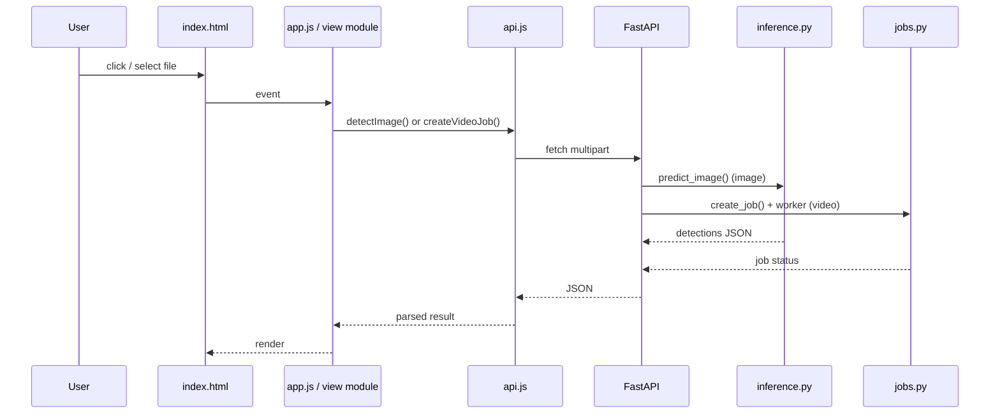

# Khushi Shakya — Frontend Guide

**Roll number:** 2301921520091
**Assigned responsibility:** Frontend development and dashboard
**Guide scope:** the actual zero-build SPA in `web/`, served by FastAPI from the same origin
**Evidence snapshot:** 22 October 2026, matching [`../PROJECT_FACTS.md`](../PROJECT_FACTS.md)

> The accepted frontend is **not Streamlit**. It is a single HTML shell, vanilla ES modules and handcrafted CSS, served by FastAPI at `http://localhost:8000`. This guide explains that implementation from the source, with the evidence boundary stated explicitly.

---

## Table of contents

1. [Assigned responsibility vs verified contribution](#1-assigned-responsibility-vs-verified-contribution)
2. [Objectives and task map](#2-objectives-and-task-map)
3. [Technical concepts and implementation workflow](#3-technical-concepts-and-implementation-workflow)
4. [Integration with the whole system](#4-integration-with-the-whole-system)
5. [Challenges, debugging, validation and testing](#5-challenges-debugging-validation-and-testing)
6. [Speaking scripts](#6-speaking-scripts)
7. [Viva questions with explanatory answers](#7-viva-questions-with-explanatory-answers)
8. [Difficult follow-up questions](#8-difficult-follow-up-questions)
9. [Practical exercises and demonstration walkthroughs](#9-practical-exercises-and-demonstration-walkthroughs)
10. [Pre-viva checklist](#10-pre-viva-checklist)
11. [One-page fact card](#11-one-page-fact-card)

---

## 1. Assigned responsibility vs verified contribution

### 1.1 What the evidence supports

The team-declared responsibility is **frontend development and dashboard**. The frontend source exists in `web/`: `index.html`, nine ES modules under `web/assets/js/`, `web/assets/css/app.css`, local fonts and brand assets. The source has been reviewed and is the accepted interface. However, the Git history does not contain a separate Khushi commit or a design-record file. Commit `b0d0649` (“feat(ui): add local dashboard frontend”) is authored by Aayush.

| Claim | Evidence status | What the evidence actually shows |
|---|---|---|
| Frontend source exists and is the accepted interface | **Verified in source** | `web/index.html`, `web/assets/js/app.js`, `store.js`, `api.js`, `inspect.js`, `video.js`, `camera.js`, `system.js`, `palette.js`, `ui.js`, `web/assets/css/app.css`. |
| The frontend was integrated in commit `b0d0649` | **Verified in history** | The commit exists and is authored by Aayush. It proves the integration point, not individual authorship of every component. |
| Khushi designed or wrote specific components | **Team-declared, not independently verified** | No separate commit, PR review record or design note is present. |
| Browser checks at 390/820/1024/1440 px | **Verified as a recorded team check** | `PROJECT_FACTS.md` §6 records “no page-level horizontal overflow” at those widths. It does not record who executed the check. |
| Webcam capture | **Verified with a synthetic device** | Chrome synthetic media device; physical camera is BLOCKED. |
| Accessibility | **Partially implemented, not formally audited** | Skip link, ARIA state, focus-visible and reduced-motion support exist. No screen-reader or contrast audit is recorded. |

The honest sentence is:

> “My assigned role was frontend development and dashboard. The repository contains the SPA, and I can walk through the modules and design decisions I worked on. The integration commit was made by Aayush, so I am not claiming the commit as my own. Here are my component ownership notes, browser test notes and design rationale.”

### 1.2 What to attach before the viva

- [ ] A component ownership list: router, store, API wrapper, inspect state machine, video polling, camera, palette, CSS system — mark which you designed, implemented, reviewed or paired on.
- [ ] A one-page design rationale for the SPA state model, hash routing, polling and responsive layout.
- [ ] Browser test notes at 390, 820, 1024 and 1440 px with date, browser version, screenshot and the exact check performed.
- [ ] Accessibility notes: keyboard path, focus behaviour, ARIA attributes, reduced motion, known gaps.
- [ ] A screen recording or screenshots of the image, video, camera and command-palette flows.
- [ ] Commit or PR review evidence if the work was paired or integrated by Aayush.

### 1.3 What not to say

- “I wrote the entire dashboard” unless the team agrees and you can show the evidence.
- “The frontend is fully accessible.” It has accessibility features, but no formal audit.
- “It works on every browser.” The recorded checks are Chrome-centric; `<dialog>`, `getUserMedia` and `MediaRecorder`-adjacent APIs vary.
- “The responsive check proves there are no layout bugs.” It proves no page-level horizontal overflow at four widths, not that every component is visually perfect.
- “Streamlit was replaced because it was bad.” The accepted stack is FastAPI + SPA; the rationale is an engineering inference, not a recorded design-minute verdict.

---

## 2. Objectives and task map

| # | Task | Files to inspect | What to run or do | What you should be able to explain |
|---|---|---|---|---|
| 1 | Map the SPA shell | `web/index.html` | Open the page; inspect the four `<section class="view">` blocks | One shell, four views, `hidden` toggling, shared sidebar/topbar/dialogs |
| 2 | Trace the router | `web/assets/js/app.js` | Change `#/overview`, `#/inspect`, `#/video`, `#/system`; use Back/Forward | Hash parsing, fallback, canonicalisation, `aria-current`, title updates |
| 3 | Trace state and events | `web/assets/js/store.js`, `app.js` | In DevTools, inspect `localStorage["infrascan.settings.v2"]`; move sliders | State shape, pub/sub, persistence, clamping |
| 4 | Audit the API wrapper | `web/assets/js/api.js` | DevTools → Network; force an offline request | `ApiError`, status 0, `detail` extraction, `FormData`, `encodeURIComponent` |
| 5 | Walk the image state machine | `web/assets/js/inspect.js` | Select a sample; run; change conf; rerun; force an error | idle → ready → analysing → success/error; disabled reasons; parameter-changed note |
| 6 | Walk the video job flow | `web/assets/js/video.js` | Upload a clip; watch polling; open result | 202 job, 850 ms polling, progress/ETA, result, downloads, beforeunload guard |
| 7 | Audit webcam capture | `web/assets/js/camera.js` | Chrome synthetic device; capture | `getUserMedia`, constraints, error mapping, canvas JPEG, stream stop |
| 8 | Audit the command palette | `web/assets/js/palette.js`, `app.js` | Press `⌘K`/`Ctrl+K`; type; arrow keys; Enter | Provider pattern, token filtering, active descendant, focus restoration |
| 9 | Audit the CSS system | `web/assets/css/app.css` | Toggle device widths; inspect computed styles | Tokens, grid, breakpoints, sidebar drawer, table overflow, reduced motion |
| 10 | Audit escaping and CSP | `web/assets/js/ui.js`, `system.js`, `infrascan/api.py` | Inspect `escapeHtml`; check response headers; try a malicious filename | XSS surfaces, safe sinks, CSP allowances and gaps |
| 11 | Audit error and offline states | `app.js`, `inspect.js`, `video.js`, `system.js` | Stop the server; reload; restart | Offline chip, toast, disabled actions, recovery polling |
| 12 | Verify responsive behaviour | browser DevTools | 390×844, 820×1180, 1024×768, 1440×900 | What changes at each breakpoint; how to measure overflow rather than trusting a hidden scrollbar |

---

## 3. Technical concepts and implementation workflow

### 3.1 Why the accepted stack is FastAPI + SPA, not Streamlit

The current repository has no Streamlit dependency in `requirements.txt`; it lists FastAPI, Uvicorn and `python-multipart`. `app.py` exports the FastAPI app, `run_app.py` launches Uvicorn, and `web/index.html` loads `/assets/js/app.js` as a module. The dashboard and API share one origin, so there is no CORS configuration, no separate dev server and no Node build step.

The engineering rationale, inferred from the code and commit sequence rather than a recorded meeting minute:

- **Explicit async jobs.** Video processing returns `202` and a job ID; the browser polls `GET /api/jobs/{id}`. This is a natural fit for a static SPA and a background worker thread.
- **One origin, two surfaces.** The same FastAPI process serves `/api/*`, `/assets/*` and `/`. There is no proxy, no CORS preflight and no second deployment.
- **Fine-grained UI state.** The dashboard needs an image state machine, object URLs, a lightbox, a camera dialog, a command palette and viewport-specific layouts. A vanilla module structure makes that state explicit.
- **No build toolchain.** There is no `package.json`, bundler or transpiler. The browser loads the modules directly. That reduces setup burden at the cost of writing more DOM code by hand.
- **Streamlit trade-off.** Streamlit is excellent for rapid Python dashboards, but its rerun model and widget lifecycle are a different programming model. The accepted implementation chose a browser-native SPA; the repository does not contain a design record that proves why every alternative was rejected.

If asked “why not Streamlit?”, answer with the accepted stack and the engineering trade-off, not with a claim that Streamlit cannot do video or state.

### 3.2 The shell: one HTML file, four views

`web/index.html` contains the entire application shell:

- a skip link to `#main`;
- a decorative ambient background;
- an inline SVG sprite with `<symbol>` icons;
- a sidebar with brand, navigation, runtime card, inference-parameter card, severity legend and footer links;
- a topbar with menu button, page title, command-palette trigger, model chip and GitHub link;
- `<main id="main">` with four `<section class="view">` blocks: overview, inspect, video, system;
- a footer;
- a toast stack;
- `<dialog>` elements for the command palette, lightbox and camera;
- `<script type="module" src="/assets/js/app.js">`.

Only one view is visible at a time. The router sets `hidden` on the others. The CSS has `[hidden] { display: none !important; }`, so the `hidden` attribute is authoritative even if a component sets `display: grid` or `flex`.

The inline SVG sprite is a deliberate choice: icons are defined once and referenced with `<use href="#i-...">`. There is no icon font and no external icon CDN. That keeps the page self-contained and compatible with the CSP.

### 3.3 Hash routing

`app.js` defines:

```js
const ROUTES = {
  overview: { title: "Overview", eyebrow: "Workspace" },
  inspect: { title: "Image inspection", eyebrow: "Image workspace" },
  video: { title: "Video analysis", eyebrow: "Video workspace" },
  system: { title: "System", eyebrow: "Runtime" },
};
```

`parseRoute()` strips the leading `#/`, removes any query string, and returns the route only if it is an own property of `ROUTES`; otherwise it returns `overview`. `route()` then:

1. canonicalises the URL with `history.replaceState(null, "", "#/<name>")`;
2. hides every `.view` whose `data-view` does not match;
3. sets `aria-current="page"` on the matching nav item and removes it from the others;
4. updates the eyebrow, title and `document.title`;
5. closes the mobile sidebar;
6. scrolls to the top;
7. observes any new `.reveal` elements.

Why hash routing rather than the History API? The app is served from a single `/` route. Hash routing needs no server-side fallback for `/inspect`, `/video` or `/system`; a refresh always requests `/`, and the fragment never reaches the server. The trade-off is an uglier URL (`/#/inspect`) and no clean server-side route for each view. For a local dashboard, that is a reasonable trade.

`go(hash)` handles the case where the target hash is already current: it calls `route()` directly instead of assigning `location.hash`, because assigning the same hash does not fire `hashchange`.

### 3.4 The store: a tiny pub/sub, not a framework

`store.js` exports a single `state` object:

```js
export const state = {
  apiOnline: true,
  status: null,
  samples: null,
  settings: loadSettings(),
  image: null,
  imageResult: null,
  imageView: "annotated",
  video: null,
  job: null,
  lastLatency: null,
  session: { scans: 0, videos: 0 },
};
```

It also exports `on(event, handler)` and `emit(event, payload)`. Listeners are stored in a `Map` of `Set`s, so multiple components can subscribe to `status`, `settings`, `samples`, `session`, `latency` and `offline`. `emit` wraps each handler in `try/catch` and logs a failure, so one broken listener does not stop the others.

Settings are persisted in `localStorage` under `infrascan.settings.v2`. `clamp()` rejects non-finite values and clamps `conf` to `[0.05, 1]` and `iou` to `[0.1, 1]`. The `try/catch` around `localStorage` handles hardened browsers or storage denial. This is a small, explicit state layer: no proxies, no reactivity magic, no dependency.

The store is not a full application state machine. The `busy` flags and `lastResult` live inside `inspect.js` and `video.js` as module-local variables. That is a deliberate simplification, but it means a page reload loses in-progress UI state even though the server may still have a job.

### 3.5 The API wrapper

`api.js` is the only place that knows the HTTP contract:

```js
async function request(path, options = {}) {
  let response;
  try {
    response = await fetch(path, options);
  } catch (error) {
    throw new ApiError(
      "Could not reach the local InfraScan server. Check that it is still running.",
      0
    );
  }
  if (!response.ok) {
    let message = `Request failed (${response.status})`;
    try {
      const body = await response.json();
      if (body && body.detail) {
        message = typeof body.detail === "string" ? body.detail : JSON.stringify(body.detail);
      }
    } catch {
      /* non-JSON error body */
    }
    throw new ApiError(message, response.status);
  }
  return response;
}
```

The `status = 0` convention distinguishes a network failure from an HTTP error. The wrapper parses the FastAPI `detail` field, so a 400 decode error, a 413 size error, a 415 video-format error or a 503 missing-checkpoint error reaches the UI as an actionable message rather than “Request failed.”

`detectImage()` and `createVideoJob()` build `FormData` and append `file`, `conf` and `iou` as strings. `getJob()` uses `encodeURIComponent(jobId)` so a job ID cannot break the path. The wrapper does not set a `Content-Type` header for multipart; the browser sets the boundary.

### 3.6 The image inspection state machine

`inspect.js` has three module-level variables: `busy`, `sourceMode` and `lastResult`. The visible states are:

| State | Trigger | UI |
|---|---|---|
| **Idle / no frame** | Initial load, clear | Empty result panel; run disabled; note “Select a frame to begin.” |
| **Ready** | File/sample/camera frame selected, model ready | Preview visible; run enabled; note shows conf/IoU/640 px |
| **Analysing** | Run clicked | Loading panel; run button busy and disabled; status “Analysing” |
| **Success** | API returns | Annotated image, metrics, severity bar, table, downloads |
| **Error** | API/network failure | Error panel with retry; status “Inspection failed” |

`updateRunState()` is the single place that decides whether the run button is enabled:

```js
const ready = state.apiOnline && modelState === "ready";
const hasImage = Boolean(state.image);
button.disabled = busy || !hasImage || !ready;
```

It also explains *why* the button is disabled: offline, no frame, model loading, model unavailable, model error, or parameters changed since the last result. That last case is important: if the user moves the confidence slider after a result, the old result is still on screen but the note says “Parameters changed — run again to apply.” The UI does not silently pretend the old result used the new thresholds.

`runInspection()` guards against double submission with `busy`, shows the loading panel, and calls `detectImage`. On success it:

- stores `state.imageResult`;
- calls `setLatency(result.inference_ms)`;
- increments the session scan count;
- renders the result;
- shows a toast with the detection count and latency.

On failure it calls `showError`, which hides the loading/output panels, shows the alert, writes the message with `textContent`, sets the status tag to error and shows a toast. The `finally` block always clears `busy`, hides the loading panel, restores the button and updates the run state.

### 3.7 File selection, dataset samples and object URLs

`selectFile()` validates the extension against `[".jpg", ".jpeg", ".png", ".webp", ".bmp"]` and the size against 25 MB before doing anything. It then calls `clearSelection({reset:false})`, creates an object URL with `URL.createObjectURL(file)`, stores the file and preview metadata in `state.image`, shows the preview, resets the output and updates the run state.

The dataset path is different. `selectSample(item)` sets `previewUrl` to the server URL `/api/samples/<name>` and `file: null`. When the user runs the inspection, `sampleToFile()` fetches that URL, converts the response to a `Blob`, and wraps it in a `File` so the same multipart endpoint can be used. This avoids a second image-inference endpoint and keeps the server contract small.

Object URL lifecycle matters:

- `clearSelection()` revokes `state.image.objectUrl` before clearing.
- `beforeunload` revokes the current object URL.
- `selectFile()` revokes the previous selection via `clearSelection`.
- The sample URL is not an object URL, so it is not revoked.

If you forget to revoke, the browser keeps the blob alive for the lifetime of the document. That is a memory leak, not a correctness bug, but it is exactly the kind of detail an examiner may ask about.

### 3.8 The result renderer and escaping

`renderResult()` builds the detection table with an HTML string. The dynamic fields are escaped:

```js
<td class="mono">${escapeHtml(detection.id)}</td>
<td>${severityChip(detection.severity)}</td>
<td><span class="mono">${(detection.confidence * 100).toFixed(1)}%</span>...</td>
<td class="mono">${formatNumber(detection.coverage_pct, 2)}%</td>
<td class="mono">${escapeHtml(formatCoords(detection.bbox))}</td>
```

`escapeHtml()` replaces `&`, `<`, `>`, `"` and `'`. `severityChip()` escapes both the `data-sev` attribute and the label. The confidence and coverage are numbers formatted with `toFixed`/`formatNumber`, so they cannot inject markup. The image `src` is `result.image_url`, which is server-generated from a UUID; the filename used for the download attribute is derived from `result.filename` and stripped of its extension.

The dataset sample grid also escapes the item name and URL before inserting them into `innerHTML`. The command palette escapes labels and hints. The toast uses `textContent` for the message. These are the main XSS defences.

One residual surface: `system.js` renders `row.description` from `/api/status` into `innerHTML` without `escapeHtml`. The values come from a server-side dictionary of fixed descriptions, so they are not user-controlled today. If the status payload ever became attacker-controlled, that would be an injection point. A defensive fix is to escape it; the current code relies on the server contract.

### 3.9 Video job polling

`video.js` follows a different pattern from the image state machine because the server processes video asynchronously:

1. `runVideo()` guards on `busy`, `state.video` and model readiness.
2. It sets the button to “Uploading…”, shows the progress panel and calls `createVideoJob`.
3. The server returns `202` with a job object (`id`, `status: "queued"`, progress, result).
4. `pollJob()` calls `getJob` immediately, then every **850 ms** with `setTimeout` after each response.
5. On `completed`, `renderResult()` stops polling, fills the metrics, sets the video source, enables downloads and increments the session video count.
6. On `failed`, `showVideoError()` stops polling and shows the error.
7. On a network/HTTP error, it also stops and shows “Lost connection to the local server.”

The polling interval is a deliberate compromise: faster polling adds request overhead; slower polling makes the progress bar feel stale. Because the next poll is scheduled only after the previous response, requests do not overlap. The ETA is computed from elapsed time and the fraction:

```js
const elapsed = (performance.now() - startedAt) / 1000;
$("#job-eta").textContent = formatEta((elapsed * (1 - fraction)) / fraction);
```

The progress bar clamps the width to `[0, 100]` and gives a minimum 1.5% while processing, so it does not look frozen at zero.

`beforeunload` warns if `busy` is true. That is a browser-level warning, not a cancellation. Closing the tab does not stop the server worker; the job continues and its output remains on disk until cleanup. On reload, the UI has no stored job ID, so it cannot resume polling. A more robust design would persist the job ID and reattach.

### 3.10 Webcam capture

`camera.js` uses `navigator.mediaDevices.getUserMedia` with:

```js
{
  audio: false,
  video: {
    facingMode: { ideal: "environment" },
    width: { ideal: 1920 },
    height: { ideal: 1080 },
  },
}
```

`facingMode: "environment"` is a hint for rear cameras on mobile; on a laptop it is ignored. The constraints are `ideal`, not `exact`, so the browser can choose a lower resolution.

If `getUserMedia` is missing, the dialog still opens and shows “This browser does not expose camera access.” If the promise rejects, the code maps the error name:

- `NotAllowedError` / `SecurityError` → permission denied;
- `NotFoundError` / `OverconstrainedError` → no camera;
- `NotReadableError` → camera busy in another application;
- anything else → generic “could not be opened.”

Capture uses a `<canvas>` at `video.videoWidth × video.videoHeight`, draws the current frame, and calls `canvas.toBlob(..., "image/jpeg", 0.92)`. The blob becomes a `File` named `webcam_<timestamp>.jpg`, the stream is stopped and the dialog closes. The stream is stopped on dialog close, cancel, backdrop click and capture. It is never uploaded as a live stream; only the still frame goes to the local server.

`getUserMedia` requires a secure context. `localhost` is treated as secure, so `http://localhost:8000` works; a plain HTTP LAN address will not. This is a browser rule, not an InfraScan bug.

### 3.11 The command palette

`palette.js` takes a command provider from `app.js`. Each command has `label`, `hint`, `icon`, `keywords` and `run`. `matches()` splits the query on whitespace and requires every token to appear in the concatenated label/hint/keywords, case-insensitively. That means “reload model” finds the reload command, and “camera” finds the webcam capture command.

The palette opens with `⌘K`/`Ctrl+K` or the topbar button. It uses `<dialog>` and `showModal()`, so the browser provides a modal focus layer. Keyboard behaviour:

- ArrowDown/ArrowUp cycle the active item.
- Home/End jump to the first/last item.
- Enter runs the active command.
- Escape closes the native dialog.
- Mouse movement updates the active item.
- On close, focus returns to `previousFocus` if it is still connected.

Each item has `role="option"` and `aria-selected`; the input holds `aria-activedescendant` pointing at the active item. The list is re-rendered on every input event. The shortcut label is `⌘K` on Mac and `Ctrl K` elsewhere, detected from `navigator.platform` with a user-agent fallback.

An accessibility gap: the input is not marked `role="combobox"`, and it does not declare `aria-controls` or `aria-expanded`. The listbox semantics are partial. The palette is usable with a keyboard, but a formal screen-reader review could improve it.

### 3.12 The System page

`system.js` renders `/api/status` into the System view:

- model state tag (ready/loading/error/unavailable);
- checkpoint name, path, task, classes, device, inference size, file size;
- Python, platform, architecture, PyTorch, Ultralytics, OpenCV, NumPy and FastAPI versions;
- severity policy rows from `status.severity_policy`;
- the reload button.

`rangeLabel()` converts the server's numeric bands into display strings: CRITICAL `≥ 8.0%`, MODERATE `2.5% – 8.0%`, MINOR `< 2.5%`. The policy table is generated from the same `SEVERITY_BANDS` tuple that the inference code uses, so the UI cannot drift from the backend policy unless the status payload is stale.

The reload button disables while the model is loading, shows “Reloading…”, calls `POST /api/model/reload`, shows a toast and dispatches `infrascan:refresh-status`. `app.js` listens for that event and re-fetches `/api/status`.

### 3.13 CSS: tokens, layout and responsive behaviour

`app.css` is a handcrafted design system of about 1,220 lines. It starts with four `@font-face` declarations for locally bundled Inter and Space Grotesk (woff2, `font-display: swap`, unicode-range subsets). There are no external font requests.

`:root` defines the palette and layout tokens: background/surface colours, border colours, text colours, accent/sky/violet, severity colours, radii, sidebar width (274px), topbar height (76px), font stacks, shadows and easing. Components use those tokens rather than repeating hex values.

The main layout is a fixed sidebar plus a workspace with a topbar, `<main>` and footer. The content grids are CSS Grid:

- `.hero` two columns;
- `.inspect-grid` two columns (controls/result);
- `.video-grid` two columns (source/status);
- `.video-result__grid` two columns (media/sidebar);
- `.system-grid` two columns;
- `.stat-strip` four columns.

Breakpoints:

| Width | What changes |
|---|---|
| ≤ 1280 px | Reduced main/topbar padding; pipeline becomes one column; smaller scanner stage |
| ≤ 1120 px | Hero becomes one column; inspect/video grids become one column; video result becomes one column |
| ≤ 1024 px | Sidebar becomes an off-canvas drawer with a scrim; workspace margin-left becomes 0; system grid one column |
| ≤ 820 px | Section heads one column; stat strip 2×2; capability/split/pipeline/CLI grids one column; result metrics 2×2; palette trigger collapses to an icon |
| ≤ 620 px | Eyebrow hidden; status chip collapses to a dot; hero actions full width; card padding reduced; run row stacks; sample grid 2 columns; spec list stacks |
| ≤ 420 px | Tighter main/topbar/footer padding; palette trigger hidden; result metrics 2 columns; third scanner tag hidden |

`body { overflow-x: hidden; }` prevents a page-level horizontal scrollbar. That is a visual safeguard, but it can also hide a wide element instead of fixing it. When you verify responsiveness, do not only look for a scrollbar. Measure:

```js
document.documentElement.scrollWidth <= window.innerWidth
document.body.scrollWidth <= window.innerWidth
```

and inspect the widest element with DevTools. The recorded check says no page-level overflow at 390, 820, 1024 and 1440 px; that is the claim you can repeat, not “every component is pixel-perfect.”

Tables use `.table-wrap { overflow-x: auto; }`, so a wide detection table scrolls inside its card rather than forcing the page wide. Code blocks use `overflow-x: auto` for the same reason. The sidebar drawer uses `transform: translateX(-100%)` and a `.sidebar-open` class; the scrim fades in and the menu button updates `aria-expanded`.

`@media (prefers-reduced-motion: reduce)` sets animation/transition durations to near-zero, disables smooth scrolling and forces `.reveal` elements to their visible state. `ui.js` also checks `matchMedia("(prefers-reduced-motion: reduce)")` before animating numbers, and falls back to the final value if the tab is hidden.

Focus styles are global (`:focus-visible`), and the skip link becomes visible on focus. The page has a logical heading order, `aria-label`s on icon-only buttons, `aria-current` on navigation, `aria-selected` on tabs/options, `aria-live` on result/status regions and native `<dialog>` semantics.

### 3.14 Accessibility: what is present and what is not proven

Present in the source:

- skip link to `#main`;
- `aria-label` on icon-only controls;
- `aria-current="page"` on the active nav item;
- `aria-selected` and roving `tabIndex` on the image-source tabs;
- `aria-live="polite"` on the sample grid, image result card and video status card;
- `role="alert"` on error panels;
- native `<dialog>` for palette, lightbox and camera;
- focus restoration in the palette;
- `:focus-visible` styling;
- reduced-motion support;
- text alternatives on images (`alt`) and an `aria-label` on the severity distribution bar.

Not proven:

- no screen-reader walkthrough is recorded;
- no colour-contrast measurement is recorded;
- the palette's combobox semantics are incomplete;
- the camera dialog's focus behaviour is native-dialog-dependent;
- keyboard access to the video `<video controls>` depends on the browser;
- the `title` attribute is used on disabled download links, which is not a reliable accessible description.

Say “accessibility features are implemented; a formal audit is still open,” not “the app is accessible.”

### 3.15 Performance choices

- No framework runtime, no bundler, no hydration.
- ES modules are loaded once and cached by the browser.
- Fonts are local and preloaded with `crossorigin`.
- Sample images use `loading="lazy"`.
- The status poll backs off: 2.5 s while the model is loading/starting, 15 s when ready, 5 s when offline.
- The status refresh is single-flight: if a refresh is in progress, a new request sets `queuedRefresh` instead of firing concurrently.
- Reveal animations use `IntersectionObserver` and unobserve after the first intersection; if the API is unavailable, all `.reveal` elements are shown immediately.
- Number animation uses `requestAnimationFrame` with a timeout fallback for occluded tabs.
- Object URLs are revoked on clear/unload.
- Video polling is sequential, not overlapping.

The app does not lazy-load route modules; all nine modules are imported at startup. For a local dashboard with a handful of views, that is simpler than code-splitting and avoids a loading waterfall.

---

## 4. Integration with the whole system

### 4.1 The browser-to-backend path



### 4.2 What the frontend sends and expects

| Action | Request | Expected response | UI on success | UI on failure |
|---|---|---|---|---|
| Load status | `GET /api/status` | app/model/runtime/severity/limits | chips, sidebar, System page | offline chip + toast; retry at 5 s |
| Load samples | `GET /api/samples` | `{available, count, shown, items}` | sample grid or empty message | empty state; upload/webcam still work |
| Detect image | `POST /api/detect/image` multipart | JSON with `image_url`, `detections`, `summary`, `inference_ms` | annotated image, metrics, table, CSV | error panel + retry |
| Create video job | `POST /api/detect/video` multipart | `202` + job JSON | progress panel | error panel; job may be marked failed |
| Poll job | `GET /api/jobs/{id}` | status/progress/result | progress or result | error “lost connection” |
| Reload model | `POST /api/model/reload` | model status | toast + status refresh | toast with detail |
| Fetch sample | `GET /api/samples/{name}` | image bytes | preview / `File` for upload | “dataset sample could not be loaded” |

### 4.3 Status polling and offline recovery

`app.js` starts with `refreshStatus()`. It sets `polling = true`, clears the timer and calls `getStatus()`. On success it stores the status, renders it, and resets the offline notification flag. On failure it calls `setOffline` and `renderOffline`, shows one toast, and schedules the next attempt at 5 s. When the server returns, the next success shows “Connection restored.”

Polling cadence:

- model `loading` or `starting` → 2.5 s;
- model ready → 15 s;
- offline → 5 s;
- a manual `infrascan:refresh-status` event triggers an immediate refresh;
- returning to a visible tab triggers a refresh.

This is why the System page and model chip update without a page reload. It is also why a server restart is noticed within the polling interval.

### 4.4 Error propagation

The backend's `HTTPException` detail is surfaced by `api.js` as `ApiError.message`. Examples:

- invalid image → 400 “The file could not be decoded as an image. Use JPG, PNG, WebP or BMP.”
- oversize image → 413 “File is too large. The limit is 25 MB.”
- unsupported video → 415 “Unsupported video format. Use MP4, AVI, MOV or MKV.”
- missing checkpoint → 503 with the configured path and reload instruction.
- job not found → 404 “Job not found. It may have been cleaned up.”
- job not complete → 409 “The job has not finished yet.”

The frontend never displays a raw stack trace. `api.js` falls back to `Request failed (<status>)` if the body is not JSON. The global FastAPI exception handler returns a generic 500 message and logs the trace server-side.

### 4.5 Same-origin and CSP consequences

The SPA is served from the same origin as the API, so `fetch("/api/...")` needs no base URL, no CORS headers and no credentials. The CSP `connect-src 'self'` enforces that. `script-src 'self'` means no inline event handlers such as `onclick="..."`; all handlers are attached with `addEventListener` in modules. `style-src 'self' 'unsafe-inline'` is required because the UI sets `style="width:..."` on severity bars and progress bars. `img-src 'self' data: blob:` supports object URLs and any data-URI previews. `media-src 'self' blob:` supports the local video preview and result. `font-src 'self'` supports the bundled fonts.

If you add a CDN library, a remote font or an inline script, the CSP will block it. That is a feature, not a bug: it keeps the dashboard local-first and auditable.

### 4.6 Failure modes at the integration boundary

| Failure | Where it appears | User experience |
|---|---|---|
| Server stopped | `fetch` rejects | “Could not reach the local InfraScan server”; offline chip; retry every 5 s |
| Model loading | `/api/status` says `loading` | Run buttons disabled; note “Model is loading”; status poll every 2.5 s |
| Model unavailable | `/api/status` says `unavailable` | “Checkpoint required — add weights/best.pt, then reload in System.” |
| Invalid image | 400 | Error panel with the decode message; retry |
| Oversize upload | 413 | Error panel/toast with the limit |
| Unsupported video | 415 | Error panel with the format list |
| Video job fails | job `failed` | “Processing failed” with the server error |
| Job record lost | 404 on poll | “Job not found. It may have been cleaned up.” |
| H.264 unavailable | server log `mp4v` | Result may not play; download still works |
| Camera denied | `getUserMedia` rejection | “Camera permission was denied…” |
| Camera busy | `NotReadableError` | “The camera is busy in another application…” |
| localStorage denied | `try/catch` | Defaults used; no persistence |
| Clipboard denied | `copyText` catch | “Could not copy. Select the command manually.” |

---

## 5. Challenges, debugging, validation and testing

### 5.1 Real frontend issues and how to discuss them

| Issue | Status | Explanation |
|---|---|---|
| Streamlit wording in older material | **Resolved for this repository** | The documentation was rebuilt for FastAPI + SPA; remaining Streamlit mentions are history or comparison. If you meet one elsewhere, confirm it is not a current-state claim, and always cite `web/` and `PROJECT_FACTS.md`. |
| Page overflow hidden by CSS | **Code-level risk** | `body { overflow-x: hidden; }` can suppress a scrollbar while a child is still too wide. The recorded check is “no page-level horizontal overflow”; repeat it by measuring `scrollWidth`. |
| `dialog` browser support | **Likely** | Native `<dialog>` is supported in modern Chrome, Edge, Safari and Firefox, but older browsers or embedded webviews may not. No polyfill is included. |
| Object URL leaks | **Code-level risk** | The main paths revoke object URLs, but any new preview path must do the same. A forgotten revoke keeps blobs in memory. |
| Video job lost on reload | **Verified behaviour** | Job IDs are not persisted; a reload cannot resume polling. The server job continues. |
| No cancel button | **Verified gap** | There is no cancel endpoint or UI. Closing the tab does not stop the job. |
| Polling overload | **Not observed** | 850 ms polling is sequential; status polling is single-flight. A long job still produces steady requests. |
| XSS via `innerHTML` | **Mostly mitigated** | `escapeHtml` is used for names, IDs, coordinates and sample URLs. `system.js` trusts server descriptions. |
| CSP and inline styles | **Verified** | `'unsafe-inline'` is allowed for styles because the UI sets widths. Scripts are restricted to `'self'`. |
| Accessibility gaps | **Verified in source** | Partial combobox semantics; no formal screen-reader/contrast audit. |
| Camera secure context | **Verified browser rule** | `localhost` works; plain HTTP on a LAN IP does not. |
| `navigator.platform` deprecated | **Likely** | The palette uses it with a user-agent fallback. It works today but is not a future-proof API. |
| `formatBytesLabel` duplication | **Code-level** | `inspect.js` defines a local `formatBytesLabel` while `ui.js` exports `formatBytes`; the local helper is used for the preview. Not a bug, but a consistency point. |
| `system.js` innerHTML descriptions | **Code-level** | Values are server-controlled constants today. Escaping would be safer if the payload ever changes. |

### 5.2 Debugging playbook

```bash
# Is the server up?
curl -s http://127.0.0.1:8000/api/health

# What does the UI receive?
curl -s http://127.0.0.1:8000/api/status | python -m json.tool

# Are the static assets served?
curl -sI http://127.0.0.1:8000/assets/js/app.js
curl -sI http://127.0.0.1:8000/assets/css/app.css

# Are the security headers present?
curl -sI http://127.0.0.1:8000/

# Is the sample picker populated?
curl -s http://127.0.0.1:8000/api/samples
```

In the browser:

- **Console:** look for module-load errors, CSP violations, `getUserMedia` errors and unhandled promise rejections.
- **Network:** filter `api`; check status codes, request payloads and response JSON.
- **Application → Local Storage:** inspect `infrascan.settings.v2`.
- **Elements:** inspect `hidden`, `aria-selected`, `aria-current`, `disabled` and `data-state`.
- **Device toolbar:** test 390, 820, 1024 and 1440 px; measure `document.documentElement.scrollWidth`.
- **Rendering:** emulate `prefers-reduced-motion: reduce`.
- **Network throttling/offline:** verify the offline chip and recovery.

### 5.3 What the recorded checks actually cover

| Check | Recorded status | What it proves |
|---|---|---|
| Dashboard root served | PASS | FastAPI returns the SPA at `/` |
| Responsive layout | PASS | 390, 820, 1024, 1440 px; no page-level horizontal overflow |
| Webcam capture | PASS with synthetic device | The browser path works without physical hardware |
| Physical camera | BLOCKED | No hardware/permission evidence |
| Image inference UI | PASS | The image flow rendered a result |
| Video playback | PASS | H.264 result played in Chrome (`readyState 4`) |
| Offline state | PASS (recorded in README release checks) | The UI shows an actionable error when the API is unreachable |
| Accessibility audit | NOT RUN | No screen-reader/contrast evidence |
| Cross-browser matrix | NOT RUN | The recorded checks are Chrome-centric |
| Automated frontend tests | NOT RUN | No test suite exists |

Do not upgrade “responsive layout PASS” into “WCAG compliant” or “cross-browser certified.”

### 5.4 A responsive verification procedure you can defend

1. Open DevTools → Toggle device toolbar.
2. Set 390×844, 820×1180, 1024×768 and 1440×900.
3. At each width, run:

```js
({
  innerWidth: window.innerWidth,
  docScroll: document.documentElement.scrollWidth,
  bodyScroll: document.body.scrollWidth,
  overflow: document.documentElement.scrollWidth > window.innerWidth,
})
```

4. Open the sidebar drawer at ≤1024 px; confirm the scrim, close button and `aria-expanded`.
5. Open the image result table; confirm it scrolls inside `.table-wrap`, not the page.
6. Open the command palette; confirm it fits and the list scrolls.
7. Check the video result and the System spec list at 390 px.
8. Capture a screenshot and write the browser version and date.

Expected observation at the four recorded widths: `overflow: false` for the page. A child element can still overflow its card; the table wrapper is the intended local scroll container.

### 5.5 A note on frontend testing without a framework

There is no Jest, Vitest, Playwright or Cypress suite. The verification is manual. If asked how you would test the frontend, propose:

- **Unit-level:** extract pure functions (`escapeHtml`, `formatBytes`, `detectionsToCsv`, `matches`, `rangeLabel`) and test them with a small runner.
- **DOM-level:** use jsdom or happy-dom for state transitions and event wiring.
- **End-to-end:** Playwright for upload, polling, offline and responsive checks.
- **Accessibility:** axe-core plus a manual screen-reader pass.
- **Visual:** screenshot comparisons at the four named widths.

That is a credible next step, not a claim that it already exists.

---

## 6. Speaking scripts

### 6.1 60-second overview

> “The InfraScan dashboard is a zero-build single-page application served by FastAPI from the same origin as the API. There is no Node, no bundler and no separate frontend server. `index.html` provides the shell and four views; `app.js` handles hash routing and status polling; `store.js` is a small pub/sub state layer; `api.js` is the only module that knows the HTTP contract. Image inspection has an explicit state machine from idle to ready to analysing to success or error. Video uploads return a job ID and the browser polls progress every 850 milliseconds. The webcam captures one still frame through a canvas and stops the stream immediately. The CSS is handcrafted with local fonts, a token system, breakpoints from 1280 down to 420 pixels, reduced-motion support and a sidebar drawer below 1024. The recorded checks cover 390, 820, 1024 and 1440 pixels with no page-level horizontal overflow, and webcam capture with Chrome's synthetic device. Physical camera and a formal accessibility audit remain blocked or not run.”

### 6.2 3-minute technical segment

> “The frontend is deliberately framework-free. `index.html` contains the entire shell: sidebar, topbar, four view sections, footer, toast stack, and three native dialogs for the command palette, lightbox and camera. Only one view is visible at a time; the router sets the `hidden` attribute on the others. The routes are hash-based: `#/overview`, `#/inspect`, `#/video`, `#/system`. An unknown hash falls back to overview, and the router canonicalises the URL with `history.replaceState`. Hash routing means a refresh always requests `/`, so there is no server-side route fallback to maintain.
>
> State lives in `store.js`: status, samples, settings, selected image, result, video, job, latency and session counts. It exposes `on` and `emit`, and the settings are persisted in `localStorage` under `infrascan.settings.v2`, clamped to the server's allowed ranges. The store is intentionally small; transient `busy` flags stay inside the view modules. `api.js` wraps `fetch`, converts a network failure into an `ApiError` with status 0, extracts FastAPI's `detail` field, and builds the multipart bodies for image and video uploads.
>
> Image inspection is a state machine. `updateRunState()` is the single authority for whether the run button is enabled: the API must be online, the model must be `ready`, a frame must be selected, and no request may be in flight. If the user changes confidence or IoU after a result, the UI says the parameters changed and asks for a rerun rather than pretending the old result used the new values. Dataset samples are fetched as blobs and wrapped in a `File`, so the same multipart endpoint handles uploads, samples and webcam captures. Object URLs are revoked when the selection is cleared or the page unloads.
>
> Video is asynchronous. The POST returns 202 with a job ID; the client polls every 850 milliseconds, updates the progress bar and ETA, and switches to the result when the job completes. The polling is sequential, so requests do not stack. There is no cancel button, and a page reload loses the job ID even though the server job continues.
>
> The webcam uses `getUserMedia` with ideal 1920×1080 and environment-facing preference, maps permission/busy/not-found errors to actionable messages, captures one canvas frame as JPEG at 0.92, and stops every track. The palette is a provider-driven command list with token filtering, arrow-key navigation and focus restoration. The CSS uses tokens, CSS Grid, local fonts and six breakpoints. The CSP allows same-origin scripts, local fonts, blob images/media and inline styles for dynamic widths. The recorded responsive check is no page-level overflow at 390, 820, 1024 and 1440; the accessibility features exist, but a formal audit does not.”

### 6.3 5-minute demo walkthrough

| Time | Action | What to point at |
|---|---|---|
| 0:00 | Open `http://localhost:8000`. | “The SPA is served by FastAPI at `/`; there is no separate frontend server.” |
| 0:15 | Point at the sidebar, topbar and model chip. | “The model chip is driven by `/api/status`; the sidebar runtime card shows the same state.” |
| 0:30 | Press `⌘K` / `Ctrl+K`; type “inspect”; press Enter. | “Hash routing plus a provider-driven command palette; the URL changes to `#/inspect`.” |
| 0:50 | Open DevTools → Network; select a dataset sample. | “The sample grid is populated from `/api/samples`; the preview uses the server URL.” |
| 1:10 | Move the confidence slider from 0.25 to 0.40. | “Settings are clamped and persisted; the run note updates.” |
| 1:20 | Click **Run inspection**. | “The button disables while busy; the request is multipart `file`, `conf`, `iou`.” |
| 1:40 | Point at the annotated image and metrics. | “The image is served from `/api/results/{uuid}.jpg`; the table is built from the JSON response.” |
| 2:00 | Toggle **Original**; open the lightbox; download CSV. | “The original is a local object URL; the CSV is generated in the browser with proper quoting.” |
| 2:20 | Change confidence again; point at the note. | “The old result is not silently reinterpreted; it says parameters changed.” |
| 2:30 | Open **Video analysis**; upload a short clip. | “POST returns 202; the job is queued.” |
| 2:50 | Point at progress and ETA. | “Polling every 850 ms, sequential; the worker is server-side.” |
| 3:10 | When complete, play the result. | “H.264 output; Chrome `readyState` should be 4. If the server log says `mp4v`, explain the fallback.” |
| 3:30 | Show the three downloads. | “MP4, CSV, JSON; counts are frame-level, not deduplicated.” |
| 3:45 | Open **System**. | “Checkpoint, device, runtime versions, severity policy — all from `/api/status`.” |
| 4:00 | Click **Reload checkpoint**. | “The button disables, the API reloads, the status refreshes.” |
| 4:15 | Open DevTools responsive mode at 390 px. | “Sidebar becomes a drawer; cards stack; the page does not scroll horizontally.” |
| 4:30 | Run the overflow snippet in the console. | “`document.documentElement.scrollWidth <= window.innerWidth` at 390, 820, 1024, 1440.” |
| 4:45 | Stop the server; refresh. | “Offline chip, actionable toast, retry at 5 s; no blank page.” |
| 4:55 | Restart the server. | “The next poll restores the connection; the toast says so.” |

**Contingencies:**

- If the camera is unavailable, use Chrome's synthetic media device or skip the live capture and explain the error mapping.
- If the video is `mp4v`, show the download and explain the browser-support limitation.
- If the model is loading, show the disabled run button and the System loading state; explain the 2.5 s poll.
- If the dataset is absent, use upload and explain that the sample grid is optional.
- If the server is offline, use it as the offline-state demo rather than restarting immediately.

---

## 7. Viva questions with explanatory answers

**1. Why is the frontend a SPA instead of Streamlit?**
The accepted implementation is FastAPI plus a static ES-module SPA served from the same origin. That gives the browser explicit control over image state, background video jobs, polling, object URLs, dialogs and responsive layouts, and it avoids a separate Python UI runtime. The trade-off is more hand-written DOM code and no framework conveniences. The repository does not contain a design-minute record of the original decision, so I present this as the architecture's rationale, not a verbatim team debate.

**2. Why not use React or Vue?**
The app has four views and a small amount of shared state; a framework would add a build step, a dependency tree and a runtime without solving a problem the project could not solve directly. Vanilla modules keep the deployment to static files and make the data flow explicit. The cost is that reusable rendering and reactivity are manual. For a larger product with many contributors, a framework would likely be worth it.

**3. How does the router work?**
`parseRoute()` reads `location.hash`, strips `#/` and any query string, and checks the result against the `ROUTES` map. Unknown routes fall back to `overview`. `route()` hides the non-matching `.view` sections, updates `aria-current`, the page title and `document.title`, closes the sidebar, scrolls to the top and observes reveal elements. `history.replaceState` canonicalises the hash without adding a history entry.

**4. Why hash routing instead of the History API?**
The app is served from a single `/` route. With hash routing, a refresh or deep link always requests `/`, and the fragment is handled entirely in the browser, so there is no need for a server-side catch-all route. The cost is a `#/` in the URL and less elegant deep-link semantics. For a local dashboard, that is a reasonable trade.

**5. What is `store.js` and why does it exist?**
It is a small pub/sub store with a single `state` object and `on`/`emit` functions. It centralizes status, samples, settings, the selected image/result, video/job, latency and session counts so that independent modules can react without passing callbacks through the DOM. Settings are persisted and clamped. It is deliberately not a full state machine; transient `busy` flags stay local to the view modules.

**6. How does `api.js` handle errors?**
It wraps `fetch` in a try/catch. A network failure becomes `ApiError` with status 0 and a “could not reach the local server” message. A non-2xx response tries to parse FastAPI's `detail` field and throws `ApiError` with the HTTP status. If the body is not JSON, it falls back to `Request failed (<status>)`. That gives the UI actionable messages for 400, 413, 415, 503 and 404.

**7. Why use `FormData` for uploads?**
The image and video endpoints accept multipart form data with a file part and numeric `conf`/`iou` parts. `FormData` lets the browser construct the multipart body and boundary correctly, including the filename and content type. Setting `Content-Type: multipart/form-data` manually would omit the boundary and break the request.

**8. Walk through the image inspection state machine.**
The states are idle/no frame, ready, analysing, success and error. `updateRunState()` enables the button only when the API is online, the model is ready, a frame is selected and no request is in flight. Running sets `busy`, shows the loading panel and disables the button. Success renders the annotated image, metrics, severity bar and table; failure shows an error panel with retry. The `finally` block always restores the button.

**9. How are dataset samples handled differently from uploads?**
A sample is selected by URL, not by a local `File`. On run, `sampleToFile()` fetches `/api/samples/<name>`, converts the response to a `Blob`, and wraps it in a `File`, so the same multipart endpoint can be used. Uploads and webcam captures already have a `File`. This keeps the server contract small and avoids a second inference endpoint.

**10. Why use object URLs, and when are they revoked?**
Object URLs let the browser preview a local `File` without uploading it first. The URL is created with `URL.createObjectURL(file)` and stored as `objectUrl`. It is revoked in `clearSelection()`, when a new file replaces the old one, and on `beforeunload`. If it is not revoked, the blob stays in memory for the document's lifetime.

**11. How does video polling work, and why 850 ms?**
The POST returns 202 with a job ID; `pollJob()` calls `GET /api/jobs/{id}` immediately, then schedules the next call 850 ms after each response. The interval is a compromise between progress responsiveness and request overhead. Because the next timer is set after the response, polls do not overlap. The ETA uses elapsed time divided by the progress fraction.

**12. Why not use WebSockets or Server-Sent Events?**
Polling is simpler, works through the same HTTP API, needs no persistent connection or server push infrastructure, and is adequate for a local single-user dashboard. The cost is latency and repeated requests. If the app had many concurrent users or needed sub-second progress, SSE or WebSockets would be a better fit.

**13. What happens if the page reloads during a video job?**
The server job continues, but the browser loses the job ID because it is stored only in module state. On reload, the UI shows the idle video view and cannot reattach. The output files remain on disk until cleanup. A more robust design would persist the job ID in `sessionStorage` and resume polling.

**14. How does webcam capture work?**
`getUserMedia` requests video only, with an ideal environment-facing camera and 1920×1080. The stream is attached to a `<video>`. On capture, the code draws the current frame to a canvas at the video's native dimensions, converts it to a JPEG blob at quality 0.92, wraps it in a `File` and passes it to the image selection flow. The stream is stopped on capture, cancel, close or backdrop click. Only the still frame is uploaded.

**15. Why capture a still instead of streaming frames to the server?**
The image endpoint expects one image, and the project's live continuous mode is the separate OpenCV `test_camera.py` HUD. Browser still capture keeps the upload small, avoids a continuous network stream and matches the inspection workflow. Continuous browser inference would need a different transport and a frame scheduler.

**16. How does the command palette work?**
`app.js` supplies a list of commands with labels, hints, keywords and `run` functions. `palette.js` filters by splitting the query into tokens and requiring every token to appear in the concatenated text. Arrow keys move the active item, Enter runs it, Escape closes the dialog, and focus returns to the previous element. The palette is a convenience layer over the same navigation and actions, not a separate router.

**17. How is XSS prevented?**
Dynamic text inserted into `innerHTML` goes through `escapeHtml`, which encodes `&`, `<`, `>`, `"` and `'`. The detection table escapes IDs and coordinates; sample tiles escape names and URLs; the palette escapes labels and hints. Toasts use `textContent`. Numeric fields are formatted before insertion. `system.js` trusts the server's fixed severity descriptions, which is a residual surface if that payload ever becomes user-controlled.

**18. What does the CSP allow and block?**
It allows same-origin scripts, styles, fonts, connections, images and media, plus `data:`/`blob:` images and `blob:` media. It blocks inline scripts, external scripts, external fonts and cross-origin connections. It allows inline styles (`'unsafe-inline'`) because the UI sets dynamic widths. That is a deliberate trade-off: strict script control, permissive style attributes.

**19. How is the responsive layout implemented?**
The layout uses CSS Grid with `minmax(0, ...)` columns to prevent intrinsic overflow. Breakpoints at 1280, 1120, 1024, 820, 620 and 420 px progressively collapse the hero, inspect/video grids, stat strip, capability cards, pipeline and CLI grid. At ≤1024 px the sidebar becomes a transform-based drawer with a scrim. Tables scroll inside `.table-wrap`. `body` has `overflow-x: hidden`, so the verification measures `scrollWidth` rather than relying on the absence of a scrollbar.

**20. What accessibility features are present?**
A skip link, `aria-label` on icon-only buttons, `aria-current` on navigation, `aria-selected` and roving tabindex on tabs, `aria-live` regions for results, `role="alert"` on errors, native dialogs, focus restoration in the palette, `:focus-visible` styles and reduced-motion support. Images have `alt` text, and the severity bar has an `aria-label`. These are meaningful features, but they are not a formal audit.

**21. What accessibility gaps remain?**
The palette input lacks full combobox semantics (`role="combobox"`, `aria-controls`, `aria-expanded`), there is no recorded screen-reader walkthrough, no colour-contrast measurement, and the camera dialog's focus behaviour depends on native `<dialog>`. Disabled download links use `title`, which is not a reliable accessible description. A formal audit with axe-core and a manual keyboard/screen-reader pass is the next step.

**22. How are offline and model-unavailable states shown?**
`app.js` catches status-fetch failures, sets the model chip to “API offline,” updates the sidebar/overview text and shows one toast. It retries every 5 seconds and shows “Connection restored” on recovery. If the API is reachable but the model is `unavailable` or `error`, the chip and System page show that state, and the run buttons are disabled with a note explaining what to do.

**23. How are settings persisted?**
`store.js` reads `infrascan.settings.v2` from `localStorage` at startup, clamps `conf` and `iou` to the server's ranges, and writes the object on every change. `resetSettings()` restores 0.25/0.45 and removes the key. All `localStorage` calls are wrapped in try/catch because storage can be denied or unavailable.

**24. How is the CSV generated?**
`ui.js` has `detectionsToCsv(result, filename)`, which builds a header row and one row per detection with image name, JSON box, confidence, severity and coverage. Values containing a comma, quote or newline are quoted, and embedded quotes are doubled. `downloadText()` creates a Blob, an object URL and a temporary anchor, clicks it and revokes the URL after 1.5 seconds. The CSV is client-side; the server does not generate it for images.

**25. What would you improve first?**
I would add a cancel endpoint and UI for video jobs, persist the active job ID so a reload can reattach, escape the System descriptions defensively, and add a small automated test suite for the pure functions and the main state transitions. After that, a formal accessibility audit and a cross-browser matrix would close the biggest evidence gaps. These are concrete improvements, not claims that the current app is broken.

---

## 8. Difficult follow-up questions

**1. “Why not use React? It would be easier.”**
React would make component reuse and complex state transitions easier, especially if the app grew to many views or multiple developers. It would also add a build step, a dependency tree, a runtime and a hydration story that the current deployment does not need. The existing app is small enough that explicit DOM code is manageable, and the zero-build constraint is valuable for a local academic demo. The right answer is a trade-off, not a claim that React is bad.

**2. “Hash routing is ugly. Why not use the History API?”**
The History API gives clean URLs and proper server routes, but it requires the server to return the SPA shell for every client route. The app is served from a single `/` and has no server-side route for `/inspect` or `/video`, so a refresh on those paths would 404 without a catch-all. Hash routing avoids that entirely. If the app moved behind a proper static host with a fallback, the History API would be the better choice.

**3. “If the API returns an HTML error page instead of JSON, what does the UI do?”**
`api.js` tries `response.json()` inside a try/catch. If parsing fails, it falls back to `Request failed (<status>)` and throws `ApiError`. The view shows that message in the error panel or toast. It will not try to render the HTML. This is deliberate: the UI should never inject an unexpected response body into the DOM.

**4. “What if two image requests race?”**
`runInspection()` sets `busy = true` before the request and enables the button only after the `finally` block, so the normal UI path prevents a second click. The server also serializes the model call with `_predict_lock`. A scripted client could still send concurrent requests; they would queue at the model lock, and the browser would receive whichever response arrives. The UI does not implement request cancellation or last-write-wins protection beyond the busy flag.

**5. “What if a video job takes an hour?”**
The browser polls every 850 ms for the duration; the server worker keeps running in a daemon thread. The UI shows progress and ETA based on elapsed time and the fraction. If the tab is closed, the job continues, but the UI cannot reattach because the job ID is not persisted. There is no timeout, cancel or resumable upload. A production version would need a durable job queue, cancellation and resumable status.

**6. “How would you add a cancel button?”**
I would add `POST /api/jobs/{id}/cancel`, a thread-safe cancellation flag checked in the `detect.run_detection` frame loop, and a UI button that calls it and then polls until the job reaches `cancelled` or `failed`. The worker would need to release the writer and capture cleanly, and the job state would need a new terminal status. That is a real backend change, not just a button.

**7. “How would you make this multi-user?”**
I would add authentication, per-user job and result ownership, a durable database for job metadata, object storage for uploads/outputs, rate limits and a queue with worker processes. The current single-process model lock and in-memory dictionary are not designed for concurrent users. The frontend would need login state, per-user histories and authorization checks on every result/job URL. That is a different architecture.

**8. “What if `localStorage` is disabled?”**
`loadSettings()` catches the exception and returns the defaults; `setSettings()` catches the write failure and keeps the in-memory value. The app still works, but settings do not persist across reloads. The UI does not warn the user, which is a minor UX gap. A visible “settings will not persist” note would be more honest.

**9. “CSP allows `'unsafe-inline'` for styles. Isn't that a security hole?”**
It weakens style injection protection, but it does not allow inline scripts, which is the more dangerous vector. The app needs inline style attributes for dynamic progress and severity widths. A stricter alternative is to set CSS custom properties through the CSSOM or use classes, which would let the policy drop `'unsafe-inline'`. That is a reasonable hardening step, not a current exploit.

**10. “How would you test the frontend without a framework?”**
I would extract pure functions (`escapeHtml`, `formatBytes`, `formatLatency`, `detectionsToCsv`, `matches`, `rangeLabel`) and test them with a small Node runner or Vitest. For DOM behaviour, jsdom or happy-dom can exercise the state transitions. For end-to-end, Playwright can cover upload, polling, offline and the four viewport widths. Accessibility would use axe-core plus a manual screen-reader pass. None of that exists today; it is the next quality step.

**11. “What if the browser does not support `<dialog>`?”**
`showModal()` would be undefined or the dialog would not behave modally, and the palette/lightbox/camera would fail. The code does not include a polyfill or feature check. Modern Chrome, Edge, Safari and Firefox support it, but older webviews may not. A robust version would feature-detect and fall back to a custom modal with a focus trap.

**12. “What if the model is loading and the user clicks Run?”**
The run button is disabled by `updateRunState()` because `modelState` is `loading` or `starting`, and the note says “Model is loading — this can take a moment.” The command palette's “Run image inspection” command checks the button's disabled state and shows an informational toast instead of forcing a request. The server would also wait up to 180 seconds in `ensure_ready`, so a scripted request could block rather than fail immediately.

**13. “What if the dataset sample fetch fails?”**
`sampleToFile()` throws “The dataset sample could not be loaded.” `runInspection()` catches it and shows the error panel with retry. The preview may still be visible because it was loaded separately, so the user can clear the selection and upload a local file. The sample grid itself handles an unavailable dataset with an empty-state message.

**14. “What if the video comes out as `mp4v`?”**
The server log records `(mp4v)` instead of `(avc1)`. The result page still sets the `<video>` source and offers the download, but Chrome may not decode MPEG-4 Part 2. The UI does not detect codec support or show a warning. The operational fix is to transcode to H.264 or use an OpenCV build with H.264 support; a product fix would probe `canPlayType` and show a fallback message.

**15. “Why does the UI say ‘no potholes above threshold’ instead of ‘no potholes’?”**
Because the model may have found candidates below the selected confidence. The result summary counts only detections above the threshold, and the empty-success panel says “No potholes above the current threshold” and suggests lowering confidence. That wording is deliberate: it avoids claiming the road is defect-free when the detector simply filtered everything out.

---

## 9. Practical exercises and demonstration walkthroughs

### Exercise 1 — Viewport and overflow audit

**Steps:**

1. Open DevTools → Toggle device toolbar.
2. Test 390×844, 820×1180, 1024×768 and 1440×900.
3. At each width, run:

```js
({
  width: window.innerWidth,
  doc: document.documentElement.scrollWidth,
  body: document.body.scrollWidth,
  overflow: document.documentElement.scrollWidth > window.innerWidth,
})
```

4. At ≤1024 px, open the sidebar with the menu button and close it with the scrim and the close button.
5. Open the image result table and confirm it scrolls inside its card.

**Expected observation:** `overflow: false` at the four recorded widths; the sidebar is a drawer only at ≤1024 px; the table scrolls locally.

**What it proves:** you can reproduce the recorded responsive check and explain why `overflow-x: hidden` is not itself proof.

### Exercise 2 — Offline state and recovery

**Steps:**

1. Load the dashboard.
2. In DevTools → Network, select **Offline**.
3. Reload the page.
4. Observe the chip, sidebar, overview and toast.
5. Set **Online** and wait for the next poll.

**Expected observation:** the chip says “API offline,” the sidebar says “Offline,” the overview shows unavailable/API unreachable, and a toast explains the local server is unreachable. When the network returns, the next status poll restores the state and shows “Connection restored.”

**What it proves:** the UI handles a network failure without a blank page and retries automatically.

### Exercise 3 — Model-unavailable UI

**Steps:**

```bash
INFRASCAN_WEIGHTS=/tmp/infrascan-no-such-checkpoint.pt \
  python run_app.py --port 8011 --no-browser
```

Open `http://127.0.0.1:8011`, then open **Image inspection** and **Video analysis**.

**Expected observation:** the model chip says “No checkpoint,” the System page shows the configured path and error, and the run buttons are disabled with notes explaining that `weights/best.pt` is required and can be reloaded from System.

**What it proves:** the frontend derives disabled states from `/api/status`, not from optimistic assumptions.

### Exercise 4 — Invalid image and oversize guard

**Steps:**

1. Try to select a `.txt` file in the image picker.
2. Try a valid image renamed to `.txt`.
3. Use DevTools to inspect the file input's `accept` attribute.
4. Send a text file directly to the API:

```bash
curl -i -X POST http://127.0.0.1:8000/api/detect/image \
  -F "file=@README.md"
```

**Expected observation:** the picker rejects the `.txt` extension with a toast before upload; the API rejects the text file with HTTP 400 and a decode message. The UI's client-side extension check is convenience, not security; the server decodes the bytes.

**What it proves:** you understand the two layers of validation and their different roles.

### Exercise 5 — Command palette keyboard path

**Steps:**

1. Press `⌘K` (Mac) or `Ctrl+K`.
2. Type “reload”.
3. Press ArrowDown/ArrowUp; press Enter.
4. Reopen, press Escape, and check where focus returns.
5. Tab through the palette trigger and the topbar buttons.

**Expected observation:** the palette filters to the reload command, the active item is highlighted and scrolled into view, Enter closes the dialog and triggers the System reload, Escape closes it and focus returns to the trigger. The shortcut label matches the platform.

**What it proves:** the palette is keyboard-operable and restores focus; it is not just a mouse menu.

### Exercise 6 — Webcam capture with a synthetic device

**Steps:**

1. Open Chrome DevTools → Sensors (or the camera settings) and choose a synthetic media device.
2. Open **Image inspection** → **Webcam** → **Open webcam**.
3. Grant permission if prompted; click **Capture frame**.
4. Observe the selected preview and the source badge.

**Expected observation:** the video preview appears, the capture button enables only after a frame is available, the captured JPEG becomes the selected frame with source “Webcam,” and the stream stops when the dialog closes.

**What it proves:** the browser capture path works without physical hardware; physical camera remains BLOCKED.

### Exercise 7 — Video job and codec inspection

**Steps:**

1. Upload a short MP4 under **Video analysis**.
2. Watch the progress panel; open DevTools → Network and filter `api/jobs`.
3. When complete, play the result and run `document.querySelector("#result-video").readyState`.
4. Check the server log for `(avc1)` or `(mp4v)`.

**Expected observation:** the create request returns 202; subsequent polls return queued/processing/completed; the result video plays if H.264; `readyState` is typically 4 for a playable file. If the log says `mp4v`, playback may fail.

**What it proves:** you can trace the asynchronous job and explain the codec-dependent browser behaviour.

### Exercise 8 — XSS probe with a hostile filename

**Steps:**

1. Create a harmless image file with a name containing markup, for example `">.jpg` (use a safe test string, not a real exploit against a third party).
2. Upload it in the image workspace.
3. Inspect the selected-name element and the result meta line.

**Expected observation:** the filename is rendered as text, not as an `` element; no alert fires. The selected name is set with `textContent`, and the result meta uses `textContent`. The detection table escapes dynamic values before `innerHTML`.

**What it proves:** you understand the difference between text sinks and HTML sinks, and you can point to the escaping helper.

### Exercise 9 — CSP and security headers

**Steps:**

```bash
curl -sI http://127.0.0.1:8000/ | grep -i "content-security\|x-content-type\|x-frame\|referrer"
curl -sI http://127.0.0.1:8000/api/health | grep -i "cache-control"
```

**Expected observation:** the CSP, `nosniff`, `DENY`, `no-referrer` headers are present; API responses have `Cache-Control: no-store`.

**What it proves:** you can connect the frontend's no-CDN/no-inline-script choices to the actual response headers.

### Exercise 10 — Reduced motion and focus visibility

**Steps:**

1. In DevTools → Rendering, emulate `prefers-reduced-motion: reduce`.
2. Reload and navigate between views.
3. Tab through the skip link, nav, sliders and buttons.

**Expected observation:** reveal animations and number animations are effectively disabled; the skip link appears on focus; focus rings are visible on interactive elements. The page remains usable without motion.

**What it proves:** the reduced-motion and focus styles are real code paths, not claims.

---

## 10. Pre-viva checklist

### Environment

- [ ] Server starts and `/api/health` reports `model_state: ready`.
- [ ] Chromium-based browser is current; a second browser is available for a quick comparison.
- [ ] Camera permission is pre-granted or a synthetic device is configured.
- [ ] A short demo video is available and plays locally.
- [ ] DevTools is familiar: Network, Application → Local Storage, device toolbar, Rendering.
- [ ] Port 8000 is free; a fallback port is known.

### Evidence

- [ ] Component ownership list is written and honest.
- [ ] Design rationale for hash routing, store, polling and responsive breakpoints is written.
- [ ] Browser test notes at 390/820/1024/1440 px include date, browser version and screenshots.
- [ ] Accessibility notes list what exists and what is not audited.
- [ ] Screenshots or a screen recording of the image, video, camera and palette flows exist.
- [ ] Commit/PR review evidence is attached if the work was paired.

### Demo

- [ ] 60-second overview rehearsed.
- [ ] 3-minute technical segment rehearsed with a timer.
- [ ] 5-minute demo rehearsed end to end at least twice.
- [ ] You can navigate by keyboard and by hash URL.
- [ ] You can explain the disabled reasons for the run buttons.
- [ ] You can show the offline state and recover from it.
- [ ] You can run the overflow measurement at the four widths.
- [ ] You have a contingency for missing camera, missing dataset, `mp4v` and model loading.

### Claims discipline

- [ ] You will not claim authorship from a team-declared role.
- [ ] You will not say “fully accessible” or “cross-browser certified.”
- [ ] You will not say “the responsive check proves no layout bugs.”
- [ ] You will not claim physical camera success.
- [ ] You will not claim Streamlit was “broken”; explain the accepted stack and trade-off.
- [ ] You will not present a screenshot as live behaviour if it is a mockup; the repository screenshots are captures, but your evidence should say what it is.

### Final five minutes

- [ ] Close extra tabs and applications.
- [ ] Zoom the browser to a readable level.
- [ ] Disable notifications.
- [ ] Keep the four viewport widths and the overflow snippet on a visible card.
- [ ] Keep the component list and the evidence boundary on one page.
- [ ] Take a breath. Describe the user action, the request, the response and the failure path.

---

## 11. One-page fact card

| Item | Value |
|---|---|
| Role | Frontend development and dashboard |
| Stack | FastAPI-served SPA; vanilla ES modules; handcrafted CSS; no Node build |
| Shell | `web/index.html`; four views; shared sidebar/topbar/dialogs |
| Routes | `#/overview`, `#/inspect`, `#/video`, `#/system`; unknown → overview |
| State | `store.js` pub/sub; `localStorage` key `infrascan.settings.v2` |
| API wrapper | `api.js`; `ApiError`; status 0 = network; FastAPI `detail` extraction |
| Image flow | upload/sample/webcam → `POST /api/detect/image` → annotated JPEG + JSON |
| Video flow | `POST /api/detect/video` → 202 job → poll 850 ms → MP4/CSV/JSON |
| Camera | `getUserMedia`; canvas JPEG 0.92; stream stopped after capture |
| Palette | `⌘K`/`Ctrl+K`; token filter; arrow keys; Enter; focus restore |
| CSS | ~1,220 lines; tokens; breakpoints 1280/1120/1024/820/620/420 |
| Recorded responsive check | 390, 820, 1024, 1440 px; no page-level horizontal overflow |
| Webcam | PASS with synthetic device; physical camera BLOCKED |
| Accessibility | Skip link, ARIA state, focus-visible, reduced motion; no formal audit |
| Security | CSP, nosniff, DENY, no-referrer; no auth; local-only |
| Known gaps | No cancel, job ID not persisted, partial combobox semantics, no frontend test suite |
| Key files | `web/index.html`, `app.js`, `store.js`, `api.js`, `inspect.js`, `video.js`, `camera.js`, `system.js`, `palette.js`, `ui.js`, `app.css` |

---

**Cross-references:** [Team preparation index](README.md) · [Verified facts](../PROJECT_FACTS.md) · [Contribution evidence](../CONTRIBUTIONS.md) · [Test strategy](../09-testing-and-results/test-strategy.md) · [Recorded results](../09-testing-and-results/verified-results.md) · [Viva question bank](../08-viva-preparation/README.md)
