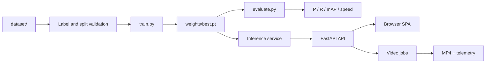

# Kajal Rawal (“Lucky”) — Testing and Presentation Guide

**Roll number:** 2301921520087
**Assigned responsibility:** Dataset testing, validation and documentation support
**Guide scope:** How the team knows a result is trustworthy, how to reproduce the recorded checks, and how to report PASS, FAIL, BLOCKED and NOT RUN without overclaiming
**Evidence snapshot:** 22 October 2026, matching [`../PROJECT_FACTS.md`](../PROJECT_FACTS.md)

> This guide is a preparation aid, not a substitute for the source or the test log. The recorded checks in `PROJECT_FACTS.md` are team evidence; the exact human operator of those runs is not recorded in Git. Your defensible contribution claim is built from the test artefacts you can attach, not from a role title alone.

---

## Table of contents

1. [Assigned responsibility vs verified contribution](#1-assigned-responsibility-vs-verified-contribution)
2. [Objectives and task map](#2-objectives-and-task-map)
3. [Technical concepts and implementation workflow](#3-technical-concepts-and-implementation-workflow)
4. [Integration with the whole system](#4-integration-with-the-whole-system)
5. [Challenges, debugging, validation and testing](#5-challenges-debugging-validation-and-testing)
6. [Speaking scripts](#6-speaking-scripts)
7. [Viva questions with explanatory answers](#7-viva-questions-with-explanatory-answers)
8. [Difficult follow-up questions](#8-difficult-follow-up-questions)
9. [Practical exercises and demonstration walkthroughs](#9-practical-exercises-and-demonstration-walkthroughs)
10. [Pre-viva checklist](#10-pre-viva-checklist)
11. [One-page fact card](#11-one-page-fact-card)

---

## 1. Assigned responsibility vs verified contribution

### 1.1 The claim you are actually defending

The team-declared role is **dataset testing, validation and documentation support**. That is a statement about assigned responsibility. It is not proof that you personally executed every recorded check, and it is not proof that you wrote every documentation page.

The repository supports four separate observations:

| Claim | Evidence status | What the evidence actually shows |
|---|---|---|
| Kajal owned dataset testing and validation | **Team-declared** | The role is recorded in [`../PROJECT_FACTS.md`](../PROJECT_FACTS.md) §1 and [`../CONTRIBUTIONS.md`](../CONTRIBUTIONS.md). No commit in either repository is independently attributable to Kajal. |
| The application passed a set of functional checks | **Verified in a recorded run** | `PROJECT_FACTS.md` §6 records compile, import, dashboard, health, image, invalid-image, missing-checkpoint, video, playback, CLI telemetry, responsive and synthetic-webcam checks. The operator is not recorded. |
| The model was evaluated on 718 test images | **Verified in a recorded run** | `PROJECT_FACTS.md` §5 records the command, environment, split counts and metrics. The operator is not recorded. |
| The local dataset has the stated structure and counts | **Verified in source / direct inspection** | `PROJECT_FACTS.md` §4 records 4,719 images, 7,340 instances and 22 background images, with per-split counts. |
| Kajal wrote specific documentation sections | **Not independently verified** | The documentation repository exists, but commit `c5414ae` is authored by Aayush. Attach a shared-document history, review comments or a signed page if you want to claim specific sections. |
| Kajal executed specific tests | **Attachable evidence required** | A dated test log, screenshots, terminal transcripts or review notes with your name close the gap. A checked box in this guide does not. |

The honest sentence is:

> “My assigned role was dataset testing, validation and documentation support. I designed and can explain the test matrix, validated the dataset structure and label contract, and reviewed the documentation against `PROJECT_FACTS.md`. The recorded 718-image evaluation and functional checks are team runs; here is the test log and the screenshots I personally captured.”

That sentence separates the role, the system evidence and your individual artefacts. It is much stronger than “I tested everything.”

### 1.2 Why the testing role matters in this project

There is no `tests/` directory and no pytest suite in the repository. `PROJECT_FACTS.md` §2 and §6 record this explicitly: automated tests are **NOT RUN** because no suite exists. The release evidence is therefore a disciplined manual test process.

That makes the testing role responsible for four things:

1. **Designing checks that can fail.** A test that cannot produce a failure is a demonstration, not a test.
2. **Recording the command, environment, expected result, observed result and artefact.** A screenshot without a command is weak evidence.
3. **Separating what ran from what did not.** `BLOCKED` and `NOT RUN` are legitimate results; hiding them is not.
4. **Reviewing documentation claims against the source and the recorded run.** A Markdown sentence is not runtime evidence.

### 1.3 What to attach before the viva

Build a one-page evidence sheet with five columns: **claim, date, command or action, observed result, artefact path**. Attach the artefacts behind it.

- [ ] A test matrix with test IDs, dates, commands and PASS/FAIL/BLOCKED/NOT RUN status.
- [ ] A terminal transcript or screenshots of `/api/health`, `/api/status`, one successful image request and one invalid-image request.
- [ ] Dataset count output for train/val/test, including image counts, label counts and background-label counts.
- [ ] A label-format audit output, even if it reports violations. A finding is better evidence than a clean claim with no log.
- [ ] A screenshot or short recording of the dashboard at one named viewport, with the date visible.
- [ ] Review notes showing which documentation pages you checked and what you corrected.
- [ ] A signed statement of what you did **not** run: physical camera, CUDA, exports, long-video stress, concurrency, accessibility audit.

If an artefact does not exist, write “not available” and explain what would close the gap. Do not fabricate a date or a result.

### 1.4 What not to say

Avoid these claims:

- “All tests passed.” The recorded evidence includes PASS, BLOCKED and NOT RUN.
- “I ran the 718-image evaluation.” The evaluation is a recorded team run; the operator is not recorded. Say “the team’s recorded evaluation” unless you have your own log.
- “The system is 79.59% accurate.” Precision is not accuracy, and the metric is not an end-to-end system accuracy.
- “The dataset is public” or “we have permission to share it.” Provenance and licensing are unresolved.
- “The camera works.” Only synthetic-device webcam capture was recorded; physical camera access is **BLOCKED**.
- “We tested on CUDA.” CUDA execution is **BLOCKED**; the evaluation used Apple M2 MPS.
- “The export works.” ONNX, TensorRT, OpenVINO, CoreML and TFLite exports are **NOT RUN**.
- “The test suite is green.” No automated test suite exists.

---

## 2. Objectives and task map

Your preparation goal is to be able to defend a test result from four directions: **what was tested, how it was tested, what the result means, and what it does not prove**. Work through these ten tasks in order.

| # | Task | Files to inspect | What to run or do | What you should be able to explain |
|---|---|---|---|---|
| 1 | Build the evidence register | `PROJECT_FACTS.md` §5–§6, `09-testing-and-results/test-strategy.md` | Copy the recorded checks into a table with status and evidence | Which checks are PASS, BLOCKED or NOT RUN, and who recorded them |
| 2 | Verify the environment | `requirements.txt`, `PROJECT_FACTS.md` §5 | `python -V`; `python -c "import fastapi, ultralytics, cv2; print(...)"` | Why package versions belong in a test record |
| 3 | Verify checkpoint identity | `weights/best.pt`, `infrascan/config.py` | `shasum -a 256 weights/best.pt`; `stat -f%z weights/best.pt` | The hash, size and why a metric without them is not reproducible |
| 4 | Audit dataset counts | `data.yaml`, `dataset/` | Count images, labels and empty labels per split | 3,281/720/718 images; 5,353/993/994 boxes; 18/2/2 backgrounds |
| 5 | Validate the label contract | `scripts/visualize_annotations.py`, `dataset/labels/` | Parse every label row; check class, range, width/height and pairing | The five-field YOLO row and the difference between a malformed label and a missing label |
| 6 | Audit split integrity | `dataset/images/{train,val,test}` | Compare basenames and SHA-256 hashes across splits | What leakage is, why random splits can leak near-duplicates, and what the audit can and cannot prove |
| 7 | Review annotations visually | `scripts/visualize_annotations.py` | `python scripts/visualize_annotations.py --split test --num 6` | Whether boxes align with potholes; the script’s sampling edge case |
| 8 | Audit the evaluation | `evaluate.py`, `PROJECT_FACTS.md` §5 | Read the command, fallback branch and `model.val()` arguments | P, R, mAP50, mAP50–95, the operating point and the `yolo11s.pt` fallback trap |
| 9 | Execute the functional matrix | `run_app.py`, `infrascan/api.py`, `web/` | Health, status, image, invalid image, missing checkpoint, video, responsive check | What each PASS actually proves and which parts are interface-level |
| 10 | Review the documentation | `07-team-preparation/`, `09-testing-and-results/`, `05-dataset-and-model/` | Compare claims with `PROJECT_FACTS.md`; record discrepancies | Why an untraceable claim must be caveated rather than repeated |

### 2.1 Working directory and environment

All commands assume:

```bash
cd "/Users/aayus/Desktop/College final year/InfraScan"
source .venv/bin/activate   # only if you created this environment
```

If `python` cannot import `fastapi`, `ultralytics` or `cv2`, the environment is not active. Do not install packages during the viva unless you have time and network access; use the prepared environment.

Check the basics:

```bash
python -V
python -c "import fastapi, ultralytics, cv2, torch; print('fastapi', fastapi.__version__); print('ultralytics', ultralytics.__version__); print('opencv', cv2.__version__); print('torch', torch.__version__)"
```

The recorded environment in `PROJECT_FACTS.md` §5 is Python 3.12.14, PyTorch 2.14.1, Ultralytics 8.4.183, OpenCV 5.0.0.93 and FastAPI 0.156.8. Your machine may differ; record what it actually reports.

---

## 3. Technical concepts and implementation workflow

### 3.1 Verification, validation and the test oracle

**Verification** asks whether the system was built correctly against its specification. **Validation** asks whether it does the right thing for the intended use. In this project:

- A unit-level verification might check that `classify_severity()` returns `CRITICAL` for a box covering 8% of the frame.
- A system-level verification might check that `POST /api/detect/image` returns a 400 for a corrupt JPEG.
- A validation question might ask whether a 60% recall detector is good enough for road screening. That is a judgement about consequences, not a code check.

A **test oracle** is the source of truth used to decide whether an observed result is correct. Good oracles in this project are:

| Oracle | Example | Why it is reliable |
|---|---|---|
| A mathematical identity | Severity coverage formula | The expected value can be computed independently |
| A file contract | A YOLO label has exactly five fields, class 0, coordinates in `[0, 1]` | The rule is explicit and checkable |
| A recorded run | `PROJECT_FACTS.md` §5–§6 | It has a command and an observed output |
| The API schema | `/api/openapi.json` | It describes the accepted request shape |
| A visual inspection | Annotated boxes over a known image | It catches misalignment that a range check cannot |

The weakest oracle is “it looked fine.” The strongest oracle is an independent expected value plus a retained artefact.

### 3.2 The four status labels

Use these labels consistently. They are the vocabulary of [`../09-testing-and-results/test-strategy.md`](../09-testing-and-results/test-strategy.md) and the team guides.

| Status | Meaning | Example in this project |
|---|---|---|
| **PASS** | The check was executed, the expected result was observed, and evidence was retained. | `/api/health` returned `{"status":"ok","model_state":"ready"}`. |
| **FAIL** | The check was executed and the observed result did not match the expected result. | A valid JPEG returns 500 instead of 200. |
| **BLOCKED** | The check could not run because a required asset, device or permission was unavailable. | Physical webcam test; CUDA benchmark. |
| **NOT RUN** | The check was designed but no execution was attempted. | ONNX export; long-video stress test; automated pytest suite. |

Two rules follow:

1. **BLOCKED is not PASS.** If the checkpoint is absent, image inference did not pass; it was blocked. The missing-checkpoint *state* can still pass as a separate check.
2. **NOT RUN is not FAIL.** An untested export target is not evidence that export is broken. It is evidence that the claim is unsupported.

A useful test record has one status per check. Do not merge “the app starts” and “inference works” into one PASS, because they fail independently.

### 3.3 Test levels that apply here

| Level | What it means in InfraScan | Concrete example |
|---|---|---|
| **Static check** | The code parses or imports without executing a full request | `python -m compileall app.py infrascan scripts` |
| **Unit check** | One function or rule is exercised with a known input | Severity at 2.49%, 2.50% and 8.00% coverage |
| **Contract check** | A boundary honours an agreed input/output shape | Invalid image returns 400; missing checkpoint returns 503 |
| **Integration check** | Two or more components work together | FastAPI calls the inference service and returns JSON + JPEG |
| **System check** | The user-facing path works end to end | Browser upload → annotated image → result table |
| **Regression check** | A previously working behaviour still works after a change | Re-run the health, image and video checks after editing `api.py` |
| **Negative check** | Invalid input is rejected safely | Corrupt image, wrong video extension, out-of-range threshold |
| **Non-functional check** | Performance, responsiveness, accessibility or security | 390/820/1024/1440 px layout; response headers; warm latency |

The recorded release checks are mostly contract, integration and system checks. There is very little unit-level evidence, which is why the severity and label checks in this guide are useful additions.

### 3.4 The dataset contract

The local dataset is a one-class YOLO detection dataset. The verified counts are:

| Split | Images | Pothole instances | Background images (empty labels) |
|---|---:|---:|---:|
| Train | 3,281 | 5,353 | 18 |
| Validation | 720 | 993 | 2 |
| Test | 718 | 994 | 2 |
| **Total** | **4,719** | **7,340** | **22** |

```text
dataset/
├── images/{train,val,test}/
└── labels/{train,val,test}/
```

The images and labels are paired by **stem**: `dataset/images/test/example.jpg` pairs with `dataset/labels/test/example.txt`. A label file with zero bytes is valid and means “no pothole in this image.” That is why the 22 background images are not missing annotations.

A label row is:

```text
class_id x_center y_center width height
```

For the one-class dataset, `class_id` is always `0`. Coordinates are normalized to `[0, 1]` by the image width and height. A row is not a pixel box.

The test split is the held-out evidence used for the reported metrics. It has 718 images, 994 instances and 2 backgrounds. The average is about 1.38 instances per image, derived from 994 ÷ 718.

### 3.5 Label validation rules

A label file can be structurally present and still be wrong. Check these rules:

| Rule | Why it matters | Failure mode |
|---|---|---|
| Image and label stems match | The loader pairs them by name | Orphan label or image silently ignored |
| Exactly five whitespace-separated fields | YOLO expects one row per object | Row skipped or training error |
| Class ID is an integer and `< nc` | `nc` is 1, so only class 0 exists | Class index error or wrong class |
| `x_center`, `y_center` in `[0, 1]` | Coordinates are normalized | Box drawn outside the image |
| `width`, `height` in `(0, 1]` | A zero-area box is not a detection | Degenerate box or divide-by-zero behaviour |
| `x_center ± width/2` and `y_center ± height/2` stay near `[0, 1]` | The box should lie inside the frame | Clipped or shifted box |
| Empty file means background, not corruption | Background images are legitimate negatives | False alarm about missing labels |
| No duplicate identical rows | Duplicate boxes distort training and evaluation | Double-counted instance |

A read-only audit you can run from the repository root:

```bash
python - <<'PY'
from pathlib import Path

root = Path("dataset")
splits = ("train", "val", "test")
image_suffixes = {".jpg", ".jpeg", ".png", ".webp", ".bmp"}

for split in splits:
    img_dir = root / "images" / split
    lbl_dir = root / "labels" / split
    images = {p.stem for p in img_dir.iterdir() if p.suffix.lower() in image_suffixes}
    labels = {p.stem for p in lbl_dir.glob("*.txt")}

    boxes = 0
    empty = 0
    bad = []
    for label_path in sorted(lbl_dir.glob("*.txt")):
        text = label_path.read_text(encoding="utf-8").strip()
        if not text:
            empty += 1
            continue
        for line_no, line in enumerate(text.splitlines(), 1):
            parts = line.split()
            if len(parts) != 5:
                bad.append((label_path.name, line_no, "field count"))
                continue
            try:
                cls = int(parts[0])
                x, y, w, h = map(float, parts[1:])
            except ValueError:
                bad.append((label_path.name, line_no, "non-numeric"))
                continue
            boxes += 1
            if cls != 0:
                bad.append((label_path.name, line_no, f"class {cls}"))
            if not all(0.0 <= value <= 1.0 for value in (x, y, w, h)):
                bad.append((label_path.name, line_no, "out of range"))
            if w <= 0 or h <= 0:
                bad.append((label_path.name, line_no, "non-positive size"))
            if (x - w / 2 < -1e-6 or x + w / 2 > 1 + 1e-6
                    or y - h / 2 < -1e-6 or y + h / 2 > 1 + 1e-6):
                bad.append((label_path.name, line_no, "box outside image"))

    print(
        f"{split}: images={len(images)} labels={len(labels)} boxes={boxes} "
        f"empty={empty} missing_labels={len(images - labels)} "
        f"orphan_labels={len(labels - images)} bad_rows={len(bad)}"
    )
    for row in bad[:5]:
        print("  ", row)
PY
```

Expected structural observation: `images` and `labels` counts are 3,281/720/718, `boxes` are 5,353/993/994, and `empty` is 18/2/2. The number of `bad_rows` is **not** pre-declared in `PROJECT_FACTS.md`; if the audit reports violations, record them as a finding. Do not “fix” the dataset during the viva.

### 3.6 Split integrity and leakage

Leakage means information from the evaluation data influenced training. The obvious form is the same image appearing in train and test. Less obvious forms are:

- the same road sequence split across frames;
- near-duplicate frames with slight camera movement;
- re-encoded or resized copies of the same image;
- labels copied from a test image into a train image with a different filename.

The repository does not contain a split manifest, deduplication log or source-level grouping. `PROJECT_FACTS.md` §4 explicitly says the exact split-generation history cannot be verified. So the honest claim is:

> “The evaluation used the `test` split and the split directories are separate. I can audit filename and exact-hash overlap, but I cannot prove that near-duplicate frames from the same source sequence were separated, because the original split manifest and source grouping are not recorded.”

A basic overlap audit:

```bash
python - <<'PY'
from pathlib import Path
from hashlib import sha256
from collections import defaultdict

root = Path("dataset")
splits = ("train", "val", "test")
by_name = defaultdict(list)
by_hash = defaultdict(list)

for split in splits:
    for path in (root / "images" / split).iterdir():
        if path.suffix.lower() not in {".jpg", ".jpeg", ".png", ".webp", ".bmp"}:
            continue
        by_name[path.name.lower()].append(split)
        digest = sha256(path.read_bytes()).hexdigest()
        by_hash[digest].append(f"{split}/{path.name}")

name_overlap = {k: v for k, v in by_name.items() if len(set(v)) > 1}
hash_overlap = {k: v for k, v in by_hash.items() if len(set(item.split("/")[0] for item in v)) > 1}

print("basename overlaps:", len(name_overlap))
for name, where in list(name_overlap.items())[:10]:
    print("  ", name, where)
print("exact-hash overlaps across splits:", len(hash_overlap))
for digest, where in list(hash_overlap.items())[:10]:
    print("  ", digest[:12], where)
PY
```

This checks exact bytes only. It will not catch resized, cropped, re-encoded or visually similar frames. A perceptual-hash or embedding-based audit would be a stronger next step, but it was not implemented or recorded.

### 3.7 `data.yaml` and path resolution

The repository configuration is:

```yaml
path: ./dataset
train: images/train
val: images/val
test: images/test
nc: 1
names:
- pothole
```

`path` is the dataset root; `train`, `val` and `test` are split paths relative to that root. `nc` is the number of classes and `names` maps class indices to labels. Because `nc: 1`, a label with class `1` is invalid.

Two practical checks:

```bash
python - <<'PY'
from pathlib import Path
import yaml

cfg = yaml.safe_load(Path("data.yaml").read_text(encoding="utf-8"))
print(cfg)
root = Path(cfg["path"])
for split in ("train", "val", "test"):
    path = root / cfg[split]
    print(split, path, "exists" if path.is_dir() else "MISSING")
PY
```

If the dataset is absent, the configuration still parses, but evaluation cannot run. That is a **BLOCKED** dataset check, not a model failure.

### 3.8 Annotation visualization and its edge case

`scripts/visualize_annotations.py` reads an image and its label file, converts normalized boxes back to pixel coordinates, draws rectangles, and writes sample images to an output directory.

The coordinate conversion is the inverse of the label format:

```python
bx1 = int((x_c - bw / 2.0) * w)
by1 = int((y_c - bh / 2.0) * h)
bx2 = int((x_c + bw / 2.0) * w)
by2 = int((y_c + bh / 2.0) * h)
```

The sampling code has a real edge-case bug:

```python
valid_samples = []
for img_path in images:
    lbl_path = lbl_dir / f"{img_path.stem}.txt"
    if lbl_path.exists() and lbl_path.stat().st_size > 0:
        valid_samples.append(img_path)
        if len(valid_samples) >= num_samples * 3:
            break

chosen = random.sample(valid_samples if valid_samples else images, min(num_samples, len(images)))
```

If `valid_samples` is non-empty but smaller than `min(num_samples, len(images))`, `random.sample()` raises `ValueError: Sample larger than population or is negative`. The fallback pool is `images`, but the sample size is still computed from `len(images)`, not from `len(valid_samples)`.

This matters for a testing guide because it shows the difference between “the script exists” and “the script is robust for every split.” The normal command with a small `--num` is fine; a large `--num` can fail. Record the edge case rather than hiding it.

Typical command:

```bash
python scripts/visualize_annotations.py \
  --dataset dataset \
  --split test \
  --num 6 \
  --out runs/verify-labels
```

Expected observation: six annotated JPEGs in `runs/verify-labels/`, each named `sample_<n>_<stem>.jpg`, with boxes over potholes. If boxes are shifted, first check whether the label coordinates are normalized to the image dimensions; if they are systematically offset, suspect a mask/image dimension mismatch in preparation.

### 3.9 The evaluation pipeline

`evaluate.py` is a thin wrapper around Ultralytics validation:

```python
metrics = model.val(
    data=data,
    split=split,
    imgsz=imgsz,
    batch=batch,
    device=device,
    workers=0 if sys.platform == 'win32' else 4,
    project=project,
    name=name,
    plots=True,
    save_json=True
)
```

The recorded command was:

```bash
python evaluate.py \
  --weights weights/best.pt \
  --data <test-data.yaml> \
  --split test \
  --imgsz 640 \
  --batch 16 \
  --device mps
```

The data was read from a temporary copy to avoid iCloud-evicted files. The normal repository command uses `--data data.yaml` once the dataset is available.

Three things to notice:

1. **The fallback branch.** If `weights/best.pt` does not exist, the script prints a warning and evaluates `yolo11s.pt` instead of stopping. The resulting numbers look like project results but describe different weights. Always verify the log line `Model Weights: .../weights/best.pt` and the checkpoint hash.
2. **No `conf` or `iou` arguments.** `evaluate.py` does not pass application thresholds to `model.val()`. Ultralytics validation defaults apply, which are not the dashboard defaults of confidence 0.25 and NMS IoU 0.45. Do not describe the reported metric as “the dashboard operating point.”
3. **The speed numbers are loop components.** Preprocess 0.17 ms, inference 3.82 ms and postprocess 10.75 ms per image on MPS at batch 16 are not end-to-end HTTP latency. The recorded warm API request was 66.2 ms.

### 3.10 What the metrics mean

| Metric | Definition | Recorded value | Correct interpretation |
|---|---|---:|---|
| Precision (P) | TP / (TP + FP) | 0.7959 | Of the detections that fired, about 79.6% matched ground truth at the validation operating point. |
| Recall (R) | TP / (TP + FN) | 0.5996 | Of the ground-truth instances, about 60.0% were found; about 40.0% were missed. |
| mAP@0.50 | Mean average precision at IoU 0.50 | 0.7111 | A box counts as correct at 50% overlap. |
| mAP@0.50–0.95 | Mean AP averaged over IoU 0.50 to 0.95 | 0.3938 | Localization is looser; the boxes are often roughly right but not tight. |

An illustrative arithmetic check, **not a confusion matrix**: if you treat 994 instances as the denominator and apply recall 0.5996, you get about 596 matched instances and about 398 missed. Applying precision 0.7959 to that matched count gives roughly 153 additional false positives (`596 / 0.7959 - 596`). This is a sanity check on the scale, not an exact count, because the reported precision and recall are aggregate validation statistics, not raw counts at one threshold.

The important story is the **precision–recall trade-off**. The model is conservative: when it fires, it is usually right, but it misses a substantial share of potholes. For road screening, a missed pothole can be more costly than a false alarm, so recall is the operational concern. Lowering the confidence threshold would usually raise recall and lower precision, but that sweep was not recorded.

### 3.11 Functional test design

The API surface gives you clear contract tests:

| Endpoint | Valid case | Negative case | Expected status |
|---|---|---|---|
| `GET /api/health` | Model ready or unavailable | None | 200 with `status` and `model_state` |
| `GET /api/status` | Always | None | 200 with app, model, runtime, media thresholds and samples |
| `GET /api/samples` | Dataset present or absent | None | 200 with `available` boolean and count |
| `POST /api/detect/image` | Valid JPG/PNG/WebP/BMP under 25 MB | Corrupt bytes | 400 with decode message |
| `POST /api/detect/image` | Valid request | `conf` outside 0.05–1.0 | 422 with threshold message |
| `POST /api/detect/image` | Valid request | Checkpoint missing | 503 with actionable message |
| `POST /api/detect/video` | MP4/AVI/MOV/MKV under 2 GB | Unsupported extension | 415 |
| `GET /api/jobs/{id}` | Existing job | Unknown ID | 404 |
| `GET /api/results/{filename}` | Saved JPEG | Traversal attempt | 404 |

Design tests around **equivalence classes**, not individual files:

- valid image formats: JPG, JPEG, PNG, WebP, BMP;
- invalid content: text renamed to `.jpg`, zero-byte file, truncated JPEG;
- size boundaries: just under and just over 25 MB;
- threshold boundaries: 0.05, 0.25, 1.0 valid; 0.049 and 1.001 invalid;
- video formats: MP4, AVI, MOV, MKV valid; `.txt` or `.webm` unsupported;
- state: checkpoint present, checkpoint missing, model still loading;
- dataset: present, absent, partially downloaded.

Boundary tests are stronger than “I uploaded one image.” They show that the guard is real.

### 3.12 Missing-checkpoint behaviour

The recorded check is important because it separates startup from inference:

- The dashboard still serves.
- `/api/health` reports `model_state: "unavailable"`.
- The System page shows the configured path and an actionable error.
- Image and video detection return **503** before reading the upload.
- The dashboard does **not** download or substitute a checkpoint.

The CLI is different: `detect.py` and `evaluate.py` retain historical `yolo11s.pt` fallbacks. That is why a CLI test can “pass” while testing different weights. For any evidence-bearing run, pass `--weights` explicitly and check the log.

### 3.13 Video job behaviour

A video upload returns **202** with a job ID. The browser polls `/api/jobs/{id}` while a background worker processes frames. The result includes an annotated MP4 and, when present, CSV and JSON telemetry.

The recorded run processed **24 frames** and produced **28 frame-level detections**. Those numbers belong to that clip. They are not a universal expected count: a different clip has a different frame count and detection count. The test assertion should be about invariants:

- the job reaches `completed` or a clear `failed` state;
- `frames_processed` equals the number of frames the worker actually read;
- the output file exists and is playable;
- telemetry rows correspond to processed frames;
- the codec is logged as `avc1` or `mp4v`.

The recorded playback check observed H.264 output and Chrome `readyState 4`. That proves the recorded file played in that browser, not that every future encode will.

### 3.14 Documentation QA

The documentation repository was rebuilt for the accepted **FastAPI + SPA** implementation, so the testing pages no longer carry Streamlit-era test wording. `PROJECT_FACTS.md` is the accepted source of truth, and the team-preparation README explicitly says so. Streamlit now appears only as **historical context and architecture comparison**, which is correct and must not be "fixed" away. Your documentation review should:

1. Find claims that name an implementation detail, a metric or a test status.
2. Check the claim against the current source file or `PROJECT_FACTS.md`.
3. If the claim is stale, mark it as a documentation defect and correct it or caveat it.
4. If the claim is unsupported, label it `[TO BE CONFIRMED]` rather than inventing a source.
5. Do not “fix” a number by copying an inherited value from an old report.

Areas to check on every review:

| Page or claim | Risk | Correct position |
|---|---|---|
| Any page describing the *current* app as Streamlit | Would contradict the source (`app.py`, `run_app.py`, `web/`) | The accepted app is FastAPI + SPA; Streamlit may only appear as history or comparison |
| Any page claiming “fresh metrics NOT RUN” | Contradicts `PROJECT_FACTS.md` §5 | The 718-image evaluation **was** run; the metrics are P 0.7959 / R 0.5996 / mAP@0.50 0.7111 / mAP@0.50–0.95 0.3938 |
| Any page claiming “all tests passed” | Contradicts BLOCKED/NOT RUN rows | Replace with the exact status table from the [manual test log](../09-testing-and-results/manual-test-log.md) |
| Any `AppTest` / Streamlit-testing reference | Would describe a framework that is not in `requirements.txt` | The current checks are HTTP, CLI and source-level; the status vocabulary still applies |
| A metric quoted without its environment | Unfalsifiable in a viva | Attach checkpoint hash, split, device and batch size, as [verified results](../09-testing-and-results/verified-results.md) does |

This is a legitimate documentation-support contribution: you are not just editing prose, you are preventing the team from defending a false claim.

---

## 4. Integration with the whole system

### 4.1 Where testing sits in the pipeline



Testing is not a phase at the end. Each arrow is a boundary with its own failure modes:

| Boundary | Input | Output | Failure mode | Test that catches it |
|---|---|---|---|---|
| Dataset → loader | Images + labels | Paired tensors | Missing label, malformed row, corrupt image | Count/pair audit; label parser |
| Loader → training | Batches | Gradients/weights | Class mismatch, empty labels, leakage | `data.yaml` check; split audit |
| Training → checkpoint | Weights | `best.pt` | Wrong architecture or stale file | Hash, size, metadata inspection |
| Checkpoint → evaluation | `best.pt` + test split | Metrics | Silent `yolo11s.pt` fallback | Log line + hash check |
| Checkpoint → inference | Image/frame | Boxes, confidence | Missing checkpoint, decode error | 503/400 contract tests |
| Inference → API | Result dict | JSON + JPEG | Threshold drift, serialization error | API schema and image check |
| API → SPA | JSON | Rendered result | Stale state, offline, wrong severity | Browser system test |

### 4.2 One image request, traced as a test

1. **Browser**: user selects a file; the SPA checks type and size before sending.
2. **HTTP**: `POST /api/detect/image` with multipart `file`, `conf`, `iou`.
3. **Validation**: `_validate_thresholds()` rejects out-of-range values with 422.
4. **Checkpoint gate**: `checkpoint_available()` returns false → 503 before reading the body.
5. **Upload read**: `_read_upload()` caps the image at 25 MB and returns 413 if exceeded.
6. **Decode**: `predict_image()` raises `InvalidImageError` for empty or undecodable bytes → 400.
7. **Readiness**: the inference service may return 503 while the model is unavailable or timed out.
8. **Prediction**: the shared model lock serialises the forward pass.
9. **Post-processing**: boxes are clamped, confidence is read, severity is computed.
10. **Persistence**: an annotated JPEG is written to `runs/dashboard/results/`.
11. **Response**: JSON with detections, severity summary, coverage and result filename.
12. **Render**: the SPA shows the annotated image, metrics, table and CSV download.

A good test asserts at least one thing at each boundary. A screenshot of the final image alone does not tell you whether the 400 path works.

### 4.3 Evaluation versus dashboard operating point

This is one of the most common viva traps.

| Aspect | `evaluate.py` | Dashboard |
|---|---|---|
| Threshold source | Ultralytics `model.val()` defaults | `config.CONF_DEFAULT = 0.25`, `config.IOU_DEFAULT = 0.45` |
| Purpose | Measure the checkpoint on a split | Show a user an interactive result |
| Metric output | P, R, mAP50, mAP50–95, speed | Per-image detections, confidence, coverage, severity |
| Device | `--device` argument; recorded `mps` | CUDA → MPS → CPU at runtime |
| Failure if weights missing | Falls back to `yolo11s.pt` | Returns 503; never substitutes |

The metric is a validation result, not a promise about what the dashboard will show at 0.25/0.45. If an examiner asks “why does the dashboard show fewer boxes than the metric suggests?”, the answer is the operating point and the NMS threshold, not a bug.

### 4.4 Dataset availability and iCloud

The local `dataset/` directory is a symlink to an external `Pothole_detection_YOLO/dataset` tree on the development machine. The dataset is also iCloud-managed. Two consequences:

1. A fresh clone of the repository does not contain the dataset; the symlink target must exist.
2. A recursive scan can stall while macOS downloads dataless files. The recorded evaluation used a temporary copy to avoid this.

Operational rule: if a count or evaluation command stalls, stop it and copy the dataset to a local, non-evicted directory. Do not interpret a stall as a corrupt dataset. Record the actual path used in the test log.

### 4.5 What happens when a dependency is missing

| Missing item | Dashboard | Detection | Evaluation | Correct status |
|---|---|---|---|---|
| Checkpoint | Serves; state `unavailable` | 503 | Falls back to `yolo11s.pt` | Checkpoint check **PASS**; inference **BLOCKED** |
| Dataset | Serves; samples count 0 | Image upload still works | Cannot run | Dataset checks **BLOCKED** |
| FastAPI/Ultralytics environment | Import fails | Cannot start | Cannot run | Environment **FAIL/BLOCKED**, not a model result |
| Physical camera | UI may show permission error | N/A | N/A | **BLOCKED** |
| Browser H.264 support | Video may not play | MP4 still written | N/A | Playback **FAIL/BLOCKED**; file check separate |

The key discipline is to report the specific missing dependency, not a vague “it didn’t work.”

---

## 5. Challenges, debugging, validation and testing

### 5.1 Real issues in this codebase

These are source-level or recorded issues, not invented war stories.

| # | Issue | Evidence | Consequence | How to discuss it |
|---|---|---|---|---|
| 1 | `evaluate.py` silently falls back to `yolo11s.pt` | `evaluate.py` lines 24–29 | Metrics may describe different weights | Always check the log and hash; call it a release-risk |
| 2 | `evaluate.py` does not pass `conf`/`iou` | `evaluate.py` lines 34–45 | Validation operating point differs from dashboard | Explain P/R are not the 0.25/0.45 UI result |
| 3 | `visualize_annotations.py` sampling bug | `visualize_annotations.py` line 61 | Large `--num` can raise `ValueError` | Record the edge case; use a small sample |
| 4 | `ingest_voc_dataset.py` has no CLI parser | `ingest_voc_dataset.py` lines 190–191 | Running it directly raises `ValueError` | It is a library-style function, not a CLI |
| 5 | CLI fallbacks to `yolo11s.pt` | `detect.py`, `evaluate.py` | CLI result may not use the intended checkpoint | Pass `--weights` explicitly |
| 6 | No automated test suite | `PROJECT_FACTS.md` §2 | Manual evidence is the only release evidence | Be honest; propose pytest as next step |
| 7 | Streamlit wording read as a current-state claim | Any page | Only the *history* is Streamlit; the app is FastAPI + SPA | State the replacement explicitly; `PROJECT_FACTS.md` wins |
| 8 | iCloud/dataless dataset stalls | `PROJECT_FACTS.md` §5 note | Evaluation or counts can hang | Use a local copy; record path |
| 9 | Dataset is an external symlink | `dataset/images`, `dataset/labels` | A clone alone is not reproducible | Document the dependency and counts |

### 5.2 Debugging playbook

Run these in order when a check fails.

```bash
# 1. Is the checkpoint present, non-empty and the recorded file?
ls -l weights/best.pt
shasum -a 256 weights/best.pt

# 2. Does the application import?
python -c "from app import app; print(app.title)"

# 3. Does the server start, and what does it report?
python run_app.py --no-browser

# 4. In a second terminal: health and status
curl -s http://127.0.0.1:8000/api/health | python -m json.tool
curl -s http://127.0.0.1:8000/api/status | python -m json.tool

# 5. Are samples visible?
curl -s http://127.0.0.1:8000/api/samples | python -m json.tool

# 6. Is the dataset structurally present?
find dataset/images/train -maxdepth 1 -type f | wc -l
find dataset/labels/train -maxdepth 1 -name '*.txt' | wc -l

# 7. What does a label look like?
find dataset/labels/test -maxdepth 1 -name '*.txt' -size +0c | head -1 | xargs head -3

# 8. Is the invalid-image path actionable?
bad="$(mktemp -t infrascan_bad).jpg"
printf 'not an image\n' > "$bad"
curl -s -o /dev/null -w "%{http_code}\n" \
  -X POST http://127.0.0.1:8000/api/detect/image \
  -F "file=@$bad" -F conf=0.25 -F iou=0.45
rm -f "$bad"
```

Expected observations, tied to the recorded checks:

| Step | Expected |
|---|---|
| 1 | File exists, 5,467,546 bytes, SHA-256 `f3490f953b4ac2aa0205c206c151be8f2da281da99708713b182492a43c7751c` |
| 2 | `InfraScan API` |
| 3 | Uvicorn starts on `127.0.0.1:8000`; model loads in the background |
| 4 | `{"status":"ok","model_state":"ready"}` when ready |
| 5 | `available: true` and a count up to 718; the UI shows at most 24 |
| 6 | 3,281 images and 3,281 labels for train |
| 7 | A row such as `0 0.512345 0.478901 0.123456 0.234567` |
| 8 | `400` with a decode message |

If step 2 fails, stop. A broken import is an environment or syntax failure, not a model result.

### 5.3 The test matrix

This is the table to bring to the viva. Statuses reflect `PROJECT_FACTS.md`; do not upgrade a status because a check “should” work.

| ID | Area | Check | Method | Expected | Status and evidence |
|---|---|---|---|---|---|
| T01 | Static | Python compilation | `python -m compileall app.py infrascan scripts` | Exit 0, no syntax errors | **PASS** — recorded in §6 |
| T02 | Static | FastAPI import | `python -c "from app import app; print(app.title)"` | `InfraScan API` | **PASS** — recorded in §6 |
| T03 | Startup | Dashboard root | `curl -s -o /dev/null -w "%{http_code}" http://127.0.0.1:8000/` | `200` | **PASS** — recorded in §6 |
| T04 | Startup | Health endpoint | `curl -s .../api/health` | `status=ok`, `model_state=ready` | **PASS** — recorded in §6 |
| T05 | Image | Valid image inference | Upload a test image | 200, annotated JPEG, at least one detection | **PASS** — 1 MODERATE, 7.0% coverage, JPEG written |
| T06 | Image | Warm latency | Time one warm API request | A recorded millisecond value | **PASS** — 66.2 ms |
| T07 | Negative | Invalid image | Upload text bytes as `.jpg` | 400 with decode message | **PASS** — recorded in §6 |
| T08 | State | Missing checkpoint | Start with `INFRASCAN_WEIGHTS` pointing to a missing file | Dashboard serves; state `unavailable`; detection 503 | **PASS** — recorded in §6 |
| T09 | Video | Job lifecycle | Upload a short clip; poll `/api/jobs/{id}` | 202, progress, completed job, output file | **PASS** — 24 frames, 28 detections |
| T10 | Video | Playback | Open the annotated MP4 in Chrome | Playable; `readyState 4` | **PASS** — H.264 output |
| T11 | CLI | Image + telemetry | `python detect.py --source ... --weights ... --save` | Annotated JPEG + CSV + JSON | **PASS** — recorded in §6 |
| T12 | UI | Responsive layout | Check 390, 820, 1024, 1440 px | No page-level horizontal overflow | **PASS** — recorded in §6 |
| T13 | Camera | Synthetic webcam | Chrome synthetic media device | Capture reaches the preview | **PASS** — synthetic only |
| T14 | Camera | Physical webcam | Use the venue camera | Permission and frames work | **BLOCKED** — hardware/permission not available |
| T15 | Hardware | CUDA execution | Run on an NVIDIA machine | CUDA selected; benchmark recorded | **BLOCKED** — test machine is Apple M2 |
| T16 | Export | ONNX/TensorRT/OpenVINO/CoreML/TFLite | Run each export and load the artefact | Successful export and inference | **NOT RUN** |
| T17 | Automation | Pytest suite | `pytest` | Suite exists and passes | **NOT RUN** — no `tests/` directory |
| T18 | Evaluation | 718-image test split | `evaluate.py --split test --imgsz 640 --batch 16 --device mps` | P/R/mAP recorded with checkpoint hash | **PASS** — recorded in §5 |
| T19 | Dataset | Split counts | Count images, labels and empty labels | 3,281/720/718; 18/2/2 backgrounds | **PASS** — recorded in §4 |
| T20 | Dataset | Sample label format | Inspect a non-empty test label | Class 0 plus four normalized floats | **PASS** — sample verified in §4 |
| T21 | Dataset | Full label audit | Parse every label row | No malformed rows; record any findings | **NOT RUN** — no full-file audit in the record |
| T22 | Dataset | Split leakage audit | Basename and SHA-256 overlap | No cross-split overlap; record near-duplicate risk | **NOT RUN** |
| T23 | Dataset | Annotation preview | `visualize_annotations.py --split test --num 6` | Six aligned annotated images | **NOT RUN** — script present, run not recorded |
| T24 | Negative | Oversize image | Upload >25 MB | 413 with limit message | **NOT RUN** — limit is source-verified only |
| T25 | Negative | Threshold bounds | `conf=0.049`, `conf=1.001`, `iou=0.05` | 422 for each | **NOT RUN** — validation code is source-verified |
| T26 | Negative | Unsupported video | Upload `.webm` or `.txt` | 415 | **NOT RUN** |
| T27 | Stress | Long video | Process a long clip; watch memory and thermals | Completes without crash; latency stable | **NOT RUN** |
| T28 | Stress | Concurrent requests | Parallel image requests during a video job | Queueing behaves; no corruption | **NOT RUN** |
| T29 | Accessibility | Keyboard/screen reader/contrast | Manual or tool audit | All controls reachable; contrast measured | **NOT RUN** — no formal audit |
| T30 | Security | Headers and CSP | `curl -sI` root and API | `nosniff`, `DENY`, `no-referrer`, CSP, `no-store` | **PASS** — source-verified; header check not separately recorded |

Two rows deserve emphasis:

- **T08** is a PASS for the *missing-checkpoint state*, not for inference. Inference under that state is correctly blocked with 503.
- **T30** is source-verified in `infrascan/api.py`, but do not call it a runtime PASS unless you captured the headers. The distinction is exactly the kind of evidence discipline the viva rewards.

### 5.4 PASS / FAIL / BLOCKED decision tree

Use this sequence:

1. **Was the check executed?** If no, the status is **NOT RUN**, unless a required asset was unavailable, in which case it is **BLOCKED**.
2. **Was the environment the intended one?** If the checkpoint was missing and the script fell back to `yolo11s.pt`, the intended check was not executed. Do not call it PASS.
3. **Did the observed result match the expected result?** If yes, **PASS**; if no, **FAIL**.
4. **Is the evidence retained?** If there is no command output, screenshot or log, the check is **not defensible** even if you remember it passing.
5. **Does the check prove the claim you are making?** A dashboard screenshot proves the UI rendered; it does not prove the API returns 400 for invalid input.

Examples:

| Situation | Correct status | Reason |
|---|---|---|
| Server starts and `/api/health` returns ready | PASS | Executed, expected state observed |
| Checkpoint absent; dashboard serves; detection returns 503 | PASS for missing-checkpoint handling; BLOCKED for inference | Two different claims |
| No GPU on the test machine | BLOCKED for CUDA | Environment unavailable |
| Export command documented but never run | NOT RUN | No execution |
| `pytest` cannot find tests | NOT RUN, not FAIL | No suite exists |
| Valid image returns 500 | FAIL | Executed, expected 200 |

### 5.5 Defending the 718-image metrics

The metrics are only as strong as the record around them. A complete defence has six parts:

1. **Checkpoint identity**: YOLO11n, 2,582,347 parameters, 6.4 GFLOPs, 5,467,546 bytes, SHA-256 `f3490f953b4ac2aa0205c206c151be8f2da281da99708713b182492a43c7751c`.
2. **Split identity**: 718 test images, 994 instances, 2 backgrounds; train 3,281/5,353/18; validation 720/993/2.
3. **Command**: `evaluate.py --weights weights/best.pt --data <test-data.yaml> --split test --imgsz 640 --batch 16 --device mps`.
4. **Environment**: Apple M2, macOS 27.0.1, Python 3.12.14, PyTorch 2.14.1, Ultralytics 8.4.183, OpenCV 5.0.0.93.
5. **Output**: P 0.7959, R 0.5996, mAP50 0.7111, mAP50–95 0.3938; preprocess 0.17 ms, inference 3.82 ms, postprocess 10.75 ms.
6. **Limits**: one split, one seed/environment, no confidence interval, no CUDA, no independent label audit, unresolved provenance.

What weakens the claim:

- quoting the numbers without the hash;
- saying “accuracy” instead of precision;
- implying the dashboard’s 0.25/0.45 thresholds produced the metric;
- claiming the test split is proven leakage-free;
- claiming the model was trained on the exact local dataset when the checkpoint metadata points to a Windows path and the split history is unrecorded;
- presenting the speed components as end-to-end latency.

What strengthens it:

- a retained evaluation log with the checkpoint path line;
- the exact command and package versions;
- a per-class or per-image output artefact, if available;
- a label audit and split-overlap audit, even if they find issues;
- a clear statement of what was not run.

### 5.6 Metrics interpretation drills

**Drill 1 — Precision is not accuracy.**
Ask: “Of 100 detections, how many were right?” Precision 0.7959 suggests about 80, but the exact count depends on the operating point and matching. It does not say how many potholes were missed.

**Drill 2 — Recall is the miss rate.**
Recall 0.5996 means about 60% found. The complement, 40%, is the approximate miss rate at that operating point. That is the number to discuss for road-safety consequences.

**Drill 3 — mAP50 versus mAP50–95.**
mAP50 allows a loose 50% overlap. mAP50–95 demands tighter boxes. The drop from 0.7111 to 0.3938 is a localization story, not a “the model detects nothing” story.

**Drill 4 — Background images.**
Two test backgrounds are legitimate negatives. They can expose false positives, but two images are far too few to estimate a false-positive rate across real roads. Do not overinterpret them.

**Drill 5 — Speed.**
0.17/3.82/10.75 ms are validation-loop components, not request latency. The warm API request was 66.2 ms. Neither is a CUDA benchmark.

### 5.7 A test log template

Use one row per check. A spreadsheet or Markdown table is fine; the important part is that the fields are filled before the viva.

| Field | Example |
|---|---|
| Test ID | T07 |
| Date and time | 2026-10-22 15:40 IST |
| Tester | Kajal Rawal |
| Build / commit | `4ddcff8` |
| Environment | Apple M2, macOS 27.0.1, Python 3.12.14 |
| Checkpoint | `weights/best.pt`, SHA-256 `f3490f...` |
| Command | `curl -X POST ... -F file=@bad.jpg` |
| Expected | HTTP 400 with decode message |
| Observed | HTTP 400, `The file could not be decoded as an image...` |
| Status | PASS |
| Artefact | `evidence/T07-invalid-image.txt` |
| Notes | Text bytes renamed to `.jpg`; no checkpoint substitution |

A log without a command is an anecdote. A log without an artefact is a memory. A log without a status is a narrative.

### 5.8 Documentation QA checklist

- [ ] Every numeric claim traces to `PROJECT_FACTS.md` or a named test log.
- [ ] Every implementation claim names a current file.
- [ ] No page says “all tests passed” while BLOCKED or NOT RUN rows exist.
- [ ] No page calls the metric “accuracy.”
- [ ] No page claims CUDA, exports or physical-camera success.
- [ ] No page invents a dataset URL, licence or group ID.
- [ ] Any Streamlit mention is history or comparison, never a current-state claim.
- [ ] Relative links resolve to existing files.
- [ ] Tables render; code fences are closed; Mermaid blocks parse.
- [ ] The page distinguishes “verified in source” from “verified in a recorded run.”

### 5.9 What testing would you do next?

Prioritize by risk, not by novelty:

1. **Label audit** on all 7,340 instances, with a retained report.
2. **Split-leakage audit** using exact hashes and perceptual hashes or embeddings.
3. **Confidence-threshold sweep** on the test split, reporting P/R at several operating points.
4. **Physical-camera test** on the presentation machine, with permission and fallback notes.
5. **CUDA benchmark** on an NVIDIA machine, including memory and thermal behaviour.
6. **Long-video and concurrent-request stress**, with memory and queue metrics.
7. **Automated pytest suite** for severity, label parsing, API contracts and path traversal.
8. **Accessibility audit** with keyboard-only navigation and a screen reader.
9. **Export tests** for ONNX at minimum, then the other targets.

A good answer names the risk each test reduces. “I would add more tests” is weaker than “I would audit labels first because a label error invalidates both training and evaluation.”

---

## 6. Speaking scripts

### 6.1 60-second overview

> “My assigned role is dataset testing, validation and documentation support. The project is a FastAPI backend serving a vanilla JavaScript dashboard over a YOLO11n pothole detector. My job is to make the evidence defensible: I check that the dataset structure and labels match the contract, that the checkpoint is the recorded file, that the API behaves correctly for valid and invalid inputs, and that the documentation does not claim more than the run supports. The recorded evaluation used 718 test images with 994 instances and produced precision 0.7959, recall 0.5996, mAP50 0.7111 and mAP50–95 0.3938 on an Apple M2 with MPS. The release checks also covered startup, image inference, invalid images, missing checkpoints, a 24-frame video job and responsive layouts. The honest boundary is that CUDA, exports, physical-camera access and a full label/leakage audit were not verified, and there is no automated test suite. I report PASS only when a check ran and the evidence was retained.”

### 6.2 3-minute technical segment

> “I separate testing into four layers: data, model, API and interface. At the data layer, the contract is one class, `pothole`, with five-field YOLO rows normalized to `[0, 1]`. The local dataset has 3,281 train, 720 validation and 718 test images, with 5,353, 993 and 994 instances, and 18, 2 and 2 background images. I check image–label stem pairing, class ID, coordinate range, positive width and height, and box containment. I also check for cross-split filename and exact-hash overlap, but I cannot prove near-duplicate separation without the original split manifest.
>
> At the model layer, the checkpoint is YOLO11n with 2,582,347 parameters, 6.4 GFLOPs and a SHA-256 hash. The recorded evaluation used the full test split, batch 16, 640 pixels and MPS. Precision 0.7959 means most fired detections were correct; recall 0.5996 means about 40% of instances were missed at the validation operating point. mAP50 is 0.7111 and mAP50–95 is 0.3938, so the boxes localize less tightly than the detection result suggests. The 0.17/3.82/10.75 ms speed figures are validation-loop components, not API latency; the warm API request was 66.2 ms.
>
> At the API layer, I test contracts, not just happy paths. A corrupt image must return 400, an out-of-range confidence must return 422, an unsupported video must return 415, and a missing checkpoint must return 503 while the dashboard still serves. The recorded run confirms the 400 and the missing-checkpoint state, and the team recorded image, video, CLI, responsive and synthetic-webcam checks.
>
> At the interface layer, a screenshot is not enough: I record the viewport, the date, the selected sample, the thresholds and the observed severity. The biggest testing gaps are the full label audit, leakage audit, physical camera, CUDA, exports, long-video stress and automated tests. I would fix the label and leakage evidence first because those affect whether the metrics mean what we say they mean.”

### 6.3 5-minute demo walkthrough

Rehearse with a timer. Put a known test image path and a short video path on your card; do not search the filesystem live.

| Time | Action | What to point at |
|---|---|---|
| 0:00 | Terminal in the project root. `pwd`, `ls -l weights/best.pt`. | “I am in the repository root so relative paths resolve.” |
| 0:15 | `shasum -a 256 weights/best.pt` | “This is the recorded checkpoint hash. If it differs, the metrics do not apply.” |
| 0:30 | Count the splits: `for s in train val test; do ...; done` | “These are the verified image and label counts: 3,281, 720, 718.” |
| 0:50 | `find dataset/labels/test -maxdepth 1 -name '*.txt' -size 0 | wc -l` | “Two test backgrounds. An empty label is a valid negative, not a missing file.” |
| 1:05 | `head -3` a non-empty test label | “Class 0 plus four normalized coordinates. No pixel values.” |
| 1:20 | Start the server: `python run_app.py --no-browser`. | “Uvicorn binds to 127.0.0.1:8000; the model loads in the background.” |
| 1:40 | Second terminal: `curl -s .../api/health | python -m json.tool` | “`status: ok`, `model_state: ready`.” |
| 1:55 | `curl -s .../api/status | python -m json.tool` | “Thresholds, media limits, severity policy and sample count come from the server, not the page.” |
| 2:10 | Open `http://127.0.0.1:8000` → **Image inspection** → **Dataset**. | “The picker reads up to 24 test images from `dataset/images/test`.” |
| 2:25 | Select a known sample; confirm conf 0.25 and IoU 0.45; **Run inspection**. | “Multipart request; decode, predict, severity, annotate, write JPEG.” |
| 2:45 | Point at the annotated image, severity badge, confidence and coverage table. | “This recorded example was MODERATE at 7.0% coverage. Severity is box area over frame area, not depth.” |
| 3:05 | Negative test: create a text file with a `.jpg` suffix and POST it. | “The API returns 400 with a decode message, not a 500 or a fake detection.” |
| 3:30 | Threshold test: POST a valid sample with `conf=0.01`. | “422 before inference; the guard is explicit.” |
| 3:45 | Open **Video analysis** and upload the prepared short clip. | “202 and a job ID; processing is a background job.” |
| 4:05 | Poll or point at progress; when complete, play the MP4. | “24 frames and 28 frame-level detections in the recorded clip. Counts are per frame, not deduplicated potholes.” |
| 4:25 | Show the telemetry downloads. | “CSV and JSON are frame-level; they are not a road inventory.” |
| 4:40 | Open the test matrix or this guide’s T-table. | “PASS, BLOCKED and NOT RUN are separate. CUDA, physical camera, exports and the full label audit are not claimed.” |
| 4:55 | Close. | “The system is a local screening prototype with a measurable evidence boundary, not a certified inspection instrument.” |

**Exact commands for the demo:**

```bash
# Terminal A — inventory and hash
cd "/Users/aayus/Desktop/College final year/InfraScan"
shasum -a 256 weights/best.pt
for s in train val test; do
  printf '%s images=' "$s"
  find "dataset/images/$s" -maxdepth 1 -type f \( -iname '*.jpg' -o -iname '*.png' \) | wc -l
  printf '%s labels=' "$s"
  find "dataset/labels/$s" -maxdepth 1 -name '*.txt' | wc -l
done

# Terminal A — server
python run_app.py --no-browser

# Terminal B — health and status
curl -s http://127.0.0.1:8000/api/health | python -m json.tool
curl -s http://127.0.0.1:8000/api/status | python -m json.tool

# Terminal B — negative image test
bad="$(mktemp -t infrascan_bad).jpg"
printf 'not an image\n' > "$bad"
curl -s -o /tmp/infrascan-invalid.json -w "%{http_code}\n" \
  -X POST http://127.0.0.1:8000/api/detect/image \
  -F "file=@$bad" -F conf=0.25 -F iou=0.45
cat /tmp/infrascan-invalid.json
rm -f "$bad"

# Terminal B — threshold guard
sample="$(find dataset/images/test -maxdepth 1 -type f -name '*.jpg' | head -1)"
curl -s -o /tmp/infrascan-threshold.json -w "%{http_code}\n" \
  -X POST http://127.0.0.1:8000/api/detect/image \
  -F "file=@$sample" -F conf=0.01 -F iou=0.45
cat /tmp/infrascan-threshold.json
```

**Contingencies:**

- If the model is still loading, open **System** and explain the background loader. Do not click **Run inspection** repeatedly.
- If the dataset is absent, skip the sample picker and upload a prepared image. Say the sample picker is optional.
- If the checkpoint is missing, demonstrate the `unavailable` state and the 503 response. Do not pretend inference works.
- If the video codec falls back to `mp4v` and Chrome will not play it, show the server log line and explain the fallback. Do not claim playback passed.
- If a negative test returns a different status than expected, stop and investigate. A live contradiction is worse than a skipped demo step.

---

## 7. Viva questions with explanatory answers

### Role and evidence

**1. What was your role in the project?**
My assigned role was dataset testing, validation and documentation support. I designed and can explain the test matrix, checked the dataset and label contract, and reviewed documentation against the verified facts. The repository does not contain a commit independently attributable to me, so I present the role as team-declared and attach my own test log and review evidence.

**2. What is the difference between your assigned role and proven authorship?**
The role is what the team agreed I would own. Proven authorship would require a commit, a signed log, a design record or another artefact tied to me. I can defend the testing work I actually did and the files I reviewed; I should not claim that a role title proves I wrote every test or page.

**3. Why is there no automated test suite?**
The repository has no `tests/` directory and no pytest configuration, so `PROJECT_FACTS.md` records automated tests as **NOT RUN**, not failed. The release evidence is a manual matrix with recorded commands and observations. Adding pytest for severity, label parsing and API contracts is a clear next step, but it is not something I can claim was done.

**4. What makes a test result defensible?**
A defensible result records the command, environment, checkpoint identity, expected result, observed result, status and artefact. The command makes it reproducible; the environment and hash make it attributable to the same system; the artefact lets someone else inspect it. A remembered “it worked” is not evidence.

### Test design

**5. What is a smoke test?**
A smoke test is a small set of checks that tells you whether the system is alive enough to test further. In this project, starting the server, loading the dashboard and calling `/api/health` are smoke checks. They do not prove inference quality; they only catch a broken startup.

**6. What is the difference between verification and validation?**
Verification checks that the system was built according to its specification, such as “invalid images return 400.” Validation checks whether it is fit for the intended use, such as “is 60% recall acceptable for road screening?” Both matter, but they answer different questions.

**7. What is a negative test?**
A negative test deliberately supplies invalid input and checks that the system rejects it safely. Examples here are a text file renamed to `.jpg`, an out-of-range confidence value, and an unsupported video extension. The expected results are 400, 422 and 415, not a crash or a fabricated detection.

**8. What is a boundary-value test?**
A boundary-value test checks the edges of an accepted range. Confidence 0.05 and 1.0 are valid; 0.049 and 1.001 should return 422. Upload size just under and just over 25 MB is another boundary. Bugs often live at the edge, not in the middle of the range.

**9. What is an equivalence class?**
An equivalence class is a group of inputs that should produce the same behaviour, so one representative can stand for the group. JPG, PNG, WebP and BMP are all valid image formats, while corrupt bytes are a separate class. Testing classes is more efficient than testing every possible file.

**10. What is a regression test?**
A regression test re-checks behaviour that previously worked after a change. If someone edits `api.py`, re-running health, image inference and invalid-image handling catches a break before the viva. The recorded matrix is a snapshot, not a permanent regression suite.

**11. What is the difference between a unit and an integration test?**
A unit test exercises one function in isolation, such as `classify_severity()` with a known box area. An integration test checks that components work together, such as FastAPI calling the inference service and returning JSON plus an annotated JPEG. A unit failure localizes the bug; an integration failure tells you the boundary is broken.

**12. Why test the missing-checkpoint state separately from inference?**
They are different claims. The application can correctly serve the dashboard and report `unavailable` while inference is blocked. If you merge them, a successful startup looks like a successful detection, which is false.

### Dataset and labels

**13. What dataset checks did you perform?**
I checked the split structure, image and label counts, empty-label backgrounds, and sample label rows. The verified counts are 3,281/720/718 images, 5,353/993/994 instances and 18/2/2 backgrounds. A full-file coordinate audit and a split-leakage audit were designed but not recorded, so I label them **NOT RUN**.

**14. What does a YOLO label row contain?**
It contains a class ID followed by four normalized numbers: `x_center`, `y_center`, `width` and `height`. For this dataset the class is always `0`, and the coordinates are fractions of the image width and height. They are not pixel coordinates.

**15. Why is an empty label file valid?**
An empty label means the image contains no pothole, which is a legitimate background example. The dataset has 22 such images across the splits. Treating every empty file as missing would produce false data-quality alarms and might encourage deleting useful negatives.

**16. How do you validate a label?**
I check that the image and label stems pair, that each row has five fields, that the class is `0`, that coordinates are in `[0, 1]`, that width and height are positive, and that the box lies inside the frame. I also look for duplicate rows and orphan labels. The audit is read-only; findings are recorded, not silently “fixed.”

**17. What is data leakage?**
Leakage is any information from the evaluation data influencing training. The obvious case is the same image in train and test; a subtler case is near-duplicate frames from the same road sequence split across sets. Leakage inflates the evaluation and makes the metric look better than it is.

**18. Can you prove there is no leakage?**
No. I can check filename and exact-hash overlap, but the repository has no split manifest or source-sequence grouping. Near-duplicates, re-encoded frames and visually similar scenes would require a perceptual-hash or embedding audit. The honest position is that held-out evaluation was intended, but leakage cannot be independently excluded from the current record.

**19. Why are there only two background images in the test split?**
The dataset is pothole-focused, and backgrounds are a small minority: 18 train, 2 validation and 2 test. They can expose some false positives, but two images are far too few to estimate a real-world false-positive rate. I would not generalize from them.

**20. What is the difference between an image count and an instance count?**
An image count is the number of files; an instance count is the number of annotated pothole boxes. The test split has 718 images and 994 instances, about 1.38 boxes per image on average. A single image can contain several potholes, so the two numbers are not interchangeable.

### Evaluation

**21. What are the verified metrics?**
On 718 test images with 994 instances and 2 backgrounds, the recorded MPS run produced precision 0.7959, recall 0.5996, mAP50 0.7111 and mAP50–95 0.3938. The command used batch 16, 640-pixel input and `--device mps`. The checkpoint hash and environment are part of the record.

**22. What does precision 0.7959 mean?**
Precision is true positives divided by true positives plus false positives. It answers: of the detections the model fired, how many matched a ground-truth pothole at the evaluation criterion? About 79.6% did, at the validation operating point. It does not mean 79.6% of images were correct.

**23. What does recall 0.5996 mean?**
Recall is true positives divided by true positives plus false negatives. It answers: of all ground-truth potholes, how many did the model find? About 60% were found, so about 40% were missed at that operating point. For road screening, that miss rate is the main operational concern.

**24. What is mAP50?**
mAP50 is mean average precision at an IoU threshold of 0.50. A predicted box counts as correct if it overlaps the ground-truth box by at least 50%. It is a relatively forgiving localization measure.

**25. What is mAP50–95, and why is it lower?**
mAP50–95 averages precision across IoU thresholds from 0.50 to 0.95 in steps of 0.05. It rewards tight boxes, so the score drops when localization is loose. The recorded 0.3938 says the boxes are often in the right region but not tightly aligned.

**26. Why is the metric not called accuracy?**
Object detection outputs a variable set of boxes, classes and scores, not one label per image. Precision, recall, AP and mAP describe different parts of that output. A single “accuracy” number would hide the trade-off between missing potholes and raising false alarms.

**27. Why were the metrics produced on MPS?**
The validation machine was an Apple M2, so MPS was the available accelerator. The checkpoint metadata records CUDA device 0 for training, which means the training environment was an NVIDIA machine. The metrics are valid for the MPS evaluation, but they are not an NVIDIA benchmark.

**28. What do the speed numbers mean?**
The recorded 0.17 ms preprocess, 3.82 ms inference and 10.75 ms postprocess are per-image averages from the validation loop at batch 16 on MPS. They are components, not end-to-end request latency. The warm API request was 66.2 ms, including HTTP, decode, annotation, JPEG encoding and disk write.

**29. Why does `evaluate.py` have a fallback trap?**
If the `--weights` path is missing, the script warns and evaluates `yolo11s.pt` instead of stopping. The metrics look plausible but describe different weights. A defensible evaluation must check the log line, the file’s existence and the checkpoint hash before quoting the result.

**30. Did the evaluation use the dashboard’s confidence and IoU thresholds?**
No. `evaluate.py` does not pass `conf` or `iou` to `model.val()`, so Ultralytics validation defaults apply. The dashboard defaults are confidence 0.25 and NMS IoU 0.45. The metric and the interactive result are therefore at different operating points.

### Functional and documentation

**31. How did you test image inference?**
I used a valid test image through the dashboard or the API and checked for a 200 response, an annotated JPEG, a detection list and a severity result. The recorded check observed one MODERATE detection at 7.0% coverage and a written JPEG. That proves the path worked for that input, not that the model is correct on all roads.

**32. How did you test invalid input?**
I sent bytes that are not a decodable image with an image filename and expected HTTP 400 with an actionable message. The recorded check observed exactly that. A 500 or a fabricated detection would have been a failure.

**33. How did you test video?**
I uploaded a short clip, received a 202 and job ID, polled the job, and checked the annotated MP4 and telemetry. The recorded run processed 24 frames and produced 28 frame-level detections. Those counts belong to that clip; the invariant is that the job completes and the outputs correspond to the processed frames.

**34. How did you test the camera?**
Only with Chrome’s synthetic media device; the recorded check confirms capture reaches the preview. A physical camera test is **BLOCKED** because it requires hardware and permission on the test machine. I do not claim the venue camera will work.

**35. What did the responsive check cover?**
The recorded check covered 390, 820, 1024 and 1440 pixels and found no page-level horizontal overflow. That is a layout smoke test, not a full accessibility audit. Keyboard-only navigation, screen-reader behaviour and contrast measurement remain **NOT RUN**.

**36. How did you review the documentation?**
I compared implementation and test claims with the current source and `PROJECT_FACTS.md`, then recorded discrepancies. The testing pages had been rebuilt for the FastAPI + SPA implementation, so the review focused on three things instead: that every PASS in the log maps to a recorded check, that every metric carries its checkpoint, split and device, and that Streamlit appears only as history. I point to the verified facts rather than repeating an inherited claim.

**37. What is the biggest limitation of your testing?**
The biggest gap is data-level assurance: no full label audit and no leakage audit are recorded. The second is environment coverage: no CUDA, no physical camera, no exports, no long-video or concurrency stress. The third is automation: the matrix is manual, so it is easy to skip a step under pressure.

**38. What would you test first if you had one more day?**
I would run the full label audit and the split-overlap audit, because label or leakage problems invalidate the metric itself. Then I would run a confidence-threshold sweep so the precision–recall trade-off is explicit. Only after that would I spend time on export or CUDA benchmarks.

---

## 8. Difficult follow-up questions

**1. “Your precision is about 80%, so is the system 80% accurate?”**
No. Precision is the share of fired detections that matched ground truth; it says nothing about the potholes the model missed. Recall is about 60%, so roughly two out of five instances were missed at the validation operating point. “Accuracy” is not a well-defined single number for a detector that outputs a variable set of boxes.

**2. “Recall is only 60%. Why should anyone use this?”**
It is a screening aid, not a certified inspection instrument. A human can review the annotated output and the severity band, and the system can prioritize frames for attention. The 40% miss rate is a real limitation and should be stated openly. If the use case requires high recall, the threshold, model size or training data would need to change and be re-evaluated.

**3. “Did you test on truly unseen data?”**
The evaluation used the held-out `test` split, which is the intended unseen set. However, the repository does not record the original split manifest or source-sequence grouping, so I cannot prove that near-duplicate frames were separated. I can say the test directory was not used for training according to the recorded workflow; I cannot prove absence of leakage beyond that.

**4. “How do you know the test images were not in training?”**
I know the evaluation command used `--split test`, and the split directories are separate. That is not the same as proving the training run never saw those images. The exact training command and split history are not recorded, and the checkpoint metadata points to a Windows data path. The honest answer is that held-out evaluation is the design, but leakage is not independently excluded.

**5. “Why evaluate on MPS when the checkpoint was trained on CUDA?”**
MPS was the accelerator available on the validation machine. The checkpoint metadata records CUDA for training, so the environments differ. The metrics are valid for the MPS evaluation but should not be presented as an NVIDIA benchmark. A CUDA run would need its own recorded benchmark.

**6. “Why is there no confidence interval or repeated-seed result?”**
Only one evaluation run is recorded, so there is no variance estimate. A single number on a single split can be informative but not statistically strong. Reporting a confidence interval would require per-image results or repeated runs, and a multi-seed study would require retraining. Neither is in the current evidence.

**7. “The evaluation thresholds differ from the dashboard. Is that a bug?”**
It is a documentation and interpretation issue, not necessarily a bug. `evaluate.py` lets Ultralytics use validation defaults, while the dashboard exposes confidence 0.25 and NMS IoU 0.45 for interactive use. The two numbers answer different questions. The mistake would be to claim the metric describes the dashboard’s exact operating point.

**8. “If the checkpoint is missing, `evaluate.py` uses `yolo11s.pt`. Isn’t that dishonest?”**
The fallback is a code-level convenience that becomes an evidence risk if it is not disclosed. A user who sees only the metric table could think it describes the project checkpoint. The correct practice is to fail fast or require an explicit `--allow-fallback`, and to check the log and hash before quoting any number. The dashboard avoids this by returning 503 instead of substituting.

**9. “Only two background images. Does that make precision look better?”**
Two backgrounds are too few to estimate a false-positive rate, so the precision figure should not be read as a real-world false-alarm rate. Precision is computed from detections and ground truth on the test split, not from a representative sample of empty roads. A proper negative set would include many more non-pothole scenes, shadows, patches and road markings.

**10. “mAP50–95 is only 0.39. Does that mean the model is poor?”**
It means localization is loose at stricter IoU thresholds, not that the detector finds nothing. mAP50 is 0.7111, so the boxes are usually in the right region. The drop says the edges are not tight, which is plausible for small, irregular and occluded potholes. Whether that is acceptable depends on whether the downstream severity heuristic needs precise edges, and it currently uses box area only.

**11. “How do you know the labels are correct?”**
I can verify the format and coordinate ranges, and I can inspect a visual sample. That is not the same as proving every box is semantically correct. A full label audit and an inter-annotator agreement study were not recorded. If the examiner pushes, I would say the format is verified, the sample is inspected, and full semantic correctness is an open risk.

**12. “The dataset provenance is unknown. Can you publish the results?”**
The results can be reported as academic results on a local dataset, with the provenance limitation stated. They should not be presented as a benchmark on a publicly reproducible dataset, and the images should not be redistributed without permission. The checkpoint and dataset are excluded from Git for this reason. A publication venue would require a licence review and source record.

**13. “There are no automated tests. Is this really engineering?”**
It is a prototype with a manual evidence process, not a production-quality test pipeline. The recorded matrix shows discipline about commands, statuses and limitations, but it is not repeatable in the way a CI suite is. The correct response is to acknowledge the gap and describe the pytest suite you would add, starting with severity, label parsing and API contracts.

**14. “Your test matrix says PASS, but where is your signed log?”**
The PASS rows come from the team’s recorded checks in `PROJECT_FACTS.md`, not from a personal signed log. I should present them as team evidence and attach my own dated log for the checks I personally executed. If I cannot produce that log, I should say so rather than imply personal ownership.

**15. “What would make you reject this release?”**
I would reject it if the checkpoint hash did not match, if a valid image returned 500, if invalid input produced a detection, if the dashboard failed to start without a checkpoint, or if the test split overlapped training by exact hash. I would also block a claim of CUDA, export or physical-camera readiness without a fresh run. A release decision should be based on failed checks and known gaps, not on a demo that happened to work.

**16. “How would you test concurrency?”**
I would start a video job and then fire several image requests in parallel, recording status codes and latency. I would check that the shared model lock serializes image inference, that video jobs do not corrupt each other, and that the server remains responsive. That test is **NOT RUN**, so I would not claim a concurrency guarantee.

---

## 9. Practical exercises and demonstration walkthroughs

Each exercise is read-only unless stated. Write down the expected observation **before** running the command; that is the test oracle.

### Exercise 1 — Inventory the dataset and pair images with labels

**Goal:** Verify the split counts and the image–label pairing.

```bash
cd "/Users/aayus/Desktop/College final year/InfraScan"
for s in train val test; do
  printf '%s images=' "$s"
  find "dataset/images/$s" -maxdepth 1 -type f \( -iname '*.jpg' -o -iname '*.png' \) | wc -l
  printf '%s labels=' "$s"
  find "dataset/labels/$s" -maxdepth 1 -name '*.txt' | wc -l
  printf '%s empty=' "$s"
  find "dataset/labels/$s" -maxdepth 1 -name '*.txt' -size 0 | wc -l
done
```

**Expected observation:** train 3,281/3,281/18, validation 720/720/2, test 718/718/2 (images/labels/empty). Totals: 4,719 images, 7,340 boxes, 22 backgrounds. If an image count and label count differ, record the exact missing or orphan stems before drawing conclusions.

### Exercise 2 — Audit every label row

**Goal:** Check field count, class, range, positive size and box containment.

Use the read-only Python audit in §3.5. Save the output to your evidence folder:

```bash
python - <<'PY' > /tmp/label-audit.txt
# paste the audit from §3.5 here
PY
cat /tmp/label-audit.txt
```

**Expected observation:** per-split image/label counts match Exercise 1; box counts are 5,353/993/994; empty counts are 18/2/2. `bad_rows` is whatever the audit finds. A clean result is not pre-recorded; if you report zero, you must have run it and retained the output.

### Exercise 3 — Visualize a sample and inspect alignment

**Goal:** Confirm that normalized boxes map back to the correct image regions.

```bash
python scripts/visualize_annotations.py \
  --dataset dataset \
  --split test \
  --num 6 \
  --out runs/verify-labels
ls -1 runs/verify-labels
```

**Expected observation:** six files named `sample_1_*.jpg` through `sample_6_*.jpg`. Open at least two and check that every red box encloses a pothole and that no obvious pothole is unboxed. If boxes are shifted, inspect the label values and the source image dimensions before blaming the model.

### Exercise 4 — Demonstrate the annotation sampler edge case

**Goal:** Show that a large `--num` can fail because the sampling pool is smaller than the requested sample.

```bash
python scripts/visualize_annotations.py \
  --dataset dataset \
  --split test \
  --num 2000 \
  --out /tmp/verify-labels-large
```

**Expected observation:** a `ValueError` from `random.sample()` saying the sample is larger than the population. This is a code-level edge case, not a dataset failure. The normal `--num 6` path is unaffected. Explain the cause: the sample size is `min(num_samples, len(images))`, but the pool may be the smaller `valid_samples` list.

### Exercise 5 — Audit split overlap

**Goal:** Check for identical filenames and exact duplicate bytes across splits.

Use the Python audit in §3.6.

**Expected observation:** the script prints a basename-overlap count and an exact-hash overlap count. Zero for both supports a clean split; a non-zero value is a finding that must be recorded. The audit cannot detect resized, cropped or re-encoded near-duplicates, so do not describe a zero result as proof of no leakage.

### Exercise 6 — Prove the evaluation fallback and threshold gap from source

**Goal:** Show two evaluation risks without running a misleading full evaluation.

```bash
grep -n "not found. Using pretrained" evaluate.py
grep -n "model.val" -A 12 evaluate.py
grep -n "CONF_DEFAULT\|IOU_DEFAULT" infrascan/config.py
```

**Expected observation:** the fallback warning is at `evaluate.py` lines 25–27, and `model.val()` has no `conf` or `iou` argument. The dashboard defaults are 0.25 and 0.45 in `config.py`. This is a source-level proof, not a runtime result.

### Exercise 7 — Run the happy-path and negative API checks

**Goal:** Reproduce the core contract checks with retained status codes.

Start the server in Terminal A:

```bash
python run_app.py --no-browser
```

In Terminal B:

```bash
curl -s http://127.0.0.1:8000/api/health | python -m json.tool

sample="$(find dataset/images/test -maxdepth 1 -type f -name '*.jpg' | head -1)"
curl -s -o /tmp/image-result.json -w "%{http_code}\n" \
  -X POST http://127.0.0.1:8000/api/detect/image \
  -F "file=@$sample" -F conf=0.25 -F iou=0.45
python -m json.tool < /tmp/image-result.json | head -40

bad="$(mktemp -t infrascan_bad).jpg"
printf 'not an image\n' > "$bad"
curl -s -o /tmp/bad-result.json -w "%{http_code}\n" \
  -X POST http://127.0.0.1:8000/api/detect/image \
  -F "file=@$bad" -F conf=0.25 -F iou=0.45
cat /tmp/bad-result.json
rm -f "$bad"
```

**Expected observation:** health returns `status: ok` and `model_state: ready`; the valid image returns 200 with detections and a result filename; the invalid bytes return 400 with a decode message. The exact detection count depends on the image and thresholds; do not expect the recorded 7.0% example for every sample.

### Exercise 8 — Test threshold and missing-checkpoint states

**Goal:** Verify the 422 guard and the 503 missing-checkpoint path.

```bash
# Threshold guard: expect 422
sample="$(find dataset/images/test -maxdepth 1 -type f -name '*.jpg' | head -1)"
curl -s -o /tmp/conf-guard.json -w "%{http_code}\n" \
  -X POST http://127.0.0.1:8000/api/detect/image \
  -F "file=@$sample" -F conf=0.01 -F iou=0.45
cat /tmp/conf-guard.json

# Missing checkpoint on a second port: expect unavailable + 503
INFRASCAN_WEIGHTS=/tmp/does-not-exist.pt python run_app.py --no-browser --port 8001
curl -s http://127.0.0.1:8001/api/health | python -m json.tool
curl -s -o /tmp/missing.json -w "%{http_code}\n" \
  -X POST http://127.0.0.1:8001/api/detect/image \
  -F "file=@$sample" -F conf=0.25 -F iou=0.45
cat /tmp/missing.json
```

**Expected observation:** the threshold request returns 422 with a range message. The second server reports `model_state: unavailable`, still serves the dashboard, and the detection request returns 503 with an actionable message. Stop the second server with `Ctrl+C`.

### Exercise 9 — Audit the documentation against the facts

**Goal:** Find one claim you cannot trace, and decide whether it is defensible.

```bash
grep -RIn "Streamlit\|AppTest\|all tests passed\|accuracy" \
  09-testing-and-results 07-team-preparation 05-dataset-and-model | head -40
```

**Expected observation:** every Streamlit hit is historical context or an architecture comparison, not a description of the running app — verify that for yourself. Then take each “accuracy” hit and check it against `PROJECT_FACTS.md` §5: does it name the split, the checkpoint and the device? Write a short note: what the page says, what the source says, and which one wins. Do not edit the main project repository; this documentation repository is the place for the correction.

### Exercise 10 — Record a signed test-log entry

**Goal:** Practise writing evidence that can survive cross-examination.

Create a one-row log using the template in §5.7 for the invalid-image test. Include the date, command, expected result, observed result, environment, checkpoint hash and artefact path.

**Expected observation:** a reader who was not present can repeat the command and understand what was and was not proven. If any field is missing, the entry is incomplete. This exercise is about the habit, not the result.

---

## 10. Pre-viva checklist

### Environment

- [ ] Repository opens at `/Users/aayus/Desktop/College final year/InfraScan`.
- [ ] Virtual environment activates; `python -V` reports the version you will quote.
- [ ] `fastapi`, `ultralytics`, `cv2` and `torch` import.
- [ ] `weights/best.pt` exists, is 5,467,546 bytes and has the recorded SHA-256.
- [ ] `dataset/images/test` is readable and not stalled on iCloud download.
- [ ] Port 8000 is free; no stale Uvicorn process is running.
- [ ] A short demo video is available locally.
- [ ] A known test image path is written on your card.

### Evidence

- [ ] Test matrix printed or open in a second window.
- [ ] Signed/dated log entries for the checks you personally ran.
- [ ] Dataset count output retained.
- [ ] Label audit output retained, including any findings.
- [ ] Health, image, invalid-image and missing-checkpoint outputs retained.
- [ ] Responsive screenshots at named viewports with dates.
- [ ] Documentation review notes with page names and corrections.
- [ ] A clear list of what is BLOCKED and NOT RUN.

### Demo

- [ ] You can start the server without reading the command.
- [ ] You know which sample you will use and what it should show.
- [ ] You can explain the severity badge without calling it depth.
- [ ] You can run the invalid-image test and explain 400.
- [ ] You can show the missing-checkpoint state without pretending inference works.
- [ ] You can play the prepared video and explain frame-level counts.
- [ ] You have a fallback if the venue machine has no dataset or camera.

### Claims discipline

- [ ] You say “precision,” not “accuracy.”
- [ ] You quote 718 images, 994 instances and 2 backgrounds.
- [ ] You say “recorded MPS evaluation,” not “CUDA benchmark.”
- [ ] You say “synthetic webcam,” not “camera tested.”
- [ ] You say “no automated suite,” not “all tests passed.”
- [ ] You say “provenance unresolved,” not “public dataset.”
- [ ] You distinguish team evidence from your personal test log.

### Final five minutes

- [ ] Close unnecessary browser tabs and terminal windows.
- [ ] Set the terminal font large enough for the room.
- [ ] Put the test matrix and fact card side by side.
- [ ] Say the 60-second overview aloud once.
- [ ] Breathe. If a number is challenged, go back to the command and the hash.

---

## 11. One-page fact card

| Item | Value |
|---|---|
| Name / roll | Kajal Rawal (“Lucky”), 2301921520087 |
| Assigned role | Dataset testing, validation and documentation support |
| Contribution evidence | Team-declared; no independent commit; attach dated test log/screenshots/review notes |
| Dataset totals | 4,719 images, 7,340 pothole instances, 22 backgrounds |
| Train | 3,281 images, 5,353 instances, 18 backgrounds |
| Validation | 720 images, 993 instances, 2 backgrounds |
| Test | 718 images, 994 instances, 2 backgrounds |
| Label format | `0 x_center y_center width height`, normalized to `[0, 1]` |
| `data.yaml` | `nc: 1`, class `pothole`, relative split paths |
| Checkpoint | YOLO11n, 2,582,347 params, 6.4 GFLOPs, 5,467,546 bytes |
| SHA-256 | `f3490f953b4ac2aa0205c206c151be8f2da281da99708713b182492a43c7751c` |
| Evaluation | P 0.7959, R 0.5996, mAP50 0.7111, mAP50–95 0.3938 |
| Evaluation environment | Apple M2, MPS, batch 16, 640 px |
| Speed components | 0.17 / 3.82 / 10.75 ms preprocess/inference/postprocess |
| Warm API request | 66.2 ms |
| Dashboard thresholds | conf 0.25, NMS IoU 0.45 (range 0.05–1.0 / 0.10–1.0) |
| Severity | CRITICAL ≥ 8.0%, MODERATE ≥ 2.5% and < 8.0%, MINOR < 2.5% |
| PASS examples | compile, import, dashboard, health, image, invalid image, missing checkpoint, 24-frame video, H.264 playback, CLI telemetry, responsive, synthetic webcam |
| BLOCKED | Physical camera, CUDA |
| NOT RUN | Exports, automated pytest suite, full label audit, leakage audit, long-video stress, concurrency, accessibility |
| Key risk | ~40% missed at the validation operating point; label/leakage assurance incomplete |
| Key sentence | “PASS means executed with evidence; BLOCKED and NOT RUN are not PASS.” |

**Five sentences to say without notes:**

> “My role is dataset testing, validation and documentation support. The dataset is one-class `pothole`: 4,719 images, 7,340 instances and 22 backgrounds, split 3,281/720/718. The recorded 718-image MPS evaluation produced precision 0.7959, recall 0.5996, mAP50 0.7111 and mAP50–95 0.3938. I test the data contract, the API contracts and the documentation claims, and I report PASS only when a check ran and the evidence was retained. CUDA, physical camera, exports, a full label/leakage audit and automated tests remain BLOCKED or NOT RUN, and the dataset/checkpoint provenance is unresolved.”

---

[Documentation homepage](../README.md) · [Team guides](README.md) · [Verified facts](../PROJECT_FACTS.md) · [Contribution evidence](../CONTRIBUTIONS.md) · [Test strategy](../09-testing-and-results/test-strategy.md)
