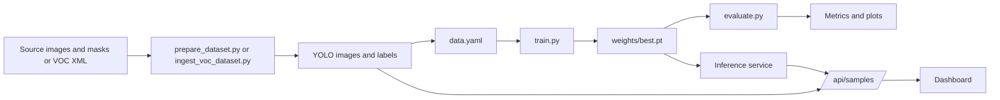

# Ronak Saini — Dataset and Documentation Guide

**Roll number:** 2301921520158
**Assigned responsibility:** Dataset collection, preparation and documentation
**Guide scope:** How the one-class pothole dataset is structured, how the preparation scripts turn masks and VOC XML into YOLO labels, how the splits are counted, and what cannot be claimed about provenance
**Evidence snapshot:** 22 October 2026, matching [`../PROJECT_FACTS.md`](../PROJECT_FACTS.md)

> This guide is a preparation aid, not a substitute for the dataset or the source. The local dataset is verified by structure and count; its original creators, stable source URLs and licence are not. Where the repository cannot prove something, this guide says `[TO BE CONFIRMED]` instead of filling the gap with a plausible story.

---

## Table of contents

1. [Assigned responsibility vs verified contribution](#1-assigned-responsibility-vs-verified-contribution)
2. [Objectives and task map](#2-objectives-and-task-map)
3. [Technical concepts and implementation workflow](#3-technical-concepts-and-implementation-workflow)
4. [Integration with the whole system](#4-integration-with-the-whole-system)
5. [Challenges, debugging, validation and documentation](#5-challenges-debugging-validation-and-documentation)
6. [Speaking scripts](#6-speaking-scripts)
7. [Viva questions with explanatory answers](#7-viva-questions-with-explanatory-answers)
8. [Difficult follow-up questions](#8-difficult-follow-up-questions)
9. [Practical exercises and demonstration walkthroughs](#9-practical-exercises-and-demonstration-walkthroughs)
10. [Pre-viva checklist](#10-pre-viva-checklist)
11. [One-page fact card](#11-one-page-fact-card)

---

## 1. Assigned responsibility vs verified contribution

### 1.1 The claim you are actually defending

The team-declared role is **dataset collection, preparation and documentation**. That is a statement about assigned responsibility. It is not proof that you personally collected every image, wrote every script or produced the exact dataset that trained the checkpoint.

The repository supports a narrower but still useful set of observations:

| Claim | Evidence status | What the evidence actually shows |
|---|---|---|
| Ronak owned dataset collection, preparation and documentation | **Team-declared** | The role is recorded in [`../PROJECT_FACTS.md`](../PROJECT_FACTS.md) §1 and [`../CONTRIBUTIONS.md`](../CONTRIBUTIONS.md). No commit in either repository is independently attributable to Ronak. |
| The local dataset has a verified structure and count | **Verified in source / direct inspection** | `PROJECT_FACTS.md` §4 records 4,719 images, 7,340 instances and 22 backgrounds, with per-split counts. |
| Preparation and ingestion utilities exist | **Verified in source** | `scripts/prepare_dataset.py`, `scripts/ingest_voc_dataset.py` and `scripts/visualize_annotations.py` are present and readable. |
| `data.yaml` defines one class and three splits | **Verified in source** | `data.yaml` sets `nc: 1`, `names: [pothole]`, and relative `train`, `val`, `test` paths. |
| A sample label uses class 0 and normalized coordinates | **Verified in source** | `PROJECT_FACTS.md` §4 records a sample test label with normalized coordinates. |
| Ronak personally collected or annotated specific images | **Attachable evidence required** | A collection log, source list, annotation session record or shared-document history closes the gap. The repository does not contain one. |
| The local dataset is the exact data used to train the checkpoint | **Not verified** | The checkpoint metadata records a Windows data path `C:\Users\Bisman Singh\...\data.yaml`; that is evidence of a training environment, not proof that the local 4,719-image copy is identical. |
| The dataset may be redistributed | **Not verified** | The dataset is excluded from Git. Provenance, licence and redistribution permission are unresolved. |

The honest sentence is:

> “My assigned role was dataset collection, preparation and documentation. I can inventory the local dataset, explain the YOLO label contract, trace the mask-to-box and VOC-to-YOLO conversion logic, and show the split counts. The repository contains the preparation utilities, but it does not record which utility produced this exact copy or whether this copy is the one used to train the checkpoint. I present the counts as verified local facts and the source/licence history as `[TO BE CONFIRMED]`.”

That is a defensible answer. “I built the entire dataset” is not, unless you can attach the collection and preparation record.

### 1.2 What is verified about the local dataset

| Fact | Verified value |
|---|---|
| Task | One-class object detection |
| Class | `pothole` (class 0) |
| Train | 3,281 images, 5,353 instances, 18 backgrounds |
| Validation | 720 images, 993 instances, 2 backgrounds |
| Test | 718 images, 994 instances, 2 backgrounds |
| Total | 4,719 images, 7,340 instances, 22 backgrounds |
| Structure | `dataset/images/{train,val,test}/` and `dataset/labels/{train,val,test}/` |
| Label format | `<class_id> <x_center> <y_center> <width> <height>`, normalized to `[0, 1]` |
| Test filename pattern | `pothole_dataset_1_...` in the local copy |
| Configuration | `data.yaml` with `nc: 1`, `names: [pothole]` |

The local `dataset/images` and `dataset/labels` entries are symlinks to an external `Pothole_detection_YOLO/dataset` tree on the development machine. That is a reproducibility dependency: a clone of the repository alone does not contain the pixels.

### 1.3 What must be attached before the viva

- [ ] A dataset inventory with date, path, image counts, label counts and background counts.
- [ ] A label-conversion or preparation log, even if it is a short note describing which script was used and on what source.
- [ ] A sample annotation inspection: one image, its label file and a visualised box.
- [ ] A split table with counts and the split policy, or an explicit statement that the policy is not recorded.
- [ ] A provenance record with named fields: creator, source URL, licence, permission, download date, transformations.
- [ ] Documentation sections you wrote or reviewed, with a shared-document history or review comments.
- [ ] A clear `[TO BE CONFIRMED]` list for everything you cannot prove.

A checked box is not evidence. Link the artefact.

### 1.4 What not to say

Avoid:

- “I collected all 4,719 images.” The repository does not record who collected them.
- “The dataset is public” or “we have permission to share it.” No licence or permission record exists.
- “The dataset came from Kaggle” or any named source without a stable URL and a record. That would be an invented provenance claim.
- “The VOC script created this dataset.” The current test filenames and split ratio do not match the VOC script’s default output.
- “The checkpoint was trained on this exact dataset.” The checkpoint metadata points to a Windows path and the local copy’s training history is not recorded.
- “The labels are all correct.” The format is verified; full semantic correctness and inter-annotator agreement are not.
- “The split is leakage-free.” Exact duplicates can be checked; near-duplicate separation cannot be proven without a source-level manifest.

---

## 2. Objectives and task map

Your goal is to be able to explain the dataset from four directions: **what is in it, how it is represented, how it was prepared, and what cannot be proven about it**. Work through these ten tasks.

| # | Task | Files to inspect | What to run or do | What you should be able to explain |
|---|---|---|---|---|
| 1 | Inventory the dataset | `dataset/`, `PROJECT_FACTS.md` §4 | Count images, labels and empty labels per split | The 3,281/720/718 split and the 22 backgrounds |
| 2 | Inspect the label schema | `data.yaml`, a sample `.txt` label | Print a non-empty label and map each field | Class 0 plus four normalized coordinates |
| 3 | Trace the mask-to-box path | `scripts/prepare_dataset.py` | Read `process_sample()` and `convert_dataset()` | How a mask contour becomes a YOLO row |
| 4 | Trace the VOC path | `scripts/ingest_voc_dataset.py` | Read `convert_voc_to_yolo()` and the split code | XML box → normalized row; 80/10/10 with seed 42 |
| 5 | Compare the split policy with the counts | `ingest_voc_dataset.py`, `PROJECT_FACTS.md` §4 | Compute 80/10/10 for 4,719 and compare with 3,281/720/718 | Why the local split is not the VOC script’s default allocation |
| 6 | Audit label quality | `dataset/labels/`, audit script in §3.9 | Check pairing, field count, range, size and duplicates | The difference between a format error and a semantic error |
| 7 | Audit split overlap | `dataset/images/` | Compare basenames and SHA-256 hashes | What exact-duplicate detection proves and what it misses |
| 8 | Visualise annotations | `scripts/visualize_annotations.py` | `--split test --num 6` | How to spot a coordinate or pairing error |
| 9 | Review the runtime contract | `infrascan/config.py`, `infrascan/api.py` | Find `DATASET_TEST_DIR` and `/api/samples` | The dashboard uses only test images for the sample picker; inference does not need the dataset |
| 10 | Write the provenance and documentation record | `05-dataset-and-model/dataset-provenance.md`, `PROJECT_FACTS.md` | Fill a claim-evidence table with `[TO BE CONFIRMED]` fields | How to document an unknown without inventing a source |

### 2.1 Working directory

All commands assume:

```bash
cd "/Users/aayus/Desktop/College final year/InfraScan"
source .venv/bin/activate   # only if you created this environment
```

The scripts use OpenCV, pandas, NumPy, PyYAML and tqdm. If an import fails, activate the prepared environment rather than installing packages during the viva.

Check the dependency surface:

```bash
python -V
python -c "import cv2, pandas, numpy, yaml; print('cv2', cv2.__version__); print('pandas', pandas.__version__); print('numpy', numpy.__version__)"
```

---

## 3. Technical concepts and implementation workflow

### 3.1 What the dataset is for

InfraScan performs **single-class object detection**, not classification or segmentation. Each training example is an image plus zero or more pothole bounding boxes. The model learns to output a box, a confidence and the class `pothole`.

The dataset is therefore not a folder of “pothole” and “no pothole” images. An image with no pothole is still useful as a negative example, represented by an **empty label file**. The model sees the image and learns that no object should fire.

The one-class choice keeps the problem narrow:

- the model does not distinguish cracks, patches, shadows or manholes;
- severity is computed later from box area, not from a class;
- the evaluation is single-class mAP, not a multi-class confusion matrix;
- a false positive can be any road feature that looks like a pothole, not just another defect class.

### 3.2 Directory contract and counts

```text
dataset/
├── images/
│   ├── train/
│   ├── val/
│   └── test/
└── labels/
    ├── train/
    ├── val/
    └── test/
```

The image and label files pair by **stem**:

```text
dataset/images/test/pothole_dataset_1_000123.jpg
dataset/labels/test/pothole_dataset_1_000123.txt
```

The verified inventory is:

| Split | Images | Instances | Backgrounds | Instances per image (derived) |
|---|---:|---:|---:|---:|
| Train | 3,281 | 5,353 | 18 | 1.63 |
| Validation | 720 | 993 | 2 | 1.38 |
| Test | 718 | 994 | 2 | 1.38 |
| **Total** | **4,719** | **7,340** | **22** | **1.56** |

The “instances per image” column is arithmetic from the verified counts, not a new measurement. Backgrounds are 0.55% of train, 0.28% of validation and 0.28% of test; 22 of 4,719 images overall, about 0.47%.

The split proportions are also worth knowing:

| Split | Share of images (derived) |
|---|---:|
| Train | 69.5% |
| Validation | 15.3% |
| Test | 15.2% |

Those are **not** 80/10/10. That matters in §3.8.

### 3.3 The YOLO label format

Each line in a label file is one object:

```text
class_id x_center y_center width height
```

For this dataset, `class_id` is always `0`, and the other four values are normalized to the image dimensions:

```text
x_center = (xmin + xmax) / 2 / image_width
y_center = (ymin + ymax) / 2 / image_height
width    = (xmax - xmin) / image_width
height   = (ymax - ymin) / image_height
```

Worked example: an image is 640 × 480. A pothole box has `xmin=100`, `xmax=300`, `ymin=120`, `ymax=240`.

```text
x_center = (100 + 300) / 2 / 640 = 200 / 640 = 0.312500
y_center = (120 + 240) / 2 / 480 = 180 / 480 = 0.375000
width    = (300 - 100) / 640     = 200 / 640 = 0.312500
height   = (240 - 120) / 480     = 120 / 480 = 0.250000
```

The label row is:

```text
0 0.312500 0.375000 0.312500 0.250000
```

The center is a **fraction**, not a pixel coordinate. The width and height are fractions of the image width and height, so the same row remains valid if the image is resized, as long as the whole image is resized without cropping.

Why normalize:

- the model can train at different input sizes;
- labels are independent of the original camera resolution;
- no coordinate overflow when images are resized;
- the same format works for 640 × 480, 1920 × 1080 or a square crop.

The cost is that a normalized box does not preserve physical size. A small box in a close-up and a large box in a distant frame can have the same normalized area, which is why severity is a heuristic.

### 3.4 `data.yaml` and path resolution

The repository configuration is:

```yaml
path: ./dataset
train: images/train
val: images/val
test: images/test
nc: 1
names:
- pothole
```

| Field | Meaning | Failure if wrong |
|---|---|---|
| `path` | Dataset root | Loader cannot find splits |
| `train` | Training split, relative to `path` | Training uses the wrong images or fails |
| `val` | Validation split | Model selection or early stopping is misled |
| `test` | Test split | Evaluation is not held out |
| `nc` | Number of classes | Class index mismatch |
| `names` | Class index → name | Labels or UI show the wrong class |

`nc: 1` means only class `0` is valid. A label row starting with `1` would refer to a class that does not exist. `names: [pothole]` is the mapping used by the UI and by Ultralytics.

The root `data.yaml` uses `path: ./dataset`. The `prepare_dataset.py` converter also writes an absolute `path` inside `dataset/data.yaml` and a relative `path: ./dataset` at the repository root. The absolute copy is convenient on the machine that generated it but is not portable to another machine. That is a documentation and reproducibility issue, not a label error.

Check the configuration without training:

```bash
python - <<'PY'
from pathlib import Path
import yaml

cfg = yaml.safe_load(Path("data.yaml").read_text(encoding="utf-8"))
print(cfg)
for split in ("train", "val", "test"):
    path = Path(cfg["path"]) / cfg[split]
    print(f"{split:5s} {path}  {'exists' if path.is_dir() else 'MISSING'}")
PY
```

Expected observation: `nc: 1`, `names: ['pothole']`, and three existing split directories when the dataset is present.

### 3.5 `prepare_dataset.py`: mask to bounding box

This script converts a segmentation-style source into detection labels. It expects:

```text
<src>/
├── splits.csv          # columns: Image, Mask, Split
├── images/             # source images
└── masks/              # grayscale masks
```

The CLI is:

```bash
python scripts/prepare_dataset.py \
  --src /path/to/raw/data_processed \
  --out ./dataset \
  --size 640 \
  --min-area 15 \
  --workers 8
```

The core function is `process_sample()`:

```python
img = cv2.imread(src_img_path)
if img is None:
    return 0, 0

mask = cv2.imread(src_mask_path, cv2.IMREAD_GRAYSCALE)
if mask is None:
    return 0, 0

orig_h, orig_w = mask.shape[:2]

contours, _ = cv2.findContours(mask, cv2.RETR_EXTERNAL, cv2.CHAIN_APPROX_SIMPLE)

yolo_labels = []
potholes_count = 0
for cnt in contours:
    area = cv2.contourArea(cnt)
    if area < min_area:
        continue

    bx, by, bw, bh = cv2.boundingRect(cnt)
    x_center = (bx + bw / 2.0) / orig_w
    y_center = (by + bh / 2.0) / orig_h
    w_norm = bw / float(orig_w)
    h_norm = bh / float(orig_h)

    x_center = max(0.0, min(1.0, x_center))
    y_center = max(0.0, min(1.0, y_center))
    w_norm = max(0.0, min(1.0, w_norm))
    h_norm = max(0.0, min(1.0, h_norm))

    yolo_labels.append(f"0 {x_center:.6f} {y_center:.6f} {w_norm:.6f} {h_norm:.6f}")
    potholes_count += 1
```

Step by step:

1. **Read the image and mask.** If either is missing, the sample is skipped and contributes `(0, 0)` to the totals.
2. **Read the mask as grayscale.** A mask is a single-channel image; non-zero pixels are foreground.
3. **Find external contours.** `RETR_EXTERNAL` returns the outer boundary of each connected foreground region. Holes inside a pothole mask are ignored.
4. **Filter small contours.** `cv2.contourArea(cnt) < min_area` drops noise. The default is 15 square pixels.
5. **Take the axis-aligned bounding rectangle.** `cv2.boundingRect()` returns `(x, y, width, height)` in mask pixels.
6. **Normalize by the mask dimensions.** The code uses `orig_h, orig_w` from the mask, not the image.
7. **Clamp to `[0, 1]`.** This prevents a contour at the edge from producing an out-of-range value.
8. **Write one row per contour with class `0`.**
9. **Resize the image to 640 × 640** with `INTER_AREA` if `target_size` is set, then write JPEG quality 90.
10. **Write the label file**, including an empty file when no contour passes the filter.

The dataset-level function then:

- verifies `splits.csv` exists;
- creates `images/{train,val,test}` and `labels/{train,val,test}`;
- builds one task per CSV row;
- converts with a `ThreadPoolExecutor` of eight workers;
- prints the total converted images and annotations;
- writes `dataset/data.yaml` with an absolute path and a root `data.yaml` with `path: ./dataset`.

```python
yaml_content = {
    'path': str(out_path.resolve()).replace('\\', '/'),
    'train': 'images/train',
    'val': 'images/val',
    'test': 'images/test',
    'nc': 1,
    'names': ['pothole']
}
```

**Important limits of this converter:**

| Limit | Consequence |
|---|---|
| Normalizes with mask dimensions, not image dimensions | If the mask and image have different width/height, boxes are systematically shifted or scaled |
| Resizes to a square 640 × 640 | The image is distorted if it was not square; normalized labels still align, but object shape changes |
| `min_area=15` is in mask pixels | Small distant potholes can be dropped; the threshold is not scale-invariant |
| Missing image or mask returns `(0, 0)` | The run does not identify which samples were skipped |
| `cv2.imwrite()` return value is ignored | A failed write may not raise immediately, especially if a split directory is missing |
| Only `train`, `val`, `test` directories are created | A different `Split` value in `splits.csv` can cause a write failure |
| No duplicate or leakage check | The converter trusts `splits.csv` |
| No post-write label validation | A malformed row would only be caught by a later audit |
| Writes an absolute path in `dataset/data.yaml` | The generated YAML is not portable |

The mask/image dimension point is the one to remember. Normalized coordinates are only correct relative to the dimensions used to compute them. If the image is 1280 × 720 and the mask is 640 × 360, a box computed with 640 × 360 still has the same *relative* position, so it aligns after the image is resized to the mask’s aspect ratio. The problem appears when the mask and image have different **aspect ratios** or are misaligned, not merely different resolutions. State it precisely: “the code assumes the mask and image describe the same frame; it does not verify that.”

### 3.6 `ingest_voc_dataset.py`: VOC XML to YOLO

This script ingests a zip archive with Pascal VOC-style annotations:

```text
annotations/<stem>.xml
images/<stem>.png | .jpg | .jpeg
```

It matches each XML file to an image by stem, shuffles the pairs with `random.seed(42)`, and splits them 80/10/10. The output filenames use the prefix `voc_`:

```python
target_stem = f"voc_{stem}"
out_img_path = images_dir / split_name / f"{target_stem}.jpg"
out_lbl_path = labels_dir / split_name / f"{target_stem}.txt"
```

The split code is:

```python
random.seed(seed)
random.shuffle(pairs)

n_total = len(pairs)
n_train = int(n_total * train_ratio)
n_val = int(n_total * val_ratio)

train_pairs = pairs[:n_train]
val_pairs = pairs[n_train:n_train + n_val]
test_pairs = pairs[n_train + n_val:]
```

The XML conversion is:

```python
for obj in root.findall("object"):
    name_elem = obj.find("name")
    if name_elem is None:
        continue
    name = name_elem.text.strip().lower()
    if "pothole" not in name:
        continue

    bndbox = obj.find("bndbox")
    if bndbox is None:
        continue

    xmin = float(bndbox.find("xmin").text)
    ymin = float(bndbox.find("ymin").text)
    xmax = float(bndbox.find("xmax").text)
    ymax = float(bndbox.find("ymax").text)

    xmin = max(0.0, min(float(img_width), xmin))
    ymin = max(0.0, min(float(img_height), ymin))
    xmax = max(0.0, min(float(img_width), xmax))
    ymax = max(0.0, min(float(img_height), ymax))

    bw = xmax - xmin
    bh = ymax - ymin
    if bw <= 1 or bh <= 1:
        continue
```

Then it computes the same normalized center/width/height and writes `0 ...`.

Key behaviours:

| Behaviour | Detail |
|---|---|
| Class filter | An object name is kept if the lowercase name **contains** `"pothole"`; other classes are ignored |
| Size source | If the XML has a valid `<size>`, it overrides the decoded image dimensions |
| Coordinate clamping | Boxes are clamped to the image bounds before normalization |
| Tiny boxes | Boxes with width or height ≤ 1 pixel are skipped |
| Empty labels | If no pothole object survives, an empty label file is written |
| JPEG quality | 95 |
| Cache cleanup | Deletes top-level `*.cache` files under `labels/` |
| Random split | `random.seed(42)` then `shuffle(pairs)`; no stratification by source or scene |
| CLI | None; `__main__` calls `ingest_dataset()` with no arguments |

That last row is a real bug-like limitation. Running the file directly:

```bash
python scripts/ingest_voc_dataset.py
```

raises:

```text
ValueError: zip_path must point to a local VOC archive.
```

The function is designed to be imported and called with a zip path, not run as a CLI. If you need to call it, do so explicitly and only on an authorized archive:

```python
from scripts.ingest_voc_dataset import ingest_dataset

stats = ingest_dataset(
    zip_path="/path/to/authorized/voc_archive.zip",
    dataset_dir="/path/to/output_dataset",
    train_ratio=0.80,
    val_ratio=0.10,
    test_ratio=0.10,
    seed=42,
)
print(stats)
```

Do not run that against the project dataset during the viva. It writes images and labels and can merge new files into existing splits.

### 3.7 `visualize_annotations.py`: checking alignment

The visualizer converts normalized labels back to pixels:

```python
bx1 = int((x_c - bw / 2.0) * w)
by1 = int((y_c - bh / 2.0) * h)
bx2 = int((x_c + bw / 2.0) * w)
by2 = int((y_c + bh / 2.0) * h)
```

```bash
python scripts/visualize_annotations.py \
  --dataset dataset \
  --split test \
  --num 6 \
  --out runs/verify-labels
```

Expected observation: six JPEGs with red boxes and a `pothole` badge. If a box is offset, the first suspect is a coordinate-normalization error, not the model. If the box is the right size but shifted, suspect a mask/image dimension mismatch or a crop that was not applied to the label.

The sampling code has an edge case:

```python
valid_samples = []
for img_path in images:
    lbl_path = lbl_dir / f"{img_path.stem}.txt"
    if lbl_path.exists() and lbl_path.stat().st_size > 0:
        valid_samples.append(img_path)
        if len(valid_samples) >= num_samples * 3:
            break

chosen = random.sample(valid_samples if valid_samples else images, min(num_samples, len(images)))
```

If `valid_samples` is non-empty but smaller than `min(num_samples, len(images))`, `random.sample()` raises `ValueError`. The normal `--num 6` path is fine; a very large `--num` can fail. Record the edge case rather than claiming the visualizer is robust for every request.

### 3.8 Split policy, split arithmetic and the mismatch

The local split is:

```text
train 3,281  (69.5%)
val     720  (15.3%)
test    718  (15.2%)
```

The VOC ingester’s default is 80/10/10. If you apply its integer split to 4,719 pairs:

```python
n = 4719
n_train = int(n * 0.80)   # 3775
n_val = int(n * 0.10)     # 471
n_test = n - n_train - n_val  # 473
```

So the VOC script’s default would produce roughly **3,775 / 471 / 473**, not **3,281 / 720 / 718**.

That is a strong, source-level observation. It means one of the following is true:

1. the current dataset was produced by a different pipeline, such as `prepare_dataset.py` reading a `splits.csv`;
2. the VOC output was subsequently re-split, merged or filtered;
3. the current dataset is a different snapshot from the one the VOC script produced.

The repository does not record which one. What you can say is:

> “The local split is about 69.5/15.3/15.2, not the VOC ingester’s 80/10/10. The default VOC allocation for 4,719 pairs would be about 3,775/471/473. The local test filenames also use the `pothole_dataset_1_` prefix, while the VOC ingester writes `voc_`. Those two observations are consistent with the local dataset not being the direct output of the current VOC ingester. I cannot prove the actual pipeline because no preparation log is attached.”

This is exactly the kind of evidence-based inference that earns marks. It is not an accusation; it is a reproducibility gap stated precisely.

`prepare_dataset.py` is a more plausible producer because it preserves the source stem and reads a `splits.csv`. But “more plausible” is not proof. If you did not run it or retain the CSV, say `[TO BE CONFIRMED]`.

### 3.9 A dataset quality audit you can run

This audit is read-only. It checks pairing, field count, class, coordinate range, positive size, box containment and duplicate rows.

```bash
python - <<'PY'
from pathlib import Path
from collections import Counter

root = Path("dataset")
splits = ("train", "val", "test")
suffixes = {".jpg", ".jpeg", ".png", ".webp", ".bmp"}

for split in splits:
    img_dir = root / "images" / split
    lbl_dir = root / "labels" / split
    images = {p.stem for p in img_dir.iterdir() if p.suffix.lower() in suffixes}
    labels = {p.stem for p in lbl_dir.glob("*.txt")}

    boxes = 0
    empty = 0
    bad = []
    duplicates = 0
    widths = []
    heights = []

    for label_path in sorted(lbl_dir.glob("*.txt")):
        text = label_path.read_text(encoding="utf-8").strip()
        if not text:
            empty += 1
            continue

        seen = set()
        for line_no, line in enumerate(text.splitlines(), 1):
            parts = line.split()
            if len(parts) != 5:
                bad.append((label_path.name, line_no, "field count"))
                continue
            try:
                cls = int(parts[0])
                x, y, w, h = map(float, parts[1:])
            except ValueError:
                bad.append((label_path.name, line_no, "non-numeric"))
                continue

            key = (cls, round(x, 6), round(y, 6), round(w, 6), round(h, 6))
            if key in seen:
                duplicates += 1
            seen.add(key)

            boxes += 1
            widths.append(w)
            heights.append(h)

            if cls != 0:
                bad.append((label_path.name, line_no, f"class {cls}"))
            if not all(0.0 <= v <= 1.0 for v in (x, y, w, h)):
                bad.append((label_path.name, line_no, "out of range"))
            if w <= 0 or h <= 0:
                bad.append((label_path.name, line_no, "non-positive size"))
            if (x - w / 2 < -1e-6 or x + w / 2 > 1 + 1e-6
                    or y - h / 2 < -1e-6 or y + h / 2 > 1 + 1e-6):
                bad.append((label_path.name, line_no, "box outside image"))

    print(
        f"{split}: images={len(images)} labels={len(labels)} boxes={boxes} "
        f"empty={empty} missing={len(images - labels)} orphan={len(labels - images)} "
        f"bad={len(bad)} duplicate_rows={duplicates}"
    )
    if widths:
        print(f"  width range:  {min(widths):.6f} .. {max(widths):.6f}")
        print(f"  height range: {min(heights):.6f} .. {max(heights):.6f}")
    for row in bad[:5]:
        print("  ", row)
PY
```

Expected structural observation:

```text
train: images=3281 labels=3281 boxes=5353 empty=18
val:   images=720  labels=720  boxes=993  empty=2
test:  images=718  labels=718  boxes=994  empty=2
```

`missing`, `orphan`, `bad` and `duplicate_rows` are **not pre-recorded** in `PROJECT_FACTS.md`. If the audit reports any, that is a finding to document. Do not silently repair the dataset before the viva; preserve the original state and record the issue.

The audit checks format and geometry. It does **not** check whether a box semantically covers the pothole. That requires visual inspection or a second annotator.

### 3.10 Split integrity and leakage

Leakage is any evaluation information that influenced training. The obvious form is an image in both train and test. The less obvious forms are:

- near-duplicate frames from the same road video;
- the same scene photographed from slightly different angles;
- re-encoded or resized copies;
- labels copied with a new filename;
- a test image used as a training background.

The repository has no split manifest, source grouping or deduplication log. `PROJECT_FACTS.md` §4 says the exact split-generation history cannot be verified. The honest claim is:

> “The evaluation used the test directory, and the split directories are separate. I can check filename and exact-byte overlap. I cannot prove near-duplicate separation because the original source grouping and split manifest are not recorded.”

A basic audit:

```bash
python - <<'PY'
from pathlib import Path
from hashlib import sha256
from collections import defaultdict

root = Path("dataset")
splits = ("train", "val", "test")
by_name = defaultdict(set)
by_hash = defaultdict(set)

for split in splits:
    for path in (root / "images" / split).iterdir():
        if path.suffix.lower() not in {".jpg", ".jpeg", ".png", ".webp", ".bmp"}:
            continue
        by_name[path.name.lower()].add(split)
        by_hash[sha256(path.read_bytes()).hexdigest()].add(f"{split}/{path.name}")

name_overlap = {k: v for k, v in by_name.items() if len(v) > 1}
hash_overlap = {
    k: v for k, v in by_hash.items()
    if len({item.split("/")[0] for item in v}) > 1
}

print("basename overlaps:", len(name_overlap))
for name, where in list(name_overlap.items())[:10]:
    print("  ", name, sorted(where))
print("exact-hash overlaps across splits:", len(hash_overlap))
for digest, where in list(hash_overlap.items())[:10]:
    print("  ", digest[:12], sorted(where))
PY
```

This catches exact bytes only. A resized or re-encoded duplicate will pass. A perceptual hash or embedding-based near-duplicate audit would be stronger, but it is not implemented or recorded.

### 3.11 Provenance and licensing

The verification boundary is explicit in [`../05-dataset-and-model/dataset-provenance.md`](../05-dataset-and-model/dataset-provenance.md) and [`../PROJECT_FACTS.md`](../PROJECT_FACTS.md) §4. The project can verify:

- the local directory structure;
- image, label and background counts;
- the one-class label format;
- the presence of preparation and ingestion utilities;
- the training-data path embedded in checkpoint metadata.

The project **cannot** verify:

- the original creators of every image;
- stable source URLs;
- dataset licences and redistribution permissions;
- whether every local image came from the named upstream sources;
- the exact split-generation history;
- whether the local copy is the exact data used to train the checkpoint.

The checkpoint metadata path is:

```text
C:\Users\Bisman Singh\...\data.yaml
```

That is evidence of a Windows training environment. It is not a dataset citation, not a licence and not proof that the local dataset is identical. Do not turn a path into a provenance claim.

A provenance record should have these fields:

| Field | Required content | Current status |
|---|---|---|
| Dataset name | The name used by the team | `[TO BE CONFIRMED]` |
| Original creator(s) | People or organisation | `[TO BE CONFIRMED]` |
| Stable source URL | A URL that still resolves | `[TO BE CONFIRMED]` |
| Download date | When the copy was obtained | `[TO BE CONFIRMED]` |
| Licence | Name and version of the licence | `[TO BE CONFIRMED]` |
| Redistribution permission | Written permission or licence clause | `[TO BE CONFIRMED]` |
| Transformations | Resize, crop, mask conversion, re-encode | Partly source-visible; run log missing |
| Split manifest | Exact file list per split and seed | `[TO BE CONFIRMED]` |
| Checksum | Hash of a manifest or archive | `[TO BE CONFIRMED]` |
| Training relationship | Proof that this copy trained the checkpoint | `[TO BE CONFIRMED]` |

A blank field is better than an invented one. If an examiner asks for the licence, say: “We do not have a verified licence record, so the dataset is excluded from the public repository and we do not claim redistribution rights.”

### 3.12 Documentation workflow

A dataset page is not a prose summary; it is an evidence record. Use this order:

1. **Scope.** What the page covers and what it does not.
2. **Inventory.** Date, path, counts and structure.
3. **Schema.** Label format, class map and YAML.
4. **Preparation paths.** Mask conversion and VOC ingestion, with source references.
5. **Split policy.** Counts, ratios, seed if known, and the mismatch if any.
6. **Quality checks.** What was run, what was found, what was not run.
7. **Provenance.** Known, unknown and `[TO BE CONFIRMED]`.
8. **Licensing.** Permission status and redistribution decision.
9. **Reproduction.** Commands, dependencies and expected observations.
10. **Evidence index.** Links to logs, samples and review notes.

When editing an existing page:

- check every number against `PROJECT_FACTS.md`;
- check every file claim against the current source;
- replace “the dataset was collected from…” with a sourced statement or `[TO BE CONFIRMED]`;
- do not copy an inherited benchmark or count without checking it;
- confirm any Streamlit reference is historical context rather than a current-state claim;
- keep relative links valid;
- add a date and an owner to the evidence table.

Documentation QA is a real contribution only if the review is traceable. Keep your review notes, even if the final page was edited by someone else.

---

## 4. Integration with the whole system

### 4.1 The data lifecycle



The dataset participates in two different paths:

- **Offline path:** preparation → training → evaluation.
- **Runtime path:** `/api/samples` reads up to 24 images from `dataset/images/test` for the dashboard picker.

Inference itself does not need the dataset. If the dataset is missing, image upload and webcam capture still work; only the sample picker is unavailable. That separation is useful in a demo.

### 4.2 Contracts at each boundary

| Boundary | Input | Output | Failure mode | Check |
|---|---|---|---|---|
| Source → converter | Images, masks or VOC XML | YOLO images and labels | Missing pair, bad XML, wrong dimensions | Pair count; label audit |
| Converter → dataset | Label rows | `images/{split}`, `labels/{split}` | Missing split directory, skipped sample | Counts and `missing`/`orphan` |
| Dataset → `data.yaml` | Relative paths | Loader resolves splits | Wrong `path`, wrong split name | YAML print and directory check |
| `data.yaml` → training | Images and labels | Trained weights | Class mismatch, leakage, corrupt image | Loader smoke test; split audit |
| Weights → evaluation | Checkpoint + test split | Metrics | Silent `yolo11s.pt` fallback | Log line and hash |
| Dataset → API samples | Test images | JSON list and image responses | Dataset absent; empty list | `/api/samples` check |
| API → browser | Sample metadata | Image preview | 404 or broken path | Browser network check |

### 4.3 How the runtime uses the dataset

`infrascan/config.py` defines:

```python
DATASET_TEST_DIR = PROJECT_ROOT / "dataset" / "images" / "test"
```

`infrascan/api.py` lists files from that directory and exposes up to `SAMPLE_LIMIT` (24) items. The endpoint returns `available: false` and an empty list if the directory is missing.

Consequences:

- a missing dataset does not prevent startup;
- a missing dataset does not prevent upload inference;
- the System page may show `samples.count: 0`;
- the sample picker is a convenience, not a dependency;
- the dataset path is fixed relative to the repository root, not configurable by an environment variable.

This is a useful distinction for the viva: “The runtime only reads test images for the sample picker. The model does not load the dataset at inference time.”

### 4.4 The checkpoint is not proof of the dataset

The checkpoint metadata records:

| Field | Value |
|---|---|
| Architecture | YOLO11n |
| Class | `pothole` |
| Input size | 640 |
| Epochs | 15 |
| Batch | 16 |
| Initial LR | 0.003 |
| Device | `0` (CUDA) |
| Seed | 0 |
| Training data path | `C:\Users\Bisman Singh\...\data.yaml` |

The local dataset is a 4,719-image copy. The metadata does not contain a dataset hash, a file list or a split manifest. It is therefore possible that:

- the checkpoint was trained on a different snapshot;
- the local copy was re-split after training;
- the local copy includes extra images or backgrounds;
- the class mapping is the same but the individual images differ.

Do not claim identity. Say: “The checkpoint and the local dataset are consistent in class and task, but the repository does not prove they are the same snapshot.”

### 4.5 Failure modes and what they mean

| Failure | Symptom | Correct interpretation |
|---|---|---|
| `dataset/` symlink target missing | Counts fail; sample picker empty | Dataset unavailable, not a model bug |
| Missing label file | Image loads but no ground truth | Pairing error; audit `missing` |
| Orphan label file | Label exists without image | Pairing error; audit `orphan` |
| Empty label | No boxes | Valid background, not corruption |
| Wrong class ID | Loader error or wrong class | `nc`/label mismatch |
| Box outside `[0, 1]` | Box clipped or misplaced | Normalization error |
| Mask/image mismatch | Boxes shifted or scaled | Preparation error |
| Duplicate image across splits | Inflated evaluation | Leakage risk |
| iCloud-evicted file | Read stalls or fails | Environment issue; copy locally |
| Absolute path in generated YAML | Works on one machine only | Portability issue |

The correct response is to identify the layer. A missing sample in the UI is not evidence that the model is broken.

---

## 5. Challenges, debugging, validation and documentation

### 5.1 Verified issues versus likely issues

| Issue | Status | Evidence | Why it matters |
|---|---|---|---|
| Dataset is excluded from Git | **Verified** | `.gitignore` / `PROJECT_FACTS.md` §4 | A clone is not a complete dataset |
| `dataset/images` and `dataset/labels` are symlinks | **Verified in the local tree** | `ls -l dataset` | The pixels live outside the repository |
| One-class label format | **Verified** | `data.yaml`, sample label | The model cannot learn other defect classes |
| 22 background images | **Verified** | `PROJECT_FACTS.md` §4 | Empty labels are intentional |
| Local split is not 80/10/10 | **Verified by arithmetic** | 3,281/720/718 vs 4,719 total | The VOC default did not produce this split |
| Test filenames use `pothole_dataset_1_` | **Verified** | `PROJECT_FACTS.md` §4 | Not the `voc_` naming of the ingester |
| `prepare_dataset.py` normalizes with mask dimensions | **Verified in source** | `process_sample()` | Mask/image mismatch can shift boxes |
| `min_area=15` filters small contours | **Verified in source** | `process_sample()` | Small potholes can be dropped |
| `ingest_voc_dataset.py` has no CLI parser | **Verified in source** | `if __name__ == "__main__": ingest_dataset()` | Direct execution raises `ValueError` |
| VOC split is seeded but not stratified | **Verified in source** | `random.seed(42)`; `shuffle(pairs)` | Source-level leakage is possible |
| `visualize_annotations.py` can raise on large `--num` | **Verified in source** | `random.sample(..., min(num_samples, len(images)))` | The sampler pool can be smaller than the sample size |
| Checkpoint training data is a Windows path | **Verified in metadata** | `PROJECT_FACTS.md` §3 | It does not prove local dataset identity |
| Dataset provenance/licence unresolved | **Verified gap** | `PROJECT_FACTS.md` §4; provenance page | No redistribution claim is safe |
| Full label audit and leakage audit | **NOT RUN** | No recorded output | The main quality-assurance gap |
| The current dataset was produced by a specific script | **Not verified** | No run log | Do not claim a pipeline you cannot show |

### 5.2 Debugging playbook

```bash
# 1. What is the dataset path and is it a symlink?
ls -ld dataset dataset/images dataset/labels
readlink dataset/images
readlink dataset/labels

# 2. Do the split counts match?
for s in train val test; do
  printf '%s images=' "$s"
  find "dataset/images/$s" -maxdepth 1 -type f \( -iname '*.jpg' -o -iname '*.png' \) | wc -l
  printf '%s labels=' "$s"
  find "dataset/labels/$s" -maxdepth 1 -name '*.txt' | wc -l
  printf '%s empty=' "$s"
  find "dataset/labels/$s" -maxdepth 1 -name '*.txt' -size 0 | wc -l
done

# 3. What does a real label look like?
label="$(find dataset/labels/test -maxdepth 1 -name '*.txt' -size +0c | head -1)"
echo "$label"
head -3 "$label"

# 4. Does the YAML resolve?
python - <<'PY'
from pathlib import Path
import yaml
cfg = yaml.safe_load(Path("data.yaml").read_text(encoding="utf-8"))
print(cfg)
for split in ("train", "val", "test"):
    p = Path(cfg["path"]) / cfg[split]
    print(split, p, p.is_dir())
PY

# 5. Are image and label stems paired?
python - <<'PY'
from pathlib import Path
for split in ("train", "val", "test"):
    images = {p.stem for p in (Path("dataset/images")/split).iterdir() if p.suffix.lower() in {".jpg",".jpeg",".png",".webp",".bmp"}}
    labels = {p.stem for p in (Path("dataset/labels")/split).glob("*.txt")}
    print(split, "missing_labels", len(images-labels), "orphan_labels", len(labels-images))
PY

# 6. Can the visualizer open a sample?
python scripts/visualize_annotations.py --split test --num 2 --out /tmp/verify-labels
```

If step 1 shows a broken symlink, stop. Counts and training cannot be reproduced until the target is available. If step 2 stalls, the iCloud copy may be downloading; use a local copy and record the path.

### 5.3 Validation matrix

| ID | Check | Method | Expected | Status |
|---|---|---|---|---|
| D01 | Train image count | `find ... | wc -l` | 3,281 | **PASS** — verified |
| D02 | Validation image count | `find ... | wc -l` | 720 | **PASS** — verified |
| D03 | Test image count | `find ... | wc -l` | 718 | **PASS** — verified |
| D04 | Train label count | `find ... | wc -l` | 3,281 | **PASS** — verified |
| D05 | Validation label count | `find ... | wc -l` | 720 | **PASS** — verified |
| D06 | Test label count | `find ... | wc -l` | 718 | **PASS** — verified |
| D07 | Background count | `-size 0` per split | 18/2/2 | **PASS** — verified |
| D08 | Total instances | Sum non-empty rows | 5,353/993/994 | **PASS** — verified |
| D09 | Sample label schema | Print a test label | class 0 + 4 floats | **PASS** — sample verified |
| D10 | `data.yaml` schema | Parse YAML | one class, three splits | **PASS** — source verified |
| D11 | Full label range audit | Audit script in §3.9 | No violations; record any | **NOT RUN** |
| D12 | Image–label pairing audit | Stem comparison | 0 missing, 0 orphan | **NOT RUN** |
| D13 | Duplicate-row audit | Per-file duplicate check | 0 duplicates; record any | **NOT RUN** |
| D14 | Exact-hash split overlap | SHA-256 audit | 0 cross-split duplicates | **NOT RUN** |
| D15 | Near-duplicate/leakage audit | Perceptual hash or embedding | Report overlap risk | **NOT RUN** |
| D16 | Annotation visualization | `visualize_annotations.py` | 6 aligned images | **NOT RUN** |
| D17 | `prepare_dataset.py` run | Convert a small authorized sample | Counts and labels match | **NOT RUN** |
| D18 | `ingest_voc_dataset.py` run | Convert a small authorized archive | Counts and labels match | **NOT RUN** |
| D19 | Dataset identity with checkpoint | Compare manifest/hash | Proven identity | **NOT RUN** / `[TO BE CONFIRMED]` |
| D20 | Licence and redistribution | Written permission | Documented permission | **BLOCKED** / `[TO BE CONFIRMED]` |

The distinction between D11–D15 and D01–D10 is the heart of the guide. The counts are verified; the deeper quality audits are not. Do not let a clean count table imply a clean label audit.

### 5.4 Documentation QA for the dataset chapter

A dataset page should answer these questions:

1. What exactly is in the dataset, with a date and path?
2. How are images and labels paired?
3. What does one label row mean?
4. How was the data prepared, and which script/path is verified?
5. What are the split counts and ratios?
6. What quality checks were run, and what did they find?
7. What is the provenance, and what is unknown?
8. What licence and redistribution decision applies?
9. What would someone need to reproduce the dataset?
10. Which claims are verified, team-declared or `[TO BE CONFIRMED]`?

Review checklist:

- [ ] Every count matches `PROJECT_FACTS.md` §4.
- [ ] Every script claim names the current file.
- [ ] No source URL or licence is invented.
- [ ] The checkpoint metadata path is not presented as dataset provenance.
- [ ] The difference between the local split and the VOC 80/10/10 default is stated if the VOC script is discussed.
- [ ] The symlink/external-folder dependency is documented.
- [ ] The `prepare_dataset.py` mask-dimension assumption is documented.
- [ ] The `ingest_voc_dataset.py` no-CLI limitation is documented.
- [ ] The visualizer edge case is documented.
- [ ] The page separates “format verified” from “semantic correctness not verified.”

### 5.5 Defending provenance under questioning

The examiner may push on one of three fronts:

**“Where did the data come from?”**
Answer with what is known: local structure and counts are verified; the inherited material describes a multi-source pothole dataset; the exact creators and URLs are not recorded. Then state what would close the gap: a source list with URLs, download dates and licence records.

**“Can you share it?”**
Answer: the dataset is excluded from Git because redistribution permission is unresolved. Do not claim it is public. If the examiner needs a copy, the team can share privately only if the licence allows it; that decision is `[TO BE CONFIRMED]`.

**“Did you train the model on this data?”**
Answer: the checkpoint is consistent with a one-class pothole task, but the metadata points to a Windows training path and there is no dataset hash or split manifest linking the local copy to the checkpoint. The honest answer is that identity is unproven.

A precise “I don’t know, and here is the evidence that would settle it” is stronger than a fabricated source.

### 5.6 What would you improve?

Prioritize:

1. **A dataset manifest** with file names, sizes, SHA-256 hashes and split assignment.
2. **A source/provenance record** with creators, URLs, download dates and licences.
3. **A full label audit** with a retained report.
4. **A leakage audit** using perceptual hashes or embeddings, grouped by source sequence.
5. **A preparation run log** naming the script, arguments, input archive and output counts.
6. **A portable `data.yaml`** with relative paths only.
7. **A fixed visualizer sampler** that uses `min(num_samples, len(pool))`.
8. **A CLI for the VOC ingester** with explicit `--zip`, `--out`, `--seed` arguments.
9. **A dataset card** in the documentation with the verified/unknown table.
10. **A checksum of the checkpoint and the manifest** stored with the experiment record.

The first two are governance; the next two are quality; the rest are reproducibility and usability.

---

## 6. Speaking scripts

### 6.1 60-second overview

> “My assigned role is dataset collection, preparation and documentation. The dataset is a one-class pothole detection dataset with 4,719 images, 7,340 annotated instances and 22 background images. The splits are 3,281 train, 720 validation and 718 test. Labels use the YOLO format: class 0 plus normalized center, width and height. The repository contains two preparation paths: a mask-to-bounding-box converter that filters contours by area and resizes to 640, and a VOC XML ingester that shuffles with seed 42 and writes an 80/10/10 split. The local split is actually about 69.5/15.3/15.2, and the test filenames do not use the VOC ingester’s `voc_` prefix, so I do not claim the VOC script produced this copy. The structure and counts are verified; the original creators, stable URLs and licence are not. The dataset is excluded from Git, and I present provenance as `[TO BE CONFIRMED]` rather than inventing it.”

### 6.2 3-minute technical segment

> “The dataset is a single-class detection dataset. Each image has a label file with one row per pothole: class 0, then normalized center x, center y, width and height. Normalization means the values are fractions of the image dimensions, so the same label survives a resize. An empty label file is a valid background, not a missing annotation. The verified counts are 3,281 train, 720 validation and 718 test images, with 5,353, 993 and 994 instances and 18, 2 and 2 backgrounds. That is 4,719 images and 7,340 instances in total.
>
> The mask-based converter reads a `splits.csv`, an image folder and a mask folder. It finds external contours, drops contours below 15 square pixels, takes the axis-aligned bounding rectangle, normalizes by the mask dimensions, and writes one class-0 row per contour. It resizes the image to 640 square with `INTER_AREA` and writes JPEG quality 90. There are two assumptions to state: the mask and image must describe the same frame, and resizing to a square distorts non-square images. Normalized labels still align after the resize, but the object shape changes.
>
> The VOC ingester reads a zip with `annotations/*.xml` and matching images. It keeps objects whose lowercase name contains `pothole`, clamps boxes to the image, skips boxes of one pixel or less, and normalizes the rest. It seeds `random` with 42, shuffles the pairs and takes 80/10/10 with integer truncation. It writes `voc_`-prefixed files. The local dataset does not use that prefix, and its split is about 69.5/15.3/15.2, whereas 80/10/10 of 4,719 would be about 3,775/471/473. So the current copy is not the direct default output of that script; the actual pipeline is not recorded.
>
> The runtime only uses `dataset/images/test` for the sample picker, up to 24 images. Inference itself does not need the dataset. The checkpoint metadata points to a Windows training path, which is evidence of an environment, not proof that the local copy trained the checkpoint.
>
> The provenance boundary is the main limitation. We can verify the local structure, counts and label format. We cannot verify the original creators, stable source URLs, licence, redistribution permission, exact split history or dataset-to-checkpoint identity. The dataset is excluded from Git for that reason, and any publication or sharing decision needs a licence review first.”

### 6.3 5-minute demo walkthrough

Rehearse with a timer. Put the dataset root and one known test image on your card.

| Time | Action | What to point at |
|---|---|---|
| 0:00 | Terminal in the project root. `pwd`; `ls -ld dataset dataset/images dataset/labels`. | “The dataset is local but external: `images` and `labels` are symlinks, so a clone alone is not enough.” |
| 0:20 | Count images, labels and empty labels per split. | “3,281/720/718 images; 18/2/2 backgrounds.” |
| 0:45 | `head -3` a non-empty test label. | “Class 0 plus four normalized numbers. No pixel coordinates.” |
| 1:00 | Draw the label math on paper or whiteboard: 640 × 480 box. | “Center and size are fractions; the row is resolution-independent.” |
| 1:25 | Run the audit script from §3.9. | “It checks pairing, field count, class, range, positive size and duplicate rows.” |
| 1:55 | Point at the counts: 5,353/993/994. | “These are instances, not images. The test split has 994 boxes in 718 images.” |
| 2:10 | `cat data.yaml`. | “One class, `pothole`; three relative splits.” |
| 2:25 | Run the split arithmetic one-liner for 4,719 at 80/10/10. | “About 3,775/471/473. The local split is 3,281/720/718, so it is not the VOC default.” |
| 2:45 | `python scripts/visualize_annotations.py --split test --num 6 --out runs/verify-labels`. | “Six samples; boxes should align with potholes.” |
| 3:15 | Open two visualisations. | “This is a format and alignment check, not a semantic audit of every label.” |
| 3:35 | `python scripts/ingest_voc_dataset.py`. | “It raises `ValueError` because there is no CLI parser; the function expects a zip path. This is a usability gap, not a claim that VOC ingestion never works.” |
| 4:00 | Show `05-dataset-and-model/dataset-provenance.md` and the TBC table. | “Creators, URLs, licence and redistribution are unverified. We do not claim the dataset is public.” |
| 4:25 | Show the checkpoint metadata path. | “A Windows training path is not a dataset citation and not proof of identity.” |
| 4:45 | Close. | “Structure and counts are verified; provenance and the exact preparation history are not. That is the boundary I defend.” |

**Exact commands:**

```bash
cd "/Users/aayus/Desktop/College final year/InfraScan"

ls -ld dataset dataset/images dataset/labels
readlink dataset/images
readlink dataset/labels

for s in train val test; do
  printf '%s images=' "$s"
  find "dataset/images/$s" -maxdepth 1 -type f \( -iname '*.jpg' -o -iname '*.png' \) | wc -l
  printf '%s labels=' "$s"
  find "dataset/labels/$s" -maxdepth 1 -name '*.txt' | wc -l
  printf '%s empty=' "$s"
  find "dataset/labels/$s" -maxdepth 1 -name '*.txt' -size 0 | wc -l
done

label="$(find dataset/labels/test -maxdepth 1 -name '*.txt' -size +0c | head -1)"
echo "$label"
head -3 "$label"

cat data.yaml

python - <<'PY'
n = 4719
train = int(n * 0.80)
val = int(n * 0.10)
test = n - train - val
print(f"VOC default for {n}: train={train} val={val} test={test}")
print("Local: train=3281 val=720 test=718")
print(f"Local shares: {3281/n:.3%} / {720/n:.3%} / {718/n:.3%}")
PY

python scripts/visualize_annotations.py \
  --dataset dataset \
  --split test \
  --num 6 \
  --out runs/verify-labels

python scripts/ingest_voc_dataset.py
```

**Contingencies:**

- If a count command stalls, the iCloud copy may be downloading. Stop, copy the dataset locally, and record the new path. Do not claim the dataset is corrupt.
- If `visualize_annotations.py` raises on `--num 6`, inspect the valid-label pool; do not hide the error.
- If the symlink is broken, use a local copy of the dataset and say so. The repository alone does not contain the pixels.
- If the examiner asks for a source URL and you do not have one, say `[TO BE CONFIRMED]` and describe the provenance record you would need.

---

## 7. Viva questions with explanatory answers

### Dataset basics

**1. What was your role in the project?**
My assigned role was dataset collection, preparation and documentation. I can explain the dataset structure, label format, preparation scripts and split counts, and I can document what is verified versus unknown. The repository does not contain a commit independently attributable to me, so I present the role as team-declared and attach my preparation and review records.

**2. What kind of dataset is this?**
It is a one-class object-detection dataset for potholes. Each image is paired with a label file containing zero or more bounding boxes for the class `pothole`. It is not a classification dataset and not a segmentation dataset at training time, even though one preparation path starts from masks.

**3. Why is there only one class?**
The project scope is pothole detection, not general road-defect classification. A single class keeps the model and evaluation simple and matches the dashboard, which reports only `pothole`. Cracks, patches, ruts and manholes are not separate classes, so they can only appear as false positives or background.

**4. How many images are in the dataset?**
There are 4,719 images in total: 3,281 train, 720 validation and 718 test. The counts were verified directly and are recorded in `PROJECT_FACTS.md` §4. A clone of the public repository does not include them because the dataset is excluded from Git.

**5. How many annotated instances are there?**
There are 7,340 pothole instances: 5,353 train, 993 validation and 994 test. An instance is one bounding box, not one image. The test split has 994 boxes across 718 images, about 1.38 per image.

**6. How many background images are there?**
There are 22 background images: 18 train, 2 validation and 2 test. A background image has an empty label file, which is a valid negative example. The test set therefore has very little negative coverage, which limits any claim about real-world false-positive rates.

**7. What is the directory structure?**
The dataset root contains `images/{train,val,test}` and `labels/{train,val,test}`. Images and labels pair by filename stem. In the local development tree, `dataset/images` and `dataset/labels` are symlinks to an external folder, so the repository alone is not a complete dataset copy.

**8. What is `data.yaml` for?**
`data.yaml` tells the trainer where the splits are and what the class map is. It sets `path: ./dataset`, the three split subdirectories, `nc: 1` and `names: [pothole]`. If the path or class count is wrong, training or evaluation can fail or use the wrong labels.

### Labels and geometry

**9. What does a YOLO label row contain?**
It contains a class ID and four normalized numbers: center x, center y, width and height. For this dataset the class is always `0`. The values are fractions of the image dimensions, not pixels.

**10. Why are coordinates normalized?**
Normalization makes labels independent of the original image resolution. The same row works after a resize, and the model can train at a fixed input size without recomputing pixel boxes. The trade-off is that the values do not directly express physical size.

**11. How do you convert a pixel box to YOLO format?**
Compute the center as `(xmin + xmax) / 2` and `(ymin + ymax) / 2`, then divide by the image width and height. Compute width and height as `xmax - xmin` and `ymax - ymin`, then divide by the same dimensions. For a 640 × 480 image and a box `(100, 120, 300, 240)`, the row is `0 0.312500 0.375000 0.312500 0.250000`.

**12. What does an empty label file mean?**
It means the image has no annotated pothole; it is a background example. It is not a missing annotation and not necessarily a corrupt file. The dataset has 22 such images, and they are useful negatives.

**13. What happens if a label has class `1`?**
`data.yaml` declares `nc: 1`, so only class `0` is valid. A class `1` row is out of range for this dataset and can cause a loader error or an incorrect class mapping. The label audit should flag it.

**14. What happens if a box extends outside `[0, 1]`?**
The label is malformed because the box is not fully inside the image. Training may clip it or fail, and the visualizer may draw it partly outside the frame. The preparation scripts clamp coordinates, but a hand-edited label can still violate the rule.

**15. Why is the box center not the top-left corner?**
YOLO’s format is center-based: `x_center`, `y_center`, `width`, `height`. It is not `xmin`, `ymin`, `xmax`, `ymax` like Pascal VOC. Mixing the two formats is a common cause of shifted or oversized boxes.

### Preparation scripts

**16. What does `prepare_dataset.py` expect as input?**
It expects a source directory with `splits.csv`, an `images/` folder and a `masks/` folder. The CSV must have `Image`, `Mask` and `Split` columns. The script uses the CSV to decide which output split each sample belongs to.

**17. How does it turn a mask into a bounding box?**
It reads the mask as grayscale, finds external contours, filters contours below `min_area`, and takes `cv2.boundingRect()` for each survivor. It then normalizes the rectangle by the mask dimensions and writes a class-0 row. One contour becomes one box.

**18. What is `min_area=15` doing?**
It drops contours whose area is less than 15 square pixels. The purpose is to suppress noise and tiny mask specks. The cost is that small or distant potholes can be dropped, and the threshold is in mask pixels, so it is not scale-invariant.

**19. Why does the script resize images to 640 × 640?**
It standardizes the stored image size for a 640-pixel training pipeline and reduces disk usage. The resize uses `INTER_AREA`, which is a reasonable downscaling filter. It also distorts non-square images, so the object shape changes even though the normalized labels still align.

**20. Does the resize break the labels?**
Not if the labels are normalized and the whole image is resized without cropping. A normalized coordinate is a fraction, so it maps to the same relative position in the resized image. The real risk is a mask/image mismatch or a crop that was not applied to the label.

**21. What happens if an image or mask is missing?**
`process_sample()` returns `(0, 0)`, so the sample is skipped and does not contribute to the converted image or pothole totals. The script does not print which sample failed. That is why a preparation log and a count reconciliation matter.

**22. What does `ingest_voc_dataset.py` do?**
It reads a zip archive with Pascal VOC XML annotations and matching images, converts each pothole box to YOLO format, and writes the images and labels into train/val/test folders. It uses `random.seed(42)` and an 80/10/10 split. Output filenames are prefixed with `voc_`.

**23. How does the VOC converter decide which objects to keep?**
It lowercases the object name and keeps it if the name contains `pothole`. Other names are ignored. That means `Pothole`, `potholes` and `pothole_damage` are kept, while `car`, `crack` or `manhole` are dropped.

**24. What happens to boxes at the image edge?**
The converter clamps `xmin`, `ymin`, `xmax` and `ymax` to the image bounds before computing width and height. Boxes with width or height of one pixel or less are skipped. Clamping prevents out-of-range labels but can shrink a box that was annotated beyond the image.

**25. Why does the VOC script use seed 42?**
It makes the shuffle reproducible for the same archive and the same pair order. It does not guarantee a leakage-free split, because the split is not stratified by source sequence or scene. Reproducibility of the split is not the same as validity of the split.

**26. Does the VOC script have a command-line interface?**
No. Its `__main__` block calls `ingest_dataset()` with no arguments, so running the file directly raises `ValueError: zip_path must point to a local VOC archive.` The function must be imported and called with an explicit zip path. That is a usability gap, not evidence that the converter logic is wrong.

**27. Why does the local split not match 80/10/10?**
The local split is 3,281/720/718, about 69.5/15.3/15.2. Applying the VOC script’s integer 80/10/10 to 4,719 pairs would give about 3,775/471/473. So the local copy is not the direct default output of that script, or it was subsequently re-split or merged. The repository does not record which.

**28. Why do the test filenames start with `pothole_dataset_1_` instead of `voc_`?**
The VOC ingester writes `voc_<stem>.jpg`, while the local test files use `pothole_dataset_1_...`. That naming difference is consistent with a different preparation path, such as the mask converter preserving the source stem. It is not proof, but it is evidence against the claim that the current VOC script produced this exact copy.

### Quality and provenance

**29. How do you validate a label?**
Check pairing, field count, class ID, coordinate range, positive width and height, box containment and duplicate rows. That catches format and geometry errors. It does not prove that the box semantically covers a pothole; that needs visual inspection or a second annotator.

**30. What is data leakage, and can you rule it out?**
Leakage is evaluation information influencing training, such as the same image or a near-duplicate frame appearing in train and test. I can check filename and exact-hash overlap, but the repository has no split manifest or source grouping. Near-duplicate leakage cannot be ruled out without a perceptual-hash or embedding audit.

**31. Where did the dataset come from?**
The local structure and counts are verified, and the inherited project material describes a multi-source pothole dataset. The original creators, stable source URLs, download dates and licences are not recorded. I mark those fields `[TO BE CONFIRMED]` and do not invent a source.

**32. Can the dataset be redistributed?**
There is no verified licence or permission record, so the safe answer is no, not without a licence review. The dataset is excluded from Git for this reason. A private demonstration to examiners may still be possible, but that decision also needs a permission check.

**33. Was the checkpoint trained on this exact dataset?**
I cannot prove it. The checkpoint metadata records a Windows data path and the same one-class task, but it contains no dataset hash or split manifest. The local copy could be a different snapshot. I describe them as consistent in task and class, not identical.

**34. What is the difference between format correctness and semantic correctness?**
Format correctness means the row has five fields, class 0, values in range and a positive box. Semantic correctness means the box actually encloses a pothole and not a shadow, patch or empty road. The audit can verify format; semantic correctness needs human review or inter-annotator agreement.

**35. How would you document the dataset?**
I would write a page with scope, inventory, label schema, preparation paths, split counts, quality checks, provenance, licensing, reproduction steps and an evidence index. Every number would trace to `PROJECT_FACTS.md` or a retained log, and every unknown would be marked `[TO BE CONFIRMED]`.

**36. What would you improve first?**
I would create a dataset manifest with file names, hashes and split assignments, then a provenance record with creators, URLs and licences. Those two artefacts make every later claim easier to defend. After that I would run a full label audit and a leakage audit.

**37. Why is the dataset excluded from Git?**
The repository is a code release, and the dataset's provenance and redistribution rights are unresolved. Including the images would make a legal claim the team cannot support. The checkpoint is excluded for the same reason. The documentation records the local counts without redistributing the files.

**38. What would you tell an examiner who wants to reproduce the dataset?**
I would say the local structure and counts are documented, but the original source list and licence are missing, so exact reconstruction is not possible from the repository. To reproduce it, they would need the original archives, the `splits.csv` or VOC zip, the preparation command and the same environment. I would not hand over a script and call that reproduction.

---

## 8. Difficult follow-up questions

**1. “Did you personally collect all 4,719 images?”**
No, I cannot claim that from the repository. My assigned role was dataset collection, preparation and documentation, but the repository contains no collection log tied to me. What I can defend is the inventory, the label contract, the preparation-script analysis and the documentation review. If I have a collection log or source list, I attach it; otherwise I say the individual collection history is unverified.

**2. “Give me the source URL and licence for the dataset.”**
I do not have a verified URL or licence to give. The project records the local structure and counts, but the original creators, stable links and redistribution terms are `[TO BE CONFIRMED]`. The dataset is excluded from Git for that reason. The correct next step is to reconstruct a provenance record from the original download records, not to guess a source.

**3. “Did `prepare_dataset.py` create this exact dataset?”**
I cannot prove it did. The script exists and its output format matches the local structure, and the `pothole_dataset_1_` naming is more consistent with it than with the VOC ingester’s `voc_` prefix. But there is no run log, `splits.csv` or output manifest tying the script to this copy. I describe it as a plausible path, not a verified provenance.

**4. “Your VOC script says 80/10/10, but your split is 69.5/15.3/15.2. Which is wrong?”**
Neither number is necessarily wrong; they describe different things. The script’s default allocation for 4,719 pairs would be about 3,775/471/473. The local split is 3,281/720/718, so the local copy was not produced by that default, or it was re-split or merged afterward. The repository does not record which, and that gap is exactly why I do not claim the VOC script produced the local dataset.

**5. “Why do the test filenames not start with `voc_`?”**
The VOC ingester explicitly writes `voc_<stem>.jpg`, while the local test files use `pothole_dataset_1_...`. That is evidence that the current copy did not come directly from that ingester, or that the files were renamed. The mask converter preserves the source stem, so it is a more plausible producer, but “more plausible” is not proof. I would need the preparation log to settle it.

**6. “How do you prevent train/test leakage?”**
The current process does not prove prevention. `prepare_dataset.py` trusts `splits.csv`, and the VOC ingester uses a random shuffle with seed 42 but no source-level grouping. A proper process would group frames by source sequence before splitting, then audit exact hashes and perceptual hashes across splits. That process is not recorded, so I can only state the risk.

**7. “Are the labels ground truth?”**
They are the team’s annotations, not an externally certified ground truth. The format is verified, and a sample can be inspected visually, but there is no inter-annotator agreement study or adjudication record. For an academic prototype, “annotated ground truth” is acceptable shorthand if the limitation is stated; it should not be presented as survey-grade truth.

**8. “Why `min_area=15`? Isn’t that arbitrary?”**
It is a heuristic noise filter measured in mask pixels. It removes tiny specks that are unlikely to be real potholes, but it can also remove small or distant potholes. The value is a design choice, not a validated threshold. A better study would sweep the threshold and measure its effect on recall and label counts.

**9. “Why resize to 640 before training if YOLO resizes internally?”**
The converter standardizes stored images and reduces disk usage, and the training pipeline uses a 640-pixel input. YOLO would resize anyway, so the early resize is not strictly necessary. The cost is an extra resampling step and distortion for non-square images. It is a pipeline convenience, not a modeling requirement.

**10. “What if the mask and image dimensions differ?”**
The code normalizes with the mask dimensions but writes the image. If the mask and image describe the same frame at different resolutions, relative coordinates still align. If they have different aspect ratios or are spatially misaligned, the boxes will be shifted or scaled. The script does not verify this, so it is a real preparation risk.

**11. “The VOC converter keeps any name containing ‘pothole’. Isn’t that too loose?”**
It is permissive by design. It keeps `pothole`, `potholes` and `Pothole`, which is useful for inconsistent VOC labels. It would also keep a name like `not_a_pothole`, which is a false positive risk. A stricter class whitelist would be safer, but it would require cleaning the source names first.

**12. “Why is there no CLI for the VOC ingester?”**
The script was written as an importable function, and the `__main__` block calls it without arguments. That is a usability gap: a user who runs the file gets a `ValueError` before any data is touched. The fix is an `argparse` interface with `--zip`, `--out`, `--seed` and explicit split ratios. I can describe the fix, but I cannot claim it exists.

**13. “The checkpoint metadata has another person’s Windows path. Did you train this model?”**
The metadata path is evidence that the checkpoint was trained in a Windows environment associated with that path. It is not proof that I trained it, and it is not proof that the local dataset was used. The honest answer is that the checkpoint provenance and the dataset-to-checkpoint relationship are unresolved. I can inspect the file and evaluate it, but I should not claim authorship of the training run.

**14. “Can you publish the dataset with the paper?”**
Not without a licence and redistribution review. The dataset is excluded from Git because the permission is unresolved. Publishing counts, label schema and evaluation results is different from publishing the images. The safe path is to publish the code and documentation, describe the local dataset, and state that the data are available only if the licence permits.

**15. “If I give you a new pothole dataset tomorrow, how would you onboard it?”**
First I would record the source, creator, licence and download date. Then I would verify the archive structure, convert it to YOLO format in a separate output directory, and check pairing, class IDs, coordinates and duplicates. I would group by source sequence before splitting, create a manifest with hashes, and run a visual sample review. Only after those checks would I train or evaluate, and I would record the exact command and checkpoint hash.

**16. “How do you document an unknown without making the report look weak?”**
I state the verified facts first, then the unknown, then what evidence would close it. For example: “The local dataset has 4,719 images and a verified label format. The original source list and licence are not recorded; a signed source list and licence review would close that gap.” That is more credible than a vague claim or an invented citation, and it gives the examiner a clear boundary.

**17. “Why should we trust your counts if the dataset is not in Git?”**
The counts were verified by direct inspection of the local tree and are recorded with the snapshot date in `PROJECT_FACTS.md`. They are reproducible on the development machine with the count commands, but not from a fresh clone because the pixels are external. That is a reproducibility limitation, not a reason to invent a different number. If the examiner wants stronger evidence, a manifest with hashes is the next step.

---

## 9. Practical exercises and demonstration walkthroughs

Write the expected observation before running each command. The goal is to build the habit of an oracle, not just to produce output.

### Exercise 1 — Inventory the dataset and inspect the symlinks

```bash
cd "/Users/aayus/Desktop/College final year/InfraScan"
ls -ld dataset dataset/images dataset/labels
readlink dataset/images
readlink dataset/labels
for s in train val test; do
  printf '%s images=' "$s"
  find "dataset/images/$s" -maxdepth 1 -type f \( -iname '*.jpg' -o -iname '*.png' \) | wc -l
  printf '%s labels=' "$s"
  find "dataset/labels/$s" -maxdepth 1 -name '*.txt' | wc -l
  printf '%s empty=' "$s"
  find "dataset/labels/$s" -maxdepth 1 -name '*.txt' -size 0 | wc -l
done
```

**Expected observation:** `dataset/images` and `dataset/labels` are symlinks to the external `Pothole_detection_YOLO/dataset` tree. Counts are 3,281/3,281/18, 720/720/2 and 718/718/2. If a symlink is broken, the counts fail; that is a dataset-availability issue, not a model issue.

### Exercise 2 — Read a label and reproduce the math by hand

```bash
label="$(find dataset/labels/test -maxdepth 1 -name '*.txt' -size +0c | head -1)"
echo "$label"
head -3 "$label"
python - <<'PY'
from pathlib import Path
p = Path("dataset/labels/test")
label = next(x for x in sorted(p.glob("*.txt")) if x.stat().st_size > 0)
parts = label.read_text(encoding="utf-8").splitlines()[0].split()
cls, x, y, w, h = int(parts[0]), *map(float, parts[1:])
print("class", cls)
print("center", x, y)
print("size", w, h)
print("x range", x - w/2, x + w/2)
print("y range", y - h/2, y + h/2)
PY
```

**Expected observation:** class 0 and four values in `[0, 1]`. The x and y ranges should lie inside `[0, 1]` within rounding tolerance. If they do not, the label is malformed or the box was clipped incorrectly.

### Exercise 3 — Run the full label audit

Use the audit script in §3.9 and save the output.

```bash
python - <<'PY' > /tmp/ronak-label-audit.txt
# paste the audit from §3.9 here
PY
cat /tmp/ronak-label-audit.txt
```

**Expected observation:** per-split image/label counts match Exercise 1; box counts are 5,353/993/994; empty counts are 18/2/2. `bad`, `missing`, `orphan` and `duplicate_rows` are findings, not pre-declared zeros. If you report zero, you must have run the audit and retained the output.

### Exercise 4 — Visualise six test annotations

```bash
python scripts/visualize_annotations.py \
  --dataset dataset \
  --split test \
  --num 6 \
  --out runs/verify-labels
ls -1 runs/verify-labels
```

**Expected observation:** six `sample_<n>_<stem>.jpg` files. Open at least two and check that every box encloses a pothole. If a box is shifted, inspect the label math and the image dimensions before blaming the model.

### Exercise 5 — Demonstrate the large-sample edge case

```bash
python scripts/visualize_annotations.py \
  --dataset dataset \
  --split test \
  --num 2000 \
  --out /tmp/verify-labels-large
```

**Expected observation:** `ValueError: Sample larger than population or is negative` from `random.sample()`. The normal `--num 6` path works; the edge case is a code-level limitation. Explain that the sample size uses `len(images)` while the pool may be the smaller `valid_samples` list.

### Exercise 6 — Reproduce the mask-to-box math on a synthetic mask

This does not modify the dataset. It reproduces the core calculation.

```bash
python - <<'PY'
import cv2
import numpy as np

mask = np.zeros((100, 100), dtype=np.uint8)
# Pixels x=20..59 and y=30..79, so the bounding rectangle is 40 x 50.
cv2.rectangle(mask, (20, 30), (59, 79), 255, -1)

contours, _ = cv2.findContours(mask, cv2.RETR_EXTERNAL, cv2.CHAIN_APPROX_SIMPLE)
cnt = max(contours, key=cv2.contourArea)
bx, by, bw, bh = cv2.boundingRect(cnt)
h, w = mask.shape
print(f"0 {(bx + bw / 2.0) / w:.6f} {(by + bh / 2.0) / h:.6f} {bw / w:.6f} {bh / h:.6f}")
PY
```

**Expected observation:** `0 0.400000 0.550000 0.400000 0.500000`. If you use an inclusive rectangle ending at `(60, 80)`, the rectangle is 41 × 51 and the values differ; that is why the exact pixel convention matters.

### Exercise 7 — Test the VOC converter with a tiny XML string

```bash
python - <<'PY'
from scripts.ingest_voc_dataset import convert_voc_to_yolo

xml = """<annotation>
  <size><width>200</width><height>100</height></size>
  <object>
    <name>pothole</name>
    <bndbox><xmin>20</xmin><ymin>10</ymin><xmax>120</xmax><ymax>60</ymax></bndbox>
  </object>
  <object>
    <name>car</name>
    <bndbox><xmin>0</xmin><ymin>0</ymin><xmax>50</xmax><ymax>50</ymax></bndbox>
  </object>
</annotation>"""

print(convert_voc_to_yolo(xml, 200, 100))
PY
```

**Expected observation:** `['0 0.350000 0.350000 0.500000 0.500000']`. The pothole is kept; the car is ignored. The center is `(20+120)/2 = 70` over 200, and `(10+60)/2 = 35` over 100; width is 100/200 and height is 50/100.

### Exercise 8 — Show the VOC script has no CLI and compute its default split

```bash
python scripts/ingest_voc_dataset.py
python - <<'PY'
n = 4719
train = int(n * 0.80)
val = int(n * 0.10)
test = n - train - val
print("VOC default:", train, val, test)
print("Local:", 3281, 720, 718)
print(f"Local shares: {3281/n:.1%} / {720/n:.1%} / {718/n:.1%}")
PY
```

**Expected observation:** the direct run raises `ValueError: zip_path must point to a local VOC archive.` before writing anything. The split calculation prints `3775 471 473` for the VOC default and `3281 720 718` for the local copy, with local shares of about 69.5/15.3/15.2.

### Exercise 9 — Audit the provenance page against the facts

```bash
sed -n '1,80p' ../InfraScan-Documentation/05-dataset-and-model/dataset-provenance.md
grep -n "Provenance boundary" -A 20 ../InfraScan-Documentation/PROJECT_FACTS.md
```

**Expected observation:** the provenance page lists required confirmations such as creators, URLs, licence and permission, while `PROJECT_FACTS.md` states that those items cannot be verified. Write a short note listing which fields are known, which are unknown and what evidence would close each gap. Do not add a source you cannot support.

### Exercise 10 — Draft a dataset card

Using the verified facts, write a one-page dataset card with these headings: purpose, inventory, schema, splits, preparation, quality checks, provenance, licence, known unknowns and reproduction steps.

**Expected observation:** every numeric field matches `PROJECT_FACTS.md`; every unknown is marked `[TO BE CONFIRMED]`; the card does not claim the dataset is public or that the checkpoint was trained on this exact copy. This is the artefact you can attach as documentation evidence.

---

## 10. Pre-viva checklist

### Dataset access

- [ ] Repository opens at `/Users/aayus/Desktop/College final year/InfraScan`.
- [ ] `dataset/images` and `dataset/labels` symlinks resolve.
- [ ] The dataset is downloaded locally, not iCloud-evicted.
- [ ] Count commands complete without stalling.
- [ ] `data.yaml` parses and all three split directories exist.
- [ ] A known test image and its label are written on your card.

### Evidence

- [ ] Inventory table with date and path.
- [ ] Count output for images, labels and backgrounds.
- [ ] Label audit output, including any findings.
- [ ] Split-ratio calculation and a statement about the VOC mismatch.
- [ ] Six visualised annotations or a note that the run was not recorded.
- [ ] Preparation-script notes naming the file and the key assumptions.
- [ ] Provenance table with explicit `[TO BE CONFIRMED]` fields.
- [ ] Documentation review notes with page names.

### Claims discipline

- [ ] You say “local dataset,” not “public dataset.”
- [ ] You say “annotated instances,” not “images,” when quoting 7,340.
- [ ] You say “the repository contains a VOC ingester,” not “the VOC ingester produced this dataset.”
- [ ] You say “the checkpoint metadata points to a Windows path,” not “the checkpoint was trained on this copy.”
- [ ] You say “format verified; semantic correctness not fully audited.”
- [ ] You say “licence unresolved,” not “free to use.”
- [ ] You distinguish team-declared role from personal evidence.

### Demo

- [ ] You can run the count loop without reading it.
- [ ] You can explain one label row in under 30 seconds.
- [ ] You can show the visualizer output and explain what alignment means.
- [ ] You can state the 80/10/10 mismatch and why it matters.
- [ ] You can demonstrate the no-CLI `ValueError` without damaging the dataset.
- [ ] You can close with the provenance boundary in one sentence.

### Final five minutes

- [ ] Put the counts, the label example and the provenance table side by side.
- [ ] Say the 60-second overview aloud once.
- [ ] Re-read the “what not to say” list.
- [ ] Breathe. If a source is challenged, say `[TO BE CONFIRMED]` and describe the record you would need.

---

## 11. One-page fact card

| Item | Value |
|---|---|
| Name / roll | Ronak Saini, 2301921520158 |
| Assigned role | Dataset collection, preparation and documentation |
| Contribution evidence | Team-declared; no independent commit; attach collection/preparation log, label audit and review notes |
| Dataset | One-class pothole detection, YOLO format |
| Total | 4,719 images, 7,340 instances, 22 backgrounds |
| Train | 3,281 images, 5,353 instances, 18 backgrounds |
| Validation | 720 images, 993 instances, 2 backgrounds |
| Test | 718 images, 994 instances, 2 backgrounds |
| Split shares | 69.5% / 15.3% / 15.2% (derived) |
| Label row | `0 x_center y_center width height`, normalized to `[0, 1]` |
| `data.yaml` | `path: ./dataset`; `nc: 1`; `names: [pothole]` |
| Mask converter | `prepare_dataset.py`; contour → bounding rect; `min_area=15`; 640 resize; JPEG 90 |
| VOC ingester | `ingest_voc_dataset.py`; XML → YOLO; seed 42; 80/10/10; `voc_` prefix |
| VOC default for 4,719 | About 3,775 / 471 / 473 |
| Local split vs VOC | Local is not the direct default output; actual pipeline not recorded |
| Test filename prefix | `pothole_dataset_1_...`, not `voc_` |
| Dataset location | `dataset/images` and `dataset/labels` are symlinks to an external folder |
| Checkpoint metadata path | `C:\Users\Bisman Singh\...\data.yaml`; environment evidence only |
| Provenance | Creators, URLs, licence, redistribution: `[TO BE CONFIRMED]` |
| Key risk | Local counts are verified; dataset-to-checkpoint identity and near-duplicate leakage are not |
| Key sentence | “The structure and counts are verified; the provenance and exact preparation history are not.” |

**Five sentences to say without notes:**

> “The dataset is a one-class pothole detection dataset with 4,719 images, 7,340 instances and 22 backgrounds, split 3,281/720/718. Labels are class 0 plus normalized center, width and height; an empty label is a valid background. The repository contains a mask-to-box converter and a VOC XML ingester, but the local split is 69.5/15.3/15.2 rather than the VOC script’s 80/10/10, and the test names lack the `voc_` prefix, so I do not claim that script produced this copy. The structure and counts are verified; the original creators, source URLs, licence and redistribution permission are `[TO BE CONFIRMED]`. The checkpoint metadata points to a Windows training path, so I also do not claim the local copy is the exact dataset that trained the model.”

---

[Documentation homepage](../README.md) · [Team guides](README.md) · [Verified facts](../PROJECT_FACTS.md) · [Contribution evidence](../CONTRIBUTIONS.md) · [Dataset provenance](../05-dataset-and-model/dataset-provenance.md) · [Annotation and preprocessing](../05-dataset-and-model/annotation-and-preprocessing.md)
