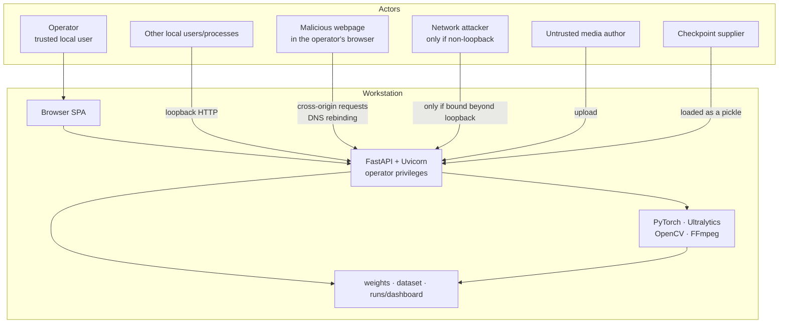
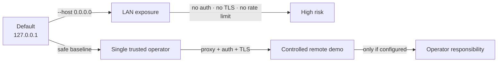

# Security and privacy

This page documents the threat model, the controls that actually exist in the source, and the risks that remain. It is deliberately conservative: a control is listed only when it can be pointed to in code, and a residual risk is listed even when exploiting it requires local access or an unlikely precondition.

> **Scope:** the accepted FastAPI + SPA application. The earlier Streamlit prototype is not assessed. No penetration test, fuzzing campaign, dependency audit or production deployment was performed.

- [Threat model](#threat-model)
- [Assets and trust boundaries](#assets-and-trust-boundaries)
- [Controls implemented](#controls-implemented)
- [Threat analysis](#threat-analysis)
  - [SEC-01 — No authentication or authorization](#sec-01--no-authentication-or-authorization)
  - [SEC-02 — No TLS, CSRF, Origin/Host validation or rate limiting](#sec-02--no-tls-csrf-originhost-validation-or-rate-limiting)
  - [SEC-03 — Checkpoint trust](#sec-03--checkpoint-trust)
  - [SEC-04 — Media decoder attack surface](#sec-04--media-decoder-attack-surface)
  - [SEC-05 — Image extension is not validated server-side](#sec-05--image-extension-is-not-validated-server-side)
  - [SEC-06 — Video extension is validated, container is not](#sec-06--video-extension-is-validated-container-is-not)
  - [SEC-07 — Resource exhaustion and availability](#sec-07--resource-exhaustion-and-availability)
  - [SEC-08 — DOM injection in `system.js`](#sec-08--dom-injection-in-systemjs)
  - [SEC-09 — CSP blocks Swagger UI](#sec-09--csp-blocks-swagger-ui)
  - [SEC-10 — Webcam stream race](#sec-10--webcam-stream-race)
  - [SEC-11 — No request timeout](#sec-11--no-request-timeout)
  - [SEC-12 — Public cache headers on media](#sec-12--public-cache-headers-on-media)
  - [SEC-13 — Retention is startup-only](#sec-13--retention-is-startup-only)
  - [Path traversal and file-name handling](#path-traversal-and-file-name-handling)
  - [Supply chain and dependencies](#supply-chain-and-dependencies)
  - [Logging and information disclosure](#logging-and-information-disclosure)
- [Deployment and exposure](#deployment-and-exposure)
- [Privacy properties](#privacy-properties)
- [Recommendations](#recommendations)
- [Verification and evidence boundary](#verification-and-evidence-boundary)
- [Responsible use](#responsible-use)
- [Related pages](#related-pages)

## Threat model

### What the application is

A single-user local web application that accepts untrusted media, runs a locally supplied machine-learning checkpoint, writes output files, and serves the results over unauthenticated HTTP. It is not a multi-tenant service, not a hardened appliance and not a safety-certified system.



### Threat actors and assumptions

| Actor | Capability | Trust assumption |
|---|---|---|
| Operator | Starts the server, chooses files and checkpoint, can read the filesystem | Trusted |
| Other local users/processes | Can usually reach `127.0.0.1:8000`; may read files if permissions allow | **Not trusted** on a shared machine |
| Malicious webpage | Can make simple cross-origin requests to loopback, attempt DNS rebinding, embed media; cannot read cross-origin responses without CORS | **Not trusted** |
| Network attacker | Full request access if the server is bound to a reachable interface; can read unencrypted traffic | **Not trusted** |
| Media author | Controls bytes processed by OpenCV/FFmpeg | **Not trusted** |
| Checkpoint supplier | Controls a file loaded through PyTorch's deserialiser | **Trusted only after provenance verification** |
| Dependency attacker | Controls a package version resolved by pip | **Not trusted** |

The design assumption is a **single trusted operator on a personal workstation**, with the service bound to loopback. The documentation does not treat that assumption as a security guarantee for a shared lab machine.

### Out of scope

- Kernel, hypervisor, firmware or physical attacks.
- Browser zero-days and malicious extensions.
- A compromised PyTorch/Ultralytics/OpenCV installation.
- Multi-tenant isolation, cloud IAM, secret management and compliance certification.
- Denial of service from an adversary with unlimited local resources.
- Safety certification or autonomous maintenance decisions.

## Assets and trust boundaries

| Asset | Sensitivity | Location | Primary risk |
|---|---|---|---|
| Uploaded image/video | Potentially personal/location-revealing | Browser memory; video copied to disk | Exposure via unauthenticated routes or retained files |
| Annotated media and telemetry | Derived sensitive data | `runs/dashboard/` | Same; also browser/proxy cache |
| Dataset samples | Licensed/private imagery | `dataset/images/test` | Enumeration and download without auth |
| Checkpoint | Valuable model artefact; possible licence restrictions | `weights/best.pt` or env path | Malicious pickle → code execution |
| Local process | Operator's OS privileges | Python/Uvicorn | Decoder or dependency compromise |
| Browser storage | Low sensitivity | `localStorage` | Only `conf`/`iou`; low impact |
| Logs | Paths, client addresses, tracebacks | stdout/stderr or redirected file | Accidental disclosure if shared/committed |

Trust boundaries:

1. **Browser content → HTTP**: filenames, multipart bytes, threshold fields, job IDs.
2. **HTTP → process**: any local caller, not just the SPA; there is no auth or client attestation.
3. **Process → filesystem**: checkpoint, dataset, result/job files.
4. **Process → third-party libraries**: decoders and deserialisers run in-process with operator privileges.
5. **Workstation → network**: only relevant if the bind address is changed or a proxy is added.

## Controls implemented

| Control | Evidence | What it does | Limitation |
|---|---|---|---|
| Loopback default | `run_app.py` default `127.0.0.1` | Keeps the listener off other interfaces unless changed | Any local process/user can still connect |
| No CORS middleware | `api.py` has no CORS setup | Cross-origin JavaScript cannot read API responses by default | Does not prevent cross-origin writes/CSRF or DNS rebinding |
| Security headers | Middleware sets `X-Content-Type-Options: nosniff`, `X-Frame-Options: DENY`, `Referrer-Policy: no-referrer`, CSP | Reduces MIME sniffing, framing and referrer leakage | No TLS/HSTS, no Permissions-Policy, no COOP/CORP |
| Content-Security-Policy | Exact string in `api.py` | Blocks inline/third-party scripts, objects and framing; restricts connections to self | `style-src 'unsafe-inline'`; does not stop server-side issues |
| API cache policy | `Cache-Control: no-store` for `/api/*` via `setdefault` | Limits caching of API responses | Media routes override it with public caching |
| Upload byte caps | 25 MB image; 2 GB video; 1 MiB chunks | Bounds a single request | No quota across requests; no pixel/duration cap |
| Threshold validation | Inclusive range checks; `422` on violation | Prevents nonsensical inference parameters | Client can still choose valid extremes |
| Image decode gate | `cv2.imdecode` must return an image | Rejects undecodable bytes | Does not validate extension or sanitise metadata |
| Video extension allowlist | `.mp4`, `.avi`, `.mov`, `.mkv` | Blocks obvious wrong file types | Container not sniffed; decoder does the real parsing |
| UUID output names | `uuid4().hex` for results/jobs | Prevents client-chosen output paths | URLs are unauthenticated capabilities |
| Basename checks | `Path(name).name == name`; fixed job filenames | Blocks simple path traversal in sample/result/output routes | Not a substitute for a formal path-security audit |
| In-memory job registry | `_jobs` dict | Unknown job IDs return `404`; outputs require a completed job | Registry is lost on restart; no auth on known IDs |
| HTML escaping in main render paths | `escapeHtml` in `ui.js`/`inspect.js`/`palette.js` | Prevents HTML injection from filenames/telemetry in those paths | `system.js` has an unescaped path; CSP is not a complete fix |
| No inline scripts in the SPA | `index.html` loads `/assets/js/app.js`; CSP `script-src 'self'` | Reduces script-injection surface | `innerHTML` sinks still exist |
| Local fonts/assets | `web/assets/fonts`, no CDN | Avoids third-party asset loads for the SPA | External links still open GitHub/docs |
| Generic 500 body | Exception handler returns a fixed detail | Avoids leaking tracebacks to clients | `503` details can include the checkpoint path |
| Server-side logging | `logger.exception` for unhandled/job errors | Aids diagnosis | Logs may contain paths; no redaction |

## Threat analysis

### SEC-01 — No authentication or authorization

**Risk:** High if exposed beyond the workstation; Medium on a shared local machine.

Every route is unauthenticated, including:

- `GET /` and `/assets/*` (SPA),
- `GET /api/status` (checkpoint path, runtime versions, platform),
- `GET /api/samples` and `/api/samples/{name}` (dataset imagery),
- `POST /api/detect/image` and `/api/detect/video` (compute and disk),
- `GET /api/jobs/{id}` and output/telemetry routes,
- `POST /api/model/reload`.

There are no users, roles, sessions, cookies or API keys. A job/result UUID is effectively a bearer capability: anyone who knows it can fetch the output, but the UUID is not an authorization check and may leak through browser history, logs or a shared screen.

**Impact on a shared machine:** another local user or process can enumerate sample filenames, view dataset images, submit inference, fill disk with jobs and trigger model reloads. On macOS/Linux, loopback is not a per-user boundary.

**Mitigation:** keep the default loopback bind and use a dedicated OS account/machine for sensitive imagery. If more than one trusted person must reach it, put an authenticating TLS proxy in front and restrict network access. Do not add a second user to the same loopback service and call it isolation.

### SEC-02 — No TLS, CSRF, Origin/Host validation or rate limiting

**Risk:** High if exposed; Medium for local cross-site actions.

Specific gaps:

| Gap | Consequence |
|---|---|
| No TLS/HSTS | Traffic, including uploaded media, is plaintext; a network observer can read it if bound beyond loopback |
| No CSRF token | A malicious page can submit simple cross-origin requests; `POST /api/model/reload` is the clearest action |
| No `Origin`/`Referer` validation | The server does not distinguish the SPA from another origin |
| No `Host` allowlist / `TrustedHostMiddleware` | DNS rebinding is not specifically mitigated |
| No rate limiting | Repeated uploads, inference or reloads can exhaust compute/disk |
| No `form-action` CSP directive | Form submissions are not constrained by the policy (the rest of the CSP remains) |

Classic CSRF usually targets cookie-authenticated actions. This app has no cookies or accounts, so the impact is **action injection and availability**, not account takeover. A cross-origin form can trigger a model reload; image/video inference requires a file field, which an attacker cannot populate with a local file through a normal form. A malicious page can still cause requests and occupy resources.

DNS rebinding is a theoretical path to same-origin access to loopback services: if a browser resolves an attacker-controlled hostname to `127.0.0.1` and the app accepts any `Host`, the attacker origin may become same-origin with the API. This was **not tested** and should not be presented as a demonstrated exploit. The absence of Host validation is the code-grounded fact.

**Mitigation:** keep loopback; if remote, terminate TLS at an authenticating proxy, enforce Host/Origin allowlists, add CSRF protection, and rate-limit uploads and reloads at the proxy. The app itself does not implement these.

### SEC-03 — Checkpoint trust

**Risk:** High impact; requires the operator to place or point at a malicious checkpoint.

`infrascan/inference.py` calls `YOLO(str(config.WEIGHTS_PATH))`. Ultralytics/PyTorch load `.pt` files through a pickle-based deserialiser. A malicious checkpoint can execute code with the privileges of the Uvicorn process. The dashboard does **not** download checkpoints and does not verify signatures or hashes.

The CLI fallback (`yolo11s.pt` when a path is missing) may resolve/download a pretrained checkpoint through Ultralytics' normal mechanism. That is a separate trust and network path and was not audited.

**Mitigation:** only use checkpoints from a trusted source; verify the SHA-256 against a value you trust; keep the process under a least-privileged OS account; do not load random `.pt` files from the internet. The documented verified hash is:

```text
f3490f953b4ac2aa0205c206c151be8f2da281da99708713b182492a43c7751c
```

A hash match proves file identity, not that the file is safe to execute.

### SEC-04 — Media decoder attack surface

**Risk:** Medium.

Uploaded images are passed to OpenCV's `imdecode`; videos are opened by OpenCV/FFmpeg and decoded frame by frame. Both are complex native parsers. A malformed file can trigger a decoder bug, consume excessive memory or crash the process. The process runs in-process with the operator's privileges; there is no sandbox, seccomp, container or separate worker user.

The byte caps (25 MB/2 GB) limit transfer size, not decoded pixel count, frame count, duration or codec complexity. An image decompression bomb can be small on disk and large in memory; a video can declare extreme dimensions or run for a very long time.

**Mitigation:** only process media you trust; keep OpenCV/FFmpeg updated; run the app under a dedicated account; for untrusted inputs, use an isolated container/VM with resource limits. The project has not fuzzed the decoders or measured their failure modes.

### SEC-05 — Image extension is not validated server-side

**Risk:** Low–Medium.

`POST /api/detect/image` does not inspect `file.filename` or its suffix. It reads bytes up to the cap and calls `cv2.imdecode`. Consequences:

- A valid image named `notes.txt` is accepted.
- A non-image named `road.jpg` returns `400` after decode.
- The browser's `accept` filter and `selectFile()` extension check are client-side only and do not constrain a direct API caller.

This is an input-consistency gap rather than a direct code-execution path. It can bypass user expectations and any future extension-based policy. The annotated output is always JPEG, so the response type is not attacker-controlled.

**Mitigation:** validate an allowlist of extensions and sniff magic bytes/dimensions before decode; cap pixel count; reject mismatches. Not implemented today.

### SEC-06 — Video extension is validated, container is not

**Risk:** Low–Medium.

The video route lower-cases the filename suffix and requires one of `.mp4`, `.avi`, `.mov`, `.mkv`. It then saves the bytes as `input.<suffix>` and starts a worker. There is no `ffprobe`, MIME sniff or magic-byte check before the job is created.

Consequences:

- A renamed non-video file is accepted (`202`), saved, then fails in the worker; the error is returned to the client.
- The extension is not evidence of the actual container/codec.
- The original bytes are retained on disk, including any metadata.

**Mitigation:** probe the container/duration/streams before accepting the job; reject mismatches; delete failed inputs promptly. Not implemented.

### SEC-07 — Resource exhaustion and availability

**Risk:** Medium locally; High if exposed.

| Vector | Behaviour |
|---|---|
| Large image | 25 MB cap, but no pixel/dimension cap; decode can allocate a large array |
| Large video | 2 GB per upload; input + output + telemetry retained |
| Many uploads | No per-user quota or total disk quota; `runs/dashboard` grows until cleanup/manual deletion |
| Many jobs | One daemon thread per accepted job; threads wait on `_worker_lock`; registry entries accumulate |
| Image flood | Threadpool requests wait on `_predict_lock`; no app-level rate limit; latency grows |
| Reload flood | Each reload waits for `_predict_lock`, clears the model and reloads; repeated calls disrupt availability |
| Long video | No cancel endpoint; a job occupies the worker lock until it finishes or the process stops |
| Malformed media | Decoder hang/crash is possible; no per-request timeout |

The model/image and video locks protect model correctness, not fairness. A local attacker can make the UI slow or unavailable without exploiting a memory-safety bug.

**Mitigation:** cap queued jobs, uploads per time window, total bytes and pixel/dimensions; add a request timeout; run cleanup periodically and on demand; bind to loopback. Not implemented.

### SEC-08 — DOM injection in `system.js`

**Risk:** Low today; latent XSS if server data becomes untrusted.

`web/assets/js/system.js` builds the severity-policy table with `innerHTML`:

```js
policyBody.innerHTML = policy
  .map(
    (row) => `<tr>
      <td><span class="sev-chip" data-sev="${String(row.name).toLowerCase()}">${row.name}</span></td>
      <td class="mono">${rangeLabel(row)}</td>
      <td>${row.description || ""}</td>
    </tr>`
  )
  .join("");
```

`row.name` and `row.description` come from `inference.severity_policy()`, which uses fixed constants in `severity.py`. There is no current path for a user or upload to control them. The sink is still unescaped, so a future change that derives descriptions from checkpoint metadata, configuration or user input would create stored DOM XSS on the local origin.

CSP (`script-src 'self'`) blocks inline event handlers and inline `<script>` execution, which reduces but does not eliminate the impact of HTML injection (for example, same-origin script/resource injection). CSP is a mitigation, not an escaping strategy.

**Mitigation:** escape `row.name`/`row.description` with `escapeHtml`, or build cells with `textContent`; keep CSP. The other main render paths (`inspect.js`, `palette.js`, sample tiles, toasts) already escape or use `textContent`.

### SEC-09 — CSP blocks Swagger UI

**Risk:** Low (functionality/compatibility).

The CSP sets `script-src 'self'` and `default-src 'self'`. FastAPI's default `/api/docs` page normally loads Swagger UI assets from a CDN and uses an inline bootstrap script. Under this policy those are expected to be blocked, leaving a blank/unstyled page. This was **not browser-verified** during the documentation run.

The OpenAPI JSON at `/api/openapi.json` is unaffected and remains the reliable machine-readable interface. Do not weaken the global CSP to fix the docs page; if interactive docs are required, serve them from a separate origin or apply a route-specific policy in a local build.

### SEC-10 — Webcam stream race

**Risk:** Low privacy.

In `camera.js`, `openCamera()` awaits `getUserMedia`, then assigns the stream to the module-level `stream`. If the user closes the dialog before the permission promise resolves, `closeCamera()` runs `stopStream()` while `stream` is still `null`; the later resolution assigns the live stream and attaches it to the video element without a subsequent stop. The camera indicator can remain active until the tab closes or permission is revoked.

**Mitigation:** track a cancellation token/`closed` flag, stop tracks immediately after `getUserMedia` resolves if the dialog is no longer open, and stop tracks in a `finally` path. Not implemented today. This is a privacy/UX bug, not a remote exploit.

### SEC-11 — No request timeout

**Risk:** Low.

`web/assets/js/api.js` wraps `fetch` but does not pass an `AbortController` signal or timeout. If the server accepts a connection and never responds (hung decoder, blocked lock, stalled upload), the UI's busy state can persist until the browser/network gives up. Status polling has a guard against overlapping requests but no abort either.

**Mitigation:** add a timeout and abort signal for status/image/video requests; distinguish upload time from processing time; surface a retry. Not implemented.

### SEC-12 — Public cache headers on media

**Risk:** Low on a shared machine.

The middleware applies `Cache-Control: no-store` to `/api/*` with `setdefault`, but the result and sample routes set their own header:

```python
headers={"Cache-Control": "public, max-age=3600"}
```

Because `setdefault` does not overwrite an existing value, annotated results and dataset samples are cacheable for one hour. Job video and telemetry explicitly use `no-store`. Consequences:

- A browser or intermediary proxy may retain a result/sample after server-side cleanup.
- A shared browser profile can expose cached images to another user.
- The URL is still required, but browser history/cache may retain it.

**Mitigation:** use `private, no-store` for result/sample media when handling sensitive imagery; avoid shared browser profiles. This is a deliberate performance/convenience trade-off in the current code, not an oversight to "fix" without considering repeated sample loads.

### SEC-13 — Retention is startup-only

**Risk:** Low privacy/disk.

`purge_old_artifacts()` and `cleanup_old_jobs()` run only during lifespan startup. While the process runs, results and job directories can persist indefinitely, even beyond the documented 24-hour TTL. Restarting triggers expiry. There is no UI delete, periodic sweep or secure erase.

**Mitigation:** stop and restart the server to apply TTL cleanup; delete `runs/dashboard/results` and `runs/dashboard/jobs` manually when appropriate; use full-disk encryption for sensitive media; do not treat deletion as secure erasure. See [Data flow](../04-architecture/data-flow.md#retention-and-deletion).

### Path traversal and file-name handling

The current routes have sensible basename checks:

- Samples: `Path(name).name != name` and an extension allowlist.
- Results: basename check plus a `.jpg` suffix.
- Job outputs: the job ID must exist in memory, then fixed filenames are joined.
- Video input: only the validated suffix is used, never the client basename.
- Results/jobs are named with server-generated UUIDs.

This blocks the obvious `../` and absolute-path cases for these routes. It is **not** a formal path-security audit, and platform-specific path semantics (Windows separators, URL decoding, symlinks) were not fuzzed. Dataset symlinks are followed by the filesystem. Do not add a new route that joins a user-supplied name without repeating the same checks.

### Supply chain and dependencies

`requirements.txt` uses lower bounds only, with no lockfile or hashes. Installing later can pull newer packages; a compromised or incompatible release becomes part of the trusted process. The ML stack is large and includes native libraries. The checkpoint is also an executable-format artefact (SEC-03).

**Mitigation:** pin exact versions and hashes for a reproducible demo; use a private index or `pip-compile`; review upgrades; run under a least-privileged account. The verified versions are recorded in [`PROJECT_FACTS.md`](../PROJECT_FACTS.md), but no audit was performed.

### Logging and information disclosure

- Uvicorn access logs include request paths and client addresses.
- `logger.exception` writes tracebacks with absolute paths to the terminal.
- `/api/status` exposes the checkpoint path, file size, platform, Python/package versions and device.
- `503` details can include the resolved checkpoint path and loader exception text.
- Job errors return `str(exc)`, which may include filesystem paths or decoder details.
- The generic `500` body does not expose the traceback; the traceback stays server-side.

These are low-impact on a trusted local machine and more significant if the service is exposed or logs are shared. Redact paths and client data before attaching logs to a report.

## Deployment and exposure

| Deployment | Exposure | Risk summary |
|---|---|---|
| `127.0.0.1`, single-user workstation | Local processes/users only | Baseline; no auth, but network attack surface is loopback |
| `127.0.0.1`, shared multi-user machine | All local users | Other users can reach the API and possibly read files; not isolated |
| `0.0.0.0` on a trusted LAN | Anyone on the LAN | **Not supported**; no auth/TLS; High |
| Public internet / port-forward | Anyone | **Do not do this**; no auth/TLS/rate limits; High |
| Behind an authenticating TLS proxy | Restricted users | Operator-added; needs Host/Origin/CSRF/rate-limit/size handling |
| Container/VM with restricted network | Isolated | Can reduce decoder/process impact, but no image is shipped |



The project has no TLS terminator, auth proxy, firewall rule or container hardening. Those are operator responsibilities, and the documentation does not claim they were tested.

## Privacy properties

### What the application collects

- Only the media the operator selects and the thresholds they choose.
- No accounts, names, email addresses, analytics events or advertising identifiers.
- No remote inference call in the application code.
- `localStorage` contains only `{"conf": number, "iou": number}` under `infrascan.settings.v2`.

### Where data goes

| Stage | Data | Destination |
|---|---|---|
| Upload | Image/video bytes | Local FastAPI process |
| Image inference | Decoded pixels | Local model; annotated JPEG written to disk |
| Video inference | Frames | Local model; annotated MP4 and telemetry written to disk |
| Results | Media/JSON | Served over loopback to the browser |
| Browser preview | Object URLs | Browser memory |
| External links | GitHub/docs | Only when the user clicks them |

The application code does not upload media to a cloud service. Third-party libraries were not audited for their own network behaviour (for example, package update checks or pretrained-weight resolution in CLI fallbacks). Do not claim "zero network egress" as an absolute property of every dependency.

### Metadata and derived data

- The original **image** is not saved by the dashboard; only the annotated JPEG is persisted. Re-encoding from decoded pixels makes ordinary EXIF unlikely to survive, but this was not tested across formats.
- The original **video** is copied byte-for-byte to `jobs/<id>/input.<ext>`, so container metadata (including location metadata, if present) remains. The annotated MP4 is written by OpenCV without audio; its metadata handling is not audited.
- Video telemetry contains frame numbers, boxes, confidence, severity and coverage — no GPS, timestamp or filename.
- Image CSV is generated in the browser and includes the selected filename.
- Faces, number plates and locations may be visible in media; there is no blurring or redaction feature.

### Retention and access

- Results/jobs are plain files under `runs/dashboard/`, protected by OS permissions only.
- The 24-hour TTL is enforced at startup, not continuously.
- There is no UI deletion, secure erase or encryption at rest.
- Browser cache may retain result/sample images for up to an hour (SEC-12).
- Logs and backups are operator-controlled and may outlive the application data.
- Any local process that can reach the port can read results/samples; see SEC-01.

### Sensitive-media guidance

If the imagery is personal, proprietary or location-sensitive:

1. Use a dedicated OS account/machine with full-disk encryption.
2. Keep the default loopback bind; do not expose the port.
3. Process only the minimum clips needed; delete `runs/dashboard` afterwards.
4. Do not share logs, screenshots or browser profiles without checking for paths/imagery.
5. Strip metadata from source video externally if that matters; the app retains the original upload.
6. Treat dataset and checkpoint licences separately; neither is redistributed by the repository.
7. Do not claim GDPR/DPDP/other compliance; no compliance programme exists.

## Recommendations

Priorities assume the current local-only use. Anything that exposes the service changes the first row from "recommended" to "required".

| Priority | Recommendation | Addresses |
|---|---|---|
| **P0** | Keep `127.0.0.1`; if remote access is required, add an authenticating TLS proxy, Host/Origin allowlists, CSRF protection, rate limits and upload-size limits at the proxy | SEC-01, SEC-02 |
| **P0** | Treat checkpoints as executable code; verify provenance/hash; never load untrusted `.pt` files | SEC-03 |
| **P1** | Escape `row.description`/`row.name` in `system.js` or build cells with `textContent` | SEC-08 |
| **P1** | Add image extension/magic-byte and pixel-dimension checks; probe video containers/duration before creating a job | SEC-05, SEC-06 |
| **P1** | Add `AbortController` timeouts to `api.js` and a bounded job queue/disk quota with periodic cleanup | SEC-07, SEC-11, SEC-13 |
| **P1** | Fix the webcam cancellation race so a late stream is stopped | SEC-10 |
| **P1** | Add `Permissions-Policy`, `form-action`, COOP/CORP and consider `private, no-store` for sensitive media | SEC-02, SEC-12 |
| **P1** | Pin dependency versions/hashes and review upgrades | Supply chain |
| **P2** | Add redaction for paths/filenames in logs and error details | Logging |
| **P2** | Fuzz image/video decoders and test malformed media in an isolated process | SEC-04 |
| **P2** | Add auth/roles only if the product scope changes to multi-user; do not bolt on a false sense of isolation | SEC-01 |
| **P2** | Fix the accessibility findings (contrast, labels, focus, mobile status) | See [Accessibility](accessibility.md) |

What **not** to do:

- Do not add `script-src 'unsafe-inline'` globally to make Swagger work.
- Do not bind `0.0.0.0` to "make the demo easier" on a shared network.
- Do not add permissive CORS (`*`) as a workaround for a separate frontend server.
- Do not treat a UUID URL as authentication.
- Do not describe the app as secure, hardened or production-ready after applying only one item.

## Verification and evidence boundary

| Claim | Evidence | Status |
|---|---|---|
| Default bind is loopback | `run_app.py` default | Source-verified |
| Security headers/CSP are set | `api.py` middleware | Source-verified; header presence not independently captured |
| `/api/health` returns ok while model unavailable | Recorded functional check | Verified |
| Missing checkpoint returns actionable 503 and dashboard still serves | Recorded functional check | Verified |
| Image decode failure returns 400 | Recorded functional check | Verified |
| Upload limits/extensions | `config.py` + route code | Source-verified |
| Path basename checks | Route code | Source-verified; not fuzzed |
| No auth/CSRF/rate limiting/Host validation | Route/middleware inspection | Source-verified |
| Checkpoint pickle trust | Ultralytics/PyTorch load path | Source/known behaviour; not exploited |
| Swagger CSP incompatibility | CSP + FastAPI defaults | Expected; not browser-verified |
| Webcam race | `camera.js` control flow | Source-verified; not reproduced |
| `system.js` unescaped `innerHTML` | `system.js` | Source-verified; no current user-controlled input |
| Contrast failure | WCAG calculation on declared CSS | Calculated; no rendered audit |
| CUDA, exports, physical webcam | — | **BLOCKED / NOT RUN** |
| Penetration test, fuzzing, dependency audit | — | **NOT PERFORMED** |

The absence of a finding is not proof of security. The application has not been externally reviewed.

## Responsible use

- This is an academic project, not a certified inspection or safety system.
- Do not use severity output as the sole basis for maintenance, road closure or legal decisions.
- Do not process imagery you are not authorised to handle.
- Do not redistribute the checkpoint or dataset without confirming permissions.
- If you discover a vulnerability, report it privately to the project maintainer rather than publishing exploit details against a deployed instance. No formal security contact or bounty programme is documented.
- If the app is ever exposed beyond loopback, treat the missing controls in this page as release blockers, not enhancements.

## Related pages

- [System architecture](../04-architecture/system-architecture.md) — trust boundaries and component responsibilities.
- [Backend and API](../04-architecture/backend-and-api.md) — routes, headers, validation and error shapes.
- [Frontend architecture](../04-architecture/frontend-architecture.md) — DOM escaping, CSP and browser state.
- [Data flow](../04-architecture/data-flow.md) — data at rest, telemetry and retention.
- [Deployment and operations](../04-architecture/deployment-and-operations.md) — exposure, logs, backup and non-goals.
- [Performance](performance.md) — measured and unmeasured performance.
- [Accessibility](accessibility.md) — WCAG review and prioritized fixes.
- [Limitations](../03-project-documentation/limitations.md) — project-level scope limits.
