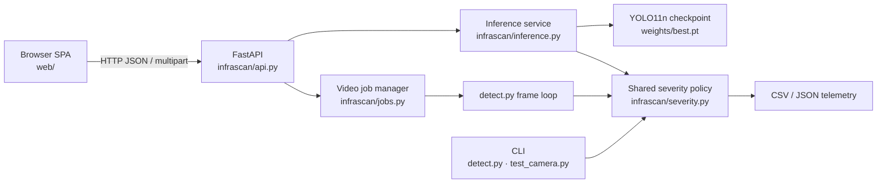

# Verified project facts

This file is the single source of truth for the documentation repository. It records only facts that can be checked against the current source tree, the running application, the local checkpoint metadata, the dataset present on the development machine, or the Git history.

**Snapshot date:** 22 October 2026
**Main repository:** <https://github.com/Aayush9808/InfraScan>
**Documentation repository:** <https://github.com/Aayush9808/InfraScan-Documentation>
**Main branch tip:** `89143ad` (`docs: clarify CLI checkpoint fallback and link documentation`)
**Documentation branch tip:** `34558c0` (`docs: QA pass — fix broken anchors, launcher caveat, and metric precision`)
**Source of truth:** local checkout at `~/Desktop/College final year/InfraScan`

If a statement is not supported below, treat it as unverified and mark it as such rather than filling the gap with an assumption.

---

## 1. Project identity

| Field | Verified value |
|---|---|
| Project name | InfraScan |
| Expanded title used in academic material | InfraScan — AI-Powered Road Inspection and Pothole Detection System |
| Institution | G. L. Bajaj Institute of Technology & Management (GLBITM) |
| Department | Computer Science & Engineering — Artificial Intelligence |
| Academic session | 2026–2027 |
| Batch | 2023 |
| Project type | Final-Year Project |
| Group ID | **Not available** — keep as `[TO BE CONFIRMED]` |
| Supervisor | **Not available** — keep as `[TO BE CONFIRMED]` |

### Team and team-declared roles

| Name | Roll number | Team-declared responsibility |
|---|---|---|
| Aayush Kumar Shrivastav | 2301921540002 | Team leader, core YOLO model, system architecture and integration |
| Kajal Rawal (“Lucky”) | 2301921520087 | Dataset testing, validation and documentation support |
| Khushi Shakya | 2301921520091 | Frontend development and dashboard |
| Ronak Saini | 2301921520158 | Dataset collection, preparation and documentation |

Role allocation is supplied by the team. It is **not** the same thing as independent authorship evidence. See [`CONTRIBUTIONS.md`](CONTRIBUTIONS.md).

---

## 2. What is implemented

InfraScan is a local-first pothole inspection workspace with two interfaces over one detection pipeline:

1. **FastAPI backend + browser dashboard** — the main application.
2. **Command-line tools** — image/video/camera inference, training, evaluation and export.

The backend serves a zero-build SPA built from vanilla ES modules, HTML and handcrafted CSS. There is no Node.js, npm, bundler or separate frontend server.

### Runtime architecture



### Verified source files

| Path | Role |
|---|---|
| `app.py` | ASGI entrypoint; exports `app` from `infrascan.api` |
| `run_app.py` | Launcher with `--host`, `--port`, `--weights`, `--no-browser`, `--reload` |

> **Launcher caveat verified on 22 October 2026:** `run_app.py` imports `infrascan.config` before `main()` parses arguments. `config.WEIGHTS_PATH` is therefore already resolved, and `--weights` does not change the running app's checkpoint path. Use `INFRASCAN_WEIGHTS=/path/to/best.pt python run_app.py` before launch. This is a known code/launcher limitation; do not document `--weights` as reliably selecting the checkpoint.
| `infrascan/api.py` | FastAPI routes, validation, static serving, security headers |
| `infrascan/config.py` | Paths, upload limits, thresholds, TTLs, allowed extensions |
| `infrascan/inference.py` | Model lifecycle, device selection, image prediction, annotation, runtime metadata |
| `infrascan/jobs.py` | Background video jobs, progress, serialised inference, cleanup |
| `infrascan/severity.py` | Shared CRITICAL / MODERATE / MINOR policy |
| `detect.py` | CLI image/video/camera inference and telemetry |
| `test_camera.py` | OpenCV live camera HUD |
| `train.py` | Ultralytics training wrapper |
| `evaluate.py` | Test/validation/train split evaluation |
| `export.py` | Ultralytics export wrapper |
| `scripts/prepare_dataset.py` | Mask/contour to YOLO label conversion |
| `scripts/ingest_voc_dataset.py` | VOC XML archive ingestion |
| `scripts/visualize_annotations.py` | Ground-truth annotation preview |
| `data.yaml` | One-class dataset configuration |
| `web/index.html` | Dashboard markup and inline SVG icon sprite |
| `web/assets/js/*.js` | SPA modules |
| `web/assets/css/app.css` | Design system and responsive layout |
| `web/assets/fonts/` | Locally bundled Inter and Space Grotesk (OFL) |

### Implemented user-facing capabilities

- Image upload, dataset-sample selection, and browser webcam capture.
- Confidence and NMS-IoU controls (conf 0.05–1.0, IoU 0.10–1.0).
- Annotated/original image comparison, result table, CSV download, lightbox.
- Video upload, background job progress, annotated MP4 playback, telemetry downloads.
- System page with checkpoint/runtime metadata, severity policy, API/CLI reference, and checkpoint reload.
- Command palette (`⌘K` / `Ctrl+K`).
- Explicit offline, invalid-input, missing-checkpoint and processing-error states.
- Responsive navigation and layouts.

### Not implemented

- User accounts, authentication, multi-user isolation or cloud storage.
- GPS/geolocation, GIS export or map integration.
- Cross-frame object tracking or pothole deduplication.
- Depth, volume, ride-quality or structural measurement.
- Crack/rut/other-defect classes.
- Automatic maintenance decisions.
- A production deployment, TLS termination or public-internet hardening.
- An automated Python test suite (no `tests/` directory or pytest suite exists).

---

## 3. Checkpoint facts

The local checkpoint `weights/best.pt` is excluded from Git but was inspected directly.

| Field | Verified value |
|---|---|
| Architecture | Ultralytics YOLO11n |
| Detection task | `detect` |
| Class | `pothole` (class 0) |
| Input size | 640 px |
| Fused model | 101 layers, 2,582,347 parameters, 6.4 GFLOPs |
| File size | 5,467,546 bytes (5.2 MB) |
| SHA-256 | `f3490f953b4ac2aa0205c206c151be8f2da281da99708713b182492a43c7751c` |
| Checkpoint metadata date | 2026-09-26 |
| Metadata Ultralytics version | 8.4.108 |
| Metadata license field | AGPL-3.0 |
| Training epochs recorded | 15 |
| Batch size recorded | 16 |
| Image size recorded | 640 |
| Optimizer recorded | `auto` |
| Initial LR recorded | 0.003 |
| LR schedule recorded | `cos_lr=True`, `lrf=0.01` |
| Device recorded | `0` (CUDA) |
| Seed recorded | 0 |
| `close_mosaic` recorded | 3 |
| Training data path in metadata | `C:\Users\Bisman Singh\...\data.yaml` |

The checkpoint is **not** redistributed by either repository. Its provenance and redistribution permission are unresolved. The metadata path is evidence of the training environment, not proof that the dataset may be redistributed.

---

## 4. Dataset facts

The local development dataset is present under `dataset/` and is excluded from Git.

| Split | Images | Pothole instances | Background images (empty labels) |
|---|---:|---:|---:|
| Train | 3,281 | 5,353 | 18 |
| Validation | 720 | 993 | 2 |
| Test | 718 | 994 | 2 |
| **Total** | **4,719** | **7,340** | **22** |

Verified structure:

```text
dataset/
├── images/{train,val,test}/
└── labels/{train,val,test}/
```

- `data.yaml` defines one class: `pothole`.
- YOLO labels use `<class_id> <x_center> <y_center> <width> <height>`, normalized to `[0, 1]`.
- A sample test label contains class `0` and normalized coordinates.
- Test image filenames in the local copy use the prefix `pothole_dataset_1_...`.
- Image counts, label-file counts and background counts were checked directly and via the evaluation log.

### Provenance boundary

The inherited project material describes a multi-source pothole dataset and the repository includes a VOC ingestion script. The current documentation can verify:

- the local file structure and counts;
- the one-class label format;
- the presence of preparation/ingestion utilities;
- the training-data path embedded in checkpoint metadata.

It **cannot** verify:

- the original creators and stable source URLs for every image;
- dataset licences and redistribution permissions;
- whether every local image came from the named upstream sources;
- the exact split-generation history.

These remain `[TO BE CONFIRMED]`. Do not cite the dataset as freely reusable.

---

## 5. Verified evaluation

A fresh evaluation was run on the full 718-image test split with the local YOLO11n checkpoint.

| Metric | Value |
|---|---:|
| Precision (P) | 0.7959 (79.59%) |
| Recall (R) | 0.5996 (59.96%) |
| mAP@0.50 | 0.7111 (71.11%) |
| mAP@0.50–0.95 | 0.3938 (39.38%) |
| Test images | 718 |
| Test instances | 994 |
| Background images | 2 |
| Preprocess | 0.17 ms/image |
| Inference | 3.82 ms/image |
| Postprocess | 10.75 ms/image |

**Command used:**

```bash
python evaluate.py \
  --weights weights/best.pt \
  --data <test-data.yaml> \
  --split test \
  --imgsz 640 \
  --batch 16 \
  --device mps
```

The evaluation data was read from a temporary copy to avoid iCloud-evicted dataset files. The normal repository command is the same once `data.yaml` points at an available dataset.

**Environment:**

| Component | Version |
|---|---|
| Machine | Apple M2 (arm64) |
| OS | macOS 27.0.1 (Darwin 27.0.1) |
| Python | 3.12.14 |
| PyTorch | 2.14.1 |
| Torchvision | 0.29.1 |
| Ultralytics | 8.4.183 |
| OpenCV | 5.0.0.93 |
| NumPy | 2.5.4 |
| pandas | 3.0.6 |
| Pillow | 13.0.0 |
| FastAPI | 0.156.8 |
| Uvicorn | 0.54.0 |
| python-multipart | 0.0.32 |
| Device used for evaluation | `mps` (Apple GPU) |
| Batch / image size | 16 / 640 |

The checkpoint metadata records training on a CUDA device. The reported metrics are an Apple MPS evaluation, not an NVIDIA benchmark.

---

## 6. Verified functional checks

These checks were executed against the accepted implementation. They are the evidence boundary for the testing chapter.

| Check | Status | Observed result |
|---|---|---|
| Python compilation | PASS | `compileall` completed for application and package files |
| FastAPI import | PASS | `app` imported and titled `InfraScan API` |
| Dashboard root | PASS | HTTP 200; SPA served |
| `/api/health` | PASS | `{"status":"ok","model_state":"ready"}` |
| Image inference | PASS | 1 MODERATE detection, 7.0% coverage, annotated JPEG written |
| Image latency (warm) | PASS | 66.2 ms in the recorded API response |
| Invalid image | PASS | HTTP 400 with actionable decode message |
| Missing checkpoint | PASS | Model state `unavailable`; dashboard still served; instructions returned |
| Video job | PASS | 24 frames processed, 28 frame-level detections |
| Video playback | PASS | H.264 output; Chrome `readyState 4` |
| CLI image + telemetry | PASS | Annotated JPEG plus CSV and JSON telemetry written |
| Responsive layout | PASS | 390, 820, 1024 and 1440 px checked; no page-level horizontal overflow |
| Webcam capture | PASS with synthetic device | Chrome synthetic media device; physical camera not independently tested |
| Live physical camera | BLOCKED | Requires local camera permission/hardware |
| CUDA execution | BLOCKED | Test machine is Apple M2; MPS path used |
| Export formats | NOT RUN | Ultralytics export paths documented but not exercised |
| Automated test suite | NOT RUN | No suite exists in the repository |

Additional observations:

- `test_camera.py` was refactored to import the shared severity policy; compile, import and `--help` checks passed.
- The main dashboard never substitutes a different checkpoint when the configured checkpoint is missing.
- The CLI scripts retain historical Ultralytics fallbacks (`yolo11s.pt`) when `--weights` is absent. This is documented in the corrected main README and must not be confused with dashboard behaviour.

---

## 7. API surface

| Method | Endpoint | Notes |
|---|---|---|
| GET | `/api/health` | Liveness + model state |
| GET | `/api/status` | App, model, runtime, severity, media limits, thresholds, samples |
| GET | `/api/samples` | Up to 24 test images from `dataset/images/test` |
| GET | `/api/samples/{name}` | Individual sample image |
| GET | `/api/results/{filename}` | Saved annotated JPEG (not in OpenAPI schema) |
| POST | `/api/detect/image` | Multipart `file`, `conf`, `iou` |
| POST | `/api/detect/video` | Multipart upload; returns 202 and job JSON |
| GET | `/api/jobs/{id}` | Job status/progress/result |
| GET | `/api/jobs/{id}/video` | Annotated MP4 when complete |
| GET | `/api/jobs/{id}/telemetry.csv` | Frame-level telemetry when present |
| GET | `/api/jobs/{id}/telemetry.json` | Frame-level telemetry when present |
| POST | `/api/model/reload` | Reload configured checkpoint |
| GET | `/api/docs` | Swagger UI |
| GET | `/api/openapi.json` | OpenAPI schema |

API defaults and limits:

- Confidence: min 0.05, max 1.0, default 0.25.
- NMS IoU: min 0.10, max 1.0, default 0.45.
- Image upload: 25 MB; JPG, JPEG, PNG, WebP, BMP.
- Video upload: 2 GB; MP4, AVI, MOV, MKV.
- Result/job TTL: 24 hours, cleaned at startup.
- No authentication.
- Default bind: `127.0.0.1:8000`.

Security headers set by middleware:

- `X-Content-Type-Options: nosniff`
- `X-Frame-Options: DENY`
- `Referrer-Policy: no-referrer`
- restrictive `Content-Security-Policy`
- `Cache-Control: no-store` on API paths

---

## 8. Severity policy

Severity is a geometric heuristic based on the detection box's area as a percentage of the full frame.

| Band | Frame coverage |
|---|---:|
| CRITICAL | ≥ 8.0% |
| MODERATE | ≥ 2.5% and < 8.0% |
| MINOR | < 2.5% |

Formula:

```text
coverage_pct = ((x2 - x1) × (y2 - y1)) / (frame_width × frame_height) × 100
```

The same `classify_severity()` function is imported by `detect.py`, `test_camera.py` and the dashboard inference service. The policy does not measure depth, volume, structural damage or ride quality.

---

## 9. Academic templates

The workspace contains the official-looking GLBITM templates, but they are **not committed** to the documentation repository.

| Template | Dimensions | Structure |
|---|---|---|
| `GLBITM PPT Format.pptx` | 13.33 × 7.50 in (16:9), 14 slides | Title, introduction, objectives, hardware/software, existing system, literature survey, motivation/problem, project diagram, modules ×2, screenshots, conclusion/scope, references, thank you |
| `GLBITM POSTER Format.pptx` | 10.50 × 14.00 in portrait, 1 slide | Group ID, abstract, introduction, objectives/motivation, methodology, workflow diagram, experimentation/results, conclusion, references, team/supervisor/session |

Theme fonts are Calibri Light / Calibri. The source must remain unmodified; content guidance maps the project onto the template rather than replacing its institutional identity.

---

## 10. Verified repository history

Main repository (`InfraScan`):

```text
89143ad docs: clarify CLI checkpoint fallback and link documentation
4ddcff8 docs: rebuild README with verified results
d67ea1c feat(api): serve dashboard with FastAPI backend
b0d0649 feat(ui): add local dashboard frontend
24bd606 chore: verify contributor attribution
9242ff3 Prepare InfraScan release
```

Documentation repository (`InfraScan-Documentation`):

```text
34558c0 docs: QA pass — fix broken anchors, launcher caveat, and metric precision
df3ff50 docs: rebuild personalized team preparation guides
77b1b8f docs: rebuild setup and execution chapter
38d4f6c docs: rebuild dataset and model chapter
f11e49a docs: rebuild architecture chapter with system, API, frontend and operations pages
2b66f7d docs: add full project report and rebuild project documentation chapter
6a18b76 docs: rebuild references, citation, licensing, and governance chapter
d0467c6 docs: rebuild testing chapter with strategy, results, evidence, and test log
0e60121 docs: add security, performance, and accessibility review
56c993d docs: link citation licence to the code repository
2b8eb4b docs: add section indexes to homepage navigation
d4e9406 docs: record launcher checkpoint-path caveat
fee98b1 docs: clarify checkpoint augmentation evidence
963e538 docs: add file-by-file code walkthrough
a1c92b9 docs: add project-wide viva question bank
26387cb docs: add GLBITM poster copy and print layout guide
46e69b6 docs: rebuild GLBITM slide content, speaker notes, and demo guide
651dbd4 docs: rebuild documentation homepage and governance notes
b2ee8a0 docs: add verified project facts and contribution evidence
c5414ae Add InfraScan academic documentation
```

Both repositories are clean and in sync with their `origin/main` remotes. The 20 documentation commits are listed newest-first; every one of them is a content change, and none rewrites prior history.

All current commits in both repositories were authored by `Aayush Kumar Shrivastav <ashrivastav2209@gmail.com>` or the GitHub identity `Aayush9808 <ashrivastav2209@gmail.com>`. This does not prove that no other person contributed outside Git; it only records what the commit metadata shows.

---

## 11. Known unknowns and unsafe claims

Never state the following without new evidence:

- A specific group ID or supervisor name.
- Fresh accuracy numbers other than the verified 718-image run.
- CUDA latency, FPS or memory figures.
- Export success for ONNX/TensorRT/OpenVINO/CoreML/TFLite.
- Dataset licence, creator list, source URL or redistribution permission.
- Checkpoint redistribution permission.
- Physical webcam behaviour on the examiner's machine.
- Individual authorship by a teammate when the only evidence is the team-declared role.
- Production readiness, safety certification, autonomous maintenance decisions, GPS/GIS capability, pothole depth, or cross-frame tracking.
- Any claim that the system was trained or evaluated on a different dataset/count than the verified values above.

When evidence is missing, write `[TO BE CONFIRMED]` or `BLOCKED`, and explain what evidence would close the gap.
