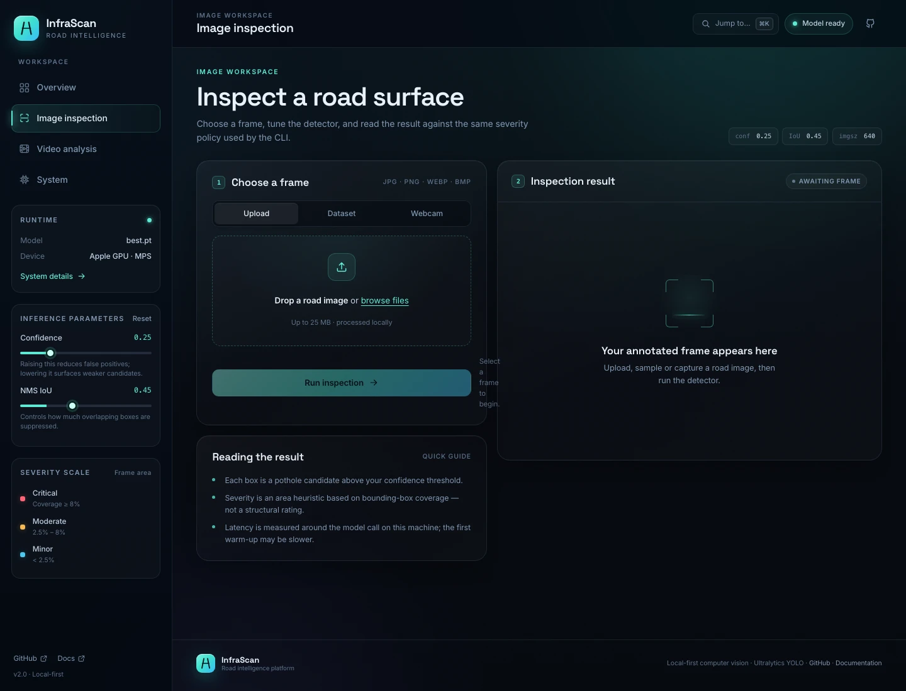
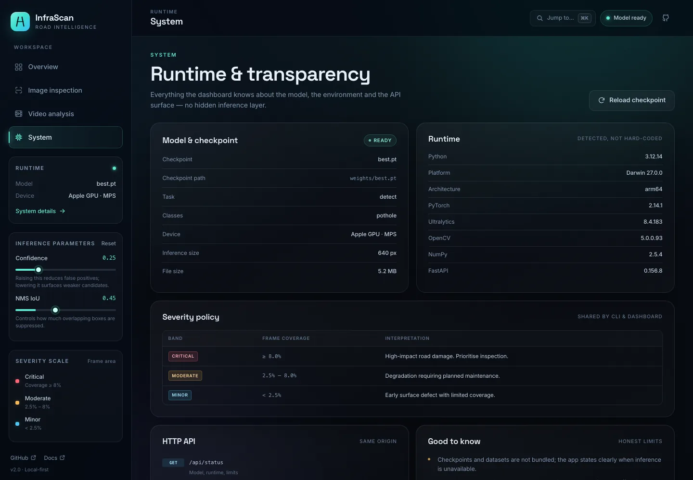

<div align="center">


# InfraScan Documentation

**A verified academic, technical and viva companion for the InfraScan road-inspection project.**

[](https://github.com/Aayush9808/InfraScan)
[](PROJECT_FACTS.md)
[](09-testing-and-results/verified-results.md)
[](https://github.com/Aayush9808/InfraScan/blob/main/LICENSE)
[](PROJECT_FACTS.md)

[Main repository](https://github.com/Aayush9808/InfraScan) · [Verified facts](PROJECT_FACTS.md) · [Project report](03-project-documentation/project-report.md) · [Viva preparation](08-viva-preparation/README.md) · [Team guides](07-team-preparation/README.md)

</div>

---

## What this repository is

This is the documentation and academic-presentation repository for **InfraScan — AI-Powered Road Inspection and Pothole Detection System**, a final-year project at G. L. Bajaj Institute of Technology & Management's Department of Computer Science & Engineering — Artificial Intelligence.

The application itself lives in the [main InfraScan repository](https://github.com/Aayush9808/InfraScan). This repository explains what was built, how it works, how it was tested, what the results mean, how to present it, and how to defend it in a viva.

> **Documentation rule:** every implementation claim is tied to the source tree or a recorded test. Unknown academic fields stay marked `[TO BE CONFIRMED]`; blocked or unexecuted tests are labelled `BLOCKED` or `NOT RUN`, never “passed.”

---

## Verified project snapshot

| Item | Verified value |
|---|---|
| Application | Local-first pothole inspection dashboard + CLI |
| Architecture | FastAPI backend, vanilla ES-module SPA, shared Python inference pipeline |
| Model | Ultralytics **YOLO11n**, 2.58M parameters, 6.4 GFLOPs, 5.2 MB |
| Task | Single-class pothole detection (`pothole`) |
| Inputs | JPG/PNG/WebP/BMP, MP4/AVI/MOV/MKV, browser webcam frame |
| Outputs | Annotated JPEG/MP4, boxes, confidence, severity, coverage, CSV/JSON telemetry |
| Test split | **718 images**, **994 instances**, 2 background images |
| Precision / Recall | **0.7959 / 0.5996** |
| mAP@0.50 / mAP@0.50–0.95 | **0.7111 / 0.3938** |
| Evaluation hardware | Apple M2, MPS, batch 16, 640 px |
| Checkpoint SHA-256 | `f3490f953b4ac2aa0205c206c151be8f2da281da99708713b182492a43c7751c` |
| Dataset counts | 4,719 images / 7,340 boxes / 22 background images |
| Dashboard | ✅ image, video, webcam frame, system, command palette, responsive layouts |
| Known blocked checks | Physical webcam, CUDA, TensorRT/ONNX/other exports |

The full evidence boundary is in [`PROJECT_FACTS.md`](PROJECT_FACTS.md); the test narrative is in [`09-testing-and-results/verified-results.md`](09-testing-and-results/verified-results.md).

---

## Choose your path

| If you are… | Start here |
|---|---|
| **Faculty / examiner** | [Project report](03-project-documentation/project-report.md) → [Architecture](04-architecture/system-architecture.md) → [Verified results](09-testing-and-results/verified-results.md) → [Limitations](03-project-documentation/limitations.md) |
| **Presenting the project** | [PPT guide](01-presentation/README.md) → [Slide content](01-presentation/slide-by-slide-content.md) → [Speaker notes](01-presentation/speaker-notes.md) → [Poster](02-poster/README.md) |
| **Defending the viva** | [Viva bank](08-viva-preparation/README.md) → your [team guide](07-team-preparation/README.md) → [Code walkthrough](03-project-documentation/code-walkthrough.md) |
| **Running the system** | [Installation](06-setup-and-execution/installation.md) → [Configuration](06-setup-and-execution/configuration.md) → [Usage](06-setup-and-execution/application-usage.md) → [Troubleshooting](06-setup-and-execution/troubleshooting.md) |
| **Reviewing the code** | [Code walkthrough](03-project-documentation/code-walkthrough.md) → [Backend/API](04-architecture/backend-and-api.md) → [Frontend architecture](04-architecture/frontend-architecture.md) |
| **Checking claims** | [Verified facts](PROJECT_FACTS.md) → [Contribution evidence](CONTRIBUTIONS.md) → [Evidence index](09-testing-and-results/evidence-index.md) |

---

## Documentation map

### 01 — Presentation
- [Presentation guide](01-presentation/README.md)
- [GLBITM template audit](01-presentation/template-audit.md)
- [Slide-by-slide content](01-presentation/slide-by-slide-content.md)
- [Speaker notes](01-presentation/speaker-notes.md)
- [Demo script](01-presentation/demo-script.md)
- [Literature survey](01-presentation/literature-survey.md)

### 02 — Poster
- [Poster guide](02-poster/README.md)
- [GLBITM poster template audit](02-poster/template-audit.md)
- [Poster copy](02-poster/poster-content.md)
- [Layout and print guide](02-poster/poster-layout-guide.md)

### 03 — Project documentation
- [Project documentation index](03-project-documentation/README.md)
- [Project report](03-project-documentation/project-report.md)
- [Project overview](03-project-documentation/project-overview.md)
- [Problem statement and objectives](03-project-documentation/problem-statement-and-objectives.md)
- [Implementation details](03-project-documentation/implementation-details.md)
- [Code walkthrough](03-project-documentation/code-walkthrough.md)
- [Limitations](03-project-documentation/limitations.md)
- [Technical glossary](03-project-documentation/technical-glossary.md)

### 04 — Architecture
- [Architecture index](04-architecture/README.md)
- [System architecture](04-architecture/system-architecture.md)
- [Backend and API](04-architecture/backend-and-api.md)
- [Frontend architecture](04-architecture/frontend-architecture.md)
- [Inference workflow](04-architecture/inference-workflow.md)
- [Component interactions](04-architecture/component-interactions.md)
- [Data flow](04-architecture/data-flow.md)
- [Deployment and operations](04-architecture/deployment-and-operations.md)

### 05 — Dataset and model
- [Dataset and model index](05-dataset-and-model/README.md)
- [Dataset provenance](05-dataset-and-model/dataset-provenance.md)
- [Annotation and preprocessing](05-dataset-and-model/annotation-and-preprocessing.md)
- [Model explanation](05-dataset-and-model/model-explanation.md)
- [Training and evaluation](05-dataset-and-model/training-and-evaluation.md)
- [Licensing and attribution](05-dataset-and-model/licensing-and-attribution.md)

### 06 — Setup and execution
- [Setup index](06-setup-and-execution/README.md)
- [Installation](06-setup-and-execution/installation.md)
- [Configuration](06-setup-and-execution/configuration.md)
- [Application usage](06-setup-and-execution/application-usage.md)
- [Troubleshooting](06-setup-and-execution/troubleshooting.md)

### 07 — Team preparation
- [Team guide index](07-team-preparation/README.md)
- [Aayush — YOLO, architecture and integration](07-team-preparation/aayush-technical-guide.md)
- [Khushi — frontend and dashboard](07-team-preparation/khushi-frontend-guide.md)
- [Kajal — dataset testing, validation and documentation](07-team-preparation/lucky-testing-presentation-guide.md)
- [Ronak — dataset collection, preparation and documentation](07-team-preparation/ronak-dataset-documentation-guide.md)

### 08 — Viva preparation
- [Viva index](08-viva-preparation/README.md)
- [Project overview questions](08-viva-preparation/project-overview-questions.md)
- [Computer vision and YOLO](08-viva-preparation/computer-vision-and-yolo.md)
- [Code and architecture](08-viva-preparation/code-and-architecture-questions.md)
- [Dataset and training](08-viva-preparation/dataset-and-training-questions.md)
- [Frontend and integration](08-viva-preparation/frontend-and-integration-questions.md)
- [Testing and limitations](08-viva-preparation/testing-and-limitations-questions.md)

### 09 — Testing and results
- [Testing index](09-testing-and-results/README.md)
- [Test strategy](09-testing-and-results/test-strategy.md)
- [Verified results](09-testing-and-results/verified-results.md)
- [Evidence index](09-testing-and-results/evidence-index.md)
- [Manual test log](09-testing-and-results/manual-test-log.md)

### 10 — References and governance
- [References and governance index](10-references-and-governance/README.md)
- [Bibliography](10-references-and-governance/bibliography.md)
- [Citation guide](10-references-and-governance/citation-guide.md)
- [Third-party attribution](10-references-and-governance/third-party-attribution.md)
- [Licences and assets](10-references-and-governance/licences-and-assets.md)
- [Acknowledgements](10-references-and-governance/acknowledgements.md)

### 11 — Security and quality
- [Security and quality index](11-security-and-quality/README.md)
- [Security and privacy](11-security-and-quality/security-and-privacy.md)
- [Performance](11-security-and-quality/performance.md)
- [Accessibility](11-security-and-quality/accessibility.md)

### Project evidence
- [Verified project facts](PROJECT_FACTS.md)
- [Contribution evidence matrix](CONTRIBUTIONS.md)
- [Missing information checklist](MISSING_INFORMATION.md)
- [Evidence assets](assets/README.md)
- [Contribution guidelines](CONTRIBUTING.md)

---

## Screenshots from the running application

<table>
<tr>
<td width="50%">

<p align="center"><em>Overview — actual runtime status and shared severity scale.</em></p>
</td>
<td width="50%">

<p align="center"><em>Image inspection — upload, sample or webcam frame, then inspect telemetry.</em></p>
</td>
</tr>
<tr>
<td width="50%">

<p align="center"><em>Video analysis — background job, progress, annotated MP4 and telemetry.</em></p>
</td>
<td width="50%">

<p align="center"><em>System — checkpoint, runtime versions, severity policy and API reference.</em></p>
</td>
</tr>
</table>

These are captures of the accepted dashboard, not mockups. Provenance and capture context are in [`assets/README.md`](assets/README.md).

<p align="center">
  
</p>
<p align="center"><em>Precision-recall curve from the verified 718-image test run (mAP@0.50 = 0.711).</em></p>

---

## Quick start (application)

Full instructions are in [Installation](06-setup-and-execution/installation.md).

```bash
git clone https://github.com/Aayush9808/InfraScan.git
cd InfraScan
python -m venv .venv
source .venv/bin/activate          # Windows: .venv\Scripts\activate
pip install -r requirements.txt

# Place a compatible checkpoint at weights/best.pt, then:
python run_app.py
```

Dashboard: <http://localhost:8000> · API docs: <http://localhost:8000/api/docs>

The checkpoint and dataset are **not redistributed**. See [dataset provenance](05-dataset-and-model/dataset-provenance.md) and [licensing](05-dataset-and-model/licensing-and-attribution.md).

---

## Team

| Name | Roll number | Assigned responsibility |
|---|---|---|
| **Aayush Kumar Shrivastav** | 2301921540002 | Team leader; core YOLO model; system architecture and integration |
| Kajal Rawal (“Lucky”) | 2301921520087 | Dataset testing, validation and documentation support |
| Khushi Shakya | 2301921520091 | Frontend development and dashboard |
| Ronak Saini | 2301921520158 | Dataset collection, preparation and documentation |

Role allocation is team-declared. Verified commit authorship and evidence gaps are separated in [`CONTRIBUTIONS.md`](CONTRIBUTIONS.md). Do not use this table as proof that a role assignment equals independent authorship.

---

## Evidence and honesty

This repository deliberately separates:

- **Implemented** — present in the source tree and exercised.
- **Verified** — executed with a recorded result.
- **Blocked** — requires hardware, data, permissions or software not available.
- **Not run** — documented but not exercised.
- **Unverified** — cannot be supported from current evidence.

The authoritative fact sheet is [`PROJECT_FACTS.md`](PROJECT_FACTS.md). The test policy is in [`09-testing-and-results/test-strategy.md`](09-testing-and-results/test-strategy.md). The unresolved academic fields are in [`MISSING_INFORMATION.md`](MISSING_INFORMATION.md).

---

## Outstanding information

| Item | Status |
|---|---|
| Official group ID | `[TO BE CONFIRMED]` |
| Supervisor name and designation | `[TO BE CONFIRMED]` |
| Final individual contribution evidence for teammates | Attach test/design/provenance records; see `CONTRIBUTIONS.md` |
| Dataset creators, source URLs and licence | `[TO BE CONFIRMED]` |
| Checkpoint redistribution permission | `[TO BE CONFIRMED]` |
| Physical webcam, CUDA and export-target tests | `BLOCKED` / `NOT RUN` |

---

## Repository links

- **Application source:** <https://github.com/Aayush9808/InfraScan>
- **Documentation:** <https://github.com/Aayush9808/InfraScan-Documentation>
- **Upstream attribution:** Bisman Singh / <https://github.com/Bisman-Singh-Dev/YOLO-Pothole-Detection-Model>
- **Ultralytics licensing:** <https://www.ultralytics.com/license>

<div align="center">

**Built as a final-year academic project. Not a certified road-safety or inspection instrument.**

</div>
